# F05b · Database diagrams by group

Companion of [F05](F05_database_schema_and_migrations.md): the same 92 port tables, drawn **one group at a time** instead of all at once. Each group is a business area with 2 to 10 tables, so each diagram stays readable.

Generated by a script from `contracts/db/schema.sql` (the schema snapshot published for the other teams, CT-17) and the table notes in `docs/reference/split/tables/`. Nothing here is hand-drawn except the group membership and the one-line group descriptions. If a migration changes a foreign key, regenerate the file; do not edit the diagrams by hand. The snapshot is the one published on 2026-10-28, so it lacks the later columns `port_settings.min_value` and `max_value` (DEC-59); foreign keys are not affected.

## How to read the diagrams

- A box is a table. Inside it only the columns that matter for understanding the model are listed: **PK** (primary key), **FK** (foreign key), **UK** (a single-column unique key), every **ENUM** column with its values, the `updated_at` **version token** (microsecond precision, used for the 409 check, F12) and **generated** columns. The full column lists are in F05 section 3.3 and the table notes.
- A line is a foreign key, drawn from the **child** (the table that holds the column) to the **parent**. The label is the foreign-key column. `}o--||` means many children to exactly one parent; `}o--o|` means the column may be empty (the parent is optional); `|o--||` means at most one child per parent (the column is unique).
- A box with only `id` and a `group` line is a **stub**: a parent table that lives in another group, shown so you can see what this group depends on. Open that group's diagram to see the table itself.
- **Edges to `users` are not drawn.** `users` is referenced by 30 foreign keys (created by, assigned to, owner, reviewer and so on); drawing them would tangle every diagram. Each group lists them in a small table instead.
- **Inbound links** (other groups that point at this group's tables) are listed in a table, not drawn.

Reading order: the overview below, then the groups in the order given (reference data first, the vessel-call flow in the middle, yard and execution last).

## Overview: how the groups depend on each other

An arrow means "has a foreign key to". The number is how many foreign keys go that way. Links to `users` and links inside a group are left out.

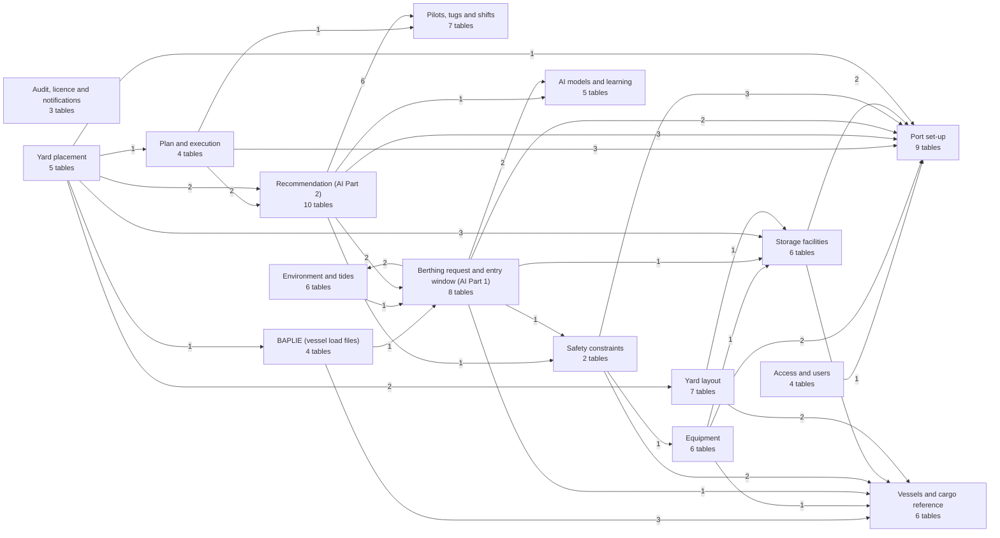

| Group | Tables | Foreign keys to other groups | Foreign keys to `users` |
| --- | --- | --- | --- |
| [Access and users](#access) | 4 | 1 | 2 |
| [Audit, licence and notifications](#system) | 3 | 0 | 2 |
| [Port set-up](#port) | 9 | 0 | 1 |
| [Pilots, tugs and shifts](#people) | 7 | 0 | 4 |
| [Vessels and cargo reference](#vessels) | 6 | 0 | 0 |
| [Equipment](#equipment) | 6 | 4 | 0 |
| [Storage facilities](#storage) | 6 | 3 | 0 |
| [Safety constraints](#safety) | 2 | 6 | 1 |
| [Environment and tides](#environment) | 6 | 1 | 1 |
| [Berthing request and entry window (AI Part 1)](#request) | 8 | 9 | 4 |
| [BAPLIE (vessel load files)](#baplie) | 4 | 4 | 3 |
| [Recommendation (AI Part 2)](#recommendation) | 10 | 13 | 3 |
| [AI models and learning](#models) | 5 | 0 | 1 |
| [Plan and execution](#plan) | 4 | 6 | 4 |
| [Yard layout](#yardzones) | 7 | 3 | 0 |
| [Yard placement](#yardplace) | 5 | 10 | 4 |

Hub tables everyone leans on: `users` (30 foreign keys in), then `terminals`, `berths`, `tugboats`, `ml_model_versions`, `berthing_requests`, `imdg_classes`, `pilot_profiles`. They sit in the groups "Access and users", "Port set-up", "Pilots, tugs and shifts", "AI models and learning", "Berthing request and entry window" and "Vessels and cargo reference".

## Access and users

Who may sign in and where they work. A user holds one active role in one organisation unit (DEC-36); devices are the tablets a user signs in from.

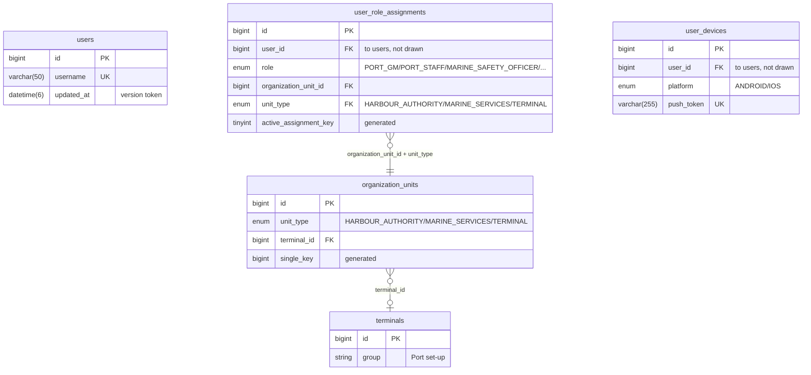

| Table | Purpose | Foreign keys (to) | Unique rules | CHECKs |
| --- | --- | --- | --- | --- |
| `organization_units` | Where a user works: the Harbour Authority, Marine Services, or one terminal. | `terminal_id` to `terminals` | `uq_org_unit_id_type` (id, unit_type); `uq_org_unit_type_key` (unit_type, single_key) | 1 |
| `users` | Port staff and field accounts; sign-in by lowercase `username`, no email (DEC-35). | none | `username` (username) | 1 |
| `user_role_assignments` | Which role a user holds in which organisation unit; one active role per user (DEC-36). | `organization_unit_id + unit_type` to `organization_units` | `uq_ura_active` (user_id, active_assignment_key) | 2 |
| `user_devices` | Mobile devices a user signed in on, with push token; revoked, never deleted. | only `users` | `uq_user_device` (user_id, device_id); `uq_user_device_push_token` (push_token) | 1 |

**Links to `users`** (not drawn):

| Table | Column | Meaning |
| --- | --- | --- |
| `user_role_assignments` | `user_id` | required |
| `user_devices` | `user_id` | required |

`users` is referenced by 30 columns in every group; they are listed under "Links to `users`" in each group, not repeated here.

## Audit, licence and notifications

Cross-cutting records: the append-only audit log, the one licence state row, and the log of notifications sent.

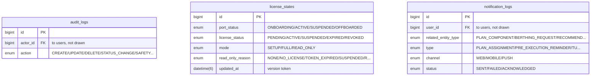

| Table | Purpose | Foreign keys (to) | Unique rules | CHECKs |
| --- | --- | --- | --- | --- |
| `audit_logs` | Append-only record of every change and refused attempt (actor, entity, before and after state). | only `users` | none | 1 |
| `license_states` | Single row: the local copy of the SaaS licence and the resulting FULL/SETUP mode. | none | none | 2 |
| `notification_logs` | Every notification attempt (channel, status, acknowledgement, failure). | only `users` | none | 3 |

**Links to `users`** (not drawn):

| Table | Column | Meaning |
| --- | --- | --- |
| `audit_logs` | `actor_id` | NULL = system / AI worker |
| `notification_logs` | `user_id` | required |

## Port set-up

The port itself: its single profile row and settings, the navigation channel and waypoints, terminals, berths and which terminals use which berths, status vocabulary and the external systems the port talks to.

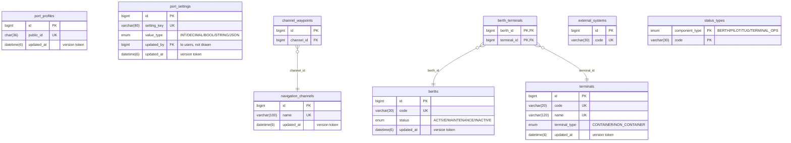

| Table | Purpose | Foreign keys (to) | Unique rules | CHECKs |
| --- | --- | --- | --- | --- |
| `port_profiles` | Single row: the port's identity, position, time zone and boundary. | none | `public_id` (public_id) | 3 |
| `port_settings` | Key/value settings of the port with value type and min/max (DEC-59). | only `users` | `setting_key` (setting_key) | 0 |
| `navigation_channels` | The approach channel(s): depth, width, speed limit. | none | `name` (name) | 1 |
| `channel_waypoints` | Ordered waypoints (lat/lon) that draw a channel. | `channel_id` to `navigation_channels` | `uq_channel_waypoint_label` (channel_id, label); `uq_channel_waypoint_order` (channel_id, sequence_order) | 3 |
| `terminals` | Terminals of the port (container or non-container) with boundary. | none | `uq_terminal_id_type` (id, terminal_type); `code` (code); `name` (name) | 0 |
| `berths` | Berths with length, depth, maximum vessel length and status. | none | `code` (code) | 4 |
| `berth_terminals` | Which terminals may use a berth (link table; shared berths have several rows). | `berth_id` to `berths`; `terminal_id` to `terminals` | none | 0 |
| `external_systems` | External systems that submit berthing requests through adapters. | none | `code` (code) | 0 |
| `status_types` | Allowed field statuses per component type (BERTH, TUG, ...). | none | none | 0 |

**Links to `users`** (not drawn):

| Table | Column | Meaning |
| --- | --- | --- |
| `port_settings` | `updated_by` | optional |

**Referenced from other groups:**

| Other table | Column | Points at | Group |
| --- | --- | --- | --- |
| `organization_units` | `terminal_id` | `terminals` | Access and users |
| `berthing_requests` | `external_system_id` | `external_systems` | Berthing request and entry window (AI Part 1) |
| `berthing_requests` | `requested_terminal_id` | `terminals` | Berthing request and entry window (AI Part 1) |
| `equipment` | `terminal_id` | `terminals` | Equipment |
| `terminal_productivity_profiles` | `terminal_id` | `terminals` | Equipment |
| `actual_status_updates` | `component_type` | `status_types` | Plan and execution |
| `plan_components` | `berth_id` | `berths` | Plan and execution |
| `plan_components` | `terminal_id` | `terminals` | Plan and execution |
| `recommendation_options` | `berth_id` | `berth_terminals` | Recommendation (AI Part 2) |
| `recommendation_overrides` | `override_berth_id` | `berths` | Recommendation (AI Part 2) |
| `recommendation_overrides` | `original_berth_id` | `berths` | Recommendation (AI Part 2) |
| `safety_constraints` | `berth_id` | `berths` | Safety constraints |
| `safety_constraints` | `berth_id` | `berth_terminals` | Safety constraints |
| `safety_constraints` | `terminal_id` | `terminals` | Safety constraints |
| `storage_facilities` | `terminal_id` | `terminals` | Storage facilities |
| `terminal_cargo_types` | `terminal_id` | `terminals` | Storage facilities |
| `terminal_recommendations` | `terminal_id` | `terminals` | Yard placement |

## Pilots, tugs and shifts

The marine workforce and fleet: pilots with their rank limits and schedules, tugs with their masters and schedules, and the port shifts those schedules refer to.

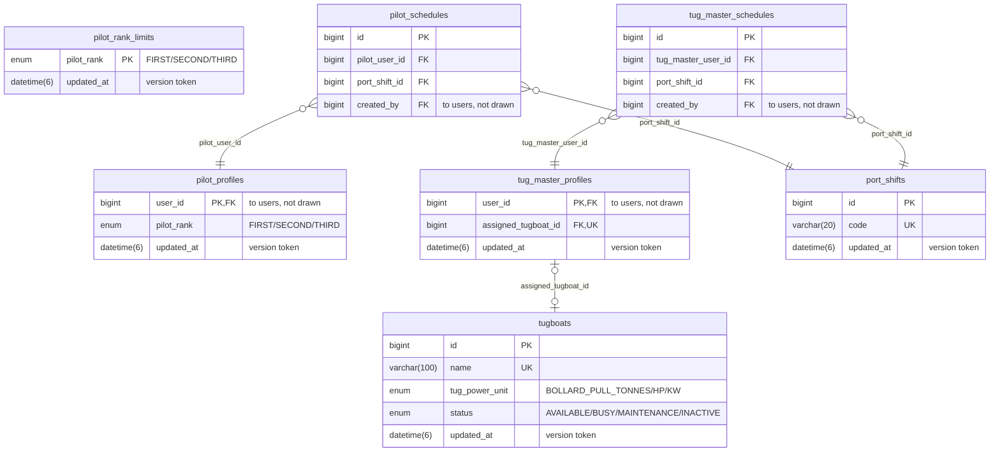

| Table | Purpose | Foreign keys (to) | Unique rules | CHECKs |
| --- | --- | --- | --- | --- |
| `pilot_profiles` | Pilot details of a user (rank); one row per pilot user. | only `users` | none | 0 |
| `pilot_rank_limits` | Largest vessel length each pilot rank may handle (settings screen). | none | none | 1 |
| `pilot_schedules` | Which pilot works which fixed shift on which day. | `pilot_user_id` to `pilot_profiles`; `port_shift_id` to `port_shifts` | `uq_pilot_schedule` (pilot_user_id, shift_date, port_shift_id) | 0 |
| `tugboats` | The port tug fleet: power, capacity, status. | none | `name` (name) | 1 |
| `tug_master_profiles` | Tug-master details of a user, including the assigned tugboat. | `assigned_tugboat_id` to `tugboats` | `assigned_tugboat_id` (assigned_tugboat_id) | 0 |
| `tug_master_schedules` | Which tug master works which fixed shift on which day. | `tug_master_user_id` to `tug_master_profiles`; `port_shift_id` to `port_shifts` | `uq_tug_master_schedule` (tug_master_user_id, shift_date, port_shift_id) | 0 |
| `port_shifts` | The fixed port shifts (code, start and end time). | none | `code` (code) | 1 |

**Links to `users`** (not drawn):

| Table | Column | Meaning |
| --- | --- | --- |
| `pilot_profiles` | `user_id` | required |
| `pilot_schedules` | `created_by` | required |
| `tug_master_profiles` | `user_id` | required |
| `tug_master_schedules` | `created_by` | required |

**Referenced from other groups:**

| Other table | Column | Points at | Group |
| --- | --- | --- | --- |
| `plan_components` | `tugboat_id` | `tugboats` | Plan and execution |
| `recommendation_option_tugs` | `tugboat_id` | `tugboats` | Recommendation (AI Part 2) |
| `recommendation_options` | `pilot_user_id` | `pilot_profiles` | Recommendation (AI Part 2) |
| `recommendation_overrides` | `override_pilot_user_id` | `pilot_profiles` | Recommendation (AI Part 2) |
| `recommendation_overrides` | `override_tugboat_id` | `tugboats` | Recommendation (AI Part 2) |
| `recommendation_overrides` | `original_pilot_user_id` | `pilot_profiles` | Recommendation (AI Part 2) |
| `recommendation_overrides` | `original_tugboat_id` | `tugboats` | Recommendation (AI Part 2) |

## Vessels and cargo reference

Reference data a vessel call is described with: vessel types and vessels, container size types and containers, dangerous-goods classes and cargo types.

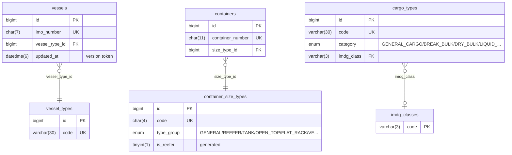

| Table | Purpose | Foreign keys (to) | Unique rules | CHECKs |
| --- | --- | --- | --- | --- |
| `vessel_types` | Vessel type list (code, name). | none | `code` (code) | 0 |
| `vessels` | Vessel master data: IMO number, dimensions, call sign, flag. | `vessel_type_id` to `vessel_types` | `imo_number` (imo_number) | 3 |
| `container_size_types` | Container size/type list (length, high cube, TEU factor, reefer flag). | none | `code` (code) | 2 |
| `containers` | Container identity (ISO number and size type) only. | `size_type_id` to `container_size_types` | `container_number` (container_number) | 1 |
| `imdg_classes` | Fixed list of IMDG dangerous-goods classes. | none | none | 0 |
| `cargo_types` | Cargo type list with category, IMDG class and temperature range. | `imdg_class` to `imdg_classes` | `code` (code) | 1 |

**Referenced from other groups:**

| Other table | Column | Points at | Group |
| --- | --- | --- | --- |
| `baplie_files` | `vessel_id` | `vessels` | BAPLIE (vessel load files) |
| `container_manifest_entries` | `container_id` | `containers` | BAPLIE (vessel load files) |
| `container_manifest_entries` | `imdg_class` | `imdg_classes` | BAPLIE (vessel load files) |
| `berthing_requests` | `vessel_id` | `vessels` | Berthing request and entry window (AI Part 1) |
| `terminal_productivity_profiles` | `vessel_type_id` | `vessel_types` | Equipment |
| `safety_constraints` | `imdg_class` | `imdg_classes` | Safety constraints |
| `safety_constraints` | `vessel_type_id` | `vessel_types` | Safety constraints |
| `terminal_cargo_types` | `cargo_type_id` | `cargo_types` | Storage facilities |
| `dg_zone_allowed_classes` | `imdg_class` | `imdg_classes` | Yard layout |
| `yard_slots` | `container_id` | `containers` | Yard layout |

## Equipment

Terminal equipment (cranes and similar), what each can do, which cargo it can handle, and the productivity of each terminal.

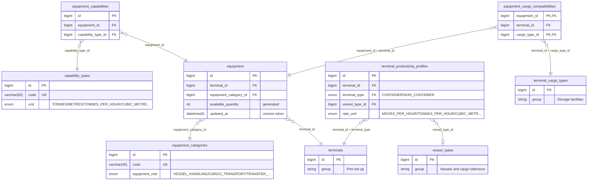

| Table | Purpose | Foreign keys (to) | Unique rules | CHECKs |
| --- | --- | --- | --- | --- |
| `equipment_categories` | Equipment category list (code, name, role). | none | `code` (code) | 0 |
| `capability_types` | Equipment capability kinds (code, name, unit). | none | `code` (code) | 0 |
| `equipment` | Equipment fleet per terminal with quantities in maintenance or blocked. | `equipment_category_id` to `equipment_categories`; `terminal_id` to `terminals` | `uq_eq_id_terminal` (id, terminal_id); `uq_eq_terminal_category` (terminal_id, equipment_category_id) | 1 |
| `equipment_capabilities` | Capability values of a piece of equipment (link table with value). | `equipment_id` to `equipment`; `capability_type_id` to `capability_types` | `uq_ecap_equipment_type` (equipment_id, capability_type_id) | 1 |
| `equipment_cargo_compatibilities` | Which cargo types a piece of equipment can handle (link table). | `equipment_id + terminal_id` to `equipment`; `terminal_id + cargo_type_id` to `terminal_cargo_types` | none | 0 |
| `terminal_productivity_profiles` | Handling-rate inputs per terminal and vessel type for the service-time calculation. | `terminal_id + terminal_type` to `terminals`; `vessel_type_id` to `vessel_types` | none | 3 |

**Referenced from other groups:**

| Other table | Column | Points at | Group |
| --- | --- | --- | --- |
| `safety_constraints` | `equipment_category_id` | `equipment_categories` | Safety constraints |

## Storage facilities

Non-container storage: storage types and facilities, tank and warehouse details, and which cargo each facility and terminal accepts.

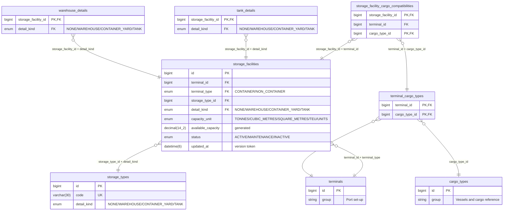

| Table | Purpose | Foreign keys (to) | Unique rules | CHECKs |
| --- | --- | --- | --- | --- |
| `storage_types` | Storage type list (tank, warehouse, container yard). | none | `uq_storage_type_id_kind` (id, detail_kind); `code` (code) | 0 |
| `storage_facilities` | Storage facilities of a terminal with capacity, occupancy and generated available capacity. | `storage_type_id + detail_kind` to `storage_types`; `terminal_id + terminal_type` to `terminals` | `uq_sf_id_kind` (id, detail_kind); `uq_sf_id_terminal` (id, terminal_id); `uq_sf_terminal_code` (terminal_id, code); `uq_sf_id_unit` (id, capacity_unit) | 7 |
| `storage_facility_cargo_compatibilities` | Which cargo types a storage facility may hold (link table). | `storage_facility_id + terminal_id` to `storage_facilities`; `terminal_id + cargo_type_id` to `terminal_cargo_types` | none | 0 |
| `tank_details` | Extra columns of a tank facility (temperature, pressure). | `storage_facility_id + detail_kind` to `storage_facilities` | none | 3 |
| `warehouse_details` | Extra columns of a warehouse facility (temperature range, monitoring). | `storage_facility_id + detail_kind` to `storage_facilities` | none | 2 |
| `terminal_cargo_types` | Which cargo types each terminal handles (link table). | `cargo_type_id` to `cargo_types`; `terminal_id` to `terminals` | none | 0 |

**Referenced from other groups:**

| Other table | Column | Points at | Group |
| --- | --- | --- | --- |
| `berthing_request_cargos` | `terminal_id` | `terminal_cargo_types` | Berthing request and entry window (AI Part 1) |
| `equipment_cargo_compatibilities` | `terminal_id` | `terminal_cargo_types` | Equipment |
| `yard_zones` | `container_yard_id` | `storage_facilities` | Yard layout |
| `storage_allocation_items` | `storage_facility_id` | `storage_facility_cargo_compatibilities` | Yard placement |
| `storage_allocation_items` | `storage_facility_id` | `storage_facilities` | Yard placement |
| `storage_movements` | `storage_facility_id` | `storage_facility_cargo_compatibilities` | Yard placement |

## Safety constraints

The limits the Marine Safety Officer sets (wind, visibility, under-keel clearance and so on) and the constraint types they refer to.

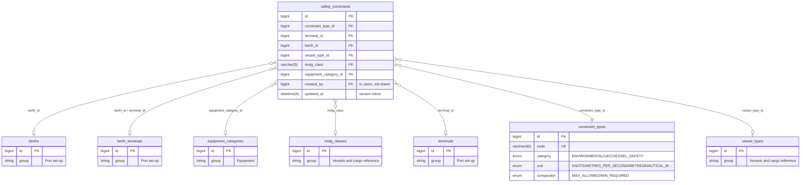

| Table | Purpose | Foreign keys (to) | Unique rules | CHECKs |
| --- | --- | --- | --- | --- |
| `constraint_types` | Catalogue of safety constraint kinds (unit, comparator, hard safety limit). | none | `code` (code) | 0 |
| `safety_constraints` | Concrete safety limits by scope (terminal, berth, vessel type, IMDG class, equipment), with validity period. | `berth_id` to `berths`; `berth_id + terminal_id` to `berth_terminals`; `equipment_category_id` to `equipment_categories`; `imdg_class` to `imdg_classes`; `terminal_id` to `terminals`; `constraint_type_id` to `constraint_types`; `vessel_type_id` to `vessel_types` | none | 1 |

**Links to `users`** (not drawn):

| Table | Column | Meaning |
| --- | --- | --- |
| `safety_constraints` | `created_by` | required |

**Referenced from other groups:**

| Other table | Column | Points at | Group |
| --- | --- | --- | --- |
| `blocked_periods` | `limiting_constraint_type_id` | `constraint_types` | Berthing request and entry window (AI Part 1) |
| `recommendation_rationale_factors` | `constraint_type_id` | `constraint_types` | Recommendation (AI Part 2) |

## Environment and tides

Weather and sea forecasts, and the tide model: constituent sets, prediction runs and predicted points.

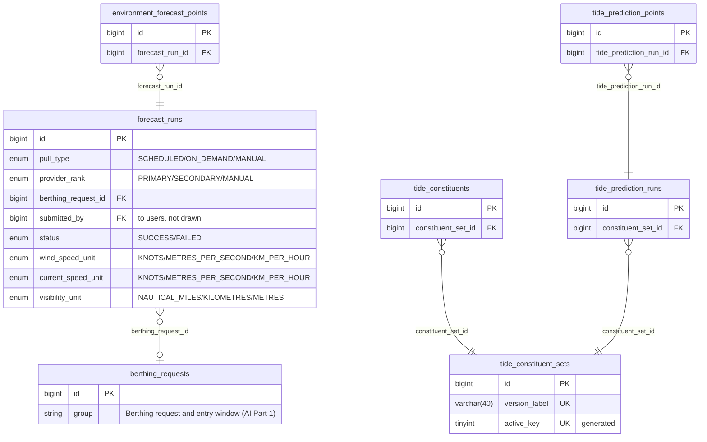

| Table | Purpose | Foreign keys (to) | Unique rules | CHECKs |
| --- | --- | --- | --- | --- |
| `environment_forecast_points` | Time series values (wind, waves, visibility, current) of a forecast run. | `forecast_run_id` to `forecast_runs` | `uq_efp_run_time` (forecast_run_id, valid_at) | 2 |
| `forecast_runs` | One weather/sea forecast pull (source, type, staleness). | `berthing_request_id` to `berthing_requests` | none | 3 |
| `tide_constituents` | Amplitude, phase and speed of each tidal constituent in a set. | `constituent_set_id` to `tide_constituent_sets` | `uq_tc_set_code` (constituent_set_id, constituent_code) | 1 |
| `tide_constituent_sets` | Versioned sets of tidal constituents; only one set active. | none | `version_label` (version_label); `active_key` (active_key) | 0 |
| `tide_prediction_points` | Predicted tide heights of a prediction run. | `tide_prediction_run_id` to `tide_prediction_runs` | `uq_tpp_run_time` (tide_prediction_run_id, valid_at) | 0 |
| `tide_prediction_runs` | One in-house harmonic tide computation over a horizon. | `constituent_set_id` to `tide_constituent_sets` | none | 1 |

**Links to `users`** (not drawn):

| Table | Column | Meaning |
| --- | --- | --- |
| `forecast_runs` | `submitted_by` | Required when pull_type = MANUAL |

**Referenced from other groups:**

| Other table | Column | Points at | Group |
| --- | --- | --- | --- |
| `entry_window_proposals` | `forecast_run_id` | `forecast_runs` | Berthing request and entry window (AI Part 1) |
| `entry_window_proposals` | `tide_prediction_run_id` | `tide_prediction_runs` | Berthing request and entry window (AI Part 1) |

## Berthing request and entry window (AI Part 1)

A vessel call: the request, its cargo and status history, and what AI Part 1 produces for it: the demand forecast, feasible windows, blocked periods and the entry-window proposal.

```mermaid
erDiagram
  berthing_requests {
    bigint id PK
    bigint vessel_id FK
    bigint requested_terminal_id FK
    enum source "MANUAL/EXTERNAL"
    bigint external_system_id FK
    bigint submitted_by FK "to users, not drawn"
    enum draft_source "MANUAL/EGMSW_FEED/REGISTRY"
    enum eta_source "MANUAL/EGMSW_FEED/REGISTRY"
    enum ports_source "MANUAL/EGMSW_FEED/REGISTRY"
    enum status "SUBMITTED/NEEDS_REVISION/PRELIMINARY_APPR..."
    datetime(6) updated_at "version token"
  }
  berthing_request_cargos {
    bigint berthing_request_id PK,FK
    bigint terminal_id FK
    bigint cargo_type_id PK,FK
    enum operation PK "DISCHARGE/LOAD"
    enum quantity_unit "TONNES/CUBIC_METRES/UNITS"
  }
  berthing_request_status_histories {
    bigint id PK
    bigint berthing_request_id FK
    enum from_status "SUBMITTED/NEEDS_REVISION/PRELIMINARY_APPR..."
    enum to_status "SUBMITTED/NEEDS_REVISION/PRELIMINARY_APPR..."
    bigint changed_by FK "to users, not drawn"
  }
  part1_runs {
    bigint id PK
    bigint berthing_request_id FK
    enum status "QUEUED/RUNNING/DONE/FAILED/REPLACED"
    enum outcome "WINDOWS_FOUND/NO_FEASIBLE_WINDOW/ENV_DATA..."
    bigint entry_window_proposal_id FK
  }
  demand_forecast_slots {
    bigint id PK
    enum method "AGGREGATION/LIGHTGBM"
    bigint model_version_id FK
  }
  feasible_windows {
    bigint id PK
    bigint proposal_id FK
  }
  blocked_periods {
    bigint id PK
    bigint proposal_id FK
    bigint limiting_constraint_type_id FK
  }
  entry_window_proposals {
    bigint id PK,FK
    bigint berthing_request_id FK
    bigint forecast_run_id FK
    bigint tide_prediction_run_id FK
    bigint bias_correction_version_id FK
    enum status "PROPOSED/CONFIRMED/REPLACED/REJECTED"
    bigint confirmed_key UK "generated"
    bigint confirmed_window_id FK
    bigint confirmed_by FK "to users, not drawn"
    bigint rejected_by FK "to users, not drawn"
    datetime(6) updated_at "version token"
  }
  external_systems {
    bigint id PK
    string group "Port set-up"
  }
  terminals {
    bigint id PK
    string group "Port set-up"
  }
  vessels {
    bigint id PK
    string group "Vessels and cargo reference"
  }
  terminal_cargo_types {
    bigint id PK
    string group "Storage facilities"
  }
  ml_model_versions {
    bigint id PK
    string group "AI models and learning"
  }
  constraint_types {
    bigint id PK
    string group "Safety constraints"
  }
  forecast_runs {
    bigint id PK
    string group "Environment and tides"
  }
  tide_prediction_runs {
    bigint id PK
    string group "Environment and tides"
  }
  berthing_requests }o--o| external_systems : "external_system_id"
  berthing_requests }o--|| terminals : "requested_terminal_id"
  berthing_requests }o--|| vessels : "vessel_id"
  berthing_request_cargos }o--|| berthing_requests : "berthing_request_id + terminal_id"
  berthing_request_cargos }o--|| terminal_cargo_types : "terminal_id + cargo_type_id"
  berthing_request_status_histories }o--|| berthing_requests : "berthing_request_id"
  part1_runs }o--o| entry_window_proposals : "entry_window_proposal_id"
  part1_runs }o--|| berthing_requests : "berthing_request_id"
  demand_forecast_slots }o--o| ml_model_versions : "model_version_id"
  feasible_windows }o--|| entry_window_proposals : "proposal_id"
  blocked_periods }o--|| constraint_types : "limiting_constraint_type_id"
  blocked_periods }o--|| entry_window_proposals : "proposal_id"
  entry_window_proposals }o--o| ml_model_versions : "bias_correction_version_id"
  entry_window_proposals }o--|| forecast_runs : "forecast_run_id"
  entry_window_proposals }o--|| berthing_requests : "berthing_request_id"
  entry_window_proposals }o--|| tide_prediction_runs : "tide_prediction_run_id"
  entry_window_proposals }o--o| feasible_windows : "confirmed_window_id + id"
```

| Table | Purpose | Foreign keys (to) | Unique rules | CHECKs |
| --- | --- | --- | --- | --- |
| `berthing_requests` | A vessel's request to berth: ETA, drafts, tonnage, ports, status, source. | `external_system_id` to `external_systems`; `requested_terminal_id` to `terminals`; `vessel_id` to `vessels` | `uq_br_id_terminal` (id, requested_terminal_id); `uq_br_id_vessel` (id, vessel_id); `uq_br_external_ref` (external_system_id, external_reference) | 5 |
| `berthing_request_cargos` | Cargo lines of non-container calls (operation, quantity, unit). | `berthing_request_id + terminal_id` to `berthing_requests`; `terminal_id + cargo_type_id` to `terminal_cargo_types` | none | 1 |
| `berthing_request_status_histories` | Every status change of a berthing request (who, when, note). | `berthing_request_id` to `berthing_requests` | none | 1 |
| `part1_runs` | Job rows for the AI Part 1 run of a berthing request (CT-09). | `entry_window_proposal_id` to `entry_window_proposals`; `berthing_request_id` to `berthing_requests` | none | 1 |
| `demand_forecast_slots` | Forecast of arrivals and congestion per time slot. | `model_version_id` to `ml_model_versions` | none | 2 |
| `feasible_windows` | The candidate time windows of an entry-window proposal. | `proposal_id` to `entry_window_proposals` | `uq_fw_id_proposal` (id, proposal_id) | 1 |
| `blocked_periods` | Periods blocked inside a proposal and the constraint that limited them. | `limiting_constraint_type_id` to `constraint_types`; `proposal_id` to `entry_window_proposals` | none | 1 |
| `entry_window_proposals` | Part 1 output: proposed safe entry windows, confirmed or rejected by staff. | `bias_correction_version_id` to `ml_model_versions`; `forecast_run_id` to `forecast_runs`; `berthing_request_id` to `berthing_requests`; `tide_prediction_run_id` to `tide_prediction_runs`; `confirmed_window_id + id` to `feasible_windows` | `uq_ewp_id_request` (id, berthing_request_id); `confirmed_key` (confirmed_key) | 4 |

**Links to `users`** (not drawn):

| Table | Column | Meaning |
| --- | --- | --- |
| `berthing_requests` | `submitted_by` | Required when MANUAL; NULL when ingested by the external adapter |
| `berthing_request_status_histories` | `changed_by` | NULL = system / external adapter |
| `entry_window_proposals` | `rejected_by` | optional |
| `entry_window_proposals` | `confirmed_by` | optional |

**Referenced from other groups:**

| Other table | Column | Points at | Group |
| --- | --- | --- | --- |
| `baplie_files` | `berthing_request_id` | `berthing_requests` | BAPLIE (vessel load files) |
| `forecast_runs` | `berthing_request_id` | `berthing_requests` | Environment and tides |
| `recommendations` | `entry_window_proposal_id` | `entry_window_proposals` | Recommendation (AI Part 2) |
| `recommendations` | `berthing_request_id` | `berthing_requests` | Recommendation (AI Part 2) |

## BAPLIE (vessel load files)

The uploaded load file of a vessel, its parse runs and issues, and the container manifest it yields.

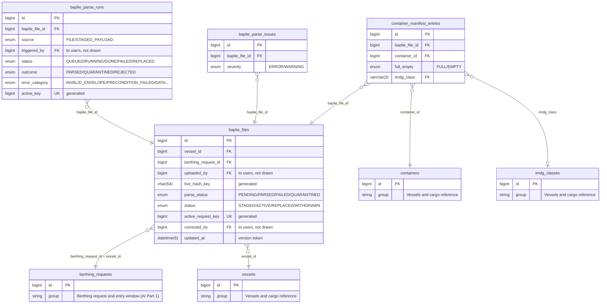

| Table | Purpose | Foreign keys (to) | Unique rules | CHECKs |
| --- | --- | --- | --- | --- |
| `baplie_files` | Uploaded BAPLIE load files with hash, parse status and manual-correction flags. | `berthing_request_id + vessel_id` to `berthing_requests`; `vessel_id` to `vessels` | `uq_bf_request_live_hash` (berthing_request_id, live_hash_key); `active_request_key` (active_request_key) | 2 |
| `baplie_parse_runs` | Job rows for the BAPLIE parser worker (CT-12). | `baplie_file_id` to `baplie_files` | `uq_bpr_active` (active_key) | 3 |
| `baplie_parse_issues` | Diagnostics found while parsing a BAPLIE file. | `baplie_file_id` to `baplie_files` | none | 0 |
| `container_manifest_entries` | Per-call container data from a BAPLIE (weight, stowage, ports, IMDG, reefer, OOG). | `container_id` to `containers`; `baplie_file_id` to `baplie_files`; `imdg_class` to `imdg_classes` | `uq_cme_file_container` (baplie_file_id, container_id) | 6 |

**Links to `users`** (not drawn):

| Table | Column | Meaning |
| --- | --- | --- |
| `baplie_files` | `uploaded_by` | required |
| `baplie_files` | `corrected_by` | optional |
| `baplie_parse_runs` | `triggered_by` | optional |

**Referenced from other groups:**

| Other table | Column | Points at | Group |
| --- | --- | --- | --- |
| `yard_placement_items` | `manifest_entry_id` | `container_manifest_entries` | Yard placement |

## Recommendation (AI Part 2)

What AI Part 2 recommends (berth, tugs, pilot): the recommendation and its options, the solver runs and model versions behind it, the rationale, and the human review and overrides.

```mermaid
erDiagram
  recommendations {
    bigint id PK
    bigint solver_run_id FK
    bigint berthing_request_id FK
    bigint terminal_id FK
    bigint entry_window_proposal_id FK
    enum status "PENDING_REVIEW/CONFIRMED/REJECTED/INVALID..."
    enum source "AI/FIFO"
    enum purpose "INITIAL/DELAY_REPLAN"
    bigint active_key UK "generated"
    datetime(6) updated_at "version token"
  }
  recommendation_options {
    bigint id PK
    bigint recommendation_id FK
    bigint terminal_id FK
    bigint berth_id FK
    bigint pilot_user_id FK
    enum service_time_method "FORMULA/ML"
    bigint rationale_template_id FK
  }
  recommendation_option_tugs {
    bigint option_id PK,FK
    bigint tugboat_id PK,FK
  }
  recommendation_overrides {
    bigint id PK
    bigint recommendation_option_id FK
    enum component_type "BERTH/PILOT/TUG/START_TIME"
    bigint original_berth_id FK
    bigint override_berth_id FK
    bigint original_pilot_user_id FK
    bigint override_pilot_user_id FK
    bigint original_tugboat_id FK
    bigint override_tugboat_id FK
    bigint overridden_by FK "to users, not drawn"
  }
  recommendation_rationale_factors {
    bigint id PK
    bigint option_id FK
    enum factor_type "CONSTRAINT/OBJECTIVE_TERM"
    bigint constraint_type_id FK
    bigint objective_term_id FK
  }
  recommendation_reviews {
    bigint recommendation_id PK,FK
    bigint user_id PK,FK "to users, not drawn"
    datetime viewed_at PK
  }
  solver_runs {
    bigint id PK
    enum trigger_type "NEW_REQUEST/REPLAN/RESOURCE_CHANGE/MANUAL"
    bigint triggered_by FK "to users, not drawn"
    enum status "QUEUED/RUNNING/OPTIMAL/FEASIBLE/INFEASIBL..."
  }
  solver_run_model_versions {
    bigint solver_run_id PK,FK
    bigint model_version_id PK,FK
  }
  objective_terms {
    bigint id PK
    varchar(40) code UK
  }
  rationale_templates {
    bigint id PK
    varchar(60) active_code UK "generated"
  }
  entry_window_proposals {
    bigint id PK
    string group "Berthing request and entry window (AI Part 1)"
  }
  berthing_requests {
    bigint id PK
    string group "Berthing request and entry window (AI Part 1)"
  }
  berth_terminals {
    bigint id PK
    string group "Port set-up"
  }
  pilot_profiles {
    bigint id PK
    string group "Pilots, tugs and shifts"
  }
  tugboats {
    bigint id PK
    string group "Pilots, tugs and shifts"
  }
  berths {
    bigint id PK
    string group "Port set-up"
  }
  constraint_types {
    bigint id PK
    string group "Safety constraints"
  }
  ml_model_versions {
    bigint id PK
    string group "AI models and learning"
  }
  recommendations }o--|| entry_window_proposals : "entry_window_proposal_id + berthing_request_id"
  recommendations }o--|| berthing_requests : "berthing_request_id + terminal_id"
  recommendations }o--|| solver_runs : "solver_run_id"
  recommendation_options }o--|| berth_terminals : "berth_id + terminal_id"
  recommendation_options }o--o| pilot_profiles : "pilot_user_id"
  recommendation_options }o--|| recommendations : "recommendation_id + terminal_id"
  recommendation_options }o--o| rationale_templates : "rationale_template_id"
  recommendation_option_tugs }o--|| recommendation_options : "option_id"
  recommendation_option_tugs }o--|| tugboats : "tugboat_id"
  recommendation_overrides }o--o| berths : "override_berth_id"
  recommendation_overrides }o--o| pilot_profiles : "override_pilot_user_id"
  recommendation_overrides }o--o| tugboats : "override_tugboat_id"
  recommendation_overrides }o--|| recommendation_options : "recommendation_option_id"
  recommendation_overrides }o--o| berths : "original_berth_id"
  recommendation_overrides }o--o| pilot_profiles : "original_pilot_user_id"
  recommendation_overrides }o--o| tugboats : "original_tugboat_id"
  recommendation_rationale_factors }o--o| constraint_types : "constraint_type_id"
  recommendation_rationale_factors }o--o| objective_terms : "objective_term_id"
  recommendation_rationale_factors }o--|| recommendation_options : "option_id"
  recommendation_reviews }o--|| recommendations : "recommendation_id"
  solver_run_model_versions }o--|| ml_model_versions : "model_version_id"
  solver_run_model_versions }o--|| solver_runs : "solver_run_id"
```

| Table | Purpose | Foreign keys (to) | Unique rules | CHECKs |
| --- | --- | --- | --- | --- |
| `recommendations` | A Part 2 recommendation for a berthing request with status and purpose. | `entry_window_proposal_id + berthing_request_id` to `entry_window_proposals`; `berthing_request_id + terminal_id` to `berthing_requests`; `solver_run_id` to `solver_runs` | `uq_rec_id_request` (id, berthing_request_id); `uq_rec_id_terminal` (id, terminal_id); `uq_rec_active` (active_key) | 0 |
| `recommendation_options` | Ranked options of a recommendation: berth, pilot, times, service-time estimate. | `berth_id + terminal_id` to `berth_terminals`; `pilot_user_id` to `pilot_profiles`; `recommendation_id + terminal_id` to `recommendations`; `rationale_template_id` to `rationale_templates` | `uq_ro_id_rec` (id, recommendation_id); `uq_ro_rank` (recommendation_id, option_rank) | 2 |
| `recommendation_option_tugs` | Tugboats proposed for an option (link table). | `option_id` to `recommendation_options`; `tugboat_id` to `tugboats` | none | 0 |
| `recommendation_overrides` | Typed staff overrides of an option (berth, pilot, tug, start time). | `override_berth_id` to `berths`; `override_pilot_user_id` to `pilot_profiles`; `override_tugboat_id` to `tugboats`; `recommendation_option_id` to `recommendation_options`; `original_berth_id` to `berths`; `original_pilot_user_id` to `pilot_profiles`; `original_tugboat_id` to `tugboats` | none | 4 |
| `recommendation_rationale_factors` | Constraints and objective terms that drove an option. | `constraint_type_id` to `constraint_types`; `objective_term_id` to `objective_terms`; `option_id` to `recommendation_options` | none | 1 |
| `recommendation_reviews` | Which user viewed which recommendation and when. | `recommendation_id` to `recommendations` | none | 0 |
| `solver_runs` | Job rows for the Part 2 port-wide joint solve (CT-10). | only `users` | none | 4 |
| `solver_run_model_versions` | Which model versions a solver run used (link table). | `model_version_id` to `ml_model_versions`; `solver_run_id` to `solver_runs` | none | 0 |
| `objective_terms` | Catalogue of solver objective terms agreed with the AI team. | none | `code` (code) | 0 |
| `rationale_templates` | Fixed versioned text templates for explanations (never generated by an LLM). | none | `uq_rt_code_version` (code, version); `active_code` (active_code) | 1 |

**Links to `users`** (not drawn):

| Table | Column | Meaning |
| --- | --- | --- |
| `recommendation_overrides` | `overridden_by` | required |
| `recommendation_reviews` | `user_id` | required |
| `solver_runs` | `triggered_by` | optional |

**Referenced from other groups:**

| Other table | Column | Points at | Group |
| --- | --- | --- | --- |
| `operational_plans` | `recommendation_option_id` | `recommendation_options` | Plan and execution |
| `operational_plans` | `recommendation_id` | `recommendations` | Plan and execution |
| `terminal_recommendations` | `recommendation_id` | `recommendations` | Yard placement |
| `terminal_recommendations` | `rationale_template_id` | `rationale_templates` | Yard placement |

## AI models and learning

The registry of machine-learning models and their versions (one champion per model), and the records that watch them: drift, evaluation metrics and retraining runs.

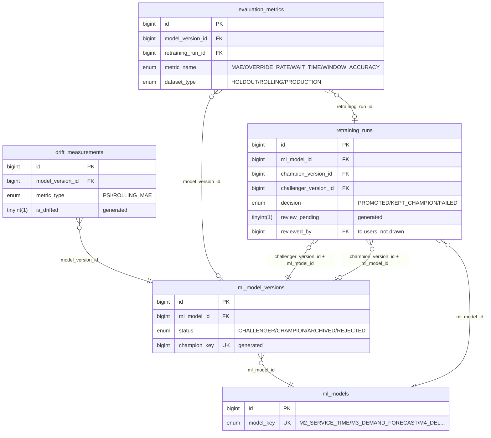

| Table | Purpose | Foreign keys (to) | Unique rules | CHECKs |
| --- | --- | --- | --- | --- |
| `ml_models` | The four machine-learning models the AI uses (M2, M3, M4, forecast bias correction). | none | `model_key` (model_key) | 0 |
| `ml_model_versions` | Versions of each model with status; at most one CHAMPION per model. | `ml_model_id` to `ml_models` | `uq_mlv_id_model` (id, ml_model_id); `uq_mlv_model_version` (ml_model_id, version_no); `champion_key` (champion_key) | 3 |
| `drift_measurements` | Model drift metrics with threshold and generated drifted flag. | `model_version_id` to `ml_model_versions` | none | 1 |
| `evaluation_metrics` | Evaluation metrics of model versions or retraining runs. | `retraining_run_id` to `retraining_runs`; `model_version_id` to `ml_model_versions` | none | 2 |
| `retraining_runs` | Champion versus challenger retraining history and review. | `challenger_version_id + ml_model_id` to `ml_model_versions`; `champion_version_id + ml_model_id` to `ml_model_versions`; `ml_model_id` to `ml_models` | none | 3 |

**Links to `users`** (not drawn):

| Table | Column | Meaning |
| --- | --- | --- |
| `retraining_runs` | `reviewed_by` | optional |

**Referenced from other groups:**

| Other table | Column | Points at | Group |
| --- | --- | --- | --- |
| `demand_forecast_slots` | `model_version_id` | `ml_model_versions` | Berthing request and entry window (AI Part 1) |
| `entry_window_proposals` | `bias_correction_version_id` | `ml_model_versions` | Berthing request and entry window (AI Part 1) |
| `solver_run_model_versions` | `model_version_id` | `ml_model_versions` | Recommendation (AI Part 2) |

## Plan and execution

The confirmed operational plan and its components (one per pilot, tug or terminal task), what actually happened in the field, and the deviations found.

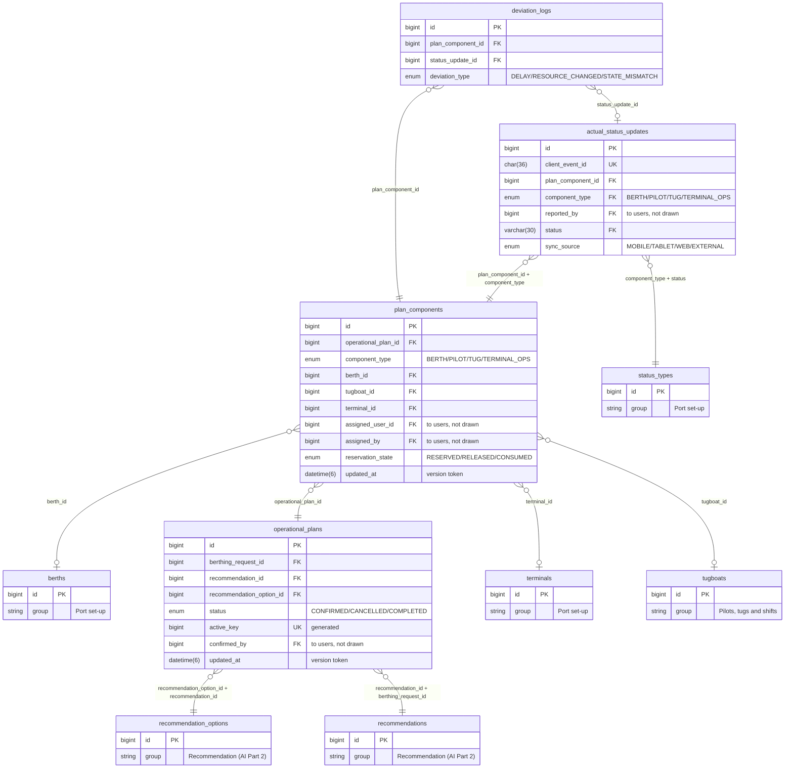

| Table | Purpose | Foreign keys (to) | Unique rules | CHECKs |
| --- | --- | --- | --- | --- |
| `operational_plans` | The confirmed plan of a berthing request (at most one active per request). | `recommendation_option_id + recommendation_id` to `recommendation_options`; `recommendation_id + berthing_request_id` to `recommendations` | `active_key` (active_key) | 0 |
| `plan_components` | One dispatched unit of a plan (berth or tug) with assignee and reservation state. | `berth_id` to `berths`; `operational_plan_id` to `operational_plans`; `terminal_id` to `terminals`; `tugboat_id` to `tugboats` | `uq_pc_id_type` (id, component_type) | 3 |
| `actual_status_updates` | Field status reports from the mobile app for a plan component. | `plan_component_id + component_type` to `plan_components`; `component_type + status` to `status_types` | `client_event_id` (client_event_id) | 0 |
| `deviation_logs` | Planned versus actual differences detected for a component (deferred feature). | `plan_component_id` to `plan_components`; `status_update_id` to `actual_status_updates` | none | 0 |

**Links to `users`** (not drawn):

| Table | Column | Meaning |
| --- | --- | --- |
| `operational_plans` | `confirmed_by` | required |
| `plan_components` | `assigned_user_id` | Pilot / Tug Master / terminal supervisor (role checked by backend, D-33) |
| `plan_components` | `assigned_by` | Dept. Officer (FR-1.5.1/2) |
| `actual_status_updates` | `reported_by` | required |

**Referenced from other groups:**

| Other table | Column | Points at | Group |
| --- | --- | --- | --- |
| `storage_movements` | `plan_component_id` | `plan_components` | Yard placement |

## Yard layout

The container yard: zone types, zones, blocks and slots, with the special rules for dangerous, oversize and reefer zones.

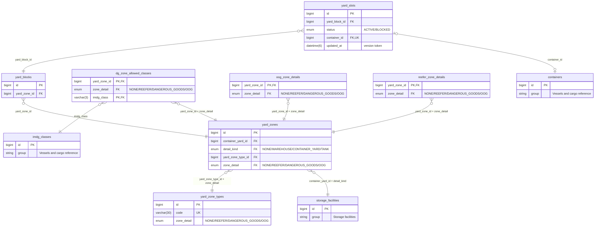

| Table | Purpose | Foreign keys (to) | Unique rules | CHECKs |
| --- | --- | --- | --- | --- |
| `yard_zone_types` | Yard zone type list; `zone_detail` says which detail table (NONE, REEFER, DANGEROUS_GOODS, OOG) zones of the type use. | none | `uq_yzt_id_detail` (id, zone_detail); `code` (code) | 0 |
| `yard_zones` | Zones of a container yard facility. | `yard_zone_type_id + zone_detail` to `yard_zone_types`; `container_yard_id + detail_kind` to `storage_facilities` | `uq_yz_id_detail` (id, zone_detail); `uq_yz_yard_code` (container_yard_id, code) | 1 |
| `yard_blocks` | Blocks inside a yard zone. | `yard_zone_id` to `yard_zones` | `uq_yb_zone_code` (yard_zone_id, code) | 0 |
| `yard_slots` | Bay/row/tier slots of a block with status and container. | `yard_block_id` to `yard_blocks`; `container_id` to `containers` | `uq_ys_id_block` (id, yard_block_id); `uq_ys_position` (yard_block_id, bay, row_no, tier); `container_id` (container_id) | 2 |
| `dg_zone_allowed_classes` | IMDG classes allowed in a dangerous-goods zone (link table). | `imdg_class` to `imdg_classes`; `yard_zone_id + zone_detail` to `yard_zones` | none | 1 |
| `oog_zone_details` | Limits of an out-of-gauge zone. | `yard_zone_id + zone_detail` to `yard_zones` | none | 2 |
| `reefer_zone_details` | Power plugs and type of a reefer zone. | `yard_zone_id + zone_detail` to `yard_zones` | none | 2 |

**Referenced from other groups:**

| Other table | Column | Points at | Group |
| --- | --- | --- | --- |
| `yard_placement_items` | `yard_block_id` | `yard_blocks` | Yard placement |
| `yard_placement_items` | `yard_slot_id` | `yard_slots` | Yard placement |

## Yard placement

Where containers are placed: the yard run, the terminal recommendation, the placement items, storage allocations and movements.

```mermaid
erDiagram
  yard_runs {
    bigint id PK
    bigint terminal_recommendation_id FK
    bigint triggered_by FK "to users, not drawn"
    enum status "QUEUED/RUNNING/DONE/FAILED/REPLACED"
    enum outcome "YARD_REC_GENERATED/GENERATION_FAILED"
    enum error_category "INVALID_ENVELOPE/PRECONDITION_FAILED/DATA..."
    bigint active_key UK "generated"
  }
  terminal_recommendations {
    bigint id PK
    bigint recommendation_id FK
    bigint terminal_id FK
    enum terminal_type FK "CONTAINER/NON_CONTAINER"
    enum rec_type "TIMING/YARD_PLACEMENT/STORAGE_ALLOCATION"
    enum decision "PENDING/ACCEPTED/REJECTED/ADJUSTED"
    bigint decided_by FK "to users, not drawn"
    enum lifecycle_status "YARD_REC_REQUESTED/YARD_REC_GENERATED/GEN..."
    bigint exported_by FK "to users, not drawn"
    bigint rationale_template_id FK
    datetime(6) updated_at "version token"
  }
  yard_placement_items {
    bigint id PK
    bigint terminal_recommendation_id FK
    enum rec_type FK "TIMING/YARD_PLACEMENT/STORAGE_ALLOCATION"
    bigint manifest_entry_id FK
    bigint yard_block_id FK
    bigint yard_slot_id FK
  }
  storage_allocation_items {
    bigint id PK
    bigint terminal_recommendation_id FK
    enum rec_type FK "TIMING/YARD_PLACEMENT/STORAGE_ALLOCATION"
    bigint storage_facility_id FK
    bigint cargo_type_id FK
    enum quantity_unit FK "TONNES/CUBIC_METRES/SQUARE_METRES/TEU/UNITS"
  }
  storage_movements {
    bigint id PK
    bigint storage_facility_id FK
    bigint cargo_type_id FK
    enum direction "IN/OUT"
    enum source "VESSEL_DISCHARGE/VESSEL_LOADING/MANUAL"
    bigint plan_component_id FK
    bigint recorded_by FK "to users, not drawn"
  }
  recommendations {
    bigint id PK
    string group "Recommendation (AI Part 2)"
  }
  rationale_templates {
    bigint id PK
    string group "Recommendation (AI Part 2)"
  }
  terminals {
    bigint id PK
    string group "Port set-up"
  }
  yard_blocks {
    bigint id PK
    string group "Yard layout"
  }
  container_manifest_entries {
    bigint id PK
    string group "BAPLIE (vessel load files)"
  }
  yard_slots {
    bigint id PK
    string group "Yard layout"
  }
  storage_facility_cargo_compatibilities {
    bigint id PK
    string group "Storage facilities"
  }
  storage_facilities {
    bigint id PK
    string group "Storage facilities"
  }
  plan_components {
    bigint id PK
    string group "Plan and execution"
  }
  yard_runs }o--|| terminal_recommendations : "terminal_recommendation_id"
  terminal_recommendations }o--|| recommendations : "recommendation_id + terminal_id"
  terminal_recommendations }o--o| rationale_templates : "rationale_template_id"
  terminal_recommendations }o--|| terminals : "terminal_id + terminal_type"
  yard_placement_items }o--|| yard_blocks : "yard_block_id"
  yard_placement_items }o--|| container_manifest_entries : "manifest_entry_id"
  yard_placement_items }o--o| yard_slots : "yard_slot_id + yard_block_id"
  yard_placement_items }o--|| terminal_recommendations : "terminal_recommendation_id + rec_type"
  storage_allocation_items }o--|| storage_facility_cargo_compatibilities : "storage_facility_id + cargo_type_id"
  storage_allocation_items }o--|| terminal_recommendations : "terminal_recommendation_id + rec_type"
  storage_allocation_items }o--|| storage_facilities : "storage_facility_id + quantity_unit"
  storage_movements }o--|| storage_facility_cargo_compatibilities : "storage_facility_id + cargo_type_id"
  storage_movements }o--o| plan_components : "plan_component_id"
```

| Table | Purpose | Foreign keys (to) | Unique rules | CHECKs |
| --- | --- | --- | --- | --- |
| `yard_runs` | Job rows for the yard-placement worker (CT-11). | `terminal_recommendation_id` to `terminal_recommendations` | `uq_yr_active` (active_key) | 3 |
| `terminal_recommendations` | Per-terminal output of a recommendation (timing, yard placement, storage allocation) with decision. | `recommendation_id + terminal_id` to `recommendations`; `rationale_template_id` to `rationale_templates`; `terminal_id + terminal_type` to `terminals` | `uq_tr_id_type` (id, rec_type); `uq_tr_rec_type` (recommendation_id, rec_type) | 5 |
| `yard_placement_items` | Slot/block placements proposed for manifest entries. | `yard_block_id` to `yard_blocks`; `manifest_entry_id` to `container_manifest_entries`; `yard_slot_id + yard_block_id` to `yard_slots`; `terminal_recommendation_id + rec_type` to `terminal_recommendations` | `uq_ypi_rec_container` (terminal_recommendation_id, manifest_entry_id) | 1 |
| `storage_allocation_items` | Storage facility allocations proposed for cargo (out of MVP, DEC-55). | `storage_facility_id + cargo_type_id` to `storage_facility_cargo_compatibilities`; `terminal_recommendation_id + rec_type` to `terminal_recommendations`; `storage_facility_id + quantity_unit` to `storage_facilities` | `uq_sai_rec_facility_cargo` (terminal_recommendation_id, storage_facility_id, cargo_type_id) | 2 |
| `storage_movements` | Cargo moved in or out of a storage facility. | `storage_facility_id + cargo_type_id` to `storage_facility_cargo_compatibilities`; `plan_component_id` to `plan_components` | none | 2 |

**Links to `users`** (not drawn):

| Table | Column | Meaning |
| --- | --- | --- |
| `yard_runs` | `triggered_by` | optional |
| `terminal_recommendations` | `exported_by` | optional |
| `terminal_recommendations` | `decided_by` | optional |
| `storage_movements` | `recorded_by` | user.id (Module 3); NULL = recorded by the system |

## Regenerating this file

The generator is `ATLANTECH/docs/guide/tools/gen_db_diagrams.mjs` (run it with `node gen_db_diagrams.mjs`; its input and output paths are absolute and point at this machine, so adjust the constants at the top first). It is a short Node script that reads `contracts/db/schema.sql` and the table notes, and writes this file. The group membership is the only hand-written input (a list of table names per group). Two checks run every time: every port table must belong to exactly one group, and every table named in a group must exist; if either fails the script stops. When a migration adds a table, add it to a group and regenerate; when it changes a foreign key, regenerate.

Numbers in this file: 92 port tables, 16 groups, 156 foreign keys (30 to `users`, 60 between groups, 66 inside a group, 129 CHECK constraints).
