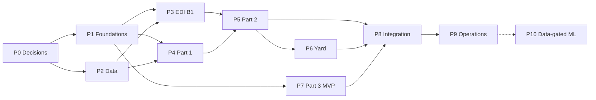

# ATLANTECH — AI Implementation Task Backlog

| Field | Value |
|---|---|
| Document | ATLANTECH AI Implementation Task Backlog |
| Version | 1.0 — draft for team review |
| Date | 22 October 2026 |
| Derived from | `ATLANTECH_AI_IMPLEMENTATION_PLAN.md` v1.0 (phases P0–P10, components, open decisions OD-xx) |
| Related | `ATLANTECH_AI_BACKEND_DEPENDENCIES.md` (dependencies AIBD-xxx) |
| Tasks | 76 (`AI-001` – `AI-106`), all with initial status `NOT STARTED` |
| Assignees and deadlines | Not assigned in this document by design |

Tags follow the implementation plan: **DOCUMENTED** (justified by a project document), **DERIVED** (needed to implement a documented requirement), **PROPOSED** (needs approval). Module and file paths marked (PROPOSED) assume the repository structure decided in `AI-010`.

## 1. Conventions

### 1.1 Priority definitions

| Priority | Meaning |
|---|---|
| P0 | Blocks the MVP critical path or a safety-relevant behaviour; must be done first. |
| P1 | Required for the MVP (ready for system-level testing). |
| P2 | Part of the documented scope; can follow the core MVP flow or uses a safe default until done. |
| P3 | Data-gated or future work; starts only when its data-sufficiency criteria are met. |

### 1.2 Complexity definitions

Complexity is an effort-size class for planning, not a deadline.

| Class | Meaning |
|---|---|
| S | Small — up to about 2 person-days. |
| M | Medium — about 3 to 5 person-days. |
| L | Large — about 1 to 2 person-weeks. |
| XL | Extra large — more than 2 person-weeks; consider splitting. |

### 1.3 Status values

`NOT STARTED` → `IN PROGRESS` → `IN REVIEW` → `DONE`; also `BLOCKED` (with the blocking item named) and `DEFERRED` (with the decision that deferred it). A task is `DONE` only when every acceptance criterion is met and its verification evidence is stored.

### 1.4 Flags

| Flag | Meaning |
|---|---|
| D | Blocked by missing data |
| A | Requires an architectural or domain decision |
| B | Coordination with the backend |
| X | Coordination with domain experts or another team |

## 2. Backlog Summary

| ID | Title | Phase | Pri | Cx | Prerequisites | Flags |
|---|---|---|---|---|---|---|
| AI-001 | Confirm AI scope and component inventory | P0 | P0 | S | — | A |
| AI-002 | Decide completion signalling, status ownership and READ_ONLY behaviour of AI jobs | P0 | P0 | S | — | A,B |
| AI-003 | Define and approve AI job and result contract v1 | P0 | P0 | M | AI-002 | B |
| AI-004 | Decide location of shared validation rule sets (override, yard adjustment, BAPLIE correction, window re-check) | P0 | P0 | S | AI-002 | A,B |
| AI-005 | Obtain Part 2 domain rules: tug formula, delay-risk rule, moves definition, financial impact, objective terms | P0 | P0 | M | — | A,X |
| AI-006 | Define joint-solve scope and resource-availability semantics | P0 | P0 | S | — | A,B |
| AI-007 | Define Part 1 assessment parameters and NO_FEASIBLE_WINDOW persistence | P0 | P0 | S | — | A,X,B |
| AI-008 | Agree thresholds register and evaluation baseline | P0 | P1 | M | — | A,X |
| AI-009 | Specify AI seed data: constraint types, objective terms, rationale templates v1, model registry rows | P0 | P1 | M | AI-005, AI-001 | B,X |
| AI-010 | Decide AI code repository and module structure | P1 | P0 | S | AI-001 | A |
| AI-011 | Implement shared worker runtime (queue consumer, idempotent claim, retries, logging) | P1 | P0 | L | AI-003, AI-010 | B |
| AI-012 | Implement configuration management | P1 | P1 | S | AI-010 | B |
| AI-013 | Implement data-access layer and request worker DB accounts | P1 | P0 | L | AI-010, AI-003 | B |
| AI-014 | Implement unit, datum and time utilities | P1 | P0 | S | AI-010 | — |
| AI-015 | Build test harness and synthetic reference-port scenario generator | P1 | P0 | M | AI-013 | — |
| AI-016 | Set up CI for AI code | P1 | P1 | S | AI-010 | — |
| AI-020 | Select weather and marine providers and build adapters | P2 | P0 | L | AI-012, AI-014 | D,A,B |
| AI-021 | Acquire and validate tidal constants and datum for the reference port | P2 | P0 | M | AI-014 | D,A |
| AI-022 | Assemble reference-port master-data dataset for testing | P2 | P1 | M | AI-015 | D,X |
| AI-023 | Build BAPLIE D.17A test corpus | P2 | P0 | M | — | D |
| AI-024 | Assess historical operational data for ML and define data-sufficiency criteria | P2 | P2 | S | AI-008 | D,X |
| AI-025 | Implement data-quality checks library | P2 | P1 | S | AI-014 | — |
| AI-030 | Implement BAPLIE D.17A segment parser and SMDG mapping | P3 | P0 | L | AI-011, AI-023 | — |
| AI-031 | Implement shared BAPLIE validation rule set and diagnostics | P3 | P0 | M | AI-030, AI-004 | A |
| AI-032 | Implement all-or-nothing BAPLIE commit, quarantine and failure handling | P3 | P0 | M | AI-031, AI-013 | B |
| AI-033 | Verify parser performance against NFR-PERF-2 | P3 | P1 | S | AI-032, AI-008 | — |
| AI-040 | Implement A1 scheduled ingestion with provider fallback (scheduler in Part 1) | P4 | P0 | M | AI-020, AI-011 | A |
| AI-041 | Implement A1 on-demand pull for a Part 1 run | P4 | P0 | S | AI-040 | — |
| AI-042 | Implement A2 astronomical tide computation | P4 | P0 | M | AI-021, AI-011 | D |
| AI-043 | Implement A3 surge residual | P4 | P1 | S | AI-041, AI-042 | — |
| AI-044 | Implement A4 threshold feasibility rules with strictest-wins scope resolution | P4 | P0 | M | AI-043, AI-009, AI-014 | — |
| AI-045 | Implement A5 UKC with Barrass squat | P4 | P0 | M | AI-043, AI-009 | X |
| AI-046 | Implement A6 uncertainty margin | P4 | P2 | M | AI-044, AI-007 | A |
| AI-047 | Implement A7 demand aggregation and peak congestion score (Phase 1) | P4 | P1 | S | AI-013, AI-007 | A |
| AI-048 | Implement Part 1 run orchestrator and persistence of outcomes | P4 | P0 | L | AI-041, AI-044, AI-045, AI-047, AI-007, AI-003 | A,B |
| AI-049 | Build Part 1 validation suite (golden scenarios) | P4 | P1 | M | AI-048, AI-022 | — |
| AI-050 | Implement port-state loader for Part 2 | P5 | P0 | M | AI-013, AI-006 | A |
| AI-051 | Implement B2 constraint filter | P5 | P0 | M | AI-050, AI-044 | — |
| AI-052 | Implement B3 service time Phase 1 formula | P5 | P0 | S | AI-050, AI-005 | A |
| AI-053 | Implement B4 delay-risk Phase 1 (rule or NULL) | P5 | P2 | S | AI-005, AI-050 | A |
| AI-054 | Implement tug-requirement computation | P5 | P0 | S | AI-005 | A,X |
| AI-055 | Implement B5 CP-SAT allocation model with ranking | P5 | P0 | XL | AI-051, AI-052, AI-054, AI-006, AI-009 | A |
| AI-056 | Implement solver outcome handling: FIFO fallback and NO_FEASIBLE_PLAN | P5 | P0 | M | AI-055 | — |
| AI-057 | Implement B6 template rationale and rationale factors | P5 | P1 | M | AI-055, AI-009 | X |
| AI-058 | Implement recommendation persistence and version records | P5 | P0 | M | AI-056, AI-057, AI-002 | B |
| AI-059 | Implement B7 re-planning: resource change, regenerate, delay re-plan | P5 | P1 | L | AI-058 | — |
| AI-060 | Implement override and adjustment validation service | P5 | P0 | M | AI-051, AI-004 | A,B |
| AI-061 | Measure Part 2 latency and concurrency | P5 | P1 | M | AI-059, AI-015 | — |
| AI-062 | Build Part 2 validation suite and baseline-comparison harness | P5 | P1 | M | AI-059, AI-015 | — |
| AI-065 | Design yard placement method, constraints and confidence | P6 | P1 | S | AI-001 | A |
| AI-066 | Implement yard placement generator and persistence | P6 | P1 | L | AI-065, AI-032, AI-058 | B |
| AI-067 | Implement yard adjustment re-validation | P6 | P2 | S | AI-066, AI-004 | B |
| AI-068 | Build yard validation suite | P6 | P2 | S | AI-066 | — |
| AI-070 | Implement model registry integration | P7 | P1 | M | AI-013, AI-009 | A |
| AI-071 | Implement C1 outcome evaluation on trusted data | P7 | P1 | M | AI-070, AI-074 | A |
| AI-072 | Implement C2 drift monitor and drift alert record | P7 | P1 | M | AI-070, AI-008 | A,B |
| AI-073 | Implement Part 3 scheduling | P7 | P1 | S | AI-011, AI-001 | A |
| AI-074 | Implement trusted-data selection | P7 | P1 | S | AI-025 | — |
| AI-080 | Implement AI/Backend contract tests | P8 | P0 | M | AI-003, AI-048, AI-058, AI-032 | B |
| AI-081 | Run end-to-end workflow tests WF-1 to WF-8 | P8 | P0 | L | AI-080, AI-059, AI-066, AI-071, AI-072 | B |
| AI-082 | Run failure-path and recovery tests | P8 | P0 | M | AI-081 | B |
| AI-083 | Run security and isolation tests | P8 | P1 | M | AI-081 | B |
| AI-084 | Run evaluation against FIFO and manual-planning baselines | P8 | P1 | L | AI-062, AI-008 | A,X |
| AI-090 | Package and deploy workers on the port server | P9 | P0 | M | AI-081 | B |
| AI-091 | Implement health checks and heartbeats | P9 | P1 | S | AI-090 | B |
| AI-092 | Implement observability: structured logs and metrics | P9 | P1 | S | AI-011 | — |
| AI-093 | Ensure reproducibility: pinned dependencies and run replay | P9 | P1 | M | AI-058, AI-048 | — |
| AI-094 | Define and rehearse rollback | P9 | P1 | S | AI-090, AI-070 | B |
| AI-095 | Write AI developer and operations documentation | P9 | P1 | M | AI-090 | — |
| AI-100 | Build training-dataset builder from trusted outcomes | P10 | P3 | L | AI-074, AI-024 | D |
| AI-101 | Train and evaluate M2 service-time LightGBM quantile model | P10 | P3 | L | AI-100, AI-070 | D |
| AI-102 | Train and evaluate M3 demand LightGBM model | P10 | P3 | L | AI-100, AI-070 | D |
| AI-103 | Train and evaluate M4 delay-risk LightGBM classifier | P10 | P3 | L | AI-100, AI-070 | D,A |
| AI-104 | Implement C3 guarded retraining pipeline | P10 | P3 | L | AI-101, AI-071 | D |
| AI-105 | Implement C4 forecast bias correction | P10 | P3 | L | AI-100, AI-048 | D,A |
| AI-106 | Establish drift baselines and rollback checks for new models | P10 | P3 | M | AI-104, AI-072 | D |

**Tasks per phase:** P0 9; P1 7; P2 6; P3 4; P4 10; P5 13; P6 4; P7 5; P8 5; P9 6; P10 7.

## 3. Dependency Map and Execution Order

### 3.1 Phase-level dependency map

### 3.2 Task-level dependencies

Each row lists a task's direct prerequisites and the tasks it unblocks. The graph was checked automatically: **no circular dependency exists**.

| Task | Depends on | Unblocks |
|---|---|---|
| AI-001 | — | AI-009, AI-010, AI-065, AI-073 |
| AI-002 | — | AI-003, AI-004, AI-058 |
| AI-003 | AI-002 | AI-011, AI-013, AI-048, AI-080 |
| AI-004 | AI-002 | AI-031, AI-060, AI-067 |
| AI-005 | — | AI-009, AI-052, AI-053, AI-054 |
| AI-006 | — | AI-050, AI-055 |
| AI-007 | — | AI-046, AI-047, AI-048 |
| AI-008 | — | AI-024, AI-033, AI-072, AI-084 |
| AI-009 | AI-005, AI-001 | AI-044, AI-045, AI-055, AI-057, AI-070 |
| AI-010 | AI-001 | AI-011, AI-012, AI-013, AI-014, AI-016 |
| AI-011 | AI-003, AI-010 | AI-030, AI-040, AI-042, AI-073, AI-092 |
| AI-012 | AI-010 | AI-020 |
| AI-013 | AI-010, AI-003 | AI-015, AI-032, AI-047, AI-050, AI-070 |
| AI-014 | AI-010 | AI-020, AI-021, AI-025, AI-044 |
| AI-015 | AI-013 | AI-022, AI-061, AI-062 |
| AI-016 | AI-010 | — |
| AI-020 | AI-012, AI-014 | AI-040 |
| AI-021 | AI-014 | AI-042 |
| AI-022 | AI-015 | AI-049 |
| AI-023 | — | AI-030 |
| AI-024 | AI-008 | AI-100 |
| AI-025 | AI-014 | AI-074 |
| AI-030 | AI-011, AI-023 | AI-031 |
| AI-031 | AI-030, AI-004 | AI-032 |
| AI-032 | AI-031, AI-013 | AI-033, AI-066, AI-080 |
| AI-033 | AI-032, AI-008 | — |
| AI-040 | AI-020, AI-011 | AI-041 |
| AI-041 | AI-040 | AI-043, AI-048 |
| AI-042 | AI-021, AI-011 | AI-043 |
| AI-043 | AI-041, AI-042 | AI-044, AI-045 |
| AI-044 | AI-043, AI-009, AI-014 | AI-046, AI-048, AI-051 |
| AI-045 | AI-043, AI-009 | AI-048 |
| AI-046 | AI-044, AI-007 | — |
| AI-047 | AI-013, AI-007 | AI-048 |
| AI-048 | AI-041, AI-044, AI-045, AI-047, AI-007, AI-003 | AI-049, AI-080, AI-093, AI-105 |
| AI-049 | AI-048, AI-022 | — |
| AI-050 | AI-013, AI-006 | AI-051, AI-052, AI-053 |
| AI-051 | AI-050, AI-044 | AI-055, AI-060 |
| AI-052 | AI-050, AI-005 | AI-055 |
| AI-053 | AI-005, AI-050 | — |
| AI-054 | AI-005 | AI-055 |
| AI-055 | AI-051, AI-052, AI-054, AI-006, AI-009 | AI-056, AI-057 |
| AI-056 | AI-055 | AI-058 |
| AI-057 | AI-055, AI-009 | AI-058 |
| AI-058 | AI-056, AI-057, AI-002 | AI-059, AI-066, AI-080, AI-093 |
| AI-059 | AI-058 | AI-061, AI-062, AI-081 |
| AI-060 | AI-051, AI-004 | — |
| AI-061 | AI-059, AI-015 | — |
| AI-062 | AI-059, AI-015 | AI-084 |
| AI-065 | AI-001 | AI-066 |
| AI-066 | AI-065, AI-032, AI-058 | AI-067, AI-068, AI-081 |
| AI-067 | AI-066, AI-004 | — |
| AI-068 | AI-066 | — |
| AI-070 | AI-013, AI-009 | AI-071, AI-072, AI-094, AI-101, AI-102, AI-103 |
| AI-071 | AI-070, AI-074 | AI-081, AI-104 |
| AI-072 | AI-070, AI-008 | AI-081, AI-106 |
| AI-073 | AI-011, AI-001 | — |
| AI-074 | AI-025 | AI-071, AI-100 |
| AI-080 | AI-003, AI-048, AI-058, AI-032 | AI-081 |
| AI-081 | AI-080, AI-059, AI-066, AI-071, AI-072 | AI-082, AI-083, AI-090 |
| AI-082 | AI-081 | — |
| AI-083 | AI-081 | — |
| AI-084 | AI-062, AI-008 | — |
| AI-090 | AI-081 | AI-091, AI-094, AI-095 |
| AI-091 | AI-090 | — |
| AI-092 | AI-011 | — |
| AI-093 | AI-058, AI-048 | — |
| AI-094 | AI-090, AI-070 | — |
| AI-095 | AI-090 | — |
| AI-100 | AI-074, AI-024 | AI-101, AI-102, AI-103, AI-105 |
| AI-101 | AI-100, AI-070 | AI-104 |
| AI-102 | AI-100, AI-070 | — |
| AI-103 | AI-100, AI-070 | — |
| AI-104 | AI-101, AI-071 | AI-106 |
| AI-105 | AI-100, AI-048 | — |
| AI-106 | AI-104, AI-072 | — |

### 3.3 Execution waves

A wave contains tasks whose prerequisites are all in earlier waves; tasks in the same wave can run in parallel.

| Wave | Tasks |
|---|---|
| 1 | AI-001, AI-002, AI-005, AI-006, AI-007, AI-008, AI-023 |
| 2 | AI-010, AI-065, AI-003, AI-004, AI-009, AI-054, AI-024 |
| 3 | AI-012, AI-014, AI-016, AI-011, AI-013 |
| 4 | AI-020, AI-021, AI-025, AI-030, AI-073, AI-092, AI-015, AI-047, AI-050, AI-070 |
| 5 | AI-040, AI-042, AI-074, AI-031, AI-022, AI-052, AI-053, AI-072 |
| 6 | AI-041, AI-071, AI-100, AI-032 |
| 7 | AI-043, AI-101, AI-102, AI-103, AI-033 |
| 8 | AI-044, AI-045, AI-104 |
| 9 | AI-046, AI-051, AI-048, AI-106 |
| 10 | AI-055, AI-060, AI-049, AI-105 |
| 11 | AI-056, AI-057 |
| 12 | AI-058 |
| 13 | AI-059, AI-066, AI-080, AI-093 |
| 14 | AI-061, AI-062, AI-067, AI-068, AI-081 |
| 15 | AI-084, AI-082, AI-083, AI-090 |
| 16 | AI-091, AI-094, AI-095 |

### 3.4 Critical path (MVP, phases P0–P9)

Computed as the longest prerequisite chain weighted by complexity (S = 1, M = 3, L = 7, XL = 12):

**AI-002 → AI-003 → AI-011 → AI-040 → AI-041 → AI-043 → AI-044 → AI-051 → AI-055 → AI-056 → AI-058 → AI-059 → AI-081 → AI-090 → AI-095**

Any delay on these tasks delays readiness for system-level testing. `AI-005` (domain rules) and `AI-006` (joint-solve scope) feed `AI-055` and are effectively on the critical path because they are decisions that the AI team does not control.

### 3.5 Parallelisable work

- After `AI-010`/`AI-011`: EDI parser (`AI-030`–`AI-033`) ∥ Part 1 physics (`AI-042`, `AI-045`) ∥ registry and metrics (`AI-070`, `AI-071`, `AI-074`) ∥ data acquisition (`AI-020`–`AI-025`).
- Within P0: `AI-001`, `AI-002`, `AI-005`, `AI-006`, `AI-007`, `AI-008` can be discussed in parallel.
- Within P5: `AI-052`, `AI-053`, `AI-054` in parallel after `AI-050`; `AI-057` in parallel with `AI-056`.

## 4. Blocked and Coordinated Work

| Category | Tasks |
|---|---|
| Blocked by missing data (D) | AI-020, AI-021, AI-022, AI-023, AI-024, AI-042, AI-100, AI-101, AI-102, AI-103, AI-104, AI-105, AI-106 |
| Requires an architectural or domain decision (A) | AI-001, AI-002, AI-004, AI-005, AI-006, AI-007, AI-008, AI-010, AI-020, AI-021, AI-031, AI-040, AI-046, AI-047, AI-048, AI-050, AI-052, AI-053, AI-054, AI-055, AI-060, AI-065, AI-070, AI-071, AI-072, AI-073, AI-084, AI-103, AI-105 |
| Requires coordination with the Backend (B) | AI-002, AI-003, AI-004, AI-006, AI-007, AI-009, AI-011, AI-012, AI-013, AI-020, AI-032, AI-048, AI-058, AI-060, AI-066, AI-067, AI-072, AI-080, AI-081, AI-082, AI-083, AI-090, AI-091, AI-094 |
| Requires domain experts or another team (X) | AI-005, AI-007, AI-008, AI-009, AI-022, AI-024, AI-045, AI-054, AI-057, AI-084 |

## 5. Task Details

### P0 — Decisions and contracts

#### AI-001 — Confirm AI scope and component inventory

- **Description:** Record, with the team, which AI components are in the MVP and which are data-gated, including the yard component missing from AI Architecture v3 and the MVP status of C3/C4.
- **Category:** Decision · **Priority:** P0 · **Status:** NOT STARTED · **Phase:** P0 — Decisions and contracts · **Complexity:** S
- **Justification:** DOCUMENTED
- **Requirements and sources:** Master_Context §6, §9; AI Architecture v3; plan F-02, F-03, OD-17, OD-23
- **Prerequisites / blocking tasks:** None
- **Inputs:** Master_Context §6; AI Architecture PDF; UML 2.16, 3.4; plan §3
- **Expected outputs:** Approved inventory: A1–A7, B1–B7, B8 yard (label), C1–C4 with MVP / data-gated status; out-of-scope list (NCT storage allocation, TIMING recommendations, Vision)
- **Files, modules or interfaces:** Decision log (location chosen in AI-010)
- **Implementation guidance:** Use the plan §3 tables as the proposal. Keep component IDs of AI Architecture v3; add B8 only as a working label until the architecture document is updated by its owner.
- **Acceptance criteria:**
  - Decision log entry lists every component with status MVP, DATA-GATED or OUT-OF-SCOPE
  - AI lead and team lead have approved the entry
  - Yard component label and owner recorded
- **Verification evidence:** Approved decision-log entry with date and approvers
- **Flags:** requires an architectural or domain decision
- **Assumptions and open questions:** Assumes the team can decide without the FRD v3 (not in workspace). Question: does the FRD list C3/C4 as future work?

#### AI-002 — Decide completion signalling, status ownership and READ_ONLY behaviour of AI jobs

- **Description:** Decide how Laravel learns that an AI job finished (to push SSE), who writes berthing_request status transitions and history rows after AI results, who creates run rows, and whether scheduled AI jobs run in READ_ONLY.
- **Category:** Decision · **Priority:** P0 · **Status:** NOT STARTED · **Phase:** P0 — Decisions and contracts · **Complexity:** S
- **Justification:** DERIVED
- **Requirements and sources:** D9, D18; UML 2.10–2.16, AD-11, AD-14; plan OD-01, OD-02, OD-18; AIBD-010, AIBD-011, AIBD-023
- **Prerequisites / blocking tasks:** None
- **Inputs:** Plan §8; dependencies document §6.8
- **Expected outputs:** Decisions OD-01, OD-02, OD-18 recorded
- **Files, modules or interfaces:** Decision log; dependencies document
- **Implementation guidance:** Evaluate the three options in plan §8.2 against D18 ('no other pub/sub channel') and NFR-PERF-4 (SSE ≤ 5 s after commit). Prefer the option that keeps all request transitions in the Backend transaction with its history row.
- **Acceptance criteria:**
  - OD-01, OD-02 and OD-18 each have one recorded option with rationale
  - Backend lead has approved OD-01 and OD-02
  - Dependencies document updated to remove PROPOSED tags for decided items
- **Verification evidence:** Decision-log entries; updated AIBD-010/011/023 status
- **Flags:** requires an architectural or domain decision, coordination with the Backend
- **Assumptions and open questions:** None beyond the options listed.

#### AI-003 — Define and approve AI job and result contract v1

- **Description:** Freeze the message formats for queue:part1, queue:part2 (solve, regenerate, resource change, delay re-plan, yard, validation) and queue:edi, and the result-table expectations.
- **Category:** Integration · **Priority:** P0 · **Status:** NOT STARTED · **Phase:** P0 — Decisions and contracts · **Complexity:** M
- **Justification:** PROPOSED
- **Requirements and sources:** D9, D18; plan §8.3–8.4, OD-22; dependencies §6.3
- **Prerequisites / blocking tasks:** AI-002
- **Inputs:** Dependencies document §6.3 proposed contracts
- **Expected outputs:** Contract v1: job envelope, per-job payloads, result expectations, error categories, retry and stale-run rules, contract version field, port_setting keys
- **Files, modules or interfaces:** Contract specification (JSON Schema files proposed)
- **Implementation guidance:** Start from the PROPOSED contracts in the dependencies document. Version every envelope (contract_version). Use run ids as correlation ids.
- **Acceptance criteria:**
  - Every AIBD contract marked PROPOSED is either approved or explicitly rejected
  - JSON Schemas exist for every job type
  - Both AI and Backend leads approve v1
- **Verification evidence:** Versioned schemas in the repository; approval record
- **Flags:** coordination with the Backend
- **Assumptions and open questions:** Depends on OD-01/OD-02 outcome.

#### AI-004 — Decide location of shared validation rule sets (override, yard adjustment, BAPLIE correction, window re-check)

- **Description:** Choose how synchronous user actions that need AI-owned rules are validated without breaking D9 (async only).
- **Category:** Decision · **Priority:** P0 · **Status:** NOT STARTED · **Phase:** P0 — Decisions and contracts · **Complexity:** S
- **Justification:** DERIVED
- **Requirements and sources:** UML 2.8, 2.11, 2.13, AD-11 A32, AD-14 A17; D9; plan F-10, OD-03
- **Prerequisites / blocking tasks:** AI-002
- **Inputs:** Plan §8.2 options (a)–(c)
- **Expected outputs:** Decision OD-03 with latency expectations and error contract (422 reasons)
- **Files, modules or interfaces:** Decision log; contract v1 (AI-003)
- **Implementation guidance:** Compare: async validation job (202 + SSE), duplicated rules in Laravel with shared test vectors, local HTTP endpoint. Record the UX impact of each on Gate 2.
- **Acceptance criteria:**
  - OD-03 recorded with chosen option for each of the four checks
  - Error categories for a rejected override are listed
- **Verification evidence:** Decision-log entry
- **Flags:** requires an architectural or domain decision, coordination with the Backend
- **Assumptions and open questions:** Option (c) would add infrastructure; needs explicit approval if chosen.

#### AI-005 — Obtain Part 2 domain rules: tug formula, delay-risk rule, moves definition, financial impact, objective terms

- **Description:** Collect the domain rules the schema refers to but no available document defines.
- **Category:** Decision · **Priority:** P0 · **Status:** NOT STARTED · **Phase:** P0 — Decisions and contracts · **Complexity:** M
- **Justification:** DOCUMENTED
- **Requirements and sources:** PortSync recommendation_option_tug, berthing_request (OQ-15-1), objective_term (P16-02); Master_Context B3, B4, D14; plan OD-04–OD-07, OD-14
- **Prerequisites / blocking tasks:** None
- **Inputs:** Domain experts (Tug and Pilotage managers, Marine Safety Officer role), terminal productivity practice
- **Expected outputs:** Approved tug-count formula; delay-risk rule or decision to write NULL; moves definition; financial-impact data decision; objective-term codes and weights; number of options per request
- **Files, modules or interfaces:** Decision log; seed specification (AI-009)
- **Implementation guidance:** Ask for formulas with units, sources and worked examples. Do not adopt a rule from literature without approval; if adopted, tag it PROPOSED and cite it.
- **Acceptance criteria:**
  - Tug formula approved with worked examples
  - OD-05, OD-06, OD-07, OD-14 each have a recorded decision
  - Objective-term codes listed for seeding
- **Verification evidence:** Decision-log entries with worked examples
- **Flags:** requires an architectural or domain decision, coordination with domain experts or another team
- **Assumptions and open questions:** Blocking for AI-054 and AI-055.

#### AI-006 — Define joint-solve scope and resource-availability semantics

- **Description:** Specify the solve scope per trigger (NEW_REQUEST, MANUAL, RESOURCE_CHANGE, REPLAN) and how occupancy and availability are derived.
- **Category:** Decision · **Priority:** P0 · **Status:** NOT STARTED · **Phase:** P0 — Decisions and contracts · **Complexity:** S
- **Justification:** DERIVED
- **Requirements and sources:** solver_run (FR-1.4.1 port-wide); D14; UML rule 11; plan F-09, F-21, OD-08, OD-19
- **Prerequisites / blocking tasks:** None
- **Inputs:** Plan §3.2 B5 proposed default; plan_component, pilot_schedule, tug_master_profile
- **Expected outputs:** Rules: which requests are variables in each trigger type; which are fixed; pilot, tug and tug-master availability rules
- **Files, modules or interfaces:** Decision log; B5 model specification
- **Implementation guidance:** Confirm or amend the pilot occupancy rule F-21. Decide whether a tug needs an assigned tug master on shift to be available.
- **Acceptance criteria:**
  - Scope table per trigger type approved
  - Availability rules for berth, tug, pilot, tug master approved
  - Rules expressed as testable statements
- **Verification evidence:** Decision-log entry with testable rule list
- **Flags:** requires an architectural or domain decision, coordination with the Backend
- **Assumptions and open questions:** Affects which recommendations a NEW_REQUEST solve may replace.

#### AI-007 — Define Part 1 assessment parameters and NO_FEASIBLE_WINDOW persistence

- **Description:** Fix the parameters the Part 1 pipeline needs to produce windows and the rule for storing blocked periods when no window is feasible.
- **Category:** Decision · **Priority:** P0 · **Status:** NOT STARTED · **Phase:** P0 — Decisions and contracts · **Complexity:** S
- **Justification:** DERIVED
- **Requirements and sources:** UML 2.10, AD-10; part1_run, entry_window_proposal, blocked_period; plan F-04, F-15, F-16, OD-09, OD-10, OD-11
- **Prerequisites / blocking tasks:** None
- **Inputs:** Marine Safety Officer and Port Authority Staff practice
- **Expected outputs:** Horizon around requested_eta; time step; minimum window duration; demand slot length and congestion formula; persistence rule for NO_FEASIBLE_WINDOW; A6 method or zero-margin default; confidence definition
- **Files, modules or interfaces:** Decision log; Part 1 specification
- **Implementation guidance:** If the persistence rule needs a change to the SQL note on part1_run.entry_window_proposal_id, raise it to the schema owner (Backend) instead of changing it locally.
- **Acceptance criteria:**
  - Every parameter has a value or a port_setting key
  - OD-10 decided and, if needed, schema-note change requested
  - OD-11 decided or zero-margin default accepted
- **Verification evidence:** Decision-log entries
- **Flags:** requires an architectural or domain decision, coordination with domain experts or another team, coordination with the Backend
- **Assumptions and open questions:** None.

#### AI-008 — Agree thresholds register and evaluation baseline

- **Description:** Create a single register of every numeric threshold the AI subsystem needs, with owner and status.
- **Category:** Decision · **Priority:** P1 · **Status:** NOT STARTED · **Phase:** P0 — Decisions and contracts · **Complexity:** M
- **Justification:** DERIVED
- **Requirements and sources:** Proposal §12 (thresholds being finalized); drift_measurement.threshold; UML AD-16 D1; NFR-EXT-4; plan F-14, OD-16, OD-20
- **Prerequisites / blocking tasks:** None
- **Inputs:** NFR spec (not in workspace), proposal §12
- **Expected outputs:** Thresholds register: drift (PSI, rolling MAE), data sufficiency per model, model improvement margin, tide tolerance, BAPLIE size classes, coverage gate; manual-planning baseline definition
- **Files, modules or interfaces:** Thresholds register document
- **Implementation guidance:** Mark each value DOCUMENTED (with source) or AGREED (with approver). Deviation-significance thresholds are Port Admin settings owned by the Backend; reference them, do not define them here.
- **Acceptance criteria:**
  - Register lists every threshold named in plan §9 and §11
  - Each has a value and approver, or is explicitly deferred
  - Manual baseline procedure documented
- **Verification evidence:** Approved register
- **Flags:** requires an architectural or domain decision, coordination with domain experts or another team
- **Assumptions and open questions:** NFR coverage gate figure must be read from the NFR spec when available.

#### AI-009 — Specify AI seed data: constraint types, objective terms, rationale templates v1, model registry rows

- **Description:** List the reference rows the AI depends on so the Backend can seed them.
- **Category:** Persistence · **Priority:** P1 · **Status:** NOT STARTED · **Phase:** P0 — Decisions and contracts · **Complexity:** M
- **Justification:** DERIVED
- **Requirements and sources:** constraint_type, objective_term, rationale_template, ml_model (PortSync); D11; NFR-UX-1, NFR-SEC-7
- **Prerequisites / blocking tasks:** AI-005, AI-001
- **Inputs:** Domain decisions; plan B6
- **Expected outputs:** Seed specification (codes, units, comparators, hard-limit flags, template texts with placeholders, ml_model keys and algorithm families)
- **Files, modules or interfaces:** Seed specification consumed by Backend seeders (AIBD-036)
- **Implementation guidance:** Templates must reference only factor placeholders and must not expose another terminal's data. Provide bilingual text only if required (NFR-UX-4 covers error messages; confirm for rationale).
- **Acceptance criteria:**
  - Every constraint factor used by A4, A5, B2 has a constraint_type code
  - Every objective term used by B5 has a code
  - Templates reviewed by a domain reviewer
  - ml_model rows defined for the four documented keys
- **Verification evidence:** Reviewed seed specification
- **Flags:** coordination with the Backend, coordination with domain experts or another team
- **Assumptions and open questions:** Whether rationale must be bilingual is not documented.

### P1 — Foundations

#### AI-010 — Decide AI code repository and module structure

- **Description:** The documented repositories do not include the Python workers; decide where AI code, tests, schemas and model artefact tooling live.
- **Category:** Infrastructure · **Priority:** P0 · **Status:** NOT STARTED · **Phase:** P1 — Foundations · **Complexity:** S
- **Justification:** DERIVED
- **Requirements and sources:** Master_Context §5.4 repositories; plan F-18
- **Prerequisites / blocking tasks:** AI-001
- **Inputs:** Team workflow (feature/<task> branches from develop)
- **Expected outputs:** Repository (or location inside an existing one) with modules common, edi, part1, part2, part3 [PROPOSED names]
- **Files, modules or interfaces:** Repository root; README
- **Implementation guidance:** Follow the team branch convention. Keep one deployable worker per part (D18).
- **Acceptance criteria:**
  - Location approved and created
  - Branch protection and PR flow match the team convention
  - Module skeleton committed
- **Verification evidence:** Repository link and first merged PR
- **Flags:** requires an architectural or domain decision
- **Assumptions and open questions:** A new repository needs organisation-owner approval.

#### AI-011 — Implement shared worker runtime (queue consumer, idempotent claim, retries, logging)

- **Description:** Provide one tested runtime so every worker handles jobs the same way.
- **Category:** Infrastructure · **Priority:** P0 · **Status:** NOT STARTED · **Phase:** P1 — Foundations · **Complexity:** L
- **Justification:** DERIVED
- **Requirements and sources:** D9, D18; part1_run.retry_count; plan §8.3–8.4
- **Prerequisites / blocking tasks:** AI-003, AI-010
- **Inputs:** Contract v1
- **Expected outputs:** Library used by all workers: Redis list consumption per queue, envelope validation, conditional QUEUED→RUNNING claim, retry policy, stale-run sweep, structured logs with run id, graceful shutdown
- **Files, modules or interfaces:** common/runtime (PROPOSED)
- **Implementation guidance:** Claim with a conditional UPDATE and check affected rows. Never acknowledge a job before the result transaction commits.
- **Acceptance criteria:**
  - Duplicate delivery of a job executes once (test)
  - Invalid envelope is rejected and logged without crashing the worker
  - Stale RUNNING run is swept per contract
  - Logs contain run id and contract version
- **Verification evidence:** Integration test report against Redis and MySQL
- **Flags:** coordination with the Backend
- **Assumptions and open questions:** Redis consumption pattern must match how Laravel pushes jobs (AI-003).

#### AI-012 — Implement configuration management

- **Description:** Centralise configuration so thresholds and schedules come from port_setting or environment, never from code.
- **Category:** Infrastructure · **Priority:** P1 · **Status:** NOT STARTED · **Phase:** P1 — Foundations · **Complexity:** S
- **Justification:** DERIVED
- **Requirements and sources:** port_setting; NFR-SEC-5; plan §8.5
- **Prerequisites / blocking tasks:** AI-010
- **Inputs:** Contract v1 port_setting keys
- **Expected outputs:** Config loader: environment variables for secrets and endpoints; port_setting reader for runtime-changeable values with typed parsing (value_type)
- **Files, modules or interfaces:** common/config (PROPOSED)
- **Implementation guidance:** Parse value_type (INT, DECIMAL, BOOL, STRING, JSON). Fail fast on missing required settings.
- **Acceptance criteria:**
  - Missing required setting stops the worker with a clear error
  - Changing a port_setting value takes effect without redeploy (documented refresh rule)
  - No secret in the repository (scan in CI)
- **Verification evidence:** Unit tests; CI secret scan
- **Flags:** coordination with the Backend
- **Assumptions and open questions:** Refresh interval to agree in AI-003.

#### AI-013 — Implement data-access layer and request worker DB accounts

- **Description:** Give workers typed, tested access to the tables they read and write.
- **Category:** Persistence · **Priority:** P0 · **Status:** NOT STARTED · **Phase:** P1 — Foundations · **Complexity:** L
- **Justification:** DERIVED
- **Requirements and sources:** PortSync DDL; audit_log privileges; plan OD-21
- **Prerequisites / blocking tasks:** AI-010, AI-003
- **Inputs:** PortSync.md DDL
- **Expected outputs:** Read models for port state; repositories for AI-owned tables; transaction helpers; account/privilege request to Backend
- **Files, modules or interfaces:** common/db (PROPOSED)
- **Implementation guidance:** Read consistency-critical state from the primary (proposed, OD-21). Write each result set in one transaction.
- **Acceptance criteria:**
  - Integration tests run against a schema created from the PortSync.md DDL
  - Each worker connects with its own account
  - Write attempts outside the agreed tables fail in tests
- **Verification evidence:** Test report; privilege matrix approved by Backend
- **Flags:** coordination with the Backend
- **Assumptions and open questions:** Schema migrations are owned by the Backend (AIBD-038).

#### AI-014 — Implement unit, datum and time utilities

- **Description:** One implementation for every conversion so Part 1 and Part 2 agree.
- **Category:** Algorithm · **Priority:** P0 · **Status:** NOT STARTED · **Phase:** P1 — Foundations · **Complexity:** S
- **Justification:** DERIVED
- **Requirements and sources:** forecast_run unit columns; constraint_type.unit; UTC column notes; port_profile.timezone; port_shift
- **Prerequisites / blocking tasks:** AI-010
- **Inputs:** Enum lists in PortSync
- **Expected outputs:** Converters for KNOTS, METRES_PER_SECOND, KM_PER_HOUR, NAUTICAL_MILES, KILOMETRES, METRES; UTC/local conversions incl. shifts crossing midnight
- **Files, modules or interfaces:** common/units, common/time (PROPOSED)
- **Implementation guidance:** Reject unknown units; never guess.
- **Acceptance criteria:**
  - Conversion tests for every enum pair used
  - Shift spanning midnight resolved correctly in tests
  - Round-trip tests within float tolerance
- **Verification evidence:** Unit test report
- **Flags:** none
- **Assumptions and open questions:** None.

#### AI-015 — Build test harness and synthetic reference-port scenario generator

- **Description:** Provide repeatable scenarios for Parts 2 and 3 before real data exists.
- **Category:** Testing · **Priority:** P0 · **Status:** NOT STARTED · **Phase:** P1 — Foundations · **Complexity:** M
- **Justification:** PROPOSED
- **Requirements and sources:** Master_Context §4 (8 terminals, 36 berths, ~26 vessels/day); NFR-CAP-1; plan §6.2
- **Prerequisites / blocking tasks:** AI-013
- **Inputs:** Reference-port headline figures; PortSync schema
- **Expected outputs:** Fixture loader; generator for minimum (1 terminal / 5 berths) and reference-scale scenarios; every dataset labelled SYNTHETIC
- **Files, modules or interfaces:** tests/fixtures, tools/scenario_generator (PROPOSED)
- **Implementation guidance:** Seeded randomness; store scenario seeds. Never present results on synthetic data as operational performance.
- **Acceptance criteria:**
  - Generator reproduces identical scenarios from a seed
  - Both configuration sizes load into the test schema
  - Synthetic label present in file names and metadata
- **Verification evidence:** Generator tests; sample scenario files
- **Flags:** none
- **Assumptions and open questions:** Distribution choices are assumptions; document them.

#### AI-016 — Set up CI for AI code

- **Description:** Automate quality gates on every pull request.
- **Category:** Operations · **Priority:** P1 · **Status:** NOT STARTED · **Phase:** P1 — Foundations · **Complexity:** S
- **Justification:** DERIVED
- **Requirements and sources:** NFR-EXT-4 coverage gates; team PR workflow
- **Prerequisites / blocking tasks:** AI-010
- **Inputs:** Thresholds register (coverage gate)
- **Expected outputs:** CI pipeline: lint, type check, unit and integration tests (MySQL and Redis services), coverage gate, secret scan
- **Files, modules or interfaces:** CI configuration
- **Implementation guidance:** Use the coverage figure from the thresholds register once agreed (AI-008).
- **Acceptance criteria:**
  - Pipeline runs on every PR
  - Failing tests block merge
  - Coverage gate enforced at the agreed value
- **Verification evidence:** CI run history
- **Flags:** none
- **Assumptions and open questions:** CI provider not documented.

### P2 — Data readiness

#### AI-020 — Select weather and marine providers and build adapters

- **Description:** Make A1 possible with two real providers.
- **Category:** Data · **Priority:** P0 · **Status:** NOT STARTED · **Phase:** P2 — Data readiness · **Complexity:** L
- **Justification:** DOCUMENTED
- **Requirements and sources:** D6; UML 2.10, 2.12; A1; plan F-17, OD-12; AIBD-031
- **Prerequisites / blocking tasks:** AI-012, AI-014
- **Inputs:** Candidate providers; A4 variable list
- **Expected outputs:** Provider evaluation (variables, units, horizon, update cadence, ensembles, licence, quota, cost); primary and secondary adapters; recorded sample payloads
- **Files, modules or interfaces:** part1/providers (PROPOSED)
- **Implementation guidance:** Record which variables each provider lacks; a missing variable must surface as a gap, not a default value. Note whether sea level is relative to a datum and which one.
- **Acceptance criteria:**
  - Two providers approved (OD-12)
  - Adapters return data mapped to forecast_run/environment_forecast_point fields and units
  - Recorded payloads used as test fixtures
  - Licence terms recorded
- **Verification evidence:** Evaluation note; adapter tests on recorded payloads
- **Flags:** blocked by missing data, requires an architectural or domain decision, coordination with the Backend
- **Assumptions and open questions:** Outbound internet from the port server must be allowed (AIBD-031).

#### AI-021 — Acquire and validate tidal constants and datum for the reference port

- **Description:** Provide and validate the inputs A2 needs.
- **Category:** Data · **Priority:** P0 · **Status:** NOT STARTED · **Phase:** P2 — Data readiness · **Complexity:** M
- **Justification:** DOCUMENTED
- **Requirements and sources:** D10; tide_constituent_set.datum_reference; navigation_channel/berth depth_datum; proposal §10.2; plan OD-13
- **Prerequisites / blocking tasks:** AI-014
- **Inputs:** Published harmonic constants; published tide table for validation
- **Expected outputs:** Constituent set ready for onboarding; validation report against the reference table
- **Files, modules or interfaces:** data/tide (PROPOSED); validation notebook
- **Implementation guidance:** Record source, licence, datum and epoch. Tolerance from the thresholds register.
- **Acceptance criteria:**
  - Constituent set has source and datum recorded
  - pyTMD predictions match the reference table within the agreed tolerance over the agreed test period
  - Datum equals the channel and berth datum used in test data
- **Verification evidence:** Validation report with plots and error statistics
- **Flags:** blocked by missing data, requires an architectural or domain decision
- **Assumptions and open questions:** Source not yet identified.

#### AI-022 — Assemble reference-port master-data dataset for testing

- **Description:** Realistic master data for integration tests and evaluation scenarios.
- **Category:** Data · **Priority:** P1 · **Status:** NOT STARTED · **Phase:** P2 — Data readiness · **Complexity:** M
- **Justification:** DERIVED
- **Requirements and sources:** Proposal §10.2 (published port data); Master_Context §4
- **Prerequisites / blocking tasks:** AI-015
- **Inputs:** Published berth and channel data (proposal refs [09], [10]) where obtainable
- **Expected outputs:** Dataset for berths, terminals, channel, tugs, pilots, shifts, productivity profiles, safety constraints — each value marked PUBLISHED (with source) or SYNTHETIC
- **Files, modules or interfaces:** data/reference_port (PROPOSED)
- **Implementation guidance:** Never mix unlabelled values; keep a provenance column.
- **Acceptance criteria:**
  - Dataset loads into the test schema without constraint violations
  - Every value has provenance
  - Domain reviewer accepted plausibility
- **Verification evidence:** Load test; provenance report
- **Flags:** blocked by missing data, coordination with domain experts or another team
- **Assumptions and open questions:** Published sources are not in the workspace.

#### AI-023 — Build BAPLIE D.17A test corpus

- **Description:** Provide parser test inputs with expected outcomes.
- **Category:** Data · **Priority:** P0 · **Status:** NOT STARTED · **Phase:** P2 — Data readiness · **Complexity:** M
- **Justification:** DOCUMENTED
- **Requirements and sources:** FR-2.1–2.6; NFR-INT-1; UML 2.7
- **Prerequisites / blocking tasks:** None
- **Inputs:** SMDG 2019 manual; sample files
- **Expected outputs:** Corpus: valid small/medium/large, IMO mismatch, invalid segments, unknown segments, missing full/empty, reefer without temperature, OOG, DG, bad check digit, unreadable file; expected results per file
- **Files, modules or interfaces:** tests/edi_corpus (PROPOSED)
- **Implementation guidance:** Generated files are acceptable if labelled; real files must be cleared for confidentiality.
- **Acceptance criteria:**
  - Each case in the list has at least one file and an expected-result file
  - Size classes match the thresholds register
- **Verification evidence:** Corpus index
- **Flags:** blocked by missing data
- **Assumptions and open questions:** Real files may be commercially sensitive.

#### AI-024 — Assess historical operational data for ML and define data-sufficiency criteria

- **Description:** State honestly whether M2/M3/M4 can be trained in the project timeline.
- **Category:** Data · **Priority:** P2 · **Status:** NOT STARTED · **Phase:** P2 — Data readiness · **Complexity:** S
- **Justification:** DOCUMENTED
- **Requirements and sources:** Master_Context §6.4 (data volume); proposal §10.1 (call-history timing); plan RSK-03
- **Prerequisites / blocking tasks:** AI-008
- **Inputs:** Any historical berth, delay or arrival data the port can share
- **Expected outputs:** Data-readiness report: what exists, volume, quality, legal constraints; sufficiency criteria per model
- **Files, modules or interfaces:** docs/data_readiness (PROPOSED)
- **Implementation guidance:** If no data is available, say so; the MVP does not depend on it.
- **Acceptance criteria:**
  - Report lists each candidate source with availability status
  - Criteria per model recorded in the thresholds register
- **Verification evidence:** Report
- **Flags:** blocked by missing data, coordination with domain experts or another team
- **Assumptions and open questions:** Access to Damietta operational history is unconfirmed.

#### AI-025 — Implement data-quality checks library

- **Description:** One set of checks used by Parts 1–3.
- **Category:** Data · **Priority:** P1 · **Status:** NOT STARTED · **Phase:** P2 — Data readiness · **Complexity:** S
- **Justification:** DOCUMENTED
- **Requirements and sources:** 48 h freshness and horizon coverage (UML 2.10); chk_efp_*; trusted-data rule
- **Prerequisites / blocking tasks:** AI-014
- **Inputs:** Schema checks; plan §6.3
- **Expected outputs:** Reusable checks: ranges, completeness, freshness, coverage, datum equality, trusted-row filter
- **Files, modules or interfaces:** common/quality (PROPOSED)
- **Implementation guidance:** Return structured reasons usable in outcomes and logs.
- **Acceptance criteria:**
  - Each check has positive and negative tests
  - Freshness boundary (exactly 48 h) tested
- **Verification evidence:** Unit test report
- **Flags:** none
- **Assumptions and open questions:** None.

### P3 — EDI parser (B1)

#### AI-030 — Implement BAPLIE D.17A segment parser and SMDG mapping

- **Description:** Deterministic EDIFACT parsing.
- **Category:** Algorithm · **Priority:** P0 · **Status:** NOT STARTED · **Phase:** P3 — EDI parser (B1) · **Complexity:** L
- **Justification:** DOCUMENTED
- **Requirements and sources:** B1; FR-2.1, FR-2.2; NFR-INT-1
- **Prerequisites / blocking tasks:** AI-011, AI-023
- **Inputs:** Corpus
- **Expected outputs:** Parsed vessel, container and stowage records in memory with segment references
- **Files, modules or interfaces:** edi/parser (PROPOSED)
- **Implementation guidance:** Unknown segments produce warnings and do not stop valid slots loading.
- **Acceptance criteria:**
  - All valid corpus files parse to the expected records
  - Unknown segments yield WARNING issues
- **Verification evidence:** Corpus test report
- **Flags:** none
- **Assumptions and open questions:** None.

#### AI-031 — Implement shared BAPLIE validation rule set and diagnostics

- **Description:** Validation shared between parsing and staff correction.
- **Category:** Algorithm · **Priority:** P0 · **Status:** NOT STARTED · **Phase:** P3 — EDI parser (B1) · **Complexity:** M
- **Justification:** DOCUMENTED
- **Requirements and sources:** FR-2.4, FR-2.5; UML 2.8 (same rule set for corrections); baplie_parse_issue; container check digit; reefer note
- **Prerequisites / blocking tasks:** AI-030, AI-004
- **Inputs:** Parsed records
- **Expected outputs:** Rule set usable by the parse job and by correction validation; ERROR/WARNING issues with segment_ref
- **Files, modules or interfaces:** edi/rules (PROPOSED)
- **Implementation guidance:** Package the rule set so the OD-03 decision can call it.
- **Acceptance criteria:**
  - Each rule has positive and negative tests
  - Correction validation path uses the same code (test proves it)
  - IMO mismatch is a blocking issue
- **Verification evidence:** Test report
- **Flags:** requires an architectural or domain decision
- **Assumptions and open questions:** Depends on OD-03 for invocation path.

#### AI-032 — Implement all-or-nothing BAPLIE commit, quarantine and failure handling

- **Description:** Persist parse results exactly as the UML requires.
- **Category:** Persistence · **Priority:** P0 · **Status:** NOT STARTED · **Phase:** P3 — EDI parser (B1) · **Complexity:** M
- **Justification:** DOCUMENTED
- **Requirements and sources:** UML 2.7, 2.8; baplie_file rules; vessel fill-empty rule; NFR-REL-4
- **Prerequisites / blocking tasks:** AI-031, AI-013
- **Inputs:** Validated records
- **Expected outputs:** One transaction: vessel find-or-create (fill empty only), earlier ACTIVE → REPLACED, containers, manifest entries, ACTIVE/PARSED; QUARANTINED with staged_payload; FAILED
- **Files, modules or interfaces:** edi/commit (PROPOSED)
- **Implementation guidance:** Never overwrite request-form data. Respect active_request_key uniqueness.
- **Acceptance criteria:**
  - Fault-injection test proves no partial commit
  - Vessel fields already set are unchanged
  - Previous ACTIVE file becomes REPLACED in the same transaction
- **Verification evidence:** Integration test report
- **Flags:** coordination with the Backend
- **Assumptions and open questions:** Who writes the audit entry for parse results (OD-02).

#### AI-033 — Verify parser performance against NFR-PERF-2

- **Description:** Measure end-to-end parse and commit time per size class.
- **Category:** Testing · **Priority:** P1 · **Status:** NOT STARTED · **Phase:** P3 — EDI parser (B1) · **Complexity:** S
- **Justification:** DOCUMENTED
- **Requirements and sources:** NFR-PERF-2 (3/10/25 s)
- **Prerequisites / blocking tasks:** AI-032, AI-008
- **Inputs:** Corpus size classes
- **Expected outputs:** Timing report
- **Files, modules or interfaces:** tests/perf (PROPOSED)
- **Implementation guidance:** Measure on prototype-like hardware; report percentiles.
- **Acceptance criteria:**
  - Measured times reported per class
  - Targets met or deviations raised as risks
- **Verification evidence:** Performance report
- **Flags:** none
- **Assumptions and open questions:** Size classes from AI-008.

### P4 — Part 1 deterministic pipeline

#### AI-040 — Implement A1 scheduled ingestion with provider fallback (scheduler in Part 1)

- **Description:** Six-hourly pulls inside Part 1, no Laravel call.
- **Category:** Algorithm · **Priority:** P0 · **Status:** NOT STARTED · **Phase:** P4 — Part 1 deterministic pipeline · **Complexity:** M
- **Justification:** DOCUMENTED
- **Requirements and sources:** A1; D6, D16; UML 2.12, AD-10
- **Prerequisites / blocking tasks:** AI-020, AI-011
- **Inputs:** Provider adapters; port_profile
- **Expected outputs:** forecast_run (SCHEDULED, PRIMARY/SECONDARY, data_stale) and points; alert log on failure
- **Files, modules or interfaces:** part1/scheduler, part1/ingestion (PROPOSED)
- **Implementation guidance:** Both providers failing keeps last data and sets data_stale; never deletes data.
- **Acceptance criteria:**
  - Primary success, primary-fail/secondary-success and both-fail paths tested
  - Pull interval from configuration
  - Alert logged on primary failure
- **Verification evidence:** Integration tests with stubbed providers
- **Flags:** requires an architectural or domain decision
- **Assumptions and open questions:** READ_ONLY behaviour per OD-18.

#### AI-041 — Implement A1 on-demand pull for a Part 1 run

- **Description:** Fresh data per request with the 48-hour stored-data fallback.
- **Category:** Algorithm · **Priority:** P0 · **Status:** NOT STARTED · **Phase:** P4 — Part 1 deterministic pipeline · **Complexity:** S
- **Justification:** DOCUMENTED
- **Requirements and sources:** A1; UML 2.10; forecast_run.chk_fr_on_demand
- **Prerequisites / blocking tasks:** AI-040
- **Inputs:** Request horizon (OD-09)
- **Expected outputs:** forecast_run (ON_DEMAND, berthing_request_id set) or stored-data selection with stale warning
- **Files, modules or interfaces:** part1/ingestion (PROPOSED)
- **Implementation guidance:** Each request uses its own data, never another request's result (AD-10 note).
- **Acceptance criteria:**
  - ON_DEMAND rows carry the request id
  - Stored data older than 48 h or not covering the horizon is refused
  - Outcome ENV_DATA_UNAVAILABLE produced when nothing usable
- **Verification evidence:** Scenario tests
- **Flags:** none
- **Assumptions and open questions:** None.

#### AI-042 — Implement A2 astronomical tide computation

- **Description:** Harmonic tide with pyTMD, in-house.
- **Category:** Algorithm · **Priority:** P0 · **Status:** NOT STARTED · **Phase:** P4 — Part 1 deterministic pipeline · **Complexity:** M
- **Justification:** DOCUMENTED
- **Requirements and sources:** A2; D7, D10; tide tables
- **Prerequisites / blocking tasks:** AI-021, AI-011
- **Inputs:** Active constituent set
- **Expected outputs:** Daily tide_prediction_run and hourly points; missing-hours computation on demand
- **Files, modules or interfaces:** part1/tide (PROPOSED)
- **Implementation guidance:** On error keep existing predictions and log.
- **Acceptance criteria:**
  - Daily job writes a run covering the configured horizon
  - Error path keeps previous run current
  - Validation from AI-021 re-run in CI on a fixed period
- **Verification evidence:** Tests; validation report link
- **Flags:** blocked by missing data
- **Assumptions and open questions:** Horizon length (OD-09).

#### AI-043 — Implement A3 surge residual

- **Description:** Surge = sea level − tide on one datum.
- **Category:** Algorithm · **Priority:** P1 · **Status:** NOT STARTED · **Phase:** P4 — Part 1 deterministic pipeline · **Complexity:** S
- **Justification:** DOCUMENTED
- **Requirements and sources:** A3; PortSync P12-02
- **Prerequisites / blocking tasks:** AI-041, AI-042
- **Inputs:** Aligned sea level and tide
- **Expected outputs:** Surge series per time step
- **Files, modules or interfaces:** part1/surge (PROPOSED)
- **Implementation guidance:** Refuse on datum mismatch; do not interpolate across gaps larger than the agreed tolerance.
- **Acceptance criteria:**
  - Formula tests
  - Datum mismatch raises a configuration error
- **Verification evidence:** Unit tests
- **Flags:** none
- **Assumptions and open questions:** Gap tolerance (OD-09).

#### AI-044 — Implement A4 threshold feasibility rules with strictest-wins scope resolution

- **Description:** Exact, auditable environmental rules.
- **Category:** Algorithm · **Priority:** P0 · **Status:** NOT STARTED · **Phase:** P4 — Part 1 deterministic pipeline · **Complexity:** M
- **Justification:** DOCUMENTED
- **Requirements and sources:** A4; D5, D12, D13; safety_constraint (strictest wins); constraint_type
- **Prerequisites / blocking tasks:** AI-043, AI-009, AI-014
- **Inputs:** Forecast series, surge, active constraints
- **Expected outputs:** Per-step blocked/feasible with limiting constraint type
- **Files, modules or interfaces:** part1/feasibility (PROPOSED)
- **Implementation guidance:** Resolve scope by terminal, berth, vessel type, IMDG class; apply comparator; margins only tighten.
- **Acceptance criteria:**
  - Table-driven tests for every comparator and category
  - Strictest-wins tests with overlapping scopes
  - No rule can loosen a hard limit (test)
- **Verification evidence:** Test report
- **Flags:** none
- **Assumptions and open questions:** None.

#### AI-045 — Implement A5 UKC with Barrass squat

- **Description:** Depth feasibility for transit and berth.
- **Category:** Algorithm · **Priority:** P0 · **Status:** NOT STARTED · **Phase:** P4 — Part 1 deterministic pipeline · **Complexity:** M
- **Justification:** DOCUMENTED
- **Requirements and sources:** A5; navigation_channel, berth, vessel, berthing_request columns
- **Prerequisites / blocking tasks:** AI-043, AI-009
- **Inputs:** Vessel and channel particulars, tide + surge, minimum UKC
- **Expected outputs:** UKC per step and berth; blocked steps with UKC limiting factor
- **Files, modules or interfaces:** part1/ukc (PROPOSED)
- **Implementation guidance:** Use speed_limit_knots as worst-case speed (column note). Variant and coefficients reviewed by the domain reviewer.
- **Acceptance criteria:**
  - Hand-computed cases reproduced
  - Boundary at minimum UKC tested
  - Domain reviewer sign-off recorded
- **Verification evidence:** Physics verification sheet
- **Flags:** coordination with domain experts or another team
- **Assumptions and open questions:** Barrass variant (OD-16 / domain input).

#### AI-046 — Implement A6 uncertainty margin

- **Description:** Conservative feasibility under forecast uncertainty.
- **Category:** Algorithm · **Priority:** P2 · **Status:** NOT STARTED · **Phase:** P4 — Part 1 deterministic pipeline · **Complexity:** M
- **Justification:** DOCUMENTED
- **Requirements and sources:** A6; feasible_window.confidence; plan OD-11
- **Prerequisites / blocking tasks:** AI-044, AI-007
- **Inputs:** Decided method
- **Expected outputs:** Effective limits per step; confidence value or NULL
- **Files, modules or interfaces:** part1/margin (PROPOSED)
- **Implementation guidance:** Until OD-11 is decided, ship the zero-margin default with NULL confidence.
- **Acceptance criteria:**
  - Margin never loosens a limit (test)
  - Confidence within 0–1 or NULL
- **Verification evidence:** Unit tests
- **Flags:** requires an architectural or domain decision
- **Assumptions and open questions:** Method OPEN.

#### AI-047 — Implement A7 demand aggregation and peak congestion score (Phase 1)

- **Description:** Inform staff of congestion around proposed windows.
- **Category:** Algorithm · **Priority:** P1 · **Status:** NOT STARTED · **Phase:** P4 — Part 1 deterministic pipeline · **Complexity:** S
- **Justification:** DOCUMENTED
- **Requirements and sources:** A7; demand_forecast_slot; entry_window_proposal.peak_congestion_score
- **Prerequisites / blocking tasks:** AI-013, AI-007
- **Inputs:** Open berthing requests
- **Expected outputs:** demand_forecast_slot rows (AGGREGATION); peak score per proposal
- **Files, modules or interfaces:** part1/demand (PROPOSED)
- **Implementation guidance:** Congestion score in 0–1 per chk_dfs_values; formula from OD-09.
- **Acceptance criteria:**
  - Slots written with method AGGREGATION and NULL model version
  - Scores within 0–1
  - Peak score matches hand computation on fixtures
- **Verification evidence:** Unit and integration tests
- **Flags:** requires an architectural or domain decision
- **Assumptions and open questions:** Congestion formula OPEN.

#### AI-048 — Implement Part 1 run orchestrator and persistence of outcomes

- **Description:** Run the Part 1 pipeline per request.
- **Category:** Integration · **Priority:** P0 · **Status:** NOT STARTED · **Phase:** P4 — Part 1 deterministic pipeline · **Complexity:** L
- **Justification:** DOCUMENTED
- **Requirements and sources:** UML 2.10, AD-10, SM-4; part1_run; entry_window_proposal; plan OD-10
- **Prerequisites / blocking tasks:** AI-041, AI-044, AI-045, AI-047, AI-007, AI-003
- **Inputs:** queue:part1 job
- **Expected outputs:** part1_run lifecycle; WINDOWS_FOUND / NO_FEASIBLE_WINDOW / ENV_DATA_UNAVAILABLE; proposal, windows, blocked periods; earlier run REPLACED
- **Files, modules or interfaces:** part1/run (PROPOSED)
- **Implementation guidance:** Discard if the request is no longer CUSTOMS_APPROVED; retry technical failures up to 3; write results in one transaction.
- **Acceptance criteria:**
  - All three outcomes produced on scenarios
  - Retry count respected, then FAILED
  - Earlier run REPLACED
  - Proposal records forecast and tide run ids as data versions
- **Verification evidence:** Scenario test report
- **Flags:** requires an architectural or domain decision, coordination with the Backend
- **Assumptions and open questions:** OD-10 persistence.

#### AI-049 — Build Part 1 validation suite (golden scenarios)

- **Description:** Protect Part 1 behaviour against regressions.
- **Category:** Testing · **Priority:** P1 · **Status:** NOT STARTED · **Phase:** P4 — Part 1 deterministic pipeline · **Complexity:** M
- **Justification:** DERIVED
- **Requirements and sources:** Plan §9; FR-3.8, FR-10.8
- **Prerequisites / blocking tasks:** AI-048, AI-022
- **Inputs:** Reference data; recorded payloads
- **Expected outputs:** Golden scenarios with expected windows and blocked periods
- **Files, modules or interfaces:** tests/part1_golden (PROPOSED)
- **Implementation guidance:** Include calm, storm, low-tide, data-missing and stale-data cases.
- **Acceptance criteria:**
  - Suite runs in CI
  - Each documented outcome covered
- **Verification evidence:** CI report
- **Flags:** none
- **Assumptions and open questions:** None.

### P5 — Part 2 AI Engine

#### AI-050 — Implement port-state loader for Part 2

- **Description:** Consistent view of live state for one solve.
- **Category:** Persistence · **Priority:** P0 · **Status:** NOT STARTED · **Phase:** P5 — Part 2 AI Engine · **Complexity:** M
- **Justification:** DOCUMENTED
- **Requirements and sources:** Master_Context §6.3 inputs; plan_component occupancy (D-20); plan F-21; OD-08, OD-19
- **Prerequisites / blocking tasks:** AI-013, AI-006
- **Inputs:** Port DB
- **Expected outputs:** Snapshot: requests in scope, confirmed windows, berths, berth_terminal, tugs, pilots, schedules, rank limits, RESERVED components, manifests, constraints
- **Files, modules or interfaces:** part2/state (PROPOSED)
- **Implementation guidance:** Read in one repeatable-read transaction from the primary (OD-21).
- **Acceptance criteria:**
  - Occupancy derived exactly from RESERVED rows overlapping a window (tests)
  - Pilot occupancy rule F-21 implemented as decided
  - Snapshot load time measured
- **Verification evidence:** Tests; timing
- **Flags:** requires an architectural or domain decision
- **Assumptions and open questions:** OD-08, OD-19 outcomes.

#### AI-051 — Implement B2 constraint filter

- **Description:** Hard rules before and after solving, also for FIFO.
- **Category:** Algorithm · **Priority:** P0 · **Status:** NOT STARTED · **Phase:** P5 — Part 2 AI Engine · **Complexity:** M
- **Justification:** DOCUMENTED
- **Requirements and sources:** B2; berth_terminal; berth.max_vessel_loa; pilot_rank_limit; safety_constraint VESSEL_SAFETY/UKC; D13
- **Prerequisites / blocking tasks:** AI-050, AI-044
- **Inputs:** State snapshot
- **Expected outputs:** Feasible candidates; binding reasons for removed candidates
- **Files, modules or interfaces:** part2/filter (PROPOSED)
- **Implementation guidance:** Reuse A4 scope resolution; return reasons as constraint_type codes.
- **Acceptance criteria:**
  - Each rule has tests
  - Filter applied to FIFO output (test)
  - Reasons usable for NO_FEASIBLE_PLAN
- **Verification evidence:** Test report
- **Flags:** none
- **Assumptions and open questions:** None.

#### AI-052 — Implement B3 service time Phase 1 formula

- **Description:** Formula-based service time.
- **Category:** Algorithm · **Priority:** P0 · **Status:** NOT STARTED · **Phase:** P5 — Part 2 AI Engine · **Complexity:** S
- **Justification:** DOCUMENTED
- **Requirements and sources:** B3; terminal_productivity_profile; chk_ro_p90; plan OD-14
- **Prerequisites / blocking tasks:** AI-050, AI-005
- **Inputs:** Moves, profile
- **Expected outputs:** service_time_p50_hours, method FORMULA, P90 NULL
- **Files, modules or interfaces:** part2/service_time (PROPOSED)
- **Implementation guidance:** Resolve profile by date and vessel type with terminal default fallback.
- **Acceptance criteria:**
  - Formula tests with hand values
  - No valid profile → candidate excluded with reason
  - P90 NULL for FORMULA (schema check passes)
- **Verification evidence:** Unit tests
- **Flags:** requires an architectural or domain decision
- **Assumptions and open questions:** Moves definition (OD-14).

#### AI-053 — Implement B4 delay-risk Phase 1 (rule or NULL)

- **Description:** Pre-ML delay risk.
- **Category:** Algorithm · **Priority:** P2 · **Status:** NOT STARTED · **Phase:** P5 — Part 2 AI Engine · **Complexity:** S
- **Justification:** DOCUMENTED
- **Requirements and sources:** B4; recommendation_option.delay_risk; plan OD-05
- **Prerequisites / blocking tasks:** AI-005, AI-050
- **Inputs:** Approved rule
- **Expected outputs:** delay_risk in 0–1 or NULL
- **Files, modules or interfaces:** part2/delay_risk (PROPOSED)
- **Implementation guidance:** Write NULL until a rule is approved; never invent a score.
- **Acceptance criteria:**
  - Approved rule implemented with tests, or NULL path tested
- **Verification evidence:** Unit tests
- **Flags:** requires an architectural or domain decision
- **Assumptions and open questions:** Rule OPEN.

#### AI-054 — Implement tug-requirement computation

- **Description:** Number of tugs per option.
- **Category:** Algorithm · **Priority:** P0 · **Status:** NOT STARTED · **Phase:** P5 — Part 2 AI Engine · **Complexity:** S
- **Justification:** DOCUMENTED
- **Requirements and sources:** recommendation_option_tug note; berthing_request GT/DWT (OQ-15-1); plan OD-04
- **Prerequisites / blocking tasks:** AI-005
- **Inputs:** Approved formula
- **Expected outputs:** Required tug count (and power if required) per request
- **Files, modules or interfaces:** part2/tugs (PROPOSED)
- **Implementation guidance:** Implement exactly the approved formula with its worked examples as tests.
- **Acceptance criteria:**
  - Worked examples reproduced
  - Unit handling for tug_power_unit tested
- **Verification evidence:** Unit tests
- **Flags:** requires an architectural or domain decision, coordination with domain experts or another team
- **Assumptions and open questions:** Formula OPEN (blocking).

#### AI-055 — Implement B5 CP-SAT allocation model with ranking

- **Description:** Port-wide joint berth, tug and pilot allocation.
- **Category:** Algorithm · **Priority:** P0 · **Status:** NOT STARTED · **Phase:** P5 — Part 2 AI Engine · **Complexity:** XL
- **Justification:** DOCUMENTED
- **Requirements and sources:** B5; D13, D14; NFR-ENG-1; objective_term; plan §7.2, OD-07, OD-08
- **Prerequisites / blocking tasks:** AI-051, AI-052, AI-054, AI-006, AI-009
- **Inputs:** Filtered candidates, service times, tug counts, occupancy
- **Expected outputs:** Ranked options per request with objective score and active terms
- **Files, modules or interfaces:** part2/solver (PROPOSED)
- **Implementation guidance:** Interval variables and no-overlap; confirmed window as hard bound; deterministic seeds; 10 s limit.
- **Acceptance criteria:**
  - Known-optimum instances reproduced
  - Zero hard-constraint violations in property tests
  - Respects the time limit
  - Options ranked by the approved objective
- **Verification evidence:** Algorithm test report
- **Flags:** requires an architectural or domain decision
- **Assumptions and open questions:** Objective and scope decisions required.

#### AI-056 — Implement solver outcome handling: FIFO fallback and NO_FEASIBLE_PLAN

- **Description:** Exactly the documented three outcomes.
- **Category:** Algorithm · **Priority:** P0 · **Status:** NOT STARTED · **Phase:** P5 — Part 2 AI Engine · **Complexity:** M
- **Justification:** DOCUMENTED
- **Requirements and sources:** D13, D15; NFR-ENG-1; solver_run.result_detail; UML 2.13, AD-11
- **Prerequisites / blocking tasks:** AI-055
- **Inputs:** Solver status
- **Expected outputs:** OPTIMAL/FEASIBLE → AI; ERROR/timeout → FIFO by arrival through filter; INFEASIBLE → binding constraints, no recommendation
- **Files, modules or interfaces:** part2/outcomes (PROPOSED)
- **Implementation guidance:** FIFO must never run on infeasibility; total time ≤ 12 s.
- **Acceptance criteria:**
  - Forced timeout yields FIFO with reason in result_detail
  - Infeasible instance yields INFEASIBLE with binding constraints and no recommendation row
  - FIFO output passes the filter
- **Verification evidence:** Failure-path tests
- **Flags:** none
- **Assumptions and open questions:** None.

#### AI-057 — Implement B6 template rationale and rationale factors

- **Description:** Explain each option with fixed templates.
- **Category:** Algorithm · **Priority:** P1 · **Status:** NOT STARTED · **Phase:** P5 — Part 2 AI Engine · **Complexity:** M
- **Justification:** DOCUMENTED
- **Requirements and sources:** B6; D11; NFR-UX-1, NFR-SEC-7; rationale_template; recommendation_rationale_factor
- **Prerequisites / blocking tasks:** AI-055, AI-009
- **Inputs:** Active terms and binding constraints
- **Expected outputs:** Factor rows per option; template link; rendered text for display
- **Files, modules or interfaces:** part2/rationale (PROPOSED)
- **Implementation guidance:** One active version per code; no free text generation; no cross-terminal data.
- **Acceptance criteria:**
  - Every option has ≥ 1 factor
  - Rendering tests per template
  - Isolation test: no other terminal's data appears
- **Verification evidence:** Tests
- **Flags:** coordination with domain experts or another team
- **Assumptions and open questions:** Language(s) of rationale.

#### AI-058 — Implement recommendation persistence and version records

- **Description:** Write results respecting all schema checks and uniqueness rules.
- **Category:** Persistence · **Priority:** P0 · **Status:** NOT STARTED · **Phase:** P5 — Part 2 AI Engine · **Complexity:** M
- **Justification:** DOCUMENTED
- **Requirements and sources:** recommendation, recommendation_option, recommendation_option_tug, solver_run, solver_run_model_version; active_key rules
- **Prerequisites / blocking tasks:** AI-056, AI-057, AI-002
- **Inputs:** Ranked options
- **Expected outputs:** One transaction per run writing all rows; solver_version; model versions used
- **Files, modules or interfaces:** part2/persist (PROPOSED)
- **Implementation guidance:** Status changes on berthing_request per OD-02 (not by the worker if the Backend owns them).
- **Acceptance criteria:**
  - All checks (chk_ro_values, chk_ro_p90, uq_ro_rank) satisfied in tests
  - Previous version REPLACED only on success
  - Run fully traceable
- **Verification evidence:** Integration tests
- **Flags:** coordination with the Backend
- **Assumptions and open questions:** OD-02.

#### AI-059 — Implement B7 re-planning: resource change, regenerate, delay re-plan

- **Description:** All documented re-planning paths.
- **Category:** Algorithm · **Priority:** P1 · **Status:** NOT STARTED · **Phase:** P5 — Part 2 AI Engine · **Complexity:** L
- **Justification:** DOCUMENTED
- **Requirements and sources:** B7; UML 2.13, 2.14, AD-12; solver_run.trigger_type; recommendation.purpose
- **Prerequisites / blocking tasks:** AI-058
- **Inputs:** Trigger jobs
- **Expected outputs:** New versions or DELAY_REPLAN proposals; previous version unchanged on failure
- **Files, modules or interfaces:** part2/replan (PROPOSED)
- **Implementation guidance:** RESOURCE_CHANGE touches pending recommendations only; DELAY_REPLAN fixes STARTED components.
- **Acceptance criteria:**
  - Each trigger tested
  - Failure keeps previous version current
  - STARTED components unchanged in DELAY_REPLAN output
- **Verification evidence:** Scenario tests
- **Flags:** none
- **Assumptions and open questions:** None.

#### AI-060 — Implement override and adjustment validation service

- **Description:** Check a staff override against availability and hard constraints.
- **Category:** Integration · **Priority:** P0 · **Status:** NOT STARTED · **Phase:** P5 — Part 2 AI Engine · **Complexity:** M
- **Justification:** DOCUMENTED
- **Requirements and sources:** UML 2.13 (422 on violation), AD-11 A32; plan OD-03
- **Prerequisites / blocking tasks:** AI-051, AI-004
- **Inputs:** Override request
- **Expected outputs:** Accept or reject with violated constraint codes
- **Files, modules or interfaces:** part2/validation (PROPOSED)
- **Implementation guidance:** Same filter code as B2; invocation per OD-03.
- **Acceptance criteria:**
  - Valid and invalid overrides for each component type tested
  - Response matches contract v1
- **Verification evidence:** Contract and unit tests
- **Flags:** requires an architectural or domain decision, coordination with the Backend
- **Assumptions and open questions:** OD-03.

#### AI-061 — Measure Part 2 latency and concurrency

- **Description:** Prove or disprove the documented performance targets.
- **Category:** Testing · **Priority:** P1 · **Status:** NOT STARTED · **Phase:** P5 — Part 2 AI Engine · **Complexity:** M
- **Justification:** DOCUMENTED
- **Requirements and sources:** NFR-PERF-1, NFR-ENG-1, NFR-CAP-2
- **Prerequisites / blocking tasks:** AI-059, AI-015
- **Inputs:** Reference-scale scenarios
- **Expected outputs:** Latency percentiles at 15 concurrent pipelines; parallel-solve result
- **Files, modules or interfaces:** tests/perf (PROPOSED)
- **Implementation guidance:** Report measured values; raise risks where targets are missed.
- **Acceptance criteria:**
  - p50/p95/p99 reported
  - ≥ 5 parallel solves demonstrated
  - Solve deadline behaviour verified
- **Verification evidence:** Performance report
- **Flags:** none
- **Assumptions and open questions:** Hardware of prototype not documented.

#### AI-062 — Build Part 2 validation suite and baseline-comparison harness

- **Description:** Quality evidence for recommendations.
- **Category:** Testing · **Priority:** P1 · **Status:** NOT STARTED · **Phase:** P5 — Part 2 AI Engine · **Complexity:** M
- **Justification:** DOCUMENTED
- **Requirements and sources:** Proposal §12 indicators; plan §7.2
- **Prerequisites / blocking tasks:** AI-059, AI-015
- **Inputs:** Scenarios
- **Expected outputs:** Property tests; harness computing conflicts, waiting, utilisation for CP-SAT vs FIFO
- **Files, modules or interfaces:** tests/part2, tools/evaluate (PROPOSED)
- **Implementation guidance:** Indicators exactly as named in the proposal.
- **Acceptance criteria:**
  - Property suite in CI
  - Harness produces the indicator table for any scenario
- **Verification evidence:** CI report; sample indicator table
- **Flags:** none
- **Assumptions and open questions:** None.

### P6 — Yard placement (B8)

#### AI-065 — Design yard placement method, constraints and confidence

- **Description:** Fill the gap in AI Architecture v3 for yard placement.
- **Category:** Decision · **Priority:** P1 · **Status:** NOT STARTED · **Phase:** P6 — Yard placement (B8) · **Complexity:** S
- **Justification:** DOCUMENTED
- **Requirements and sources:** UML 2.16, AD-14; yard tables; plan F-02, OD-15
- **Prerequisites / blocking tasks:** AI-001
- **Inputs:** Options A/B in plan §7.6
- **Expected outputs:** Approved method, constraint list, confidence definition, input 'schedule' definition
- **Files, modules or interfaces:** Decision log; B8 specification
- **Implementation guidance:** No LIFO rule assumed (AD-14).
- **Acceptance criteria:**
  - OD-15 recorded
  - Constraint list mapped to tables
- **Verification evidence:** Decision-log entry
- **Flags:** requires an architectural or domain decision
- **Assumptions and open questions:** Method OPEN.

#### AI-066 — Implement yard placement generator and persistence

- **Description:** Block-level placement for container calls.
- **Category:** Algorithm · **Priority:** P1 · **Status:** NOT STARTED · **Phase:** P6 — Yard placement (B8) · **Complexity:** L
- **Justification:** DOCUMENTED
- **Requirements and sources:** 2.16, AD-14; terminal_recommendation; yard_placement_item; FR-8.5–8.8
- **Prerequisites / blocking tasks:** AI-065, AI-032, AI-058
- **Inputs:** Manifest, yard structure, equipment, schedule
- **Expected outputs:** YARD_REC_GENERATED with items, rationale, confidence; or GENERATION_FAILED with reason
- **Files, modules or interfaces:** part2/yard (PROPOSED)
- **Implementation guidance:** Accepting reserves nothing (Backend). Terminal-scoped output only.
- **Acceptance criteria:**
  - Zero rule violations on scenarios
  - Failure path writes failure_reason
  - chk_tr_* constraints satisfied
- **Verification evidence:** Test report
- **Flags:** coordination with the Backend
- **Assumptions and open questions:** None.

#### AI-067 — Implement yard adjustment re-validation

- **Description:** Every planner adjustment is re-validated.
- **Category:** Integration · **Priority:** P2 · **Status:** NOT STARTED · **Phase:** P6 — Yard placement (B8) · **Complexity:** S
- **Justification:** DOCUMENTED
- **Requirements and sources:** AD-14 A17; OD-03
- **Prerequisites / blocking tasks:** AI-066, AI-004
- **Inputs:** Adjusted placements
- **Expected outputs:** Valid or violated constraint
- **Files, modules or interfaces:** part2/yard_validation (PROPOSED)
- **Implementation guidance:** Same rules as generation.
- **Acceptance criteria:**
  - Valid and invalid adjustments tested
- **Verification evidence:** Tests
- **Flags:** coordination with the Backend
- **Assumptions and open questions:** OD-03.

#### AI-068 — Build yard validation suite

- **Description:** Regression protection for B8.
- **Category:** Testing · **Priority:** P2 · **Status:** NOT STARTED · **Phase:** P6 — Yard placement (B8) · **Complexity:** S
- **Justification:** DERIVED
- **Requirements and sources:** Plan §9
- **Prerequisites / blocking tasks:** AI-066
- **Inputs:** Scenarios with reefer, DG, OOG, blocked slots
- **Expected outputs:** Regression suite
- **Files, modules or interfaces:** tests/yard (PROPOSED)
- **Implementation guidance:** Cover capacity edge cases.
- **Acceptance criteria:**
  - Suite in CI with each constraint covered
- **Verification evidence:** CI report
- **Flags:** none
- **Assumptions and open questions:** None.

### P7 — Part 3 MVP and model registry

#### AI-070 — Implement model registry integration

- **Description:** Version and artefact handling for all models.
- **Category:** ML · **Priority:** P1 · **Status:** NOT STARTED · **Phase:** P7 — Part 3 MVP and model registry · **Complexity:** M
- **Justification:** DOCUMENTED
- **Requirements and sources:** ml_model, ml_model_version (one CHAMPION, deployed_at); D8; plan OD-17
- **Prerequisites / blocking tasks:** AI-013, AI-009
- **Inputs:** Seed rows
- **Expected outputs:** Load champion by model key; register versions; artefacts on local volume with hash
- **Files, modules or interfaces:** common/registry (PROPOSED)
- **Implementation guidance:** artifact_path on local volume only; never upload anywhere.
- **Acceptance criteria:**
  - One-champion rule enforced (test)
  - Champion loading falls back to Phase 1 path when none exists
  - Artefact hash verified on load
- **Verification evidence:** Tests
- **Flags:** requires an architectural or domain decision
- **Assumptions and open questions:** Whether Phase 1 methods get version rows (OD-17).

#### AI-071 — Implement C1 outcome evaluation on trusted data

- **Description:** Periodic outcome metrics.
- **Category:** ML · **Priority:** P1 · **Status:** NOT STARTED · **Phase:** P7 — Part 3 MVP and model registry · **Complexity:** M
- **Justification:** DOCUMENTED
- **Requirements and sources:** C1; evaluation_metric (chk_em_scope); trusted rule
- **Prerequisites / blocking tasks:** AI-070, AI-074
- **Inputs:** Plan vs actual, overrides, waits, windows
- **Expected outputs:** evaluation_metric rows: MAE, OVERRIDE_RATE, WAIT_TIME, WINDOW_ACCURACY
- **Files, modules or interfaces:** part3/evaluation (PROPOSED)
- **Implementation guidance:** System-level metrics without model version; MAE requires one.
- **Acceptance criteria:**
  - Hand-computed metric expectations reproduced
  - Untrusted rows excluded (test)
- **Verification evidence:** Tests
- **Flags:** requires an architectural or domain decision
- **Assumptions and open questions:** Window-accuracy definition (OD-16).

#### AI-072 — Implement C2 drift monitor and drift alert record

- **Description:** Watch M2, M3, M4 for drift.
- **Category:** ML · **Priority:** P1 · **Status:** NOT STARTED · **Phase:** P7 — Part 3 MVP and model registry · **Complexity:** M
- **Justification:** DOCUMENTED
- **Requirements and sources:** C2; drift_measurement; DRIFT_ALERT; UML 3.4
- **Prerequisites / blocking tasks:** AI-070, AI-008
- **Inputs:** Reference and current distributions
- **Expected outputs:** PSI per feature, rolling MAE; alert signal for Backend notification
- **Files, modules or interfaces:** part3/drift (PROPOSED)
- **Implementation guidance:** Threshold from the register; alert delivered by the Backend.
- **Acceptance criteria:**
  - PSI and MAE computations tested
  - Above-threshold case produces alert signal
  - Healthy case stored with is_drifted false
- **Verification evidence:** Tests
- **Flags:** requires an architectural or domain decision, coordination with the Backend
- **Assumptions and open questions:** Needs model version rows (OD-17).

#### AI-073 — Implement Part 3 scheduling

- **Description:** Run Part 3 on a schedule without a queue.
- **Category:** Infrastructure · **Priority:** P1 · **Status:** NOT STARTED · **Phase:** P7 — Part 3 MVP and model registry · **Complexity:** S
- **Justification:** DERIVED
- **Requirements and sources:** UML 3.4 'Part 3 Scheduler'; plan F-01, OD-17; port_setting retrain_interval_days example
- **Prerequisites / blocking tasks:** AI-011, AI-001
- **Inputs:** Decided host and cadence
- **Expected outputs:** Periodic evaluation (and later retraining) triggers
- **Files, modules or interfaces:** part3/scheduler (PROPOSED)
- **Implementation guidance:** Cadence from port_setting.
- **Acceptance criteria:**
  - Runs at configured cadence in test clock
  - Overlapping runs prevented
- **Verification evidence:** Tests
- **Flags:** requires an architectural or domain decision
- **Assumptions and open questions:** Host OPEN.

#### AI-074 — Implement trusted-data selection

- **Description:** Only trusted events feed evaluation and training.
- **Category:** Data · **Priority:** P1 · **Status:** NOT STARTED · **Phase:** P7 — Part 3 MVP and model registry · **Complexity:** S
- **Justification:** DOCUMENTED
- **Requirements and sources:** clock_skew_suspect rule; AD-16; UML rule 8
- **Prerequisites / blocking tasks:** AI-025
- **Inputs:** actual_status_update
- **Expected outputs:** Filtered datasets for C1–C4
- **Files, modules or interfaces:** part3/trusted (PROPOSED)
- **Implementation guidance:** Human review never makes a record trusted.
- **Acceptance criteria:**
  - Suspect rows excluded in every Part 3 query (test)
- **Verification evidence:** Tests
- **Flags:** none
- **Assumptions and open questions:** None.

### P8 — Integration and end-to-end

#### AI-080 — Implement AI/Backend contract tests

- **Description:** Detect contract drift early.
- **Category:** Integration · **Priority:** P0 · **Status:** NOT STARTED · **Phase:** P8 — Integration and end-to-end · **Complexity:** M
- **Justification:** DERIVED
- **Requirements and sources:** Contract v1; dependencies §6.3
- **Prerequisites / blocking tasks:** AI-003, AI-048, AI-058, AI-032
- **Inputs:** JSON Schemas
- **Expected outputs:** Contract suites runnable in both CIs
- **Files, modules or interfaces:** contracts/tests (PROPOSED)
- **Implementation guidance:** Producer and consumer tests for every job type and result expectation.
- **Acceptance criteria:**
  - Suites green in AI and Backend CI
- **Verification evidence:** CI reports from both repositories
- **Flags:** coordination with the Backend
- **Assumptions and open questions:** Backend CI participation.

#### AI-081 — Run end-to-end workflow tests WF-1 to WF-8

- **Description:** Prove the complete workflows with the Backend.
- **Category:** Testing · **Priority:** P0 · **Status:** NOT STARTED · **Phase:** P8 — Integration and end-to-end · **Complexity:** L
- **Justification:** DOCUMENTED
- **Requirements and sources:** Plan §4; UML flows
- **Prerequisites / blocking tasks:** AI-080, AI-059, AI-066, AI-071, AI-072
- **Inputs:** Real Backend in test environment
- **Expected outputs:** E2E report
- **Files, modules or interfaces:** tests/e2e (PROPOSED)
- **Implementation guidance:** Include SSE arrival time measurement (NFR-PERF-4).
- **Acceptance criteria:**
  - All eight workflows pass
  - Observed SSE delay reported
- **Verification evidence:** E2E report
- **Flags:** coordination with the Backend
- **Assumptions and open questions:** Backend readiness.

#### AI-082 — Run failure-path and recovery tests

- **Description:** Provider outages, stale data, tide error, solver timeout, worker crash, duplicate jobs, status changed mid-run, READ_ONLY.
- **Category:** Testing · **Priority:** P0 · **Status:** NOT STARTED · **Phase:** P8 — Integration and end-to-end · **Complexity:** M
- **Justification:** DOCUMENTED
- **Requirements and sources:** Plan §8.4, §9
- **Prerequisites / blocking tasks:** AI-081
- **Inputs:** Fault injection
- **Expected outputs:** Failure-path report
- **Files, modules or interfaces:** tests/failure (PROPOSED)
- **Implementation guidance:** Each case maps to a documented outcome.
- **Acceptance criteria:**
  - Every case reproduces its documented outcome
- **Verification evidence:** Report
- **Flags:** coordination with the Backend
- **Assumptions and open questions:** None.

#### AI-083 — Run security and isolation tests

- **Description:** DB privileges, egress limited to providers, no artefact leaves the server, rationale isolation, secrets handling.
- **Category:** Security · **Priority:** P1 · **Status:** NOT STARTED · **Phase:** P8 — Integration and end-to-end · **Complexity:** M
- **Justification:** DOCUMENTED
- **Requirements and sources:** NFR-SEC-1, SEC-5, SEC-7; D8; audit_log privileges
- **Prerequisites / blocking tasks:** AI-081
- **Inputs:** Deployed workers
- **Expected outputs:** Security test report
- **Files, modules or interfaces:** tests/security (PROPOSED)
- **Implementation guidance:** Use network monitoring during E2E to list outbound connections.
- **Acceptance criteria:**
  - Only approved provider hosts contacted
  - Privilege violations refused
  - No cross-terminal data in terminal-visible outputs
- **Verification evidence:** Report
- **Flags:** coordination with the Backend
- **Assumptions and open questions:** None.

#### AI-084 — Run evaluation against FIFO and manual-planning baselines

- **Description:** Assess recommendation quality and coordination benefit experimentally.
- **Category:** Testing · **Priority:** P1 · **Status:** NOT STARTED · **Phase:** P8 — Integration and end-to-end · **Complexity:** L
- **Justification:** DOCUMENTED
- **Requirements and sources:** Proposal §12, §13; Master_Context §4; OD-20
- **Prerequisites / blocking tasks:** AI-062, AI-008
- **Inputs:** Agreed scenarios; manual baseline procedure
- **Expected outputs:** Evaluation report on the six proposal indicators
- **Files, modules or interfaces:** docs/evaluation (PROPOSED)
- **Implementation guidance:** Report measured values with scenario provenance; no claims beyond measurements; the >26 vessels/day question is assessed, not assumed.
- **Acceptance criteria:**
  - All six indicators reported per scenario
  - Scenario provenance (published or synthetic) stated
- **Verification evidence:** Evaluation report
- **Flags:** requires an architectural or domain decision, coordination with domain experts or another team
- **Assumptions and open questions:** Baseline definition (OD-20).

### P9 — Operational readiness

#### AI-090 — Package and deploy workers on the port server

- **Description:** Run the four workers reliably.
- **Category:** Operations · **Priority:** P0 · **Status:** NOT STARTED · **Phase:** P9 — Operational readiness · **Complexity:** M
- **Justification:** DOCUMENTED
- **Requirements and sources:** Master_Context §5.3–5.4 (one worker per part, prototype vs production); NFR-REL restart ≤ 60 s
- **Prerequisites / blocking tasks:** AI-081
- **Inputs:** Prototype environment
- **Expected outputs:** Deployment artefacts, process supervision, environment configuration
- **Files, modules or interfaces:** deploy/ (PROPOSED)
- **Implementation guidance:** Supervisor restarts crashed workers; separate processes per queue.
- **Acceptance criteria:**
  - Workers start on boot
  - Killed worker restarts within 60 s
  - Deployment repeatable from documentation
- **Verification evidence:** Deployment log; restart test
- **Flags:** coordination with the Backend
- **Assumptions and open questions:** Supervisor tool not documented.

#### AI-091 — Implement health checks and heartbeats

- **Description:** Expose worker health to operators.
- **Category:** Operations · **Priority:** P1 · **Status:** NOT STARTED · **Phase:** P9 — Operational readiness · **Complexity:** S
- **Justification:** PROPOSED
- **Requirements and sources:** NFR-REL; plan §10
- **Prerequisites / blocking tasks:** AI-090
- **Inputs:** —
- **Expected outputs:** Per-worker health probe and heartbeat
- **Files, modules or interfaces:** common/health (PROPOSED)
- **Implementation guidance:** Check DB, Redis and last successful loop.
- **Acceptance criteria:**
  - Probe reports unhealthy when DB or Redis is down (test)
- **Verification evidence:** Tests
- **Flags:** coordination with the Backend
- **Assumptions and open questions:** Where health is displayed (Backend?).

#### AI-092 — Implement observability: structured logs and metrics

- **Description:** Make AI behaviour inspectable.
- **Category:** Operations · **Priority:** P1 · **Status:** NOT STARTED · **Phase:** P9 — Operational readiness · **Complexity:** S
- **Justification:** DOCUMENTED
- **Requirements and sources:** Provider failure alerts in application log (2.10, 2.12); plan §10
- **Prerequisites / blocking tasks:** AI-011
- **Inputs:** —
- **Expected outputs:** JSON logs with run id; job duration, queue wait, outcome counters
- **Files, modules or interfaces:** common/observability (PROPOSED)
- **Implementation guidance:** Redact commercially sensitive manifest data from logs.
- **Acceptance criteria:**
  - Every job log line has run id
  - Metrics exported for duration and outcomes
  - Redaction test
- **Verification evidence:** Sample logs; tests
- **Flags:** none
- **Assumptions and open questions:** Log aggregation tool not documented.

#### AI-093 — Ensure reproducibility: pinned dependencies and run replay

- **Description:** Any result can be explained and reproduced.
- **Category:** Operations · **Priority:** P1 · **Status:** NOT STARTED · **Phase:** P9 — Operational readiness · **Complexity:** M
- **Justification:** DOCUMENTED
- **Requirements and sources:** solver_version; data versions on proposals; ml_model_version training window
- **Prerequisites / blocking tasks:** AI-058, AI-048
- **Inputs:** —
- **Expected outputs:** Lock files; replay tool rebuilding a run's inputs from stored data
- **Files, modules or interfaces:** tools/replay (PROPOSED)
- **Implementation guidance:** Seed the solver; store solver parameters with the run (result_detail or logs).
- **Acceptance criteria:**
  - Replay of a stored run reproduces its options
- **Verification evidence:** Replay test
- **Flags:** none
- **Assumptions and open questions:** Input snapshot storage size.

#### AI-094 — Define and rehearse rollback

- **Description:** Return quickly to a known-good state.
- **Category:** Operations · **Priority:** P1 · **Status:** NOT STARTED · **Phase:** P9 — Operational readiness · **Complexity:** S
- **Justification:** DOCUMENTED
- **Requirements and sources:** C3 rollback; plan §10
- **Prerequisites / blocking tasks:** AI-090, AI-070
- **Inputs:** —
- **Expected outputs:** Rollback runbook for code, templates and models
- **Files, modules or interfaces:** docs/runbook (PROPOSED)
- **Implementation guidance:** Model rollback re-promotes the previous version with audit.
- **Acceptance criteria:**
  - Rollback rehearsed on prototype for each artefact type
- **Verification evidence:** Rehearsal log
- **Flags:** coordination with the Backend
- **Assumptions and open questions:** None.

#### AI-095 — Write AI developer and operations documentation

- **Description:** Keep the AI subsystem maintainable.
- **Category:** Documentation · **Priority:** P1 · **Status:** NOT STARTED · **Phase:** P9 — Operational readiness · **Complexity:** M
- **Justification:** DERIVED
- **Requirements and sources:** Team handover; plan §10
- **Prerequisites / blocking tasks:** AI-090
- **Inputs:** All implementation
- **Expected outputs:** Developer guide, contract reference, runbook, model cards template
- **Files, modules or interfaces:** docs/ (PROPOSED)
- **Implementation guidance:** Link every component to its tests and decisions.
- **Acceptance criteria:**
  - Documents reviewed by another team member
- **Verification evidence:** Review record
- **Flags:** none
- **Assumptions and open questions:** None.

### P10 — Data-gated ML and guarded learning

#### AI-100 — Build training-dataset builder from trusted outcomes

- **Description:** Reproducible training data.
- **Category:** ML · **Priority:** P3 · **Status:** NOT STARTED · **Phase:** P10 — Data-gated ML and guarded learning · **Complexity:** L
- **Justification:** DOCUMENTED
- **Requirements and sources:** Master_Context §6.4; trusted rule; time-based split
- **Prerequisites / blocking tasks:** AI-074, AI-024
- **Inputs:** Operational history
- **Expected outputs:** Versioned datasets per model with time-based splits
- **Files, modules or interfaces:** part3/datasets (PROPOSED)
- **Implementation guidance:** No leakage from post-decision features.
- **Acceptance criteria:**
  - Datasets reproducible by version
  - Leakage tests
- **Verification evidence:** Tests
- **Flags:** blocked by missing data
- **Assumptions and open questions:** Data availability.

#### AI-101 — Train and evaluate M2 service-time LightGBM quantile model

- **Description:** Replace the formula only if better.
- **Category:** ML · **Priority:** P3 · **Status:** NOT STARTED · **Phase:** P10 — Data-gated ML and guarded learning · **Complexity:** L
- **Justification:** DOCUMENTED
- **Requirements and sources:** B3 Phase 2; recommendation_option P50/P90
- **Prerequisites / blocking tasks:** AI-100, AI-070
- **Inputs:** Dataset
- **Expected outputs:** Challenger version with model card
- **Files, modules or interfaces:** part2/models/m2 (PROPOSED)
- **Implementation guidance:** Compare with the formula baseline on held-out time-based data.
- **Acceptance criteria:**
  - Beats baseline by the agreed margin or is not promoted
- **Verification evidence:** Model card
- **Flags:** blocked by missing data
- **Assumptions and open questions:** Margin (OD-16).

#### AI-102 — Train and evaluate M3 demand LightGBM model

- **Description:** Replace aggregation only if better.
- **Category:** ML · **Priority:** P3 · **Status:** NOT STARTED · **Phase:** P10 — Data-gated ML and guarded learning · **Complexity:** L
- **Justification:** DOCUMENTED
- **Requirements and sources:** A7 Phase 2; demand_forecast_slot.method LIGHTGBM
- **Prerequisites / blocking tasks:** AI-100, AI-070
- **Inputs:** Dataset
- **Expected outputs:** Challenger version with model card
- **Files, modules or interfaces:** part1/models/m3 (PROPOSED)
- **Implementation guidance:** Baseline = aggregation.
- **Acceptance criteria:**
  - Beats baseline by the agreed margin or is not promoted
- **Verification evidence:** Model card
- **Flags:** blocked by missing data
- **Assumptions and open questions:** Margin (OD-16).

#### AI-103 — Train and evaluate M4 delay-risk LightGBM classifier

- **Description:** Replace the rule only if better.
- **Category:** ML · **Priority:** P3 · **Status:** NOT STARTED · **Phase:** P10 — Data-gated ML and guarded learning · **Complexity:** L
- **Justification:** DOCUMENTED
- **Requirements and sources:** B4; deviation and override history
- **Prerequisites / blocking tasks:** AI-100, AI-070
- **Inputs:** Dataset; label definition
- **Expected outputs:** Challenger version with model card
- **Files, modules or interfaces:** part2/models/m4 (PROPOSED)
- **Implementation guidance:** Agree the meaning of 'MAE' for promotion of a classifier (OD-16).
- **Acceptance criteria:**
  - Beats baseline by the agreed margin or is not promoted
- **Verification evidence:** Model card
- **Flags:** blocked by missing data, requires an architectural or domain decision
- **Assumptions and open questions:** Label definition.

#### AI-104 — Implement C3 guarded retraining pipeline

- **Description:** Automatic promotion only when not worse on MAE and override rate.
- **Category:** ML · **Priority:** P3 · **Status:** NOT STARTED · **Phase:** P10 — Data-gated ML and guarded learning · **Complexity:** L
- **Justification:** DOCUMENTED
- **Requirements and sources:** C3; D12; retraining_run; UML 3.4, AD-16
- **Prerequisites / blocking tasks:** AI-101, AI-071
- **Inputs:** Champion, challenger
- **Expected outputs:** retraining_run with PROMOTED / KEPT_CHAMPION / FAILED; review flag
- **Files, modules or interfaces:** part3/retraining (PROPOSED)
- **Implementation guidance:** Never touch constraint values; skip when data insufficient.
- **Acceptance criteria:**
  - Promotion rule tests for all three decisions
  - Hard limits unchanged (test)
  - Previous version kept for rollback
- **Verification evidence:** Tests
- **Flags:** blocked by missing data
- **Assumptions and open questions:** None.

#### AI-105 — Implement C4 forecast bias correction

- **Description:** Correct systematic provider bias without overwriting raw data.
- **Category:** ML · **Priority:** P3 · **Status:** NOT STARTED · **Phase:** P10 — Data-gated ML and guarded learning · **Complexity:** L
- **Justification:** DOCUMENTED
- **Requirements and sources:** C4; entry_window_proposal.bias_correction_version_id; FORECAST_BIAS_CORRECTION
- **Prerequisites / blocking tasks:** AI-100, AI-048
- **Inputs:** Forecast vs actual
- **Expected outputs:** Correction versions applied when Part 1 reads forecasts
- **Files, modules or interfaces:** part3/bias (PROPOSED)
- **Implementation guidance:** Observed actuals source must be agreed (later provider analyses or station data).
- **Acceptance criteria:**
  - Raw provider rows unchanged (test)
  - Proposal records the version used
- **Verification evidence:** Tests
- **Flags:** blocked by missing data, requires an architectural or domain decision
- **Assumptions and open questions:** Source of observed actuals.

#### AI-106 — Establish drift baselines and rollback checks for new models

- **Description:** Detect problems after adoption and roll back.
- **Category:** ML · **Priority:** P3 · **Status:** NOT STARTED · **Phase:** P10 — Data-gated ML and guarded learning · **Complexity:** M
- **Justification:** DOCUMENTED
- **Requirements and sources:** C2; AD-16 P10
- **Prerequisites / blocking tasks:** AI-104, AI-072
- **Inputs:** Promoted versions
- **Expected outputs:** Reference distributions per version; post-adoption check
- **Files, modules or interfaces:** part3/drift (PROPOSED)
- **Implementation guidance:** Rollback logged with model version.
- **Acceptance criteria:**
  - Post-adoption degradation triggers rollback in test
- **Verification evidence:** Tests
- **Flags:** blocked by missing data
- **Assumptions and open questions:** None.

## 6. Traceability Matrix

### 6.1 Implementation-plan phases to tasks

| Phase | Tasks |
|---|---|
| P0 — Decisions and contracts | AI-001, AI-002, AI-003, AI-004, AI-005, AI-006, AI-007, AI-008, AI-009 |
| P1 — Foundations | AI-010, AI-011, AI-012, AI-013, AI-014, AI-015, AI-016 |
| P2 — Data readiness | AI-020, AI-021, AI-022, AI-023, AI-024, AI-025 |
| P3 — EDI parser (B1) | AI-030, AI-031, AI-032, AI-033 |
| P4 — Part 1 deterministic pipeline | AI-040, AI-041, AI-042, AI-043, AI-044, AI-045, AI-046, AI-047, AI-048, AI-049 |
| P5 — Part 2 AI Engine | AI-050, AI-051, AI-052, AI-053, AI-054, AI-055, AI-056, AI-057, AI-058, AI-059, AI-060, AI-061, AI-062 |
| P6 — Yard placement (B8) | AI-065, AI-066, AI-067, AI-068 |
| P7 — Part 3 MVP and model registry | AI-070, AI-071, AI-072, AI-073, AI-074 |
| P8 — Integration and end-to-end | AI-080, AI-081, AI-082, AI-083, AI-084 |
| P9 — Operational readiness | AI-090, AI-091, AI-092, AI-093, AI-094, AI-095 |
| P10 — Data-gated ML and guarded learning | AI-100, AI-101, AI-102, AI-103, AI-104, AI-105, AI-106 |

### 6.2 Requirements and decisions to tasks

| Requirement / decision | Tasks |
|---|---|
| FR-2.1–FR-2.6 BAPLIE (B1) | AI-023, AI-030, AI-031, AI-032, AI-033 |
| FR-3.6, FR-3.8, FR-10.8 Entry window (Part 1) | AI-007, AI-040, AI-041, AI-042, AI-043, AI-044, AI-045, AI-046, AI-047, AI-048, AI-049 |
| FR-4.1–FR-4.9 Recommendation (Part 2) | AI-005, AI-006, AI-050, AI-051, AI-052, AI-053, AI-054, AI-055, AI-056, AI-057, AI-058, AI-059, AI-060, AI-062 |
| FR-6.1–FR-6.4 Deviations as Part 3 inputs | AI-071, AI-074 |
| FR-8.5–FR-8.8 Yard placement | AI-065, AI-066, AI-067, AI-068 |
| NFR-PERF-1, NFR-ENG-1, NFR-CAP-2 | AI-055, AI-056, AI-061 |
| NFR-PERF-2, NFR-INT-1 | AI-030, AI-033 |
| NFR-UX-1 rationale | AI-057 |
| NFR-SEC-1, SEC-5, SEC-7 | AI-012, AI-057, AI-083, AI-092 |
| NFR-CAP-1 port-agnostic | AI-015, AI-022 |
| NFR-EXT-4 test coverage | AI-016 |
| D2 Part 1 never allocates | AI-048 |
| D8 no artefact leaves the port | AI-070, AI-083 |
| D9, D18 async queues | AI-003, AI-011, AI-080 |
| D10 tide in-house | AI-021, AI-042 |
| D11 template rationale | AI-009, AI-057 |
| D12 guarded retraining / safety limits | AI-044, AI-104 |
| D13 hard Part 1 constraints | AI-051, AI-055, AI-056 |
| D14 ranking | AI-005, AI-055 |
| D15 FIFO only on technical failure | AI-056 |
| D16 scheduler in Part 1 | AI-040 |
| Master_Context §6.4 C1, C2 MVP | AI-070, AI-071, AI-072, AI-073, AI-074 |
| Master_Context §6.2–6.4 Phase 2 ML | AI-024, AI-100, AI-101, AI-102, AI-103, AI-104, AI-105, AI-106 |
| Proposal §12 evaluation | AI-008, AI-062, AI-084 |

### 6.3 Open decisions to tasks

| Open decision | Resolved or implemented in |
|---|---|
| OD-01 | AI-002 |
| OD-02 | AI-002 |
| OD-03 | AI-004, AI-060, AI-067 |
| OD-04 | AI-005, AI-054 |
| OD-05 | AI-005, AI-053 |
| OD-06 | AI-005 |
| OD-07 | AI-005, AI-009, AI-055 |
| OD-08 | AI-006, AI-050 |
| OD-09 | AI-007 |
| OD-10 | AI-007, AI-048 |
| OD-11 | AI-007, AI-046 |
| OD-12 | AI-020 |
| OD-13 | AI-021 |
| OD-14 | AI-005, AI-052 |
| OD-15 | AI-065 |
| OD-16 | AI-008 |
| OD-17 | AI-001, AI-070, AI-073 |
| OD-18 | AI-002 |
| OD-19 | AI-006 |
| OD-20 | AI-008, AI-084 |
| OD-21 | AI-013 |
| OD-22 | AI-003 |
| OD-23 | AI-001 |

## 7. Coverage Check

**Plan deliverables without a task:** none found. Every phase P0–P10 has tasks (§6.1); every component A1–A7, B1–B8, C1–C4 has at least one implementation task (§3 of the plan lists them); every open decision OD-01–OD-23 maps to a task (§6.3).

**Known coverage limits:**

- NCT storage allocation (`STORAGE_ALLOCATION`) and `TIMING` terminal recommendations have no implementation task: they are out of the current scope (plan OD-23). If the scope changes, new tasks are needed.
- Backend work (enqueuing, status transitions, SSE, notifications, seeders, master-data screens) is not in this backlog; it is specified in `ATLANTECH_AI_BACKEND_DEPENDENCIES.md` for the Backend plan.
- The Vision module is excluded by the project scope.

**Tasks without a documented or proposed justification:** none. Each task carries DOCUMENTED, DERIVED or PROPOSED in its Justification field. Tasks tagged PROPOSED (AI-003, AI-015, AI-091) must be approved with contract v1 or the P1 plan review before work starts.

