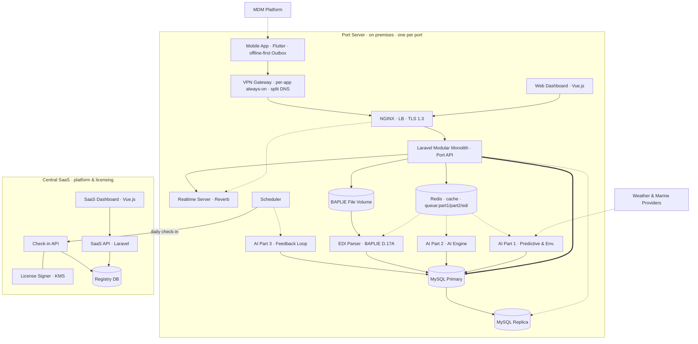

# ATLANTECH — System Architecture (v3.0)

> **Status:** High-level system design v3.0 (October 2026), aligned with the UML set (UC-1–3, sequence 1.1–3.4, AD-1–AD-20, SM-1–SM-6) and the decision register behind it. Where an older document disagrees with this file, see `UML_Context.md` §11. Companion PDF: `ATLANTECH_System_Architecture_v3.pdf`.
> **Tags:** 🟢 CONFIRMED · 🟡 PROPOSAL, not decided · 🔵 CARRIED, unchanged from the original documents.
> **Out of scope by explicit decision:** the Vision module, and any sharing of data or AI models between ports or between a port and the Central SaaS.

## What changed from v2.0

| # | v2.0 said | v3.0 (matches the UML) |
|---|---|---|
| 1 | External "Request Sources" with adapters | Removed. Port Authority Staff enter berthing requests; there is no external request source. |
| 2 | Terminal Operating Systems as an integration that "uses recommendations" | Not integrated. The CT Operation Planner exports the yard plan and enters it into the TOS by hand. |
| 3 | "Isolated · no runtime calls" between port and SaaS | The port makes a daily outbound license check-in to the SaaS Check-in API (or receives a manual token file). Only licensing crosses; no operational data or AI models. |
| 4 | SaaS = dashboard, API, registry | Adds Check-in API, License Signer with a KMS-held key, the Support Engineer and the offline Root CA. Registry also holds admin accounts, governorates and signing keys. |
| 5 | Notifications inside Laravel | Separate Realtime Server (Reverb): SSE to web, WebSocket to mobile, sent only after the DB commit. No push service. |
| 6 | No scheduler | Scheduler runs weather pulls (6 h), astronomical tide (daily), license check-in (daily), Part 3 evaluation and retraining, task re-send and escalation. |
| 7 | Mobile connects straight to NGINX | Managed devices (MDM), per-app always-on VPN, split DNS `app.atlantech.io`; offline-first Outbox synced through `/sync/events`. |
| 8 | Seven functional areas | Adds License & Mode, Check-in Client, Users & Devices, Mobile Sync, Container Yard, Notifications. |
| 9 | Part 2 = berth, tug, pilot | Also service-time and delay-risk prediction, FIFO fallback on technical solver failure, yard placement for CT. |
| 10 | Weather "every 6 h + on demand" | Primary and secondary provider; astronomical tide computed locally every day. |
| 11 | Berthing request state diagram with `RECEIVED_FROM_EXTERNAL` | Replaced by the SM-4 vocabulary (§5). |
| 12 | EDI Parser "inside Laravel or a satellite" | Python worker on `queue:edi`, deterministic, not AI. |

---

## 1. Identity and positioning 🔵

- **ATLANTECH — Intelligent Port Operations.** *"ATLANTECH recommends and coordinates; existing terminal and port systems execute."*
- Core problem: terminals and departments plan in isolation but compete for the same berths, channel, tugs and pilots.
- Reference port (case study only): Damietta, 8 terminals, 36 berths, ≈26 vessels/day. The product is port-agnostic (1 terminal / 5 berths up to 10 / 50 by configuration).

## 2. Deployment and isolation 🟢

- **Port Server:** one full installation per port, on premises in the port LAN, same stack everywhere.
- **Central SaaS:** licensing, plans, billing records and the port registry only. No operational data, no training data, no AI models.
- **The only link** is licensing: a daily outbound check-in from the port (returns a signed token), or a manual token file for ports without internet (only for an `ACTIVE` license, uploaded by the Port Admin).
- Cross-port (federated) learning was rejected. Inside one port, terminals are separated by terminal-level row security (403).

## 3. Components 🟢

| Layer | Technology | Notes |
|---|---|---|
| Clients | Vue.js web; Flutter mobile | Web over HTTPS + SSE inside the LAN. Mobile over HTTPS + WebSocket through the VPN, offline-first Outbox, idempotent events. |
| Device management | MDM, VPN gateway, split DNS | Managed phones; enroll, revoke, `WIPE_PENDING`. |
| Entry | NGINX | Load balancer, TLS 1.3 termination. |
| Application | Laravel modular monolith (1+ instances) | Functional areas: Auth & RBAC, License & Mode, Check-in Client, Users & Devices, Port & Resources, Berthing Requests, BAPLIE, Recommendations, Plans & Dispatch, Container Yard, Mobile Sync, Tracking & Deviations, Notifications, Audit. One-way module dependencies. |
| Write chain | Every request | auth 401 → role & terminal 403 → app version 426 → license mode 423 → record version 409 → business rules 409/422 → plan limits 422 → audit. |
| Realtime | Reverb | SSE to web, WebSocket to mobile, after commit. Re-send at T+10 / T+20 min, escalate at T+30. |
| Scheduler | Laravel scheduler | Weather (6 h), tide (daily), license check-in (daily), Part 3 runs, reminders and escalation. |
| Cache & jobs | Redis | Cache, hot state, `queue:part1`, `queue:part2`, `queue:edi`. |
| Workers | Python | EDI Parser, AI Part 1, AI Part 2 (OR-Tools CP-SAT), AI Part 3. Read state from and write results to MySQL. |
| Data | MySQL primary + replica; BAPLIE file volume | Terminal-level row security, append-only audit, AES-256 at rest. |
| Central SaaS | Vue.js dashboard, Laravel API, Check-in API, License Signer (KMS), MySQL registry | Registry: admin accounts, governorates, license plans, port registry & lifecycle, annual licenses, signing keys, billing records, platform audit. |

**Not connected by design:** no external berthing-request source, no TOS integration (manual entry), no payment gateway (payment only recorded), no push service.

## 4. Licensing and port-side mode 🟢

| Mode | When |
|---|---|
| `SETUP` | Port `ONBOARDING`: only setup writes (first Port Admin, users, configuration, berths, resources). |
| `FULL` | Port `ACTIVE`, license `ACTIVE`, valid token. |
| `READ_ONLY` | Any other case, always with a reason. New writes return `423 LICENSE_READ_ONLY`; running work can still be updated. |

Tokens are signed lazily, carry `kid`, port id, port status, plan limits and dates; an existing token is reused while more than 14 days remain, and a banner warns at 14 days or less. The Support Engineer deploys the signed build, signs the port TLS certificate with the offline Root CA and gives support only inside a session opened by the Port IT Administrator.

## 5. Berthing request lifecycle (SM-4) 🟢

`SUBMITTED` → `PRELIMINARY_APPROVED` → `CUSTOMS_APPROVED` (entered by hand) → `ENTRY_WINDOW_CONFIRMED` (AI Part 1 window, staff confirm) → `RECOMMENDATION_GENERATED` (AI Part 2) → `PLAN_CONFIRMED` → `COMPLETED`.
Side paths: `NEEDS_REVISION` (back to `SUBMITTED` on resubmit), `REJECTED`, `CANCELLED` (only before preliminary approval). `ENTRY_WINDOW_CONFIRMED` can be reopened to `CUSTOMS_APPROVED` while no plan is confirmed. `PLAN_CONFIRMED` → `PLAN_CANCELLED` releases resources (normally only if no component has started; otherwise only the Port Admin safety exception); from `PLAN_CANCELLED` the call is re-planned from `ENTRY_WINDOW_CONFIRMED` or ends. A delay re-plan keeps `PLAN_CONFIRMED` and replaces the plan version. Outcomes that are not states: `ENV_DATA_UNAVAILABLE`, `NO_FEASIBLE_PLAN`. Full transition table: `ATLANTECH_State_Diagrams.md`.

## 6. AI module 🟢

| Part | Role | Notes |
|---|---|---|
| Part 1 — Predictive & Environmental | Feasible entry-time windows | Weather, wave and sea level from a primary and a secondary provider every 6 h and on demand; astronomical tide computed locally each day. Outputs constraints only, never allocates. |
| Part 2 — AI Engine | Sole allocation authority | Service-time and delay-risk prediction, hard safety filter, CP-SAT for berth, tug and pilot; deterministic FIFO fallback on technical solver failure (also passes the hard filter); yard placement for CT; template-based rationale (not an LLM). |
| Part 3 — Feedback Loop | Learning, local to the port | Trusted data only, drift watch, forecast bias correction, guarded retraining: a candidate is deployed only if not worse on MAE and override rate; previous model kept for rollback. |

## 7. Actors and RBAC 🔵

Hierarchy per domain: Administrator/Manager → Officer/Planner → Supervisor/Field Executor. Plus the SaaS Admin (no port data), the Marine Safety Officer (safety constraints, environmental limits, chart datum, under-keel clearance), the Port Admin, the Port IT Administrator and the ATLANTECH Support Engineer. Full list: `Users & Actors.md`, `UML_Context.md` §2.

## 8. Data model — key entities 🔵🟡

Unchanged core: `port_profile`, `terminal`, `berth`, `navigation_channel`/`channel_waypoint`, `tugboat`, `user`/`role`/`user_role_assignment`, `pilot_profile`, `tug_master_profile`, `storage_facility`, `vessel`, `baplie_file`, `container`, `berthing_request` (+ status history), `recommendation`/`recommendation_output`/`recommendation_override`, `safety_constraint`, `operational_plan`, `actual_status_update`, `deviation_log`, `notification_log`, `audit_log`.
Needed by the diagrams (🟡, schema not yet locked): `environment_forecast`, `device`, `outbox_event` receipts (idempotency keys), `license_token`, `model_version`. Central registry is a separate database.

## 9. Brand 🔵

Deep Navy `#083A4F`, Muted Gold `#A58D66`, Light Teal `#C0D5D6`, Mid Teal `#407E8C`, Off-White `#E5E1DD`. Montserrat (primary), Inter (secondary).

## 10. Working rules

- Never invent facts or business rules; unknowns stay open questions.
- Never present a proposal as a decision; keep the 🟢/🟡/🔵 tags.
- New architectural decisions need the team's explicit confirmation.
- No design may move operational data or model updates between ports, or between a port and the SaaS, beyond license verification.
