<!-- Generated from docs/reference/uml/ATLANTECH_Activity_Diagrams.md lines 856-980 by build-index.mjs. Do not edit: edit the source and rebuild. -->
### AD-10 — Customs approval, entry window and environmental data

```mermaid
flowchart TD
    START@{ shape: sm-circ }
    D0{"Triggering event?"}
    subgraph L_STAFF["Port Authority Staff"]
        direction TB
        A1("Open a PRELIMINARY_APPROVED berthing request")
        A2("Record Customs Approval")
        D8{"Staff action?"}
        STOP3@{ shape: fr-circ }
        A28("Enter manual environmental data")
        A17("Review proposed windows, blocked periods, conditions and data timestamp")
        D5{"Decision?"}
        RO1("Reopen a confirmed entry window with a reason - no confirmed plan yet")
    end
    subgraph L_SRV["Port Server"]
        direction TB
        D1{"READ_ONLY?"}
        A3("Reject with 423 LICENSE_READ_ONLY")
        STOP2@{ shape: fr-circ }
        A4("Set status CUSTOMS_APPROVED")
        A5("Create a Part 1 run QUEUED and enqueue it - 3 retries, then FAILED")
        DM{"READ_ONLY?"}
        A29("Store manual data as a forecast run with pull_type MANUAL, provider_rank MANUAL and submitted_by; audit entry")
        A16("Notify dashboard via SSE")
        D11{"READ_ONLY?"}
        A20("Confirm window - server re-checks status and constraints")
        DX{"Re-check passed?"}
        A409("Return 409 with the reason")
        A21("Set status ENTRY_WINDOW_CONFIRMED")
        A22("Hand the confirmed window and constraints to Part 2 - AD-11")
        STOP5@{ shape: fr-circ }
        AR("Proposal REJECTED with rejection_reason; request stays CUSTOMS_APPROVED")
        STOP6@{ shape: fr-circ }
        DRC{"READ_ONLY?"}
        DRO{"READ_ONLY?"}
        RO2("Set status CUSTOMS_APPROVED")
        N6["Manual data passes the same safety constraints - no bypass"]
    end
    subgraph L_AI1["AI Part 1 - Predictive and Environmental"]
        direction TB
        A6("Fetch environmental data for this request and compute tide in-house")
        D2{"Fresh retrieval successful?"}
        A8("Attach the retrieved data and its timestamp to this request")
        D7{"Stored data recent enough?"}
        A9("Use stored data with a stale-data warning and its timestamp")
        A24("Outcome ENV_DATA_UNAVAILABLE - staff submit manual data")
        A14("Aggregate demand and peak congestion from open requests")
        D9{"All constraints satisfied?"}
        A18("Outcome NO_FEASIBLE_WINDOW: show blocked periods and limiting factors")
        STOP4@{ shape: fr-circ }
        A15("Outcome WINDOWS_FOUND: write feasible windows and constraints")
        N1["Each request uses its own data - never another request's result"]
        N2["Part 1 never allocates berth, tug or pilot"]
        N5["Stored data counts only if measured within 48 h and covering the request horizon"]
        S1("Scheduled job fires in Part 1")
        FK2@{ shape: fork }
        S2("Pull weather, wave and surge data - every 6 h")
        D6{"Primary provider reachable?"}
        S8("Raise an alert and try the secondary provider")
        D6b{"Secondary provider reachable?"}
        S4("Store forecast run with provider_rank PRIMARY or SECONDARY and its timestamp")
        S5("Keep last stored data, mark data_stale, log the source failure")
        S6("Compute astronomical tide for a multi-day horizon - daily")
        S7("Store tide data")
        JN2@{ shape: fork }
        STOP1@{ shape: fr-circ }
        N4["The scheduler runs in Part 1, not in the web application"]
    end
    subgraph L_WX["Weather and Marine Data Providers"]
        direction TB
        A7("Return weather, wave and sea-level data")
        S3("Return weather, wave and surge data")
    end
    START --> D0
    D0 -->|"Schedule: 6-hourly weather or daily tide"| S1 --> FK2
    FK2 --> S2 --> D6
    D6 -->|"Yes"| S3 --> S4 --> JN2
    D6 -->|"No"| S8 --> D6b
    D6b -->|"Yes"| S3
    D6b -->|"No"| S5 --> JN2
    FK2 --> S6 --> S7 --> JN2
    JN2 --> STOP1
    D0 -->|"Staff records Customs Approval"| A1 --> A2 --> D1
    D1 -->|"Yes"| A3 --> STOP2
    D1 -->|"No"| A4 --> A5 --> A6 --> D2
    D2 -->|"Yes"| A7 --> A8 --> A14
    D2 -->|"No"| D7
    D7 -->|"Yes"| A9 --> A14
    D7 -->|"No"| A24 --> D8
    D8 -->|"Enter manual data"| A28 --> DM
    DM -->|"Yes"| A3
    DM -->|"No"| A29 --> A14
    D8 -->|"Not yet - request held"| STOP3
    A14 --> D9
    D9 -->|"No"| A18 --> STOP4
    D9 -->|"Yes"| A15 --> A16 --> A17 --> D5
    D5 -->|"Confirm"| D11
    D11 -->|"Yes"| A3
    D11 -->|"No"| A20 --> DX
    DX -->|"No"| A409 --> A17
    DX -->|"Yes"| A21 --> A22 --> STOP5
    D5 -->|"Reject all windows"| AR --> STOP6
    D5 -->|"Recompute"| DRC
    DRC -->|"Yes"| A3
    DRC -->|"No"| A5
    D0 -->|"Staff reopens the window"| RO1 --> DRO
    DRO -->|"Yes"| A3
    DRO -->|"No"| RO2 --> A5
    N1 -.- A6
    N2 -.- A15
    N4 -.- S1
    N5 -.- D7
    N6 -.- A29
    classDef term fill:#083A4F,stroke:#083A4F,color:#083A4F
    classDef bar fill:#083A4F,stroke:#083A4F
    classDef dec fill:#FFFFFF,stroke:#A58D66,stroke-width:2px,color:#083A4F
    classDef note fill:#F4EFE7,stroke:#A58D66,color:#3B3326,font-size:13px
    class START,STOP1,STOP2,STOP3,STOP4,STOP5,STOP6 term
    class FK2,JN2 bar
    class D0,D1,D11,D2,D5,D6,D6b,D7,D8,D9,DM,DRC,DRO,DX dec
    class N1,N2,N4,N5,N6 note
```

