<!-- Generated from docs/reference/uml/ATLANTECH_Activity_Diagrams.md lines 982-1073 by build-index.mjs. Do not edit: edit the source and rebuild. -->
### AD-11 — Recommendation to confirmed operational plan

```mermaid
flowchart TD
    subgraph L_SRV["Port Server"]
        direction TB
        START@{ shape: sm-circ }
        A1("Receive request in ENTRY_WINDOW_CONFIRMED")
        D0{"READ_ONLY?"}
        A34("Reject with 423 LICENSE_READ_ONLY - no new plan")
        STOP1@{ shape: fr-circ }
        A2("Enqueue job on the Part 2 queue")
        A11("Set status RECOMMENDATION_GENERATED")
        A12("Notify dashboard via SSE")
        A24("Show the no-feasible-plan reason to staff")
        DO{"READ_ONLY?"}
        A16("Create a MODIFIED_BY_STAFF version and record the override reason")
        D4{"READ_ONLY?"}
        A19("Reject with 423 LICENSE_READ_ONLY")
        STOP3@{ shape: fr-circ }
        A20("In one transaction: re-check availability, book berth, tug and pilot, create operational plan CONFIRMED, set request PLAN_CONFIRMED, set version CONFIRMED")
        D7{"Committed?"}
        A35("Roll back - plan stays unconfirmed, show the resource conflict")
        A23("Send pilotage and tug components for assignment - AD-13; request a yard recommendation for a container vessel - AD-14")
        STOP4@{ shape: fr-circ }
        N3["Generation, review and confirmation are separate steps"]
        N4["The plan counts as confirmed only after the booking commits"]
    end
    subgraph L_AI2["AI Part 2 - AI Engine"]
        direction TB
        A3("Load BAPLIE data, confirmed window, Part 1 constraints, resource state and competing requests")
        A5("Predict service time and delay risk")
        A6("Solve berth, tug and pilot allocation with CP-SAT")
        D1{"Solver result?"}
        A30("Build FIFO fallback plan by arrival order")
        A31("Set source FIFO; store the failure reason in solver_run.result_detail")
        A4("Apply the hard safety and feasibility filter - discard violating candidates")
        D3{"Feasible candidate left?"}
        A7("Outcome NO_FEASIBLE_PLAN, binding constraints in solver_run.result_detail - request stays ENTRY_WINDOW_CONFIRMED")
        A8("Rank by time urgency, then financial impact when time priority is close or tied")
        A9("Write recommendation version PENDING_REVIEW with source AI or FIFO and template rationale")
        A32("Check the override against hard safety and feasibility constraints")
        D5{"Override passes?"}
        A33("Reject the override and show the violated constraint")
        N1["FIFO is only a fallback for a technical solver failure and never bypasses hard constraints"]
    end
    subgraph L_STAFF["Port Authority Staff"]
        direction TB
        D6{"Next step?"}
        STOP2@{ shape: fr-circ }
        A13("Review ranked options and rationale against the unified port state")
        D2{"Override a component?"}
        A14("Change the berth, tug or pilot component")
        A15("Enter the override reason")
        A17("Select the recommended option")
        A18("Confirm the operational plan")
        N2["Override data feeds AI Part 3 - AD-16"]
    end
    START --> A1 --> D0
    D0 -->|"Yes"| A34 --> STOP1
    D0 -->|"No"| A2 --> A3 --> A5 --> A6 --> D1
    D1 -->|"Solved"| A4
    D1 -->|"Technical failure: error or timeout"| A30 --> A31 --> A4
    D1 -->|"Infeasible"| A7
    A4 --> D3
    D3 -->|"No"| A7 --> A24 --> D6
    D6 -->|"Regenerate - AD-12"| D0
    D6 -->|"Wait"| STOP2
    D3 -->|"Yes"| A8 --> A9 --> A11 --> A12 --> A13 --> D2
    D2 -->|"Yes"| DO
    DO -->|"Yes"| A19
    DO -->|"No"| A14 --> A15 --> A32 --> D5
    D5 -->|"No"| A33 --> A14
    D5 -->|"Yes"| A16 --> A18
    D2 -->|"No"| A17 --> A18
    A18 --> D4
    D4 -->|"Yes"| A19 --> STOP3
    D4 -->|"No"| A20 --> D7
    D7 -->|"No"| A35 --> A13
    D7 -->|"Yes"| A23 --> STOP4
    N1 -.- A30
    N2 -.- A15
    N3 -.- A12
    N4 -.- D7
    classDef term fill:#083A4F,stroke:#083A4F,color:#083A4F
    classDef bar fill:#083A4F,stroke:#083A4F
    classDef dec fill:#FFFFFF,stroke:#A58D66,stroke-width:2px,color:#083A4F
    classDef note fill:#F4EFE7,stroke:#A58D66,color:#3B3326,font-size:13px
    class START,STOP1,STOP2,STOP3,STOP4 term
    class D0,D1,D2,D3,D4,D5,D6,D7,DO dec
    class N1,N2,N3,N4 note
```

