<!-- Generated from docs/reference/uml/ATLANTECH_Activity_Diagrams.md lines 1075-1186 by build-index.mjs. Do not edit: edit the source and rebuild. -->
### AD-12 — Regenerate recommendation, delay re-plan and cancel plan

```mermaid
flowchart TD
    START@{ shape: sm-circ }
    D1{"Triggering event?"}
    subgraph L_SRV["Port Server"]
        direction TB
        A1("Detect resource-state change: berth, tug or pilot")
        A2("Find pending recommendations that use the affected resource")
        D2{"Any found?"}
        STOP1@{ shape: fr-circ }
        D8{"READ_ONLY?"}
        A21("Do not regenerate in READ_ONLY - previous version stays current")
        STOP2@{ shape: fr-circ }
        A4("Enqueue regeneration on the Part 2 queue")
        A6("Show regeneration failure - previous version stays current")
        A8("Notify staff via SSE")
        DG{"Plan already confirmed?"}
        G2("Return 409 - use delay re-plan or cancel")
        STOP5@{ shape: fr-circ }
        DR1{"READ_ONLY?"}
        R0("No proposal; staff notified")
        STOP6@{ shape: fr-circ }
        R3("In one transaction: reserve new resources, release unused ones, keep STARTED components, old version REPLACED, proposal becomes the INITIAL version, changed components back to assignment - AD-13")
        DR3{"Committed?"}
        R4("Roll back - old version stays confirmed")
        STOP8@{ shape: fr-circ }
        DC2{"READ_ONLY?"}
        A423("Reject with 423 LICENSE_READ_ONLY")
        STOP9@{ shape: fr-circ }
        A17("Check the current plan and operation state")
        D4{"Execution already started?"}
        A18("Return 409 - Port Admin safety exception only, AD-13")
        STOP10@{ shape: fr-circ }
        A11("In one transaction: plan CANCELLED, release berth, tug and pilot, request PLAN_CANCELLED")
        D5{"Committed?"}
        A19("Roll back, keep the previous state and show the error")
        A16("Notify affected officers and field users")
        DC{"Call continues?"}
        C1("Re-plan: request back to ENTRY_WINDOW_CONFIRMED - AD-11")
        STOP12@{ shape: fr-circ }
        C2("Request stays PLAN_CANCELLED")
        STOP13@{ shape: fr-circ }
        N1["Triggers: resource-state change (pending recommendations only), staff regenerate before confirmation, significant deviation (delay re-plan)"]
        N3["Released resources count as a resource-state change"]
        N4["Field events queued offline for a cancelled plan are later rejected with a reason - AD-15"]
    end
    subgraph L_AI2["AI Part 2 - AI Engine"]
        direction TB
        A5("Re-run generation with updated inputs - same pipeline as AD-11")
        D3{"Regeneration successful?"}
        A7("Write the new version (PENDING_REVIEW); previous version REPLACED")
        R1("Build a delay re-plan proposal version with purpose DELAY_REPLAN")
    end
    subgraph L_STAFF["Port Authority Staff"]
        direction TB
        A9("Review the new recommendation - continues in AD-11")
        STOP4@{ shape: fr-circ }
        D6{"Retry regeneration?"}
        STOP3@{ shape: fr-circ }
        G1("Ask to regenerate the recommendation")
        R2("Review the delay re-plan proposal")
        DR2{"Confirm the proposal?"}
        R5("Proposal discarded - current plan stays")
        STOP7@{ shape: fr-circ }
        A10("Request cancellation with a reason and answer: does the call continue?")
        D7{"Retry cancellation?"}
        STOP11@{ shape: fr-circ }
    end
    START --> D1
    D1 -->|"Resource state changed"| A1 --> A2 --> D2
    D2 -->|"No"| STOP1
    D2 -->|"Yes"| D8
    D8 -->|"Yes"| A21 --> STOP2
    D8 -->|"No"| A4 --> A5 --> D3
    D3 -->|"No"| A6 --> D6
    D6 -->|"Yes"| D8
    D6 -->|"No"| STOP3
    D3 -->|"Yes"| A7 --> A8 --> A9 --> STOP4
    D1 -->|"Staff asks to regenerate"| G1 --> DG
    DG -->|"Yes"| G2 --> STOP5
    DG -->|"No"| D8
    D1 -->|"Significant deviation - AD-16"| DR1
    DR1 -->|"Yes"| R0 --> STOP6
    DR1 -->|"No"| R1 --> R2 --> DR2
    DR2 -->|"No"| R5 --> STOP7
    DR2 -->|"Yes"| R3 --> DR3
    DR3 -->|"No"| R4 --> STOP8
    DR3 -->|"Yes"| A16
    D1 -->|"Staff cancels the plan"| A10 --> DC2
    DC2 -->|"Yes"| A423 --> STOP9
    DC2 -->|"No"| A17 --> D4
    D4 -->|"Yes"| A18 --> STOP10
    D4 -->|"No"| A11 --> D5
    D5 -->|"No"| A19 --> D7
    D7 -->|"Yes"| A11
    D7 -->|"No"| STOP11
    D5 -->|"Yes"| A16 --> DC
    DC -->|"Yes"| C1 --> STOP12
    DC -->|"No"| C2 --> STOP13
    N1 -.- D1
    N3 -.- A16
    N4 -.- A11
    classDef term fill:#083A4F,stroke:#083A4F,color:#083A4F
    classDef bar fill:#083A4F,stroke:#083A4F
    classDef dec fill:#FFFFFF,stroke:#A58D66,stroke-width:2px,color:#083A4F
    classDef note fill:#F4EFE7,stroke:#A58D66,color:#3B3326,font-size:13px
    class START,STOP1,STOP2,STOP3,STOP4,STOP5,STOP6,STOP7,STOP8,STOP9,STOP10,STOP11,STOP12,STOP13 term
    class D1,D2,D3,D4,D5,D6,D7,D8,DC,DC2,DG,DR1,DR2,DR3 dec
    class N1,N3,N4 note
```

