<!-- Generated from docs/reference/uml/ATLANTECH_Activity_Diagrams.md lines 1188-1320 by build-index.mjs. Do not edit: edit the source and rebuild. -->
### AD-13 — Dispatch, notification and acknowledgement

```mermaid
flowchart TD
    START@{ shape: sm-circ }
    D0{"Triggering event?"}
    subgraph L_SRV["Port Server"]
        direction TB
        A1("Split the PLAN_CONFIRMED plan into pilotage and tug components")
        A0("Propose pilot and tug from availability")
        FK1@{ shape: fork }
        V1("Check operation state, READ_ONLY policy, pilot availability and eligibility")
        DV1{"Check result?"}
        V2("Check operation state, READ_ONLY policy, tug availability and eligibility")
        DV2{"Check result?"}
        A26("Stop this assignment: show the reason, 423 LICENSE_READ_ONLY or invalid operation state, and audit REJECTED_ATTEMPT")
        STOP2@{ shape: fr-circ }
        A2("Record the assignment and audit entry")
        A24("Schedule the reminder at the configured lead time")
        A3("Send task notification at T+0: SSE to web, WS event to mobile; record the send")
        A25("Start acknowledgement checks at T+10, T+20 and T+30 from the first send")
        D1{"Delivered?"}
        A4("Record delivery state failed")
        A5("Mark the notification ACKNOWLEDGED; cancel pending retries")
        STOP1@{ shape: fr-circ }
        C1("Check the operation state")
        D5{"Execution already started?"}
        C2("Cancel pilot and tug assignments and pending reminders")
        C3("Notify assigned officers and field users of the cancellation")
        STOP8@{ shape: fr-circ }
        C4("Block normal cancellation")
        N1["No push service: a closed app receives nothing until it is reopened"]
        N6["Delivery is never acknowledgement - only the recipient acknowledges"]
        N3["Pilot and tug paths are independent: each assignment continues on its own"]
        N7["Choosing another pilot or tug cannot bypass READ_ONLY"]
        N2["Reminder lead time comes from configurable operational settings"]
    end
    subgraph L_STAFF["Port Authority Staff"]
        direction TB
        K1("Request cancellation of the operation")
    end
    subgraph L_PDO["Pilotage Department Officer"]
        direction TB
        P1("Review the pilotage component")
        P2("Review the proposed Marine Pilot; confirm or replace")
        P4("See the rejection reason and choose again")
        P3("Assign the pilotage component to the Marine Pilot")
    end
    subgraph L_TDO["Tug Department Officer"]
        direction TB
        T1("Review the tug component")
        T2("Review the proposed Tug Master and tug; confirm or replace")
        T4("See the rejection reason and choose again")
        T3("Assign the tug component to the Tug Master")
    end
    subgraph L_MU["Marine Pilot or Tug Master"]
        direction TB
        M1("Receive WS event and fetch the task via REST")
        M2("See the task on next app open via REST catch-up")
        M3("Acknowledge notification - written to the Outbox, synced by AD-15")
        M4("Receive the pre-execution reminder")
        STOP6@{ shape: fr-circ }
    end
    subgraph L_SCH["Scheduler"]
        direction TB
        S1("Reminder time reached")
        S3("Check the actual task state")
        D7{"Task still active?"}
        STOP7@{ shape: fr-circ }
        S2("Send the pre-execution reminder")
        Q1("Acknowledgement check time reached")
        D8{"Acknowledged?"}
        STOP3@{ shape: fr-circ }
        D9{"Which check?"}
        Q2("Send a retry through the same channels and record it (T+10, T+20)")
        STOP4@{ shape: fr-circ }
        Q3("At T+30 send ACK_ESCALATION to the assigning officer and the department manager")
        STOP5@{ shape: fr-circ }
        N5["Acknowledgement retries are separate from the pre-execution reminder"]
    end
    subgraph L_PAD["Port Admin"]
        direction TB
        D6{"Serious safety exception?"}
        STOP9@{ shape: fr-circ }
        K2("Enter the exception reason")
        C5("Cancel the remaining components with reason: plan CANCELLED, request PLAN_CANCELLED, release unused resources, audit SAFETY_EXCEPTION - allowed in READ_ONLY")
        STOP10@{ shape: fr-circ }
        N4["The safety exception is a Port Admin action with a mandatory reason and audit"]
    end
    START --> D0
    D0 -->|"Plan confirmed"| A1 --> A0 --> FK1
    FK1 --> P1 --> P2 --> V1 --> DV1
    DV1 -->|"Unavailable or not eligible"| P4 --> P2
    DV1 -->|"READ_ONLY or invalid operation state"| A26
    DV1 -->|"Passed"| P3 --> A2
    FK1 --> T1 --> T2 --> V2 --> DV2
    DV2 -->|"Unavailable or not eligible"| T4 --> T2
    DV2 -->|"READ_ONLY or invalid operation state"| A26
    DV2 -->|"Passed"| T3 --> A2
    A2 --> A24 --> A3 --> A25 --> D1
    D1 -->|"Yes"| M1 --> M3
    D1 -->|"No"| A4 --> M2 --> M3
    M3 --> A5 --> STOP1
    A26 --> STOP2
    D0 -->|"Acknowledgement check time"| Q1 --> D8
    D8 -->|"Yes"| STOP3
    D8 -->|"No"| D9
    D9 -->|"T+10 or T+20"| Q2 --> STOP4
    D9 -->|"T+30"| Q3 --> STOP5
    D0 -->|"Reminder time"| S1 --> S3 --> D7
    D7 -->|"Yes"| S2 --> M4 --> STOP6
    D7 -->|"No - cancelled or done"| STOP7
    D0 -->|"Cancellation requested"| K1 --> C1 --> D5
    D5 -->|"No"| C2 --> C3 --> STOP8
    D5 -->|"Yes"| C4 --> D6
    D6 -->|"No - request refused"| STOP9
    D6 -->|"Yes"| K2 --> C5 --> STOP10
    N1 -.- A4
    N2 -.- A24
    N3 -.- A2
    N4 -.- C5
    N5 -.- Q1
    N6 -.- D1
    N7 -.- A26
    classDef term fill:#083A4F,stroke:#083A4F,color:#083A4F
    classDef bar fill:#083A4F,stroke:#083A4F
    classDef dec fill:#FFFFFF,stroke:#A58D66,stroke-width:2px,color:#083A4F
    classDef note fill:#F4EFE7,stroke:#A58D66,color:#3B3326,font-size:13px
    class START,STOP1,STOP2,STOP3,STOP4,STOP5,STOP6,STOP7,STOP8,STOP9,STOP10 term
    class FK1 bar
    class D0,D1,D5,D6,D7,D8,D9,DV1,DV2 dec
    class N1,N2,N3,N4,N5,N6,N7 note
```

