<!-- Generated from docs/reference/uml/ATLANTECH_Activity_Diagrams.md lines 1596-1711 by build-index.mjs. Do not edit: edit the source and rebuild. -->
### AD-15 — Field status update, Outbox sync and realtime

```mermaid
flowchart TD
    START@{ shape: sm-circ }
    D0{"Triggering event?"}
    subgraph L_FU["Field User - Pilot, Tug Master, CT Supervisor"]
        direction TB
        F1("Open an assigned task")
        F2("Set the actual status or acknowledge a notification")
    end
    subgraph L_APP["Mobile App"]
        direction TB
        A0("On restart: reset stale SENDING entries to PENDING")
        A1("Load the task from the local cache")
        A2("Write event to the Outbox: idempotency_key, recorded_at, user_id, state PENDING")
        A3("Show the update locally as not yet synced")
        A4("Sync trigger: connectivity change or manual sync")
        D8{"Signed in with a valid token?"}
        A8("Hold the Outbox unsent and ask the user to sign in again - AD-17")
        STOP1@{ shape: fr-circ }
        A5("Ping /system/ping")
        D1{"Server reachable?"}
        DT{"Fewer than 5 tries in this cycle?"}
        A10("Wait with backoff: 2 s, doubling, max 60 s")
        A6("End the cycle - keep working offline, events stay PENDING")
        STOP2@{ shape: fr-circ }
        A13("Mark the next PENDING entries SENDING")
        A7("Send the batch in order to POST /sync/events with idempotency_key and client_sent_at")
        A21("Return SENDING entries to PENDING")
        A9("Stop sync and show update required - Outbox preserved")
        STOP3@{ shape: fr-circ }
        A11("Mark entry DONE and show the synced confirmation")
        STOP4@{ shape: fr-circ }
        A12("Mark entry REJECTED and keep the reason in the rejected list")
        STOP5@{ shape: fr-circ }
        W1("Other devices: receive the WS event id and GET the details")
        N1["Android keeps the WS alive with a foreground service during an active task; iOS has no background WS"]
        N2["Pending entries survive app updates and network failures"]
        N7["DONE and REJECTED entries are purged after 30 days"]
        N6["Other devices and reconnecting apps catch up with GET /api/v1/sync/changes?since=lastSyncToken"]
    end
    subgraph L_SRV["Port Server"]
        direction TB
        D2{"Request result?"}
        D3{"client_event_id already stored?"}
        S1("Return the previous result: duplicate")
        DR{"READ_ONLY and a creation event?"}
        S3r("Reject with 423")
        S2("Validate the event")
        D4{"Event still logical?"}
        S3("Reject with reason, e.g. plan cancelled")
        S4("Apply the event, update resource state, store client_event_id, reported_at, client_sent_at and received_at")
        D5{"Clock gap over 5 min?"}
        S5("Mark clock_skew_suspect: received_at minus client_sent_at over 5 min - still applied now")
        S9("Commit the DB transaction")
        S6("Run the deviation check - AD-16")
        S7("Publish the realtime event id")
        FK1@{ shape: fork }
        S8("Return applied")
        JN1@{ shape: fork }
        N3["In READ_ONLY, status updates and acknowledgements are applied; only creation events are rejected"]
        N5["A suspect event still changes operational state; its untrusted label only excludes it from evaluation and training"]
        N4["Notifications are sent only after the DB commit"]
    end
    subgraph L_OU["Office User"]
        direction TB
        O1("Dashboard receives the live update via SSE")
    end
    START --> D0
    D0 -->|"Field update"| F1 --> A1 --> F2 --> A2 --> A3 --> A4
    D0 -->|"App restart"| A0 --> A4
    A4 --> D8
    D8 -->|"No"| A8 --> STOP1
    D8 -->|"Yes"| A5 --> D1
    D1 -->|"No"| DT
    DT -->|"Yes"| A10 --> A5
    DT -->|"No"| A6 --> STOP2
    D1 -->|"Yes"| A13 --> A7 --> D2
    D2 -->|"401"| A21
    D2 -->|"426"| A21
    D2 -->|"No answer or transient error"| A21
    A21 -->|"after 401"| A8
    A21 -->|"after 426"| A9 --> STOP3
    A21 -->|"after a send failure"| A6
    D2 -->|"200: per-event processing"| D3
    D3 -->|"Yes"| S1 --> A11
    D3 -->|"No"| DR
    DR -->|"Yes"| S3r --> A12
    DR -->|"No"| S2 --> D4
    D4 -->|"No"| S3 --> A12
    D4 -->|"Yes"| S4 --> D5
    D5 -->|"Yes"| S5 --> S9
    D5 -->|"No"| S9
    S9 --> S6 --> S7 --> FK1
    FK1 --> O1 --> JN1
    FK1 --> W1 --> JN1
    FK1 --> S8 --> JN1
    JN1 --> A11 --> STOP4
    A12 --> STOP5
    N1 -.- W1
    N2 -.- A21
    N3 -.- DR
    N4 -.- S9
    N5 -.- S5
    N6 -.- W1
    N7 -.- A11
    classDef term fill:#083A4F,stroke:#083A4F,color:#083A4F
    classDef bar fill:#083A4F,stroke:#083A4F
    classDef dec fill:#FFFFFF,stroke:#A58D66,stroke-width:2px,color:#083A4F
    classDef note fill:#F4EFE7,stroke:#A58D66,color:#3B3326,font-size:13px
    class START,STOP1,STOP2,STOP3,STOP4,STOP5 term
    class FK1,JN1 bar
    class D0,D1,D2,D3,D4,D5,D8,DR,DT dec
    class N1,N2,N3,N4,N5,N6,N7 note
```

