<!-- Generated from docs/reference/uml/ATLANTECH_Activity_Diagrams.md lines 1713-1799 by build-index.mjs. Do not edit: edit the source and rebuild. -->
### AD-16 — Deviation detection and AI feedback loop

```mermaid
flowchart TD
    START@{ shape: sm-circ }
    D0{"Triggering event?"}
    subgraph L_SRV["Port Server"]
        direction TB
        A1("Actual status applied - from AD-15")
        A2("Compare planned and actual using reported_at")
        D1{"Over the threshold?"}
        A3("Store the actual outcome")
        STOP1@{ shape: fr-circ }
        A4("Record the deviation in the deviation log")
        DS{"Significant deviation?"}
        AR("Request a delay re-plan proposal - AD-12")
        A5("Notify staff via SSE")
        A7("Record override, correction and observed result")
        A8("Record stays untrusted - excluded from evaluation")
        A9("Record is trusted")
        STOP2@{ shape: fr-circ }
        N6["Human review records a note only; it never makes a record trusted"]
        N7["A clock-skew event already updated operational state in AD-15; the untrusted label does not undo that"]
        N1["Thresholds are set per operation type by the Port Admin"]
    end
    subgraph L_STAFF["Port Authority Staff"]
        direction TB
        S1("Browse and filter deviations by vessel, terminal, resource type and date")
        S3("Review the deviation and enter an override or correction")
        D2{"clock_skew_suspect?"}
        S2("Review untrusted events and record a resolution note - the record stays untrusted")
        STOP3@{ shape: fr-circ }
    end
    subgraph L_AI3["AI Part 3 - Feedback Loop"]
        direction TB
        P0("Select trusted data only")
        P1("Evaluate outcomes on MAE and override rate")
        P2("Monitor drift on the service time, demand and delay-risk models")
        P3("Apply forecast bias correction to Part 1 inputs")
        P4("Build a time-based train and test split")
        P5("Train a candidate model")
        P6("Compare candidate and approved baseline on MAE and override rate, held-out data")
        D3{"Candidate not worse on both?"}
        P7("Adopt the candidate and keep the previous version for rollback")
        D4{"Problem after adoption?"}
        P10("Roll back to the previous model version")
        P8("Reject the candidate and keep the current model")
        P9("Log evaluation, decision and model version")
        STOP4@{ shape: fr-circ }
        N2["Nothing leaves the port"]
        N3["Hard safety constraints are never relaxed by a model"]
        N4["Overrides are analysed as a signal, not an automatic retraining trigger"]
    end
    subgraph L_PAD["Port Admin"]
        direction TB
        R1("Review the rejected model candidate")
    end
    START --> D0
    D0 -->|"Actual status received"| A1 --> A2 --> D1
    D1 -->|"No"| A3 --> STOP1
    D1 -->|"Yes"| A4 --> DS
    DS -->|"Yes"| AR --> A5
    DS -->|"No"| A5
    A5 --> S1 --> S3 --> A7 --> D2
    D2 -->|"Yes"| A8
    D2 -->|"No"| A9 --> STOP2
    A8 --> S2 --> STOP3
    D0 -->|"Periodic evaluation"| P0 --> P1 --> P2 --> P3 --> P4 --> P5 --> P6 --> D3
    D3 -->|"Yes"| P7 --> D4
    D4 -->|"Yes"| P10 --> P9
    D4 -->|"No"| P9
    D3 -->|"No"| P8 --> R1 --> P9
    P9 --> STOP4
    N1 -.- D1
    N6 -.- S2
    N7 -.- A8
    N2 -.- P1
    N3 -.- P7
    N4 -.- A7
    classDef term fill:#083A4F,stroke:#083A4F,color:#083A4F
    classDef bar fill:#083A4F,stroke:#083A4F
    classDef dec fill:#FFFFFF,stroke:#A58D66,stroke-width:2px,color:#083A4F
    classDef note fill:#F4EFE7,stroke:#A58D66,color:#3B3326,font-size:13px
    class START,STOP1,STOP2,STOP3,STOP4 term
    class D0,D1,D2,D3,D4,DS dec
    class N1,N2,N3,N4,N6,N7 note
```

