<!-- Generated from docs/reference/uml/ATLANTECH_Activity_Diagrams.md lines 1801-1885 by build-index.mjs. Do not edit: edit the source and rebuild. -->
### AD-17 — Mobile first launch, login and re-authentication

```mermaid
flowchart TD
    subgraph L_MU["Mobile User"]
        direction TB
        START@{ shape: sm-circ }
        U1("Open the app")
        U2("Enter username and password")
        UF("Change the password - forced on first login")
    end
    subgraph L_APP["Mobile App"]
        direction TB
        D0{"First launch?"}
        A1("Call GET /system/info on the fixed base URL app.atlantech.io")
        A2("Show the port name and tag logs with port_public_id")
        D2{"Stored token state?"}
        A3("Keep the Outbox pending - a token is never renewed offline")
        A4("Work offline with cached data")
        D3{"Network back?"}
        A5("Call POST /auth/login")
        A6("Show the login error - the Outbox stays unsent")
        A7("Block sync and show update required - Outbox preserved")
        STOP1@{ shape: fr-circ }
        A8("Store the token in secure storage")
        A9("Pre-fetch assigned tasks to the local cache")
        D6{"Pending Outbox for this user?"}
        A10("Resume queued events with their idempotency keys - AD-15")
        D7{"READ_ONLY or token expiry within 14 days?"}
        A11("Show a banner and hide create buttons")
        A12("Show assigned tasks")
        D8{"A later protected request returns 401?"}
        STOP2@{ shape: fr-circ }
        A13("Pause sync and protected actions")
        N1["The Outbox is never sent before authentication succeeds"]
        N2["A token revoked by the Port Admin also returns 401 and forces a new login"]
        N3["The mobile app is for field users only; staff features are web only"]
    end
    subgraph L_SRV["Port Server"]
        direction TB
        S1("Return port_public_id, port name, license_mode, token_warning_days_left, min_app_version")
        D4{"Credentials?"}
        S2("Return 401")
        S2b("Return 403 ACCOUNT_DISABLED")
        D5{"App version at least min_app_version?"}
        S3("Return 426")
        S4("Issue a token named by device id, 30-day sliding")
        S5("Register or update the device: id, platform, app version, last seen")
        DF{"must_change_password set?"}
    end
    START --> U1 --> D0
    D0 -->|"Yes"| A1 --> S1 --> A2 --> D2
    D0 -->|"No"| D2
    D2 -->|"Valid"| D7
    D2 -->|"None"| U2
    D2 -->|"Expired while offline"| A3 --> A4 --> D3
    D3 -->|"No"| A4
    D3 -->|"Yes"| U2
    U2 --> A5 --> D4
    D4 -->|"Wrong"| S2 --> A6 --> U2
    D4 -->|"Account inactive"| S2b --> A6
    D4 -->|"Valid"| D5
    D5 -->|"No"| S3 --> A7 --> STOP1
    D5 -->|"Yes"| S4 --> S5 --> DF
    DF -->|"Yes"| UF --> A8
    DF -->|"No"| A8
    A8 --> A9 --> D6
    D6 -->|"Yes"| A10 --> D7
    D6 -->|"No"| D7
    D7 -->|"Yes"| A11 --> A12
    D7 -->|"No"| A12
    A12 --> D8
    D8 -->|"Yes"| A13 --> U2
    D8 -->|"No"| STOP2
    N1 -.- A6
    N2 -.- A13
    N3 -.- U1
    classDef term fill:#083A4F,stroke:#083A4F,color:#083A4F
    classDef bar fill:#083A4F,stroke:#083A4F
    classDef dec fill:#FFFFFF,stroke:#A58D66,stroke-width:2px,color:#083A4F
    classDef note fill:#F4EFE7,stroke:#A58D66,color:#3B3326,font-size:13px
    class START,STOP1,STOP2 term
    class D0,D2,D3,D4,D5,D6,D7,D8,DF dec
    class N1,N2,N3 note
```

