<!-- Generated from docs/reference/uml/ATLANTECH_Activity_Diagrams.md lines 1395-1495 by build-index.mjs. Do not edit: edit the source and rebuild. -->
### AD-18 — Web login, roles and port administration

```mermaid
flowchart TD
    subgraph L_OU["Office User - Port Admin, Department Manager, CT Admin, Marine Safety Officer"]
        direction TB
        START@{ shape: sm-circ }
        U1("Open the web dashboard and enter credentials")
        UF("Change the password - forced on first login")
        U2("Choose an action")
        D1{"Action?"}
        U3("View data: port state, port audit log, master-data history (audit log filtered by entity)")
        U4("Port Admin: create, edit or deactivate user; assign or end roles and terminal scope")
        U5("Edit master data: port, channel, terminals, berths, tugs, tug masters, pilots, CT equipment, yard, NCT storage, safety constraints; Marine Safety Officer: environmental limits, chart datum and UKC")
        U6("Port Admin: view registered devices and revoke tokens")
        U8("Refresh and review the latest data")
        U7("Log out")
    end
    subgraph L_SRV["Port Server"]
        direction TB
        S1("Verify credentials")
        D2{"Result?"}
        S2("Return 401")
        S2b("Return 403 ACCOUNT_DISABLED")
        STOP1@{ shape: fr-circ }
        S3("Start web session")
        DF{"must_change_password set?"}
        S5("Authorize the request: role and terminal ownership")
        D3{"Allowed?"}
        S6("Return 403")
        S4("Return data within role and terminal scope")
        DB{"SETUP mode and not on setup allowlist?"}
        S16("Reject - the port is not ready for operations until ACTIVE")
        D4{"READ_ONLY and not on allowlist?"}
        S7("Return 423 LICENSE_READ_ONLY")
        D7{"updated_at unchanged?"}
        S12("Return 409 Conflict")
        D8{"Self or last active Port Admin?"}
        S13("Reject - you cannot deactivate yourself or the last active Port Admin, or remove that role")
        D5{"Adds a user, terminal or berth?"}
        D6{"Within license limits?"}
        S8("Reject 422 PLAN_LIMIT_EXCEEDED - nothing saved; tug master and pilot accounts count as users")
        S9("Save the change - ending a role sets active_to")
        D9{"User deactivated?"}
        S14("Set revoked_at on the user's tokens and end sessions")
        S10("Record audit entry (before and after state)")
        S15("Audit REJECTED_ATTEMPT")
        S11("End session - token revoked_at")
        STOP2@{ shape: fr-circ }
        N1["Authorization and terminal isolation are enforced by the API, not by hiding UI"]
        N4["READ_ONLY allowlist: master-data edits and user creation blocked; deactivating a user and revoking tokens allowed"]
        N5["Setup allowlist: first Port Admin and setup users, port configuration, berths and resources - never operational records; ends at ACTIVE"]
        N3["Token revoke is independent of the MDM certificate revoke - AD-19"]
        N6["A resource change regenerates pending recommendations only - AD-12"]
    end
    START --> U1 --> S1 --> D2
    D2 -->|"Wrong credentials"| S2 --> U1
    D2 -->|"Account inactive"| S2b --> STOP1
    D2 -->|"Valid"| S3 --> DF
    DF -->|"Yes"| UF --> U2
    DF -->|"No"| U2
    U2 --> D1
    D1 -->|"View"| S5
    D1 -->|"Manage users"| U4 --> S5
    D1 -->|"Edit master data"| U5 --> S5
    D1 -->|"Manage devices"| U6 --> S5
    D1 -->|"Log out"| U7 --> S11 --> STOP2
    S5 --> D3
    D3 -->|"No"| S6 --> S15
    D3 -->|"Yes, read"| S4 --> U3 --> U2
    D3 -->|"Yes, write"| DB
    DB -->|"Yes"| S16 --> S15
    DB -->|"No"| D4
    D4 -->|"Yes"| S7 --> S15
    D4 -->|"No"| D7
    D7 -->|"No"| S12 --> S15
    D7 -->|"Yes"| D8
    D8 -->|"Yes"| S13 --> S15
    D8 -->|"No"| D5
    D5 -->|"No"| S9
    D5 -->|"Yes"| D6
    D6 -->|"No"| S8 --> S15
    D6 -->|"Yes"| S9
    S9 --> D9
    D9 -->|"Yes"| S14 --> S10
    D9 -->|"No"| S10
    S10 --> U2
    S15 --> U8 --> U2
    N1 -.- S5
    N3 -.- U6
    N4 -.- D4
    N5 -.- DB
    N6 -.- S10
    classDef term fill:#083A4F,stroke:#083A4F,color:#083A4F
    classDef bar fill:#083A4F,stroke:#083A4F
    classDef dec fill:#FFFFFF,stroke:#A58D66,stroke-width:2px,color:#083A4F
    classDef note fill:#F4EFE7,stroke:#A58D66,color:#3B3326,font-size:13px
    class START,STOP1,STOP2 term
    class D1,D2,D3,D4,D5,D6,D7,D8,D9,DB,DF dec
    class N1,N3,N4,N5,N6 note
```

