<!-- Generated from docs/reference/uml/ATLANTECH_Activity_Diagrams.md lines 1497-1592 by build-index.mjs. Do not edit: edit the source and rebuild. -->
### AD-19 — Device enrollment, VPN and device revocation

```mermaid
flowchart TD
    START@{ shape: sm-circ }
    D0{"Triggering event?"}
    subgraph L_PIT["Port IT Administrator"]
        direction TB
        A1("Enroll the device in the MDM: Android Enterprise or supervised iPhone")
        A10("Revoke the device in the MDM")
        PI1("Inform the Port Admin")
        N1["Port IT revokes the certificate in the MDM; the Port Admin revokes the API tokens"]
    end
    subgraph L_MDM["MDM Platform"]
        direction TB
        E1("Validate the enrollment request and device identity")
        DE{"Device identity valid?"}
        E2("Reject enrollment and record audit entry")
        STOP1@{ shape: fr-circ }
        A2("Issue a per-device certificate")
        A3("Push the app via managed Play or ABM, the per-app always-on VPN profile and DNS")
        A18("Record the enrollment in audit")
        STOP2@{ shape: fr-circ }
        A15("Revoke the device certificate")
        DW{"Device online?"}
        A11("Selective wipe of the device")
        A16("Record WIPE_PENDING")
        A17("Retry the wipe when the device reconnects")
        A18b("Record revocation and wipe outcome in audit")
        N2["Un-synced Outbox events on a wiped device are lost"]
    end
    subgraph L_DEV["Field User - Managed Device"]
        direction TB
        A4("Device ready for field work - local DB encrypted")
        A5("Phone leaves the port Wi-Fi")
        A6("Start per-app always-on VPN - WireGuard UDP 51820 or IPsec")
        D1{"Mobile data available?"}
        A7("Work offline: record events in the Outbox - AD-15")
        A21("Device reconnects: back on the port LAN, or in coverage")
        D3{"Connected how?"}
        A22("Sync queued events with the server - AD-15")
        STOP4@{ shape: fr-circ }
        N4["Outbox events are preserved through app updates"]
    end
    subgraph L_VPN["VPN Gateway"]
        direction TB
        A8("Validate the MDM-issued device certificate")
        D2{"Certificate valid and not revoked?"}
        A9("Refuse the tunnel")
        STOP3@{ shape: fr-circ }
        A12("Push DNS: app.atlantech.io to the server LAN IP")
        A13("Route only ATLANTECH app traffic into the tunnel")
        A19("Terminate the device's active VPN connection")
        N3["The gateway is the only internet-facing port component"]
    end
    subgraph L_PAD["Port Admin"]
        direction TB
        PA1("Revoke the device's API tokens")
    end
    subgraph L_SRV["Port Server"]
        direction TB
        A14("Serve API requests - normal login and role checks still apply")
        A20("Set revoked_at on the device's tokens and end its sessions")
        STOP5@{ shape: fr-circ }
    end
    START --> D0
    D0 -->|"New device"| A1 --> E1 --> DE
    DE -->|"No"| E2 --> STOP1
    DE -->|"Yes"| A2 --> A3 --> A4 --> A18 --> STOP2
    D0 -->|"Field user off Wi-Fi"| A5 --> A6 --> D1
    D1 -->|"No"| A7 --> A21 --> D3
    D3 -->|"Port LAN"| A22
    D3 -->|"Mobile coverage"| A6
    D1 -->|"Yes"| A8 --> D2
    D2 -->|"No"| A9 --> STOP3
    D2 -->|"Yes"| A12 --> A13 --> A14 --> A22 --> STOP4
    D0 -->|"Device lost or user leaves"| A10 --> FK1@{ shape: fork }
    FK1 --> A15 --> JN1@{ shape: fork }
    FK1 --> A19 --> JN1
    JN1 --> DW
    DW -->|"Yes"| A11 --> A18b
    DW -->|"No"| A16 --> A17 --> A11
    A18b --> PI1 --> PA1 --> A20 --> STOP5
    N1 -.- A10
    N2 -.- A11
    N3 -.- A8
    N4 -.- A4
    classDef term fill:#083A4F,stroke:#083A4F,color:#083A4F
    classDef bar fill:#083A4F,stroke:#083A4F
    classDef dec fill:#FFFFFF,stroke:#A58D66,stroke-width:2px,color:#083A4F
    classDef note fill:#F4EFE7,stroke:#A58D66,color:#3B3326,font-size:13px
    class START,STOP1,STOP2,STOP3,STOP4,STOP5 term
    class FK1,JN1 bar
    class D0,D1,D2,D3,DE,DW dec
    class N1,N2,N3,N4 note
```

