<!-- Generated from docs/reference/uml/ATLANTECH_Activity_Diagrams.md lines 100-207 by build-index.mjs. Do not edit: edit the source and rebuild. -->
### AD-2 — License issue, renewal and token signing

```mermaid
flowchart TD
    START@{ shape: sm-circ }
    D0{"Triggering event?"}
    subgraph L_SA["SaaS Admin"]
        direction TB
        A1("Select port and plan")
        D1{"Operation?"}
        D9{"Retry later?"}
        STOP2@{ shape: fr-circ }
        R1("Start signing-key rotation")
        R6("Activate the new key once ports run the update")
        R7("Retire the old key when no valid token uses its kid")
    end
    subgraph L_SAAS["Central SaaS"]
        direction TB
        D8{"Another PENDING license for the port?"}
        D2{"Port already has an ACTIVE license?"}
        A2("Reject the conflicting license")
        A3("Snapshot the package limits, annual price and currency")
        A4("Set valid_from and expires_at; a renewal starts at the current license's expires_at")
        D3{"expires_at after valid_from?"}
        A5("Return validation error")
        D4{"Operation?"}
        D5{"valid_from in the future?"}
        A6("Target status PENDING")
        A7("Target status ACTIVE")
        A11("In one transaction: save license and audit entry - no token")
        STOP1@{ shape: fr-circ }
        A15("Audit the rejected attempt - state unchanged")
        C1("Daily date check on all licenses")
        C3("Expire ACTIVE, SUSPENDED and PENDING licenses past expires_at")
        D10{"PENDING license ready to activate?"}
        C2("Set ACTIVE")
        C5("No change - log the skipped transition")
        C4("Record SYSTEM audit entry")
        STOP5@{ shape: fr-circ }
        N5["Ready = valid_from reached, not on hold and no other ACTIVE license. A held PENDING license waits for Reinstate - AD-3"]
        R2("Sign new tokens with the new key and its kid")
        R3("Record platform audit entry")
        STOP6@{ shape: fr-circ }
        N3["Each licence keeps one plan snapshot - no plan switching or proration during a licence"]
        N6["The billing transaction is created manually by the SaaS Admin - AD-4"]
    end
    subgraph L_KMS["License Signer / KMS"]
        direction TB
        K1("Build claims: port_public_id, port_status, limits, kid, nbf, iat, exp, jti")
        K2("Sign with the Ed25519 private key held in the KMS")
        D6{"Signing succeeded?"}
        K3("No token issued - return error to the caller; license unchanged")
        STOP3@{ shape: fr-circ }
        K4("Return signed token to the caller")
        STOP4@{ shape: fr-circ }
        R5("Create new key pair with a new kid")
        R4("Key PREPARED - public key ships with the next application update")
        N2["Token expiry is never after the license expiry"]
        N4["The port verifies kid, signature, port, nbf, expiry and iat - AD-5, AD-6"]
    end
    subgraph L_SCH["Scheduler"]
        direction TB
        S1("Run daily license roll-over")
    end
    START --> D0
    D0 -->|"Admin action"| A1 --> D8
    D8 -->|"Yes"| A2
    D8 -->|"No"| D1
    D1 -->|"Issue"| D2
    D2 -->|"Yes"| A2
    D2 -->|"No"| A3
    D1 -->|"Renew early"| A3
    A3 --> A4 --> D3
    D3 -->|"No"| A5
    D3 -->|"Yes"| D4
    D4 -->|"Issue"| D5
    D4 -->|"Renew early"| A6
    D5 -->|"Yes"| A6
    D5 -->|"No"| A7
    A6 --> A11
    A7 --> A11
    A11 --> STOP1
    A2 --> A15
    A5 --> A15
    A15 --> D9
    D9 -->|"Yes"| A1
    D9 -->|"No"| STOP2
    D0 -->|"Token requested by AD-5 check-in or AD-6 manual token"| K1 --> K2 --> D6
    D6 -->|"No"| K3 --> STOP3
    D6 -->|"Yes"| K4 --> STOP4
    D0 -->|"Daily schedule"| S1 --> C1 --> C3 --> D10
    D10 -->|"Yes"| C2 --> C4
    D10 -->|"No"| C5 --> C4
    C4 --> STOP5
    D0 -->|"Key rotation"| R1 --> R5 --> R4 --> R6 --> R2 --> R7 --> R3 --> STOP6
    N2 -.- K1
    N3 -.- A1
    N4 -.- K2
    N5 -.- D10
    N6 -.- A11
    classDef term fill:#083A4F,stroke:#083A4F,color:#083A4F
    classDef bar fill:#083A4F,stroke:#083A4F
    classDef dec fill:#FFFFFF,stroke:#A58D66,stroke-width:2px,color:#083A4F
    classDef note fill:#F4EFE7,stroke:#A58D66,color:#3B3326,font-size:13px
    class START,STOP1,STOP2,STOP3,STOP4,STOP5,STOP6 term
    class D0,D1,D10,D2,D3,D4,D5,D6,D8,D9 dec
    class N2,N3,N4,N5,N6 note
```

