<!-- Generated from docs/reference/uml/ATLANTECH_Activity_Diagrams.md lines 613-667 by build-index.mjs. Do not edit: edit the source and rebuild. -->
### AD-20 — TLS certificate renewal and remote support

```mermaid
flowchart TD
    START@{ shape: sm-circ }
    D0{"Triggering event?"}
    subgraph L_PIT["Port IT Administrator"]
        direction TB
        C1("Generate new key and CSR on the server")
        C3("Install renewed TLS certificate")
        STOP1@{ shape: fr-circ }
        S1("Raise support request with an approved ticket and scope")
        S2("Open temporary, time-boxed support VPN account for the approved scope")
        S7("Close support access manually")
        N1["Only the steps that involve ATLANTECH are shown"]
    end
    subgraph L_SE["ATLANTECH Support Engineer"]
        direction TB
        C2("Validate the CSR and sign it with the offline Root CA")
        S10("Identify the named Support Engineer and verify MFA")
        S3("Connect through the support VPN")
        S5("Work within the approved scope")
    end
    subgraph L_VPN["VPN Gateway"]
        direction TB
        S4("Check Support Engineer identity, MFA, ticket, scope and time box")
        D2{"All checks pass?"}
        S6("Refuse connection and audit the attempt")
        STOP2@{ shape: fr-circ }
        D3{"How does the session end?"}
        S8("Terminate connection and revoke the support account")
        S9("Record support session in audit")
        STOP3@{ shape: fr-circ }
        N2["Default is no access - no standing inbound path"]
        N3["Remote support scope = the approved support ticket; onboarding sessions follow AD-1 and close at ACTIVE"]
    end
    START --> D0
    D0 -->|"TLS certificate near its 2-year expiry"| C1 --> C2 --> C3 --> STOP1
    D0 -->|"Support needed"| S1 --> S2 --> S10 --> S3 --> S4 --> D2
    D2 -->|"No"| S6 --> STOP2
    D2 -->|"Yes"| S5 --> D3
    D3 -->|"Time box expires"| S8
    D3 -->|"Work done"| S7 --> S8
    S8 --> S9 --> STOP3
    N1 -.- C1
    N2 -.- S4
    N3 -.- S5
    classDef term fill:#083A4F,stroke:#083A4F,color:#083A4F
    classDef bar fill:#083A4F,stroke:#083A4F
    classDef dec fill:#FFFFFF,stroke:#A58D66,stroke-width:2px,color:#083A4F
    classDef note fill:#F4EFE7,stroke:#A58D66,color:#3B3326,font-size:13px
    class START,STOP1,STOP2,STOP3 term
    class D0,D2,D3 dec
    class N1,N2,N3 note
```

