<!-- Generated from docs/reference/uml/ATLANTECH_Activity_Diagrams.md lines 345-461 by build-index.mjs. Do not edit: edit the source and rebuild. -->
### AD-5 — Daily license check-in and license mode

```mermaid
flowchart TD
    START@{ shape: sm-circ }
    D0{"Triggering event?"}
    subgraph L_PAD["Port Admin"]
        direction TB
        A1("Press Check now")
        A20("View license status, mode, reason and last check-in")
        STOP5@{ shape: fr-circ }
    end
    subgraph L_SRV["Port Server"]
        direction TB
        L1("Validate stored token and stored statuses locally against trusted time")
        D10{"Token valid, port and license ACTIVE?"}
        STOP1@{ shape: fr-circ }
        A2("Scheduler fires at a randomised overnight time")
        A3("Port sends outbound check-in with its API credential")
        D1{"SaaS reachable?"}
        A4("Keep current token and statuses, retry next cycle")
        A9("Verify Ed25519 signature with the key for its kid")
        D4{"Signature and port_public_id valid?"}
        D9{"iat newer than the stored token?"}
        A10("Discard token, log it, keep current token")
        STOP4@{ shape: fr-circ }
        A12("Re-baseline trusted time to server_time and advance max_seen_time")
        A23("Persist port_status, license_status and status_received_at")
        A13("Persist token, iat, limits, token_expires_at, last successful check-in")
        D13{"Port lifecycle?"}
        A25("READ_ONLY, reason PORT_OFFBOARDED; history stays viewable")
        A29("READ_ONLY, reason PORT_SUSPENDED")
        A26("Mode SETUP - setup allowlist only")
        D6{"License state?"}
        A14("READ_ONLY, reason TOKEN_EXPIRED")
        A21("READ_ONLY, reason SUSPENDED or REVOKED")
        A27("READ_ONLY, reason LICENSE_NOT_YET_IN_EFFECT")
        D7{"Was READ_ONLY before?"}
        A15("Restore FULL mode")
        A16("Keep FULL mode")
        D8{"14 days or less to token expiry?"}
        A17("Show token-expiry warning banner")
        A18("Show read-only banner with the reason")
        N3["Internet loss alone never stops work; token expiry forces READ_ONLY"]
        N4["FULL needs license ACTIVE and port ACTIVE; a suspended port is reinstated through the activation checklist"]
    end
    subgraph L_SAAS["Central SaaS"]
        direction TB
        A5("Authenticate port credential")
        D2{"Credential valid?"}
        A6("Return 401 and record SYSTEM audit entry")
        STOP2@{ shape: fr-circ }
        D12{"Port status?"}
        A24("Return port_status OFFBOARDED, server_time - no token")
        A22("Return status and reason, server_time - no token")
        A7("Find the license in effect; update last_check_in_at")
        D11{"License in effect?"}
        A28("Return PENDING status and valid_from - no token")
        D3{"Valid token, over 14 days left?"}
        A8("Sign token lazily - first token of an ACTIVE license, or refresh - AD-2")
        D14{"Signing succeeded?"}
        A30("Return existing token if still valid, else 503")
        STOP3@{ shape: fr-circ }
        A19("Return token, license status, port_status and server_time")
    end
    START --> D0
    D0 -->|"Protected request or local periodic check"| L1 --> D10
    D10 -->|"Yes"| STOP1
    D10 -->|"No - request blocked"| D13
    D0 -->|"Daily schedule"| A2 --> A3
    D0 -->|"Admin check now"| A1 --> A3
    A3 --> D1
    D1 -->|"No"| A4 --> L1
    D1 -->|"Yes"| A5 --> D2
    D2 -->|"No"| A6 --> STOP2
    D2 -->|"Yes"| D12
    D12 -->|"OFFBOARDED"| A24 --> A23
    D12 -->|"SUSPENDED"| A22
    D12 -->|"ONBOARDING or ACTIVE"| A7 --> D11
    D11 -->|"SUSPENDED, REVOKED or EXPIRED"| A22 --> A23
    D11 -->|"Only PENDING before valid_from"| A28 --> A23
    D11 -->|"ACTIVE"| D3
    D3 -->|"Yes"| A19
    D3 -->|"No"| A8 --> D14
    D14 -->|"Yes"| A19
    D14 -->|"No"| A30 --> STOP3
    A19 --> A9 --> D4
    D4 -->|"No"| A10
    D4 -->|"Yes"| D9
    D9 -->|"No"| A10
    A10 --> STOP4
    D9 -->|"Yes"| A12 --> A13 --> A23
    A23 --> D13
    D13 -->|"OFFBOARDED"| A25 --> A18
    D13 -->|"SUSPENDED"| A29 --> A18
    D13 -->|"ONBOARDING"| A26 --> A20
    D13 -->|"ACTIVE"| D6
    D6 -->|"EXPIRED or token expired"| A14 --> A18
    D6 -->|"SUSPENDED or REVOKED"| A21 --> A18
    D6 -->|"PENDING not yet in effect"| A27 --> A18
    D6 -->|"ACTIVE and valid"| D7
    D7 -->|"Yes"| A15 --> D8
    D7 -->|"No"| A16 --> D8
    D8 -->|"Yes"| A17 --> A20
    D8 -->|"No"| A20
    A18 --> A20
    A20 --> STOP5
    N3 -.- A4
    N4 -.- D13
    classDef term fill:#083A4F,stroke:#083A4F,color:#083A4F
    classDef bar fill:#083A4F,stroke:#083A4F
    classDef dec fill:#FFFFFF,stroke:#A58D66,stroke-width:2px,color:#083A4F
    classDef note fill:#F4EFE7,stroke:#A58D66,color:#3B3326,font-size:13px
    class START,STOP1,STOP2,STOP3,STOP4,STOP5 term
    class D0,D1,D10,D11,D12,D13,D14,D2,D3,D4,D6,D7,D8,D9 dec
    class N3,N4 note
```

