<!-- Generated from docs/reference/uml/ATLANTECH_Activity_Diagrams.md lines 463-536 by build-index.mjs. Do not edit: edit the source and rebuild. -->
### AD-6 — Manual license token and read-only enforcement

```mermaid
flowchart TD
    START@{ shape: sm-circ }
    D0{"Triggering event?"}
    subgraph L_SA["SaaS Admin"]
        direction TB
        A1("Generate manual token for an ACTIVE license (else 422) - token carries port_status")
        A2("Deliver token file to the port out of band")
        N1["The SaaS Admin uses a secure out-of-band channel and sets delivered_at when the Port Admin confirms receipt"]
    end
    subgraph L_PAD["Port Admin"]
        direction TB
        A3("Upload the token file")
        N2["Upload is allowed in READ_ONLY - it is the recovery path"]
    end
    subgraph L_USR["Office or Mobile User"]
        direction TB
        U1("Send a request from web or mobile")
        U2("See read-only message - mobile hides create buttons")
        STOP5@{ shape: fr-circ }
    end
    subgraph L_SRV["Port Server"]
        direction TB
        A4("Validate token: signature, kid, port_public_id, nbf and expiry; iat newer than the stored token; iat after status_received_at for a stored SUSPENDED or REVOKED status; reject if stored port status is OFFBOARDED")
        D1{"Token valid?"}
        A5("Reject with reason: forged, other port, expired, old or issued before a suspension")
        A9("Record audit entry")
        A6("Accept and store token and iat - also while ONBOARDING")
        D5{"Port and license ACTIVE, no clock rollback?"}
        A10("Token kept; new operations stay blocked with the reason")
        STOP1@{ shape: fr-circ }
        D2{"Was READ_ONLY?"}
        A7("Restore FULL mode")
        STOP2@{ shape: fr-circ }
        A8("Keep FULL mode")
        STOP3@{ shape: fr-circ }
        M1("Middleware: auth, RBAC, app version, license mode and port status")
        D3{"Mode READ_ONLY?"}
        D4{"On the server-side allowlist?"}
        M2("Pass to controller")
        STOP4@{ shape: fr-circ }
        M3("Return 423 LICENSE_READ_ONLY")
        N3["Allowed in READ_ONLY: reads and reports, license recovery, login, status updates and acknowledgements, reject and return actions, access removal, Port Admin safety exception"]
        N4["Blocked: every action not on the allowlist - 423"]
        N6["The ONBOARDING setup allowlist is separate and never applies in READ_ONLY"]
    end
    START --> D0
    D0 -->|"Port has no outbound internet"| A1 --> A2 --> A3 --> A4 --> D1
    D1 -->|"No"| A5 --> A9
    D1 -->|"Yes"| A6 --> A9 --> D5
    D5 -->|"No"| A10 --> STOP1
    D5 -->|"Yes"| D2
    D2 -->|"Yes"| A7 --> STOP2
    D2 -->|"No"| A8 --> STOP3
    D0 -->|"Any API request"| U1 --> M1 --> D3
    D3 -->|"No"| M2 --> STOP4
    D3 -->|"Yes"| D4
    D4 -->|"Yes"| M2
    D4 -->|"No"| M3 --> U2 --> STOP5
    N1 -.- A2
    N2 -.- A3
    N3 -.- D4
    N4 -.- M3
    N6 -.- M3
    classDef term fill:#083A4F,stroke:#083A4F,color:#083A4F
    classDef bar fill:#083A4F,stroke:#083A4F
    classDef dec fill:#FFFFFF,stroke:#A58D66,stroke-width:2px,color:#083A4F
    classDef note fill:#F4EFE7,stroke:#A58D66,color:#3B3326,font-size:13px
    class START,STOP1,STOP2,STOP3,STOP4,STOP5 term
    class D0,D1,D2,D3,D4,D5 dec
    class N1,N2,N3,N4,N6 note
```

