<!-- Generated from docs/reference/uml/ATLANTECH_Activity_Diagrams.md lines 671-772 by build-index.mjs. Do not edit: edit the source and rebuild. -->
### AD-8 — BAPLIE upload, parsing and correction

```mermaid
flowchart TD
    START@{ shape: sm-circ }
    D0{"Triggering event?"}
    subgraph L_STAFF["Port Authority Staff"]
        direction TB
        A1("Select the Berthing Request, or leave it empty for auto-match, and upload the BAPLIE file")
        A10("Review the error message and diagnostics")
        D5{"Next step?"}
        STOP4@{ shape: fr-circ }
        A15("Correct or supplement the staged data")
        W0("Withdraw a BAPLIE file")
        A14("Review parsed vessel and cargo data")
        STOP5@{ shape: fr-circ }
    end
    subgraph L_SRV["Port Server"]
        direction TB
        D1{"READ_ONLY?"}
        A2("Reject with 423 LICENSE_READ_ONLY")
        STOP1@{ shape: fr-circ }
        A3("Store the file, compute its SHA-256 hash, create the record: status STAGED, parse_status PENDING")
        DM{"Request selected or auto-matched?"}
        AM("Reject 422 - select the request")
        STOP2@{ shape: fr-circ }
        D2{"Duplicate file for this request?"}
        A4("Reject 409 duplicate")
        STOP3@{ shape: fr-circ }
        A5("Queue parse job for the EDI Parser")
        DC{"READ_ONLY?"}
        V1("Validate the corrected data")
        DV{"Corrected data valid?"}
        A20("parse_status PARSED")
        A13("Notify dashboard via SSE")
        DWR{"READ_ONLY?"}
        DW{"File used by a PLAN_CONFIRMED plan?"}
        W3("Return 409 - cancel the plan first")
        STOP6@{ shape: fr-circ }
        W2("Set WITHDRAWN; the latest REPLACED file of the request becomes ACTIVE; audit entry")
        STOP7@{ shape: fr-circ }
        N1["BAPLIE upload is a new write and is blocked in READ_ONLY. Duplicate = same SHA-256 hash for the same request, earlier copy not WITHDRAWN"]
        N4["Correction, withdraw and vessel edit are blocked in READ_ONLY (423)"]
        N5["Auto-match needs exactly one request with the same IMO and an ETA within 24 h"]
    end
    subgraph L_EDI["EDI Parser"]
        direction TB
        A6("Parse BAPLIE per D.17A and SMDG 2019")
        DR{"File readable?"}
        A21("File cannot be read - parse_status FAILED, no staged data")
        A7("Validate content")
        DI{"Vessel IMO matches the request?"}
        D3{"Parsing and validation successful?"}
        A8("Write specific diagnostics - blocking")
        A9("Save extracted payload and diagnostics as staged data")
        A19("parse_status QUARANTINED (staged data kept) and log the reason")
        A11("Extract vessel configuration, container manifest, stowage and timing")
        A12("In one transaction: find-or-create vessel by IMO (fill empty fields only), previous ACTIVE file of the request becomes REPLACED, save containers, file ACTIVE")
        D7{"Committed?"}
        N3["A failed import is never published downstream as a partial result"]
    end
    START --> D0
    D0 -->|"Upload"| A1 --> D1
    D1 -->|"Yes"| A2 --> STOP1
    D1 -->|"No"| A3 --> DM
    DM -->|"No"| AM --> STOP2
    DM -->|"Yes"| D2
    D2 -->|"Yes"| A4 --> STOP3
    D2 -->|"No"| A5 --> A6 --> DR
    DR -->|"No"| A21 --> A10
    DR -->|"Yes"| A7 --> DI
    DI -->|"No"| A8
    DI -->|"Yes"| D3
    D3 -->|"No"| A8 --> A9 --> A19 --> A10 --> D5
    D5 -->|"Correct staged data"| A15 --> DC
    DC -->|"Yes"| A2
    DC -->|"No"| V1 --> DV
    DV -->|"No"| A10
    DV -->|"Yes"| A12
    D5 -->|"Upload a corrected file"| A1
    D5 -->|"Withdraw the file"| W0
    D5 -->|"Leave it"| STOP4
    D3 -->|"Yes"| A11 --> A12 --> D7
    D7 -->|"No - rolled back"| A9
    D7 -->|"Yes"| A20 --> A13 --> A14 --> STOP5
    D0 -->|"Withdraw"| W0 --> DWR
    DWR -->|"Yes"| A2
    DWR -->|"No"| DW
    DW -->|"Yes"| W3 --> STOP6
    DW -->|"No"| W2 --> STOP7
    N1 -.- D1
    N4 -.- DC
    N3 -.- A9
    N5 -.- DM
    classDef term fill:#083A4F,stroke:#083A4F,color:#083A4F
    classDef bar fill:#083A4F,stroke:#083A4F
    classDef dec fill:#FFFFFF,stroke:#A58D66,stroke-width:2px,color:#083A4F
    classDef note fill:#F4EFE7,stroke:#A58D66,color:#3B3326,font-size:13px
    class START,STOP1,STOP2,STOP3,STOP4,STOP5,STOP6,STOP7 term
    class D0,D1,D2,D3,D5,D7,DC,DI,DM,DR,DV,DW,DWR dec
    class N1,N3,N4,N5 note
```

