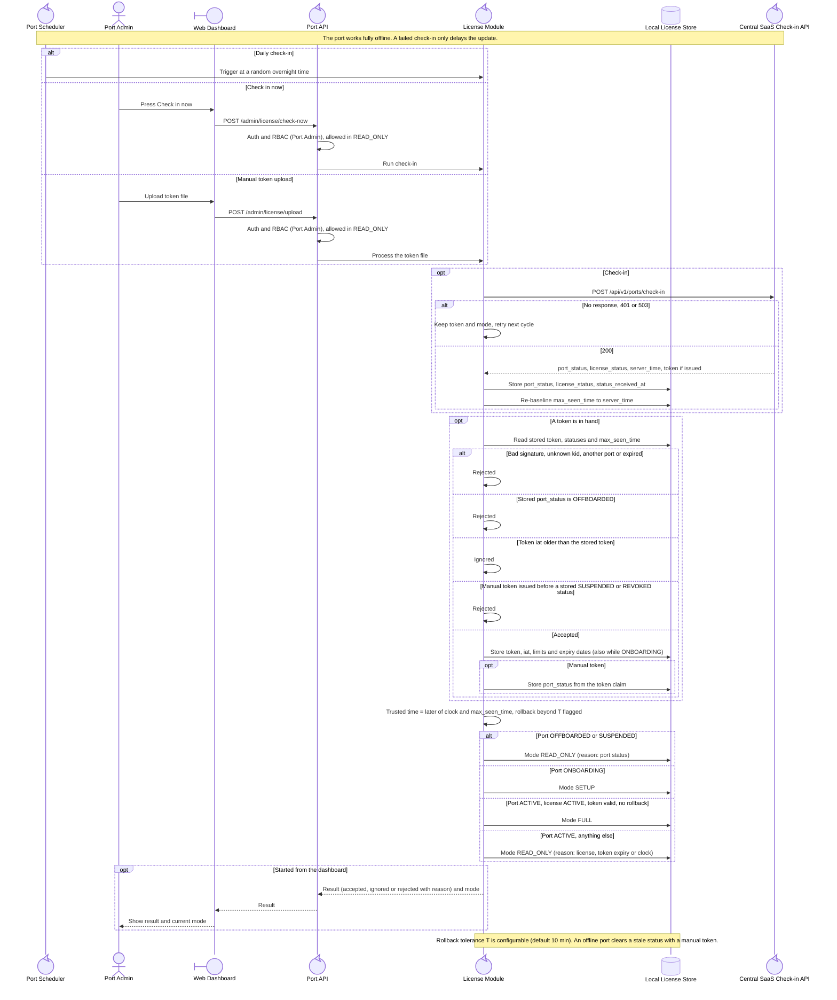

<!-- Generated from docs/reference/uml/ATLANTECH_Sequence_Diagrams.md lines 675-749 by build-index.mjs. Do not edit: edit the source and rebuild. -->
### 1.13 Port license check-in and token upload

