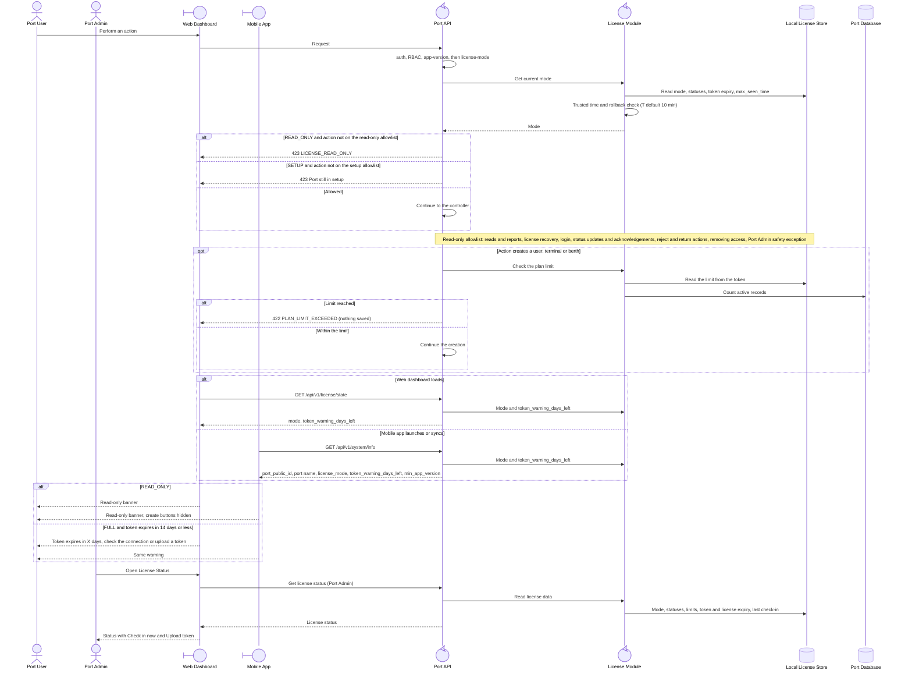

<!-- Generated from docs/reference/uml/ATLANTECH_Sequence_Diagrams.md lines 751-814 by build-index.mjs. Do not edit: edit the source and rebuild. -->
### 1.14 Read-only enforcement, limits and license status

