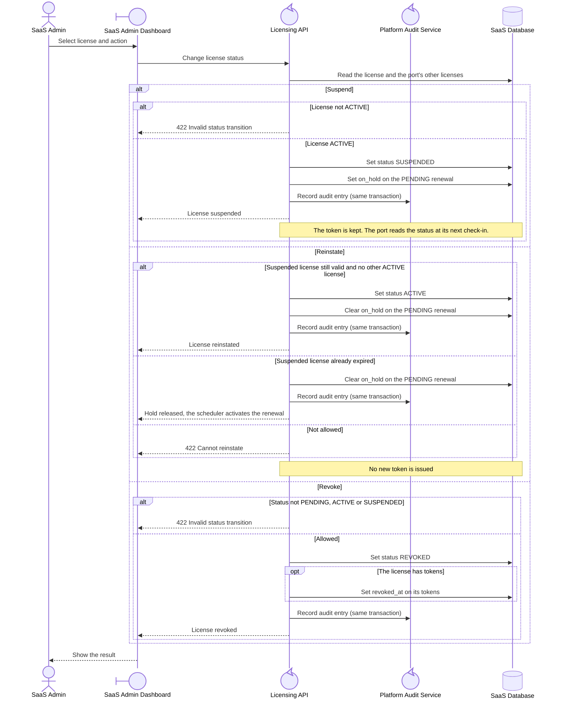

<!-- Generated from docs/reference/uml/ATLANTECH_Sequence_Diagrams.md lines 406-460 by build-index.mjs. Do not edit: edit the source and rebuild. -->
### 1.8 Suspend, reinstate and revoke a license

