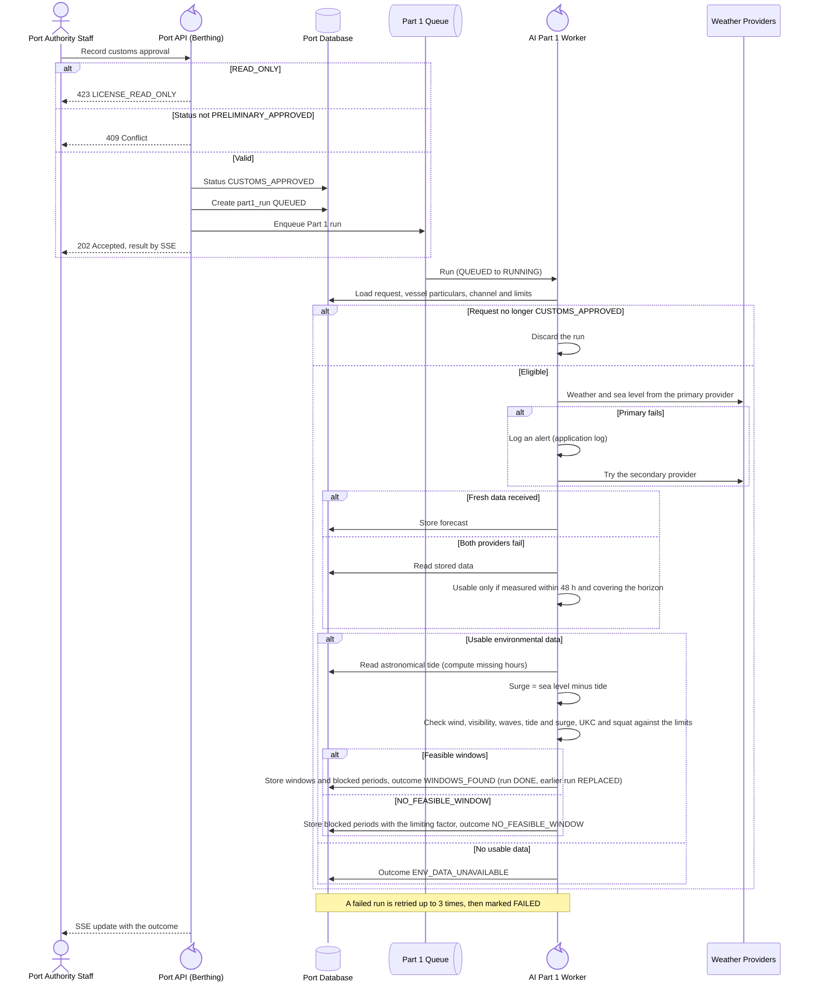

<!-- Generated from docs/reference/uml/ATLANTECH_Sequence_Diagrams.md lines 1361-1416 by build-index.mjs. Do not edit: edit the source and rebuild. -->
### 2.10 Customs approval and entry-window assessment

