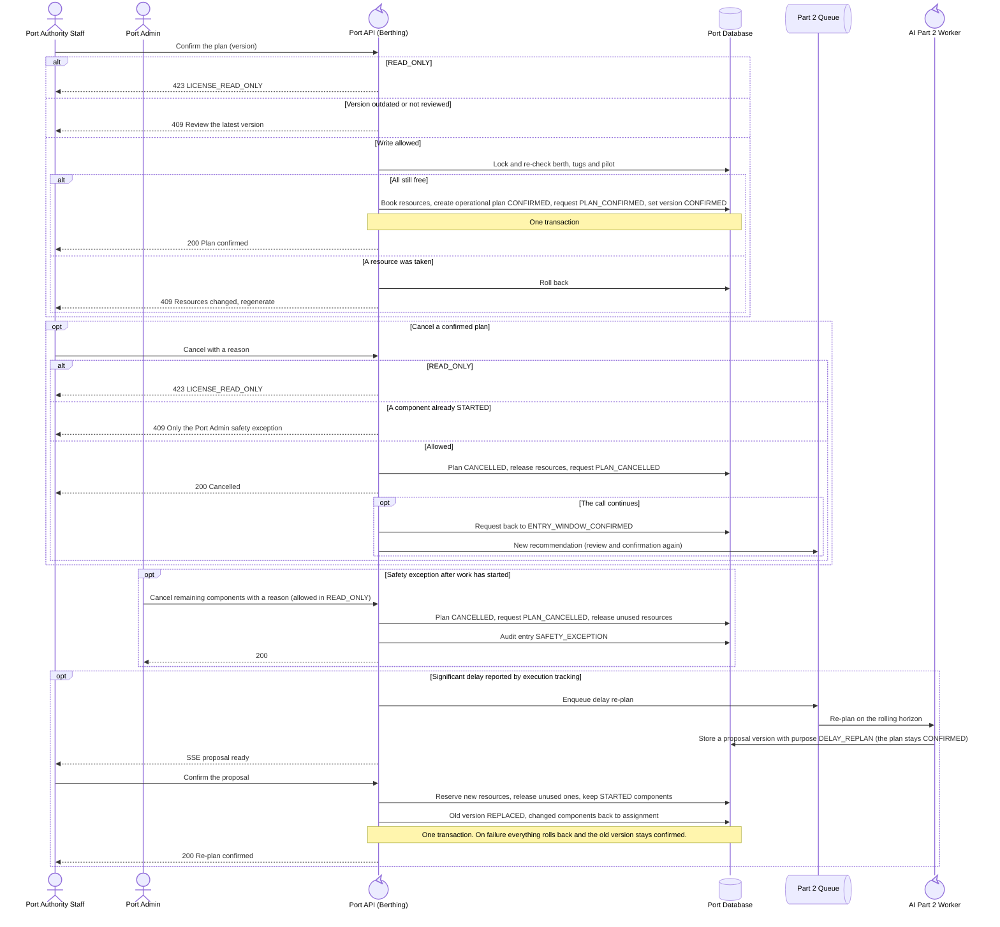

<!-- Generated from docs/reference/uml/ATLANTECH_Sequence_Diagrams.md lines 1598-1660 by build-index.mjs. Do not edit: edit the source and rebuild. -->
### 2.14 Plan confirmation, cancellation and delay re-plan

