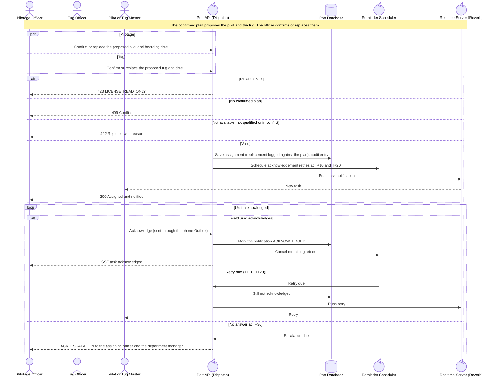

<!-- Generated from docs/reference/uml/ATLANTECH_Sequence_Diagrams.md lines 1662-1711 by build-index.mjs. Do not edit: edit the source and rebuild. -->
### 2.15 Dispatch, notifications and acknowledgement

