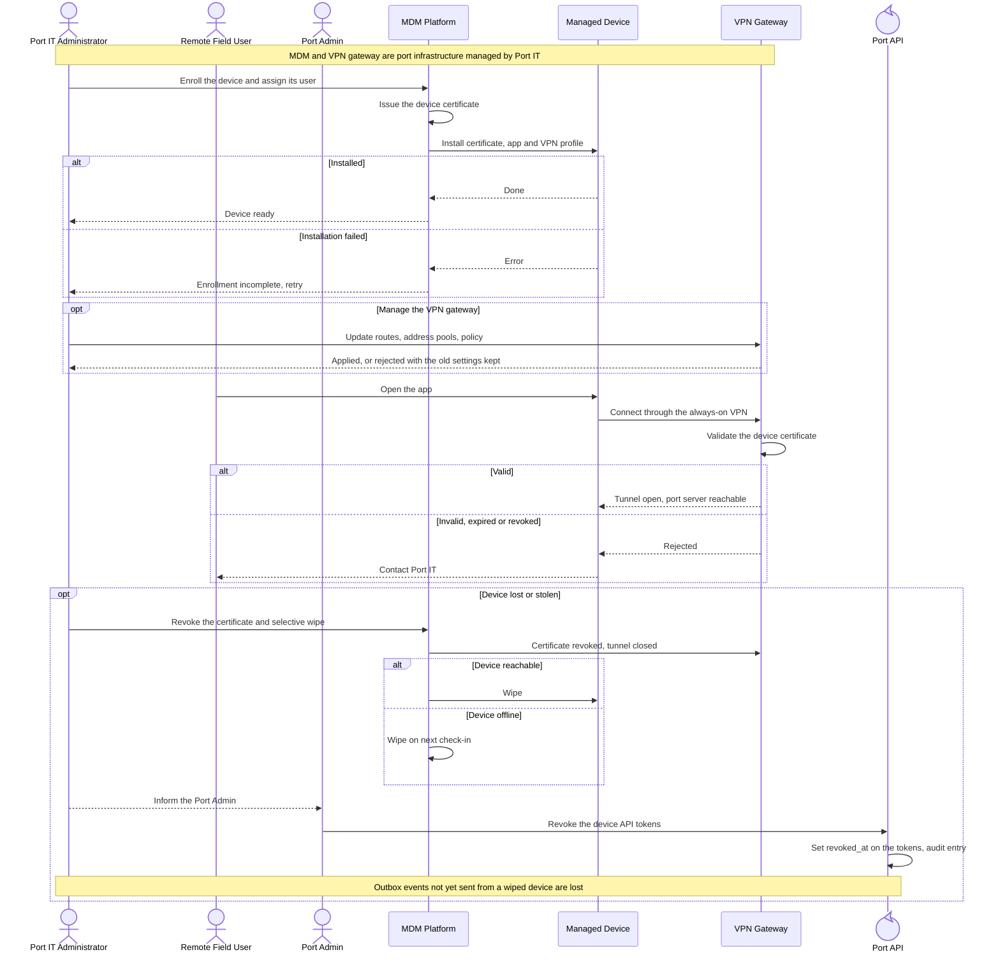

<!-- Generated from docs/reference/uml/ATLANTECH_Sequence_Diagrams.md lines 1763-1816 by build-index.mjs. Do not edit: edit the source and rebuild. -->
### 2.17 Device enrollment, VPN and lost devices

