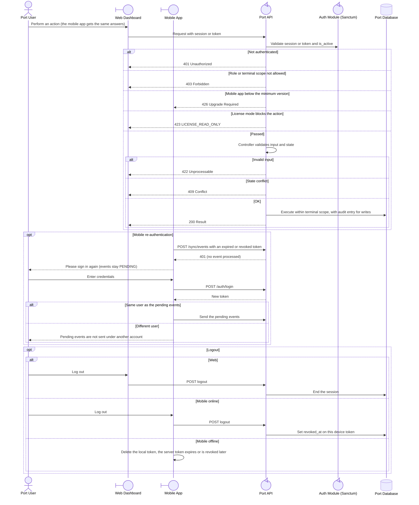

<!-- Generated from docs/reference/uml/ATLANTECH_Sequence_Diagrams.md lines 882-943 by build-index.mjs. Do not edit: edit the source and rebuild. -->
### 2.2 Request checks, re-authentication and logout

