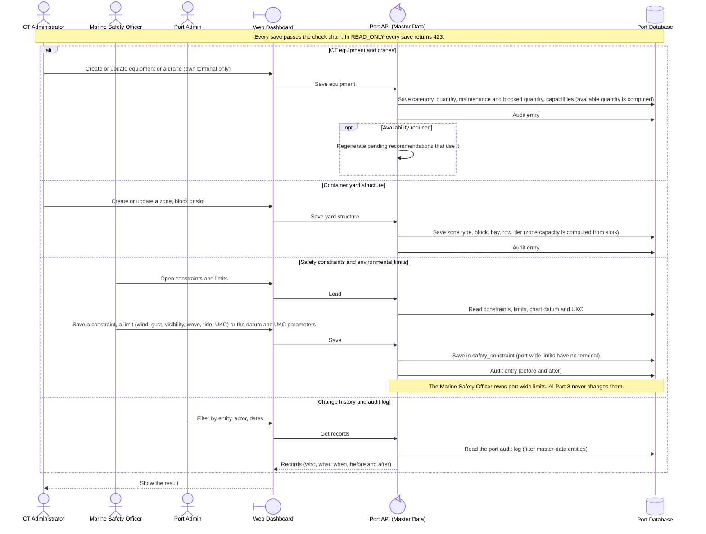

<!-- Generated from docs/reference/uml/ATLANTECH_Sequence_Diagrams.md lines 1127-1173 by build-index.mjs. Do not edit: edit the source and rebuild. -->
### 2.6 Terminal equipment, yard, safety limits and audit

