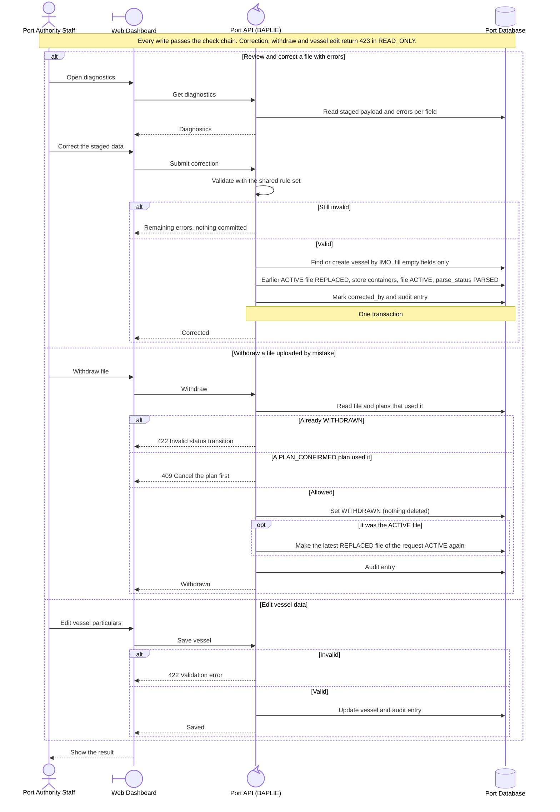

<!-- Generated from docs/reference/uml/ATLANTECH_Sequence_Diagrams.md lines 1236-1294 by build-index.mjs. Do not edit: edit the source and rebuild. -->
### 2.8 BAPLIE correction, withdraw and vessel data

