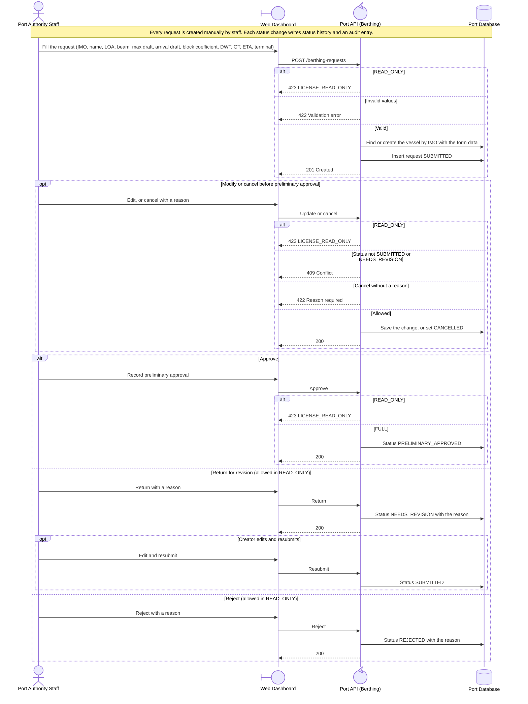

<!-- Generated from docs/reference/uml/ATLANTECH_Sequence_Diagrams.md lines 1296-1359 by build-index.mjs. Do not edit: edit the source and rebuild. -->
### 2.9 Berthing request: create, change and review

