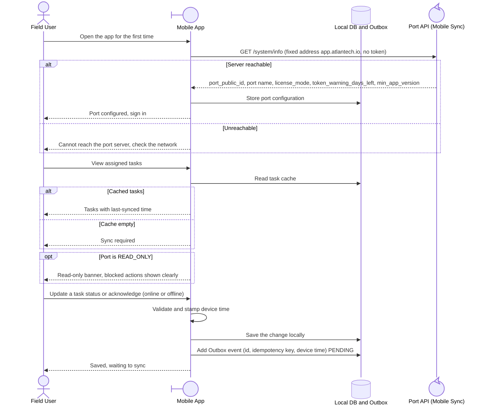

<!-- Generated from docs/reference/uml/ATLANTECH_Sequence_Diagrams.md lines 1820-1856 by build-index.mjs. Do not edit: edit the source and rebuild. -->
### 3.1 Mobile first launch and offline work

