<!-- Generated from docs/reference/uml/ATLANTECH_Sequence_Diagrams.md lines 1962-2002 by build-index.mjs. Do not edit: edit the source and rebuild. -->
### 3.4 Model evaluation and guarded retraining

```mermaid
sequenceDiagram
    actor PA as Port Admin
    participant SCH@{ "type": "control" } as Part 3 Scheduler
    participant P3@{ "type": "control" } as AI Part 3 Worker
    participant DB@{ "type": "database" } as Port Database
    participant API@{ "type": "control" } as Port API

    Note over SCH,DB: Runs on a schedule. Only trusted events are used. Part 3 never changes safety limits.

    SCH->>P3: Periodic evaluation
    P3->>DB: Load outcomes (plan vs actual, deviations, overrides, waiting times)
    P3->>P3: Compute MAE, override rate, waiting time, window accuracy
    P3->>DB: Store evaluation
    P3->>P3: Drift check on service time, demand and delay-risk models
    alt Drift above threshold
        P3->>DB: Drift alert (DRIFT_ALERT notification), audit entry
        API-->>PA: SSE drift alert
    else Healthy
        P3->>DB: Store drift measurement (is_drifted false)
    end
    P3->>DB: Store forecast bias correction (new version, provider data untouched)

    SCH->>P3: Periodic retraining
    P3->>DB: Load trusted training data
    alt Not enough data
        P3->>DB: Retraining skipped, current model stays
    else Enough data
        P3->>P3: Train a candidate on a time-based split
        P3->>P3: Compare with the current model on MAE and override rate
        alt Candidate not worse on both
            P3->>DB: Deploy candidate, keep the previous model for rollback, audit entry
            API-->>PA: SSE new model deployed with its metrics
        else Candidate worse
            P3->>DB: Candidate flagged, current model stays, audit entry
            API-->>PA: SSE candidate flagged for review
        end
    end
```

