<!-- Generated from docs/reference/uml/ATLANTECH_Use_Case_Diagrams.md lines 3-258 by build-index.mjs. Do not edit: edit the source and rebuild. -->
## Diagram 1: Central SaaS, Licensing and Billing

```mermaid
---
config:
  layout: elk
  theme: base
  fontFamily: Inter, Arial, sans-serif
  elk:
    nodePlacementStrategy: BRANDES_KOEPF
    mergeEdges: false
    considerModelOrder: NODES_AND_EDGES
    forceNodeModelOrder: true
  flowchart:
    padding: 18
  themeVariables:
    fontFamily: '"Inter", "Arial", sans-serif'
    fontSize: 16px
    primaryColor: '#FFFFFF'
    primaryBorderColor: '#407E8C'
    primaryTextColor: '#083A4F'
    lineColor: '#083A4F'
    clusterBkg: '#F7F5F2'
    clusterBorder: '#A58D66'
    edgeLabelBackground: '#FFFFFF'
    titleColor: '#083A4F'
---
flowchart LR

  subgraph G_P_ADM[" "]
    direction LR
    SA_P_ADM@{ img: "data:image/svg+xml;base64,PHN2ZyB4bWxucz0naHR0cDovL3d3dy53My5vcmcvMjAwMC9zdmcnIHdpZHRoPSc0MCcgaGVpZ2h0PSc2NCcgdmlld0JveD0nMCAwIDQwIDY0Jz48ZyBmaWxsPSdub25lJyBzdHJva2U9JyMwODNBNEYnIHN0cm9rZS13aWR0aD0nMi42JyBzdHJva2UtbGluZWNhcD0ncm91bmQnIHN0cm9rZS1saW5lam9pbj0ncm91bmQnPjxjaXJjbGUgY3g9JzIwJyBjeT0nOScgcj0nNycvPjxwYXRoIGQ9J00yMCAxNnYyNE01IDI2aDMwTTIwIDQwTDggNjBNMjAgNDBsMTIgMjAnLz48L2c+PC9zdmc+", label: "SaaS Admin", pos: "b", w: 40, h: 64, constraint: "on" }
    subgraph P_ADM["Platform Administration"]
      direction TB
      U001(["Authenticate SaaS Admin with Email OTP"])
      U002(["Manage SaaS Admin Accounts"])
      U003(["Manage Plan Parameters"])
      U004(["Manage Governorate List"])
      U005(["View Platform Audit Log"])
      U006(["Record Platform Audit Entry"])
      U007(["Monitor Port Fleet and License Status"])
    end
  end
  subgraph G_P_REG[" "]
    direction LR
    SA_P_REG@{ img: "data:image/svg+xml;base64,PHN2ZyB4bWxucz0naHR0cDovL3d3dy53My5vcmcvMjAwMC9zdmcnIHdpZHRoPSc0MCcgaGVpZ2h0PSc2NCcgdmlld0JveD0nMCAwIDQwIDY0Jz48ZyBmaWxsPSdub25lJyBzdHJva2U9JyMwODNBNEYnIHN0cm9rZS13aWR0aD0nMi42JyBzdHJva2UtbGluZWNhcD0ncm91bmQnIHN0cm9rZS1saW5lam9pbj0ncm91bmQnPjxjaXJjbGUgY3g9JzIwJyBjeT0nOScgcj0nNycvPjxwYXRoIGQ9J00yMCAxNnYyNE01IDI2aDMwTTIwIDQwTDggNjBNMjAgNDBsMTIgMjAnLz48L2c+PC9zdmc+", label: "SaaS Admin", pos: "b", w: 40, h: 64, constraint: "on" }
    subgraph P_REG["Port Registry and Lifecycle"]
      direction TB
      U008(["Register Port Deployment"])
      U009(["Update Registry Record"])
      U010(["Issue Port API Credential"])
      U011(["Rotate Port API Credential"])
      U017(["Activate or Reinstate Port"])
      U018(["Suspend Port"])
      U019(["Offboard Port"])
    end
  end
  subgraph G_P_PROV[" "]
    direction LR
    SE_P_PROV@{ img: "data:image/svg+xml;base64,PHN2ZyB4bWxucz0naHR0cDovL3d3dy53My5vcmcvMjAwMC9zdmcnIHdpZHRoPSc0MCcgaGVpZ2h0PSc2NCcgdmlld0JveD0nMCAwIDQwIDY0Jz48ZyBmaWxsPSdub25lJyBzdHJva2U9JyMwODNBNEYnIHN0cm9rZS13aWR0aD0nMi42JyBzdHJva2UtbGluZWNhcD0ncm91bmQnIHN0cm9rZS1saW5lam9pbj0ncm91bmQnPjxjaXJjbGUgY3g9JzIwJyBjeT0nOScgcj0nNycvPjxwYXRoIGQ9J00yMCAxNnYyNE01IDI2aDMwTTIwIDQwTDggNjBNMjAgNDBsMTIgMjAnLz48L2c+PC9zdmc+", label: "Support Engineer", pos: "b", w: 40, h: 64, constraint: "on" }
    PIT_P_PROV@{ img: "data:image/svg+xml;base64,PHN2ZyB4bWxucz0naHR0cDovL3d3dy53My5vcmcvMjAwMC9zdmcnIHdpZHRoPSc0MCcgaGVpZ2h0PSc2NCcgdmlld0JveD0nMCAwIDQwIDY0Jz48ZyBmaWxsPSdub25lJyBzdHJva2U9JyMwODNBNEYnIHN0cm9rZS13aWR0aD0nMi42JyBzdHJva2UtbGluZWNhcD0ncm91bmQnIHN0cm9rZS1saW5lam9pbj0ncm91bmQnPjxjaXJjbGUgY3g9JzIwJyBjeT0nOScgcj0nNycvPjxwYXRoIGQ9J00yMCAxNnYyNE01IDI2aDMwTTIwIDQwTDggNjBNMjAgNDBsMTIgMjAnLz48L2c+PC9zdmc+", label: "Port IT Administrator", pos: "b", w: 40, h: 64, constraint: "on" }
    PAD_P_PROV@{ img: "data:image/svg+xml;base64,PHN2ZyB4bWxucz0naHR0cDovL3d3dy53My5vcmcvMjAwMC9zdmcnIHdpZHRoPSc0MCcgaGVpZ2h0PSc2NCcgdmlld0JveD0nMCAwIDQwIDY0Jz48ZyBmaWxsPSdub25lJyBzdHJva2U9JyMwODNBNEYnIHN0cm9rZS13aWR0aD0nMi42JyBzdHJva2UtbGluZWNhcD0ncm91bmQnIHN0cm9rZS1saW5lam9pbj0ncm91bmQnPjxjaXJjbGUgY3g9JzIwJyBjeT0nOScgcj0nNycvPjxwYXRoIGQ9J00yMCAxNnYyNE01IDI2aDMwTTIwIDQwTDggNjBNMjAgNDBsMTIgMjAnLz48L2c+PC9zdmc+", label: "Port Admin", pos: "b", w: 40, h: 64, constraint: "on" }
    subgraph P_PROV["Provisioning and Certificates"]
      direction TB
      U012(["Provision Port Server with Signed Build"])
      U139(["Deploy Build and Verify Signature"])
      U015(["Bootstrap Port Instance"])
      U016(["Install Initial License"])
      U138(["Install Port TLS Certificate"])
      U013(["Generate Key and CSR"])
      U014(["Sign Port TLS Certificate with Root CA"])
      U020(["Renew Port TLS Certificate"])
    end
  end
  subgraph G_P_SUP[" "]
    direction LR
    SE_P_SUP@{ img: "data:image/svg+xml;base64,PHN2ZyB4bWxucz0naHR0cDovL3d3dy53My5vcmcvMjAwMC9zdmcnIHdpZHRoPSc0MCcgaGVpZ2h0PSc2NCcgdmlld0JveD0nMCAwIDQwIDY0Jz48ZyBmaWxsPSdub25lJyBzdHJva2U9JyMwODNBNEYnIHN0cm9rZS13aWR0aD0nMi42JyBzdHJva2UtbGluZWNhcD0ncm91bmQnIHN0cm9rZS1saW5lam9pbj0ncm91bmQnPjxjaXJjbGUgY3g9JzIwJyBjeT0nOScgcj0nNycvPjxwYXRoIGQ9J00yMCAxNnYyNE01IDI2aDMwTTIwIDQwTDggNjBNMjAgNDBsMTIgMjAnLz48L2c+PC9zdmc+", label: "Support Engineer", pos: "b", w: 40, h: 64, constraint: "on" }
    PIT_P_SUP@{ img: "data:image/svg+xml;base64,PHN2ZyB4bWxucz0naHR0cDovL3d3dy53My5vcmcvMjAwMC9zdmcnIHdpZHRoPSc0MCcgaGVpZ2h0PSc2NCcgdmlld0JveD0nMCAwIDQwIDY0Jz48ZyBmaWxsPSdub25lJyBzdHJva2U9JyMwODNBNEYnIHN0cm9rZS13aWR0aD0nMi42JyBzdHJva2UtbGluZWNhcD0ncm91bmQnIHN0cm9rZS1saW5lam9pbj0ncm91bmQnPjxjaXJjbGUgY3g9JzIwJyBjeT0nOScgcj0nNycvPjxwYXRoIGQ9J00yMCAxNnYyNE01IDI2aDMwTTIwIDQwTDggNjBNMjAgNDBsMTIgMjAnLz48L2c+PC9zdmc+", label: "Port IT Administrator", pos: "b", w: 40, h: 64, constraint: "on" }
    VPN_P_SUP@{ img: "data:image/svg+xml;base64,PHN2ZyB4bWxucz0naHR0cDovL3d3dy53My5vcmcvMjAwMC9zdmcnIHdpZHRoPSc0MCcgaGVpZ2h0PSc2NCcgdmlld0JveD0nMCAwIDQwIDY0Jz48ZyBmaWxsPSdub25lJyBzdHJva2U9JyM0MDdFOEMnIHN0cm9rZS13aWR0aD0nMi42JyBzdHJva2UtbGluZWNhcD0ncm91bmQnIHN0cm9rZS1saW5lam9pbj0ncm91bmQnPjxjaXJjbGUgY3g9JzIwJyBjeT0nOScgcj0nNycvPjxwYXRoIGQ9J00yMCAxNnYyNE01IDI2aDMwTTIwIDQwTDggNjBNMjAgNDBsMTIgMjAnLz48L2c+PC9zdmc+", label: "VPN Gateway", pos: "b", w: 40, h: 64, constraint: "on" }
    subgraph P_SUP["Onboarding and Support Access"]
      direction TB
      U141(["Open Onboarding Session"])
      U142(["Perform Remote Install or Support Session"])
      U143(["Close Session at Activation or Expiry"])
      U144(["Audit Session"])
    end
  end
  subgraph G_P_LIC[" "]
    direction LR
    SA_P_LIC@{ img: "data:image/svg+xml;base64,PHN2ZyB4bWxucz0naHR0cDovL3d3dy53My5vcmcvMjAwMC9zdmcnIHdpZHRoPSc0MCcgaGVpZ2h0PSc2NCcgdmlld0JveD0nMCAwIDQwIDY0Jz48ZyBmaWxsPSdub25lJyBzdHJva2U9JyMwODNBNEYnIHN0cm9rZS13aWR0aD0nMi42JyBzdHJva2UtbGluZWNhcD0ncm91bmQnIHN0cm9rZS1saW5lam9pbj0ncm91bmQnPjxjaXJjbGUgY3g9JzIwJyBjeT0nOScgcj0nNycvPjxwYXRoIGQ9J00yMCAxNnYyNE01IDI2aDMwTTIwIDQwTDggNjBNMjAgNDBsMTIgMjAnLz48L2c+PC9zdmc+", label: "SaaS Admin", pos: "b", w: 40, h: 64, constraint: "on" }
    SCH_P_LIC@{ img: "data:image/svg+xml;base64,PHN2ZyB4bWxucz0naHR0cDovL3d3dy53My5vcmcvMjAwMC9zdmcnIHdpZHRoPSc0MCcgaGVpZ2h0PSc2NCcgdmlld0JveD0nMCAwIDQwIDY0Jz48ZyBmaWxsPSdub25lJyBzdHJva2U9JyM0MDdFOEMnIHN0cm9rZS13aWR0aD0nMi42JyBzdHJva2UtbGluZWNhcD0ncm91bmQnIHN0cm9rZS1saW5lam9pbj0ncm91bmQnPjxjaXJjbGUgY3g9JzIwJyBjeT0nOScgcj0nNycvPjxwYXRoIGQ9J00yMCAxNnYyNE01IDI2aDMwTTIwIDQwTDggNjBNMjAgNDBsMTIgMjAnLz48L2c+PC9zdmc+", label: "Scheduler", pos: "b", w: 40, h: 64, constraint: "on" }
    KMS_P_LIC@{ img: "data:image/svg+xml;base64,PHN2ZyB4bWxucz0naHR0cDovL3d3dy53My5vcmcvMjAwMC9zdmcnIHdpZHRoPSc0MCcgaGVpZ2h0PSc2NCcgdmlld0JveD0nMCAwIDQwIDY0Jz48ZyBmaWxsPSdub25lJyBzdHJva2U9JyM0MDdFOEMnIHN0cm9rZS13aWR0aD0nMi42JyBzdHJva2UtbGluZWNhcD0ncm91bmQnIHN0cm9rZS1saW5lam9pbj0ncm91bmQnPjxjaXJjbGUgY3g9JzIwJyBjeT0nOScgcj0nNycvPjxwYXRoIGQ9J00yMCAxNnYyNE01IDI2aDMwTTIwIDQwTDggNjBNMjAgNDBsMTIgMjAnLz48L2c+PC9zdmc+", label: "KMS / License Signer", pos: "b", w: 40, h: 64, constraint: "on" }
    PSV_P_LIC@{ img: "data:image/svg+xml;base64,PHN2ZyB4bWxucz0naHR0cDovL3d3dy53My5vcmcvMjAwMC9zdmcnIHdpZHRoPSc0MCcgaGVpZ2h0PSc2NCcgdmlld0JveD0nMCAwIDQwIDY0Jz48ZyBmaWxsPSdub25lJyBzdHJva2U9JyM0MDdFOEMnIHN0cm9rZS13aWR0aD0nMi42JyBzdHJva2UtbGluZWNhcD0ncm91bmQnIHN0cm9rZS1saW5lam9pbj0ncm91bmQnPjxjaXJjbGUgY3g9JzIwJyBjeT0nOScgcj0nNycvPjxwYXRoIGQ9J00yMCAxNnYyNE01IDI2aDMwTTIwIDQwTDggNjBNMjAgNDBsMTIgMjAnLz48L2c+PC9zdmc+", label: "Port Check-in Client", pos: "b", w: 40, h: 64, constraint: "on" }
    subgraph P_LIC["License Management"]
      direction TB
      U021(["Issue License"])
      U022(["Renew License Early"])
      U028(["Enforce One Active License per Port"])
      U024(["Suspend License"])
      U025(["Reinstate License"])
      U026(["Revoke License"])
      U034(["Revoke License Token"])
      U027(["Update License Status by Date"])
      U029(["Sign and Issue License Token"])
      U030(["Generate Manual Token File"])
      U031(["Deliver Token File to Port"])
      U032(["Process Port Check-in"])
      U033(["Authenticate Check-in"])
      U035(["Rotate Signing Key"])
    end
  end
  subgraph G_P_BIL[" "]
    direction LR
    SA_P_BIL@{ img: "data:image/svg+xml;base64,PHN2ZyB4bWxucz0naHR0cDovL3d3dy53My5vcmcvMjAwMC9zdmcnIHdpZHRoPSc0MCcgaGVpZ2h0PSc2NCcgdmlld0JveD0nMCAwIDQwIDY0Jz48ZyBmaWxsPSdub25lJyBzdHJva2U9JyMwODNBNEYnIHN0cm9rZS13aWR0aD0nMi42JyBzdHJva2UtbGluZWNhcD0ncm91bmQnIHN0cm9rZS1saW5lam9pbj0ncm91bmQnPjxjaXJjbGUgY3g9JzIwJyBjeT0nOScgcj0nNycvPjxwYXRoIGQ9J00yMCAxNnYyNE01IDI2aDMwTTIwIDQwTDggNjBNMjAgNDBsMTIgMjAnLz48L2c+PC9zdmc+", label: "SaaS Admin", pos: "b", w: 40, h: 64, constraint: "on" }
    subgraph P_BIL["Billing"]
      direction TB
      U036(["Create Billing Transaction"])
      U037(["Record Payment Outcome"])
      U038(["Handle Failed Payment"])
      U039(["Refund Payment"])
      U040(["Cancel Billing Transaction"])
      U041(["Review Billing History"])
    end
  end
  subgraph G_P_PORT[" "]
    direction LR
    PAD_P_PORT@{ img: "data:image/svg+xml;base64,PHN2ZyB4bWxucz0naHR0cDovL3d3dy53My5vcmcvMjAwMC9zdmcnIHdpZHRoPSc0MCcgaGVpZ2h0PSc2NCcgdmlld0JveD0nMCAwIDQwIDY0Jz48ZyBmaWxsPSdub25lJyBzdHJva2U9JyMwODNBNEYnIHN0cm9rZS13aWR0aD0nMi42JyBzdHJva2UtbGluZWNhcD0ncm91bmQnIHN0cm9rZS1saW5lam9pbj0ncm91bmQnPjxjaXJjbGUgY3g9JzIwJyBjeT0nOScgcj0nNycvPjxwYXRoIGQ9J00yMCAxNnYyNE01IDI2aDMwTTIwIDQwTDggNjBNMjAgNDBsMTIgMjAnLz48L2c+PC9zdmc+", label: "Port Admin", pos: "b", w: 40, h: 64, constraint: "on" }
    PU_P_PORT@{ img: "data:image/svg+xml;base64,PHN2ZyB4bWxucz0naHR0cDovL3d3dy53My5vcmcvMjAwMC9zdmcnIHdpZHRoPSc0MCcgaGVpZ2h0PSc2NCcgdmlld0JveD0nMCAwIDQwIDY0Jz48ZyBmaWxsPSdub25lJyBzdHJva2U9JyMwODNBNEYnIHN0cm9rZS13aWR0aD0nMi42JyBzdHJva2UtbGluZWNhcD0ncm91bmQnIHN0cm9rZS1saW5lam9pbj0ncm91bmQnPjxjaXJjbGUgY3g9JzIwJyBjeT0nOScgcj0nNycvPjxwYXRoIGQ9J00yMCAxNnYyNE01IDI2aDMwTTIwIDQwTDggNjBNMjAgNDBsMTIgMjAnLz48L2c+PC9zdmc+", label: "Port User", pos: "b", w: 40, h: 64, constraint: "on" }
    SCH_P_PORT@{ img: "data:image/svg+xml;base64,PHN2ZyB4bWxucz0naHR0cDovL3d3dy53My5vcmcvMjAwMC9zdmcnIHdpZHRoPSc0MCcgaGVpZ2h0PSc2NCcgdmlld0JveD0nMCAwIDQwIDY0Jz48ZyBmaWxsPSdub25lJyBzdHJva2U9JyM0MDdFOEMnIHN0cm9rZS13aWR0aD0nMi42JyBzdHJva2UtbGluZWNhcD0ncm91bmQnIHN0cm9rZS1saW5lam9pbj0ncm91bmQnPjxjaXJjbGUgY3g9JzIwJyBjeT0nOScgcj0nNycvPjxwYXRoIGQ9J00yMCAxNnYyNE01IDI2aDMwTTIwIDQwTDggNjBNMjAgNDBsMTIgMjAnLz48L2c+PC9zdmc+", label: "Scheduler", pos: "b", w: 40, h: 64, constraint: "on" }
    SAAS_P_PORT@{ img: "data:image/svg+xml;base64,PHN2ZyB4bWxucz0naHR0cDovL3d3dy53My5vcmcvMjAwMC9zdmcnIHdpZHRoPSc0MCcgaGVpZ2h0PSc2NCcgdmlld0JveD0nMCAwIDQwIDY0Jz48ZyBmaWxsPSdub25lJyBzdHJva2U9JyM0MDdFOEMnIHN0cm9rZS13aWR0aD0nMi42JyBzdHJva2UtbGluZWNhcD0ncm91bmQnIHN0cm9rZS1saW5lam9pbj0ncm91bmQnPjxjaXJjbGUgY3g9JzIwJyBjeT0nOScgcj0nNycvPjxwYXRoIGQ9J00yMCAxNnYyNE01IDI2aDMwTTIwIDQwTDggNjBNMjAgNDBsMTIgMjAnLz48L2c+PC9zdmc+", label: "Central SaaS Check-in API", pos: "b", w: 40, h: 64, constraint: "on" }
    subgraph P_PORT["License on the Port Server"]
      direction TB
      U042(["Perform Daily Check-in"])
      U043(["Check In Now"])
      U049(["Upload Manual Token"])
      U044(["Validate License Token"])
      U051(["Detect Clock Rollback"])
      U045(["Determine License Mode"])
      U048(["Display Token Expiry or Read-Only Banner"])
      U050(["Restore Full Mode"])
      U052(["View License Status"])
      UCR(["Perform Restricted Write Action"])
      U046(["Enforce Read-Only Mode"])
      U047(["Enforce Plan Limits"])
    end
  end

  SA_P_ADM --- U001
  SA_P_ADM --- U002
  SA_P_ADM --- U003
  SA_P_ADM --- U004
  SA_P_ADM --- U005
  SA_P_ADM --- U007
  SA_P_REG --- U008
  SA_P_REG --- U009
  SA_P_REG --- U011
  SA_P_REG --- U017
  SA_P_REG --- U018
  SA_P_REG --- U019
  SA_P_LIC --- U021
  SA_P_LIC --- U022
  SA_P_LIC --- U024
  SA_P_LIC --- U025
  SA_P_LIC --- U026
  SA_P_LIC --- U030
  SA_P_LIC --- U031
  SA_P_LIC --- U034
  SA_P_LIC --- U035
  SA_P_BIL --- U036
  SA_P_BIL --- U037
  SA_P_BIL --- U038
  SA_P_BIL --- U039
  SA_P_BIL --- U040
  SA_P_BIL --- U041
  SE_P_PROV --- U012
  SE_P_PROV --- U014
  SE_P_PROV --- U015
  SE_P_SUP --- U142
  PIT_P_PROV --- U013
  PIT_P_PROV --- U020
  PIT_P_PROV --- U138
  PIT_P_PROV --- U139
  PIT_P_SUP --- U141
  PIT_P_SUP --- U143
  PIT_P_SUP --- U144
  U141 --- VPN_P_SUP
  U143 --- VPN_P_SUP
  PAD_P_PROV --- U016
  PAD_P_PORT --- U043
  PAD_P_PORT --- U049
  PAD_P_PORT --- U052
  PU_P_PORT --- U048
  PU_P_PORT --- UCR
  U027 --- SCH_P_LIC
  U042 --- SCH_P_PORT
  U029 --- KMS_P_LIC
  U035 --- KMS_P_LIC
  U032 --- PSV_P_LIC
  U042 --- SAAS_P_PORT

  U002 -. "«include»" .-> U006
  U003 -. "«include»" .-> U006
  U004 -. "«include»" .-> U006
  U008 -. "«include»" .-> U010
  U019 -. "«include»" .-> U026
  U012 -. "«include»" .-> U141
  U012 -. "«include»" .-> U139
  U015 -. "«include»" .-> U141
  U015 -. "«include»" .-> U138
  U015 -. "«include»" .-> U016
  U016 -. "«include»" .-> U044
  U020 -. "«include»" .-> U013
  U020 -. "«include»" .-> U014
  U142 -. "«include»" .-> U141
  U142 -. "«include»" .-> U144
  U143 -. "«extend»" .-> U141
  U022 -. "«include»" .-> U021
  U021 -. "«include»" .-> U028
  U025 -. "«extend»" .-> U024
  U034 -. "«extend»" .-> U026
  U030 -. "«include»" .-> U029
  U032 -. "«include»" .-> U033
  U032 -. "«include»" .-> U029
  U036 -. "«extend»" .-> U021
  U036 -. "«extend»" .-> U022
  U038 -. "«extend»" .-> U037
  U039 -. "«extend»" .-> U037
  U043 -. "«include»" .-> U042
  U042 -. "«include»" .-> U044
  U042 -. "«include»" .-> U045
  U049 -. "«include»" .-> U044
  U049 -. "«include»" .-> U045
  U051 -. "«extend»" .-> U044
  U048 -. "«extend»" .-> U045
  U050 -. "«extend»" .-> U042
  U050 -. "«extend»" .-> U049
  UCR -. "«include»" .-> U046
  UCR -. "«include»" .-> U047

  classDef uc fill:#FFFFFF,stroke:#407E8C,stroke-width:1.6px,color:#083A4F
  classDef ref fill:#E5E1DD,stroke:#A58D66,stroke-width:1.4px,stroke-dasharray:5 4,color:#083A4F
  classDef actor fill:none,stroke:none,color:#083A4F,font-weight:600
  classDef note fill:#FDFBF7,stroke:#A58D66,stroke-width:1.2px,color:#083A4F
  classDef sysactor fill:none,stroke:none,color:#407E8C,font-weight:600

  class U001,U002,U003,U004,U005,U006,U007,U008,U009,U010,U011,U017,U018,U019,U012,U139,U015,U016,U138,U013,U014,U020,U141,U142,U143,U144,U021,U022,U028,U024,U025,U026,U034,U027,U029,U030,U031,U032,U033,U035,U036,U037,U038,U039,U040,U041,U042,U043,U049,U044,U051,U045,U048,U050,U052,UCR,U046,U047 uc
  class SA_P_ADM,SA_P_REG,SA_P_LIC,SA_P_BIL,SE_P_PROV,SE_P_SUP,PIT_P_PROV,PIT_P_SUP,PAD_P_PROV,PAD_P_PORT,PU_P_PORT actor
  class VPN_P_SUP,SCH_P_LIC,SCH_P_PORT,KMS_P_LIC,PSV_P_LIC,SAAS_P_PORT sysactor
  style G_P_ADM fill:none,stroke:none
  style G_P_REG fill:none,stroke:none
  style G_P_PROV fill:none,stroke:none
  style G_P_SUP fill:none,stroke:none
  style G_P_LIC fill:none,stroke:none
  style G_P_BIL fill:none,stroke:none
  style G_P_PORT fill:none,stroke:none
```

