<!-- Generated from docs/reference/uml/ATLANTECH_Use_Case_Diagrams.md lines 556-709 by build-index.mjs. Do not edit: edit the source and rebuild. -->
## Diagram 3: Execution Feedback and Model Learning

```mermaid
---
config:
  layout: elk
  theme: base
  fontFamily: Inter, Arial, sans-serif
  elk:
    nodePlacementStrategy: BRANDES_KOEPF
    mergeEdges: false
    considerModelOrder: NODES_AND_EDGES
    forceNodeModelOrder: true
  flowchart:
    padding: 18
  themeVariables:
    fontFamily: '"Inter", "Arial", sans-serif'
    fontSize: 16px
    primaryColor: '#FFFFFF'
    primaryBorderColor: '#407E8C'
    primaryTextColor: '#083A4F'
    lineColor: '#083A4F'
    clusterBkg: '#F7F5F2'
    clusterBorder: '#A58D66'
    edgeLabelBackground: '#FFFFFF'
    titleColor: '#083A4F'
---
flowchart LR

  subgraph G_P_MOB[" "]
    direction LR
    MU_P_MOB@{ img: "data:image/svg+xml;base64,PHN2ZyB4bWxucz0naHR0cDovL3d3dy53My5vcmcvMjAwMC9zdmcnIHdpZHRoPSc0MCcgaGVpZ2h0PSc2NCcgdmlld0JveD0nMCAwIDQwIDY0Jz48ZyBmaWxsPSdub25lJyBzdHJva2U9JyMwODNBNEYnIHN0cm9rZS13aWR0aD0nMi42JyBzdHJva2UtbGluZWNhcD0ncm91bmQnIHN0cm9rZS1saW5lam9pbj0ncm91bmQnPjxjaXJjbGUgY3g9JzIwJyBjeT0nOScgcj0nNycvPjxwYXRoIGQ9J00yMCAxNnYyNE01IDI2aDMwTTIwIDQwTDggNjBNMjAgNDBsMTIgMjAnLz48L2c+PC9zdmc+", label: "Mobile User", pos: "b", w: 40, h: 64, constraint: "on" }
    subgraph P_MOB["Mobile App Basics"]
      direction TB
      U113(["Identify Port on First Launch"])
      U115(["View Assigned Tasks"])
      U123(["Show Read-Only Restrictions"])
      U116(["Work Offline with Local Data"])
    end
  end
  subgraph G_P_EXE[" "]
    direction LR
    RFU_P_EXE@{ img: "data:image/svg+xml;base64,PHN2ZyB4bWxucz0naHR0cDovL3d3dy53My5vcmcvMjAwMC9zdmcnIHdpZHRoPSc0MCcgaGVpZ2h0PSc2NCcgdmlld0JveD0nMCAwIDQwIDY0Jz48ZyBmaWxsPSdub25lJyBzdHJva2U9JyMwODNBNEYnIHN0cm9rZS13aWR0aD0nMi42JyBzdHJva2UtbGluZWNhcD0ncm91bmQnIHN0cm9rZS1saW5lam9pbj0ncm91bmQnPjxjaXJjbGUgY3g9JzIwJyBjeT0nOScgcj0nNycvPjxwYXRoIGQ9J00yMCAxNnYyNE01IDI2aDMwTTIwIDQwTDggNjBNMjAgNDBsMTIgMjAnLz48L2c+PC9zdmc+", label: "Remote Field User", pos: "b", w: 40, h: 64, constraint: "on" }
    OFU_P_EXE@{ img: "data:image/svg+xml;base64,PHN2ZyB4bWxucz0naHR0cDovL3d3dy53My5vcmcvMjAwMC9zdmcnIHdpZHRoPSc0MCcgaGVpZ2h0PSc2NCcgdmlld0JveD0nMCAwIDQwIDY0Jz48ZyBmaWxsPSdub25lJyBzdHJva2U9JyMwODNBNEYnIHN0cm9rZS13aWR0aD0nMi42JyBzdHJva2UtbGluZWNhcD0ncm91bmQnIHN0cm9rZS1saW5lam9pbj0ncm91bmQnPjxjaXJjbGUgY3g9JzIwJyBjeT0nOScgcj0nNycvPjxwYXRoIGQ9J00yMCAxNnYyNE01IDI2aDMwTTIwIDQwTDggNjBNMjAgNDBsMTIgMjAnLz48L2c+PC9zdmc+", label: "On-site Field User", pos: "b", w: 40, h: 64, constraint: "on" }
    subgraph P_EXE["Execution Tracking"]
      direction TB
      U100(["Update Actual Task Status"])
      U101(["Update Terminal Actual Status"])
      U117(["Queue Event in Outbox"])
      U102(["Detect and Record Deviation"])
      R096(["Acknowledge Notification (Diagram 2)"])
      R089(["Re-generate Recommendation or Delay Re-plan (Diagram 2)"])
    end
  end
  subgraph G_P_SYNC[" "]
    direction LR
    MU_P_SYNC@{ img: "data:image/svg+xml;base64,PHN2ZyB4bWxucz0naHR0cDovL3d3dy53My5vcmcvMjAwMC9zdmcnIHdpZHRoPSc0MCcgaGVpZ2h0PSc2NCcgdmlld0JveD0nMCAwIDQwIDY0Jz48ZyBmaWxsPSdub25lJyBzdHJva2U9JyMwODNBNEYnIHN0cm9rZS13aWR0aD0nMi42JyBzdHJva2UtbGluZWNhcD0ncm91bmQnIHN0cm9rZS1saW5lam9pbj0ncm91bmQnPjxjaXJjbGUgY3g9JzIwJyBjeT0nOScgcj0nNycvPjxwYXRoIGQ9J00yMCAxNnYyNE01IDI2aDMwTTIwIDQwTDggNjBNMjAgNDBsMTIgMjAnLz48L2c+PC9zdmc+", label: "Mobile User", pos: "b", w: 40, h: 64, constraint: "on" }
    SRV_P_SYNC@{ img: "data:image/svg+xml;base64,PHN2ZyB4bWxucz0naHR0cDovL3d3dy53My5vcmcvMjAwMC9zdmcnIHdpZHRoPSc0MCcgaGVpZ2h0PSc2NCcgdmlld0JveD0nMCAwIDQwIDY0Jz48ZyBmaWxsPSdub25lJyBzdHJva2U9JyM0MDdFOEMnIHN0cm9rZS13aWR0aD0nMi42JyBzdHJva2UtbGluZWNhcD0ncm91bmQnIHN0cm9rZS1saW5lam9pbj0ncm91bmQnPjxjaXJjbGUgY3g9JzIwJyBjeT0nOScgcj0nNycvPjxwYXRoIGQ9J00yMCAxNnYyNE01IDI2aDMwTTIwIDQwTDggNjBNMjAgNDBsMTIgMjAnLz48L2c+PC9zdmc+", label: "Port Server Sync Endpoint", pos: "b", w: 40, h: 64, constraint: "on" }
    subgraph P_SYNC["Offline Sync"]
      direction TB
      U118(["Synchronize Outbox"])
      U114(["Check Real Connectivity"])
      U121(["Retry Connectivity Check with Backoff"])
      U119(["Apply Event Idempotently"])
      U120(["Reject Invalid Event and Show Reason"])
      U122(["Flag Clock-skew-suspect Event"])
      R060(["Re-authenticate and Resume Outbox (Diagram 2)"])
      R061(["Enforce Minimum App Version (Diagram 2)"])
    end
  end
  subgraph G_P_AI[" "]
    direction LR
    PAS_P_AI@{ img: "data:image/svg+xml;base64,PHN2ZyB4bWxucz0naHR0cDovL3d3dy53My5vcmcvMjAwMC9zdmcnIHdpZHRoPSc0MCcgaGVpZ2h0PSc2NCcgdmlld0JveD0nMCAwIDQwIDY0Jz48ZyBmaWxsPSdub25lJyBzdHJva2U9JyMwODNBNEYnIHN0cm9rZS13aWR0aD0nMi42JyBzdHJva2UtbGluZWNhcD0ncm91bmQnIHN0cm9rZS1saW5lam9pbj0ncm91bmQnPjxjaXJjbGUgY3g9JzIwJyBjeT0nOScgcj0nNycvPjxwYXRoIGQ9J00yMCAxNnYyNE01IDI2aDMwTTIwIDQwTDggNjBNMjAgNDBsMTIgMjAnLz48L2c+PC9zdmc+", label: "Port Authority Staff", pos: "b", w: 40, h: 64, constraint: "on" }
    PAD_P_AI@{ img: "data:image/svg+xml;base64,PHN2ZyB4bWxucz0naHR0cDovL3d3dy53My5vcmcvMjAwMC9zdmcnIHdpZHRoPSc0MCcgaGVpZ2h0PSc2NCcgdmlld0JveD0nMCAwIDQwIDY0Jz48ZyBmaWxsPSdub25lJyBzdHJva2U9JyMwODNBNEYnIHN0cm9rZS13aWR0aD0nMi42JyBzdHJva2UtbGluZWNhcD0ncm91bmQnIHN0cm9rZS1saW5lam9pbj0ncm91bmQnPjxjaXJjbGUgY3g9JzIwJyBjeT0nOScgcj0nNycvPjxwYXRoIGQ9J00yMCAxNnYyNE01IDI2aDMwTTIwIDQwTDggNjBNMjAgNDBsMTIgMjAnLz48L2c+PC9zdmc+", label: "Port Admin", pos: "b", w: 40, h: 64, constraint: "on" }
    AI3_P_AI@{ img: "data:image/svg+xml;base64,PHN2ZyB4bWxucz0naHR0cDovL3d3dy53My5vcmcvMjAwMC9zdmcnIHdpZHRoPSc0MCcgaGVpZ2h0PSc2NCcgdmlld0JveD0nMCAwIDQwIDY0Jz48ZyBmaWxsPSdub25lJyBzdHJva2U9JyM0MDdFOEMnIHN0cm9rZS13aWR0aD0nMi42JyBzdHJva2UtbGluZWNhcD0ncm91bmQnIHN0cm9rZS1saW5lam9pbj0ncm91bmQnPjxjaXJjbGUgY3g9JzIwJyBjeT0nOScgcj0nNycvPjxwYXRoIGQ9J00yMCAxNnYyNE01IDI2aDMwTTIwIDQwTDggNjBNMjAgNDBsMTIgMjAnLz48L2c+PC9zdmc+", label: "AI Part 3 Engine", pos: "b", w: 40, h: 64, constraint: "on" }
    subgraph P_AI["Model Learning"]
      direction TB
      U103(["Browse Deviations"])
      U104(["Review Clock-skew-suspect Events"])
      U105(["Evaluate Outcomes, Drift and Forecast Bias"])
      U106(["Retrain and Conditionally Deploy Model"])
      U107(["Review Flagged Model Candidate"])
    end
  end
  subgraph G_P_RT[" "]
    direction LR
    MU_P_RT@{ img: "data:image/svg+xml;base64,PHN2ZyB4bWxucz0naHR0cDovL3d3dy53My5vcmcvMjAwMC9zdmcnIHdpZHRoPSc0MCcgaGVpZ2h0PSc2NCcgdmlld0JveD0nMCAwIDQwIDY0Jz48ZyBmaWxsPSdub25lJyBzdHJva2U9JyMwODNBNEYnIHN0cm9rZS13aWR0aD0nMi42JyBzdHJva2UtbGluZWNhcD0ncm91bmQnIHN0cm9rZS1saW5lam9pbj0ncm91bmQnPjxjaXJjbGUgY3g9JzIwJyBjeT0nOScgcj0nNycvPjxwYXRoIGQ9J00yMCAxNnYyNE01IDI2aDMwTTIwIDQwTDggNjBNMjAgNDBsMTIgMjAnLz48L2c+PC9zdmc+", label: "Mobile User", pos: "b", w: 40, h: 64, constraint: "on" }
    RFU_P_RT@{ img: "data:image/svg+xml;base64,PHN2ZyB4bWxucz0naHR0cDovL3d3dy53My5vcmcvMjAwMC9zdmcnIHdpZHRoPSc0MCcgaGVpZ2h0PSc2NCcgdmlld0JveD0nMCAwIDQwIDY0Jz48ZyBmaWxsPSdub25lJyBzdHJva2U9JyMwODNBNEYnIHN0cm9rZS13aWR0aD0nMi42JyBzdHJva2UtbGluZWNhcD0ncm91bmQnIHN0cm9rZS1saW5lam9pbj0ncm91bmQnPjxjaXJjbGUgY3g9JzIwJyBjeT0nOScgcj0nNycvPjxwYXRoIGQ9J00yMCAxNnYyNE01IDI2aDMwTTIwIDQwTDggNjBNMjAgNDBsMTIgMjAnLz48L2c+PC9zdmc+", label: "Remote Field User", pos: "b", w: 40, h: 64, constraint: "on" }
    OU_P_RT@{ img: "data:image/svg+xml;base64,PHN2ZyB4bWxucz0naHR0cDovL3d3dy53My5vcmcvMjAwMC9zdmcnIHdpZHRoPSc0MCcgaGVpZ2h0PSc2NCcgdmlld0JveD0nMCAwIDQwIDY0Jz48ZyBmaWxsPSdub25lJyBzdHJva2U9JyMwODNBNEYnIHN0cm9rZS13aWR0aD0nMi42JyBzdHJva2UtbGluZWNhcD0ncm91bmQnIHN0cm9rZS1saW5lam9pbj0ncm91bmQnPjxjaXJjbGUgY3g9JzIwJyBjeT0nOScgcj0nNycvPjxwYXRoIGQ9J00yMCAxNnYyNE01IDI2aDMwTTIwIDQwTDggNjBNMjAgNDBsMTIgMjAnLz48L2c+PC9zdmc+", label: "Office User", pos: "b", w: 40, h: 64, constraint: "on" }
    RV_P_RT@{ img: "data:image/svg+xml;base64,PHN2ZyB4bWxucz0naHR0cDovL3d3dy53My5vcmcvMjAwMC9zdmcnIHdpZHRoPSc0MCcgaGVpZ2h0PSc2NCcgdmlld0JveD0nMCAwIDQwIDY0Jz48ZyBmaWxsPSdub25lJyBzdHJva2U9JyM0MDdFOEMnIHN0cm9rZS13aWR0aD0nMi42JyBzdHJva2UtbGluZWNhcD0ncm91bmQnIHN0cm9rZS1saW5lam9pbj0ncm91bmQnPjxjaXJjbGUgY3g9JzIwJyBjeT0nOScgcj0nNycvPjxwYXRoIGQ9J00yMCAxNnYyNE01IDI2aDMwTTIwIDQwTDggNjBNMjAgNDBsMTIgMjAnLz48L2c+PC9zdmc+", label: "Realtime Server", pos: "b", w: 40, h: 64, constraint: "on" }
    subgraph P_RT["Realtime Updates"]
      direction TB
      U124(["Receive Realtime Update"])
      U125(["Reconnect and Catch Up"])
      U126(["Keep Realtime Alive in Background"])
      U127(["Receive Live Dashboard Updates"])
    end
  end

  MU_P_MOB --- U113
  MU_P_MOB --- U115
  MU_P_MOB --- U116
  MU_P_SYNC --- U118
  MU_P_RT --- U124
  RFU_P_EXE --- U100
  RFU_P_RT --- U126
  OFU_P_EXE --- U100
  OFU_P_EXE --- U101
  OU_P_RT --- U127
  PAS_P_AI --- U103
  PAS_P_AI --- U104
  PAD_P_AI --- U107
  U119 --- SRV_P_SYNC
  U124 --- RV_P_RT
  U127 --- RV_P_RT
  U105 --- AI3_P_AI
  U106 --- AI3_P_AI

  U123 -. "«extend»" .-> U115
  U117 -. "«extend»" .-> U100
  U117 -. "«extend»" .-> U101
  U117 -. "«extend»" .-> R096
  U102 -. "«extend»" .-> U100
  U102 -. "«extend»" .-> U101
  U102 -. "«trigger»" .-> R089
  U118 -. "«include»" .-> U119
  U118 -. "«include»" .-> U114
  U121 -. "«extend»" .-> U114
  U120 -. "«extend»" .-> U119
  U122 -. "«extend»" .-> U119
  R060 -. "«extend»" .-> U118
  R061 -. "«extend»" .-> U118
  U104 -. "«extend»" .-> U103
  U106 -. "«include»" .-> U105
  U107 -. "«extend»" .-> U106
  U125 -. "«extend»" .-> U124
  U126 -. "«extend»" .-> U124

  classDef uc fill:#FFFFFF,stroke:#407E8C,stroke-width:1.6px,color:#083A4F
  classDef ref fill:#E5E1DD,stroke:#A58D66,stroke-width:1.4px,stroke-dasharray:5 4,color:#083A4F
  classDef actor fill:none,stroke:none,color:#083A4F,font-weight:600
  classDef note fill:#FDFBF7,stroke:#A58D66,stroke-width:1.2px,color:#083A4F
  classDef sysactor fill:none,stroke:none,color:#407E8C,font-weight:600

  class U113,U115,U123,U116,U100,U101,U117,U102,U118,U114,U121,U119,U120,U122,U103,U104,U105,U106,U107,U124,U125,U126,U127 uc
  class R096,R089,R060,R061 ref
  class MU_P_MOB,MU_P_SYNC,MU_P_RT,RFU_P_EXE,RFU_P_RT,OFU_P_EXE,OU_P_RT,PAS_P_AI,PAD_P_AI actor
  class SRV_P_SYNC,RV_P_RT,AI3_P_AI sysactor
  style G_P_MOB fill:none,stroke:none
  style G_P_EXE fill:none,stroke:none
  style G_P_SYNC fill:none,stroke:none
  style G_P_AI fill:none,stroke:none
  style G_P_RT fill:none,stroke:none
```

