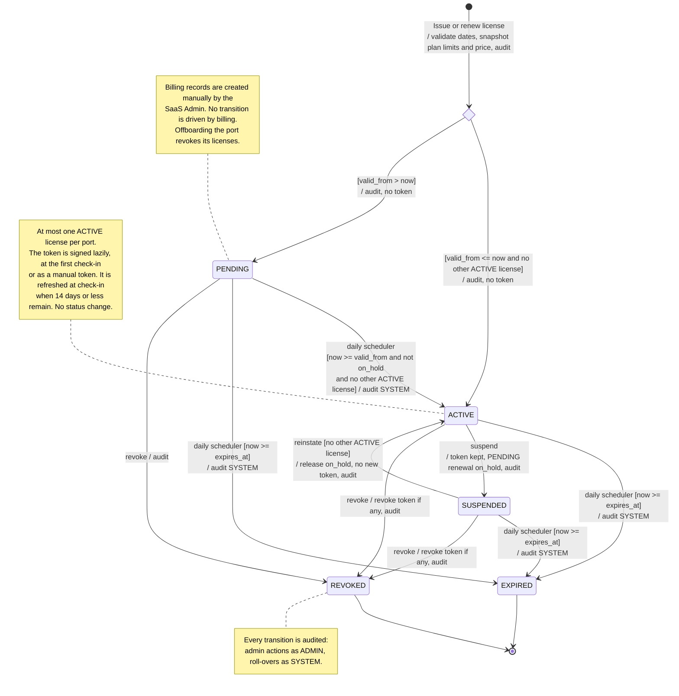
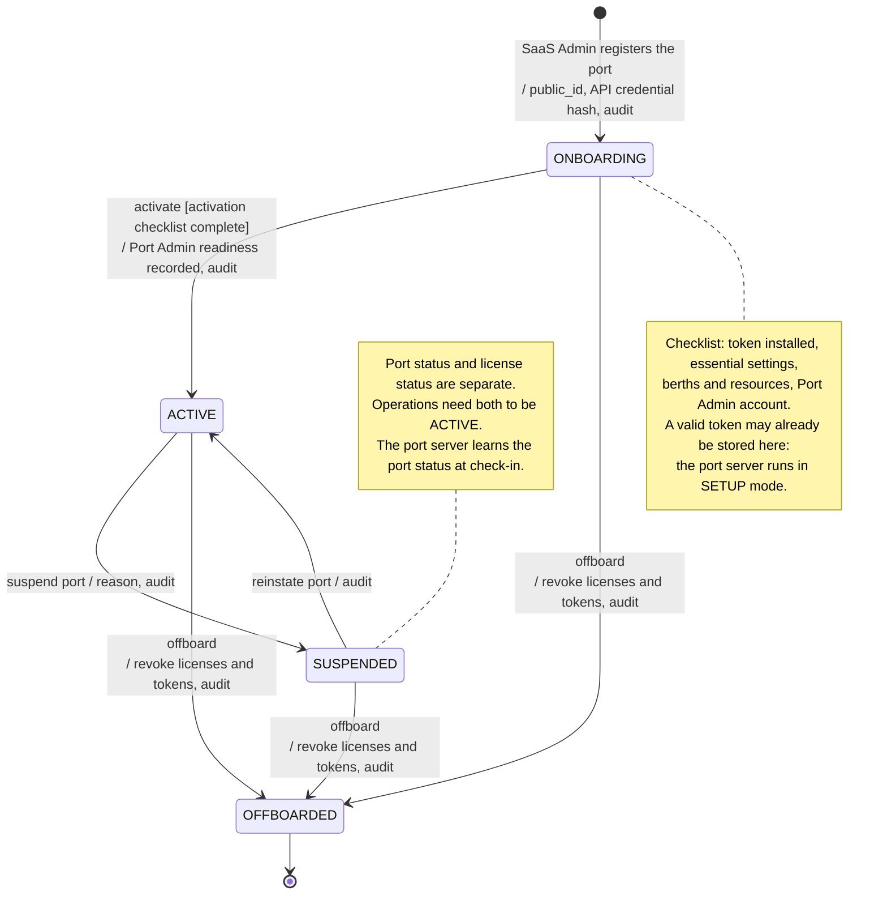
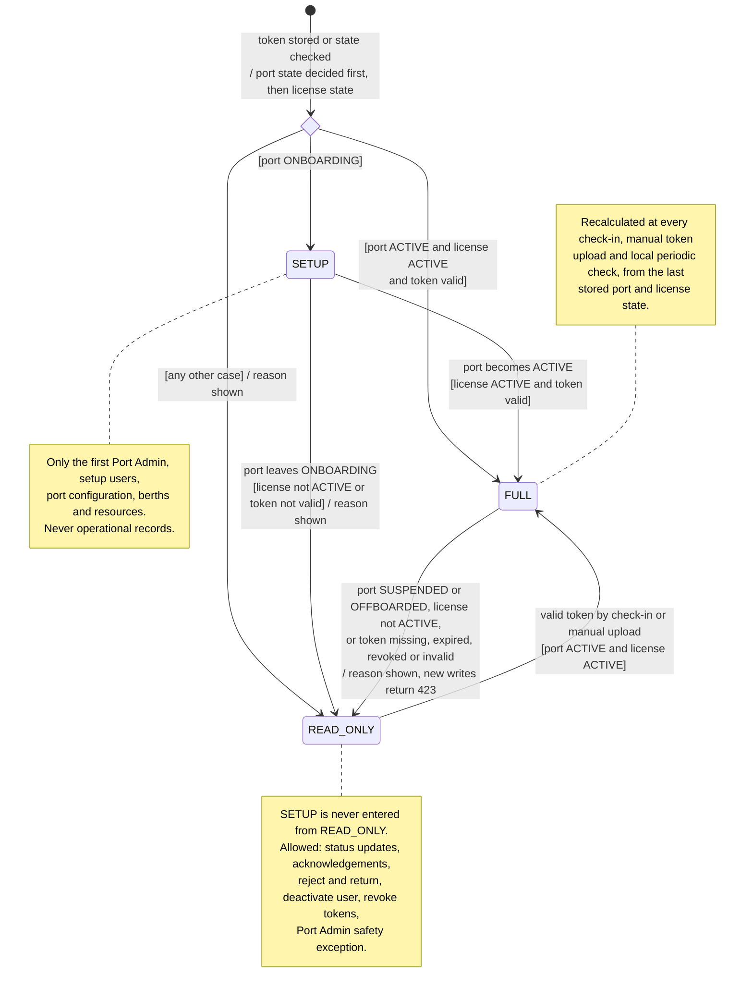
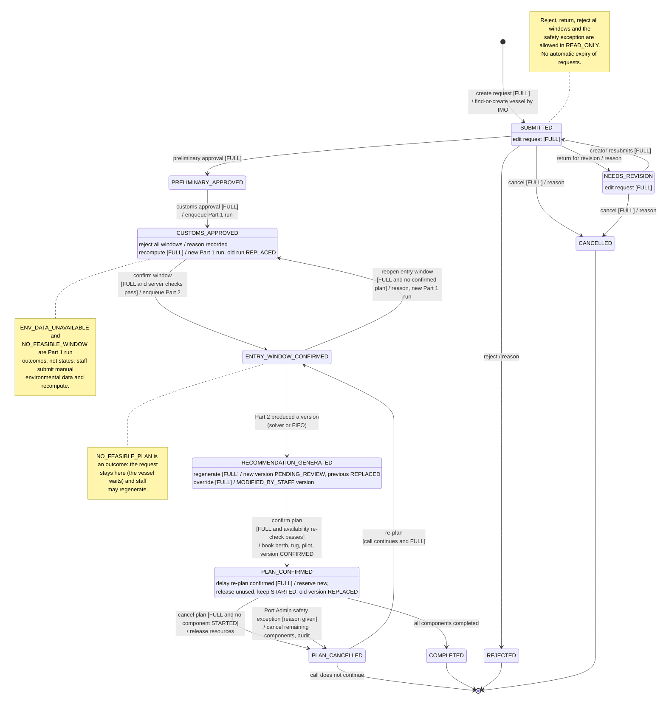
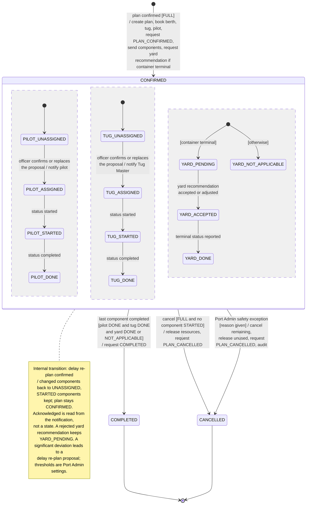
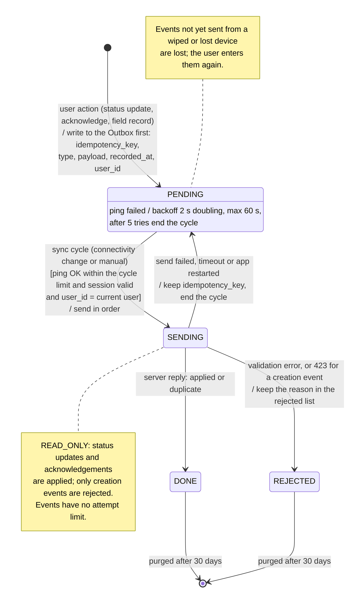

# ATLANTECH — State Diagrams

Mermaid code only, in three categories.

## Category 1 — Central SaaS, Licensing and Billing

### SM-1 — License (central SaaS)

### SM-2 — Port lifecycle (central SaaS)

### SM-3 — Port-side license mode

## Category 2 — Port Setup, Operations and Recommendation

### SM-4 — Berthing request

### SM-5 — Operational plan

## Category 3 — Execution Feedback and Model Learning

### SM-6 — Outbox event (mobile app)

