# ATLANTECH Use Case Diagrams

## Diagram 1: Central SaaS, Licensing and Billing

```mermaid
---
config:
  layout: elk
  theme: base
  fontFamily: Inter, Arial, sans-serif
  elk:
    nodePlacementStrategy: BRANDES_KOEPF
    mergeEdges: false
    considerModelOrder: NODES_AND_EDGES
    forceNodeModelOrder: true
  flowchart:
    padding: 18
  themeVariables:
    fontFamily: '"Inter", "Arial", sans-serif'
    fontSize: 16px
    primaryColor: '#FFFFFF'
    primaryBorderColor: '#407E8C'
    primaryTextColor: '#083A4F'
    lineColor: '#083A4F'
    clusterBkg: '#F7F5F2'
    clusterBorder: '#A58D66'
    edgeLabelBackground: '#FFFFFF'
    titleColor: '#083A4F'
---
flowchart LR

  subgraph G_P_ADM[" "]
    direction LR
    SA_P_ADM@{ img: "data:image/svg+xml;base64,PHN2ZyB4bWxucz0naHR0cDovL3d3dy53My5vcmcvMjAwMC9zdmcnIHdpZHRoPSc0MCcgaGVpZ2h0PSc2NCcgdmlld0JveD0nMCAwIDQwIDY0Jz48ZyBmaWxsPSdub25lJyBzdHJva2U9JyMwODNBNEYnIHN0cm9rZS13aWR0aD0nMi42JyBzdHJva2UtbGluZWNhcD0ncm91bmQnIHN0cm9rZS1saW5lam9pbj0ncm91bmQnPjxjaXJjbGUgY3g9JzIwJyBjeT0nOScgcj0nNycvPjxwYXRoIGQ9J00yMCAxNnYyNE01IDI2aDMwTTIwIDQwTDggNjBNMjAgNDBsMTIgMjAnLz48L2c+PC9zdmc+", label: "SaaS Admin", pos: "b", w: 40, h: 64, constraint: "on" }
    subgraph P_ADM["Platform Administration"]
      direction TB
      U001(["Authenticate SaaS Admin with Email OTP"])
      U002(["Manage SaaS Admin Accounts"])
      U003(["Manage Plan Parameters"])
      U004(["Manage Governorate List"])
      U005(["View Platform Audit Log"])
      U006(["Record Platform Audit Entry"])
      U007(["Monitor Port Fleet and License Status"])
    end
  end
  subgraph G_P_REG[" "]
    direction LR
    SA_P_REG@{ img: "data:image/svg+xml;base64,PHN2ZyB4bWxucz0naHR0cDovL3d3dy53My5vcmcvMjAwMC9zdmcnIHdpZHRoPSc0MCcgaGVpZ2h0PSc2NCcgdmlld0JveD0nMCAwIDQwIDY0Jz48ZyBmaWxsPSdub25lJyBzdHJva2U9JyMwODNBNEYnIHN0cm9rZS13aWR0aD0nMi42JyBzdHJva2UtbGluZWNhcD0ncm91bmQnIHN0cm9rZS1saW5lam9pbj0ncm91bmQnPjxjaXJjbGUgY3g9JzIwJyBjeT0nOScgcj0nNycvPjxwYXRoIGQ9J00yMCAxNnYyNE01IDI2aDMwTTIwIDQwTDggNjBNMjAgNDBsMTIgMjAnLz48L2c+PC9zdmc+", label: "SaaS Admin", pos: "b", w: 40, h: 64, constraint: "on" }
    subgraph P_REG["Port Registry and Lifecycle"]
      direction TB
      U008(["Register Port Deployment"])
      U009(["Update Registry Record"])
      U010(["Issue Port API Credential"])
      U011(["Rotate Port API Credential"])
      U017(["Activate or Reinstate Port"])
      U018(["Suspend Port"])
      U019(["Offboard Port"])
    end
  end
  subgraph G_P_PROV[" "]
    direction LR
    SE_P_PROV@{ img: "data:image/svg+xml;base64,PHN2ZyB4bWxucz0naHR0cDovL3d3dy53My5vcmcvMjAwMC9zdmcnIHdpZHRoPSc0MCcgaGVpZ2h0PSc2NCcgdmlld0JveD0nMCAwIDQwIDY0Jz48ZyBmaWxsPSdub25lJyBzdHJva2U9JyMwODNBNEYnIHN0cm9rZS13aWR0aD0nMi42JyBzdHJva2UtbGluZWNhcD0ncm91bmQnIHN0cm9rZS1saW5lam9pbj0ncm91bmQnPjxjaXJjbGUgY3g9JzIwJyBjeT0nOScgcj0nNycvPjxwYXRoIGQ9J00yMCAxNnYyNE01IDI2aDMwTTIwIDQwTDggNjBNMjAgNDBsMTIgMjAnLz48L2c+PC9zdmc+", label: "Support Engineer", pos: "b", w: 40, h: 64, constraint: "on" }
    PIT_P_PROV@{ img: "data:image/svg+xml;base64,PHN2ZyB4bWxucz0naHR0cDovL3d3dy53My5vcmcvMjAwMC9zdmcnIHdpZHRoPSc0MCcgaGVpZ2h0PSc2NCcgdmlld0JveD0nMCAwIDQwIDY0Jz48ZyBmaWxsPSdub25lJyBzdHJva2U9JyMwODNBNEYnIHN0cm9rZS13aWR0aD0nMi42JyBzdHJva2UtbGluZWNhcD0ncm91bmQnIHN0cm9rZS1saW5lam9pbj0ncm91bmQnPjxjaXJjbGUgY3g9JzIwJyBjeT0nOScgcj0nNycvPjxwYXRoIGQ9J00yMCAxNnYyNE01IDI2aDMwTTIwIDQwTDggNjBNMjAgNDBsMTIgMjAnLz48L2c+PC9zdmc+", label: "Port IT Administrator", pos: "b", w: 40, h: 64, constraint: "on" }
    PAD_P_PROV@{ img: "data:image/svg+xml;base64,PHN2ZyB4bWxucz0naHR0cDovL3d3dy53My5vcmcvMjAwMC9zdmcnIHdpZHRoPSc0MCcgaGVpZ2h0PSc2NCcgdmlld0JveD0nMCAwIDQwIDY0Jz48ZyBmaWxsPSdub25lJyBzdHJva2U9JyMwODNBNEYnIHN0cm9rZS13aWR0aD0nMi42JyBzdHJva2UtbGluZWNhcD0ncm91bmQnIHN0cm9rZS1saW5lam9pbj0ncm91bmQnPjxjaXJjbGUgY3g9JzIwJyBjeT0nOScgcj0nNycvPjxwYXRoIGQ9J00yMCAxNnYyNE01IDI2aDMwTTIwIDQwTDggNjBNMjAgNDBsMTIgMjAnLz48L2c+PC9zdmc+", label: "Port Admin", pos: "b", w: 40, h: 64, constraint: "on" }
    subgraph P_PROV["Provisioning and Certificates"]
      direction TB
      U012(["Provision Port Server with Signed Build"])
      U139(["Deploy Build and Verify Signature"])
      U015(["Bootstrap Port Instance"])
      U016(["Install Initial License"])
      U138(["Install Port TLS Certificate"])
      U013(["Generate Key and CSR"])
      U014(["Sign Port TLS Certificate with Root CA"])
      U020(["Renew Port TLS Certificate"])
    end
  end
  subgraph G_P_SUP[" "]
    direction LR
    SE_P_SUP@{ img: "data:image/svg+xml;base64,PHN2ZyB4bWxucz0naHR0cDovL3d3dy53My5vcmcvMjAwMC9zdmcnIHdpZHRoPSc0MCcgaGVpZ2h0PSc2NCcgdmlld0JveD0nMCAwIDQwIDY0Jz48ZyBmaWxsPSdub25lJyBzdHJva2U9JyMwODNBNEYnIHN0cm9rZS13aWR0aD0nMi42JyBzdHJva2UtbGluZWNhcD0ncm91bmQnIHN0cm9rZS1saW5lam9pbj0ncm91bmQnPjxjaXJjbGUgY3g9JzIwJyBjeT0nOScgcj0nNycvPjxwYXRoIGQ9J00yMCAxNnYyNE01IDI2aDMwTTIwIDQwTDggNjBNMjAgNDBsMTIgMjAnLz48L2c+PC9zdmc+", label: "Support Engineer", pos: "b", w: 40, h: 64, constraint: "on" }
    PIT_P_SUP@{ img: "data:image/svg+xml;base64,PHN2ZyB4bWxucz0naHR0cDovL3d3dy53My5vcmcvMjAwMC9zdmcnIHdpZHRoPSc0MCcgaGVpZ2h0PSc2NCcgdmlld0JveD0nMCAwIDQwIDY0Jz48ZyBmaWxsPSdub25lJyBzdHJva2U9JyMwODNBNEYnIHN0cm9rZS13aWR0aD0nMi42JyBzdHJva2UtbGluZWNhcD0ncm91bmQnIHN0cm9rZS1saW5lam9pbj0ncm91bmQnPjxjaXJjbGUgY3g9JzIwJyBjeT0nOScgcj0nNycvPjxwYXRoIGQ9J00yMCAxNnYyNE01IDI2aDMwTTIwIDQwTDggNjBNMjAgNDBsMTIgMjAnLz48L2c+PC9zdmc+", label: "Port IT Administrator", pos: "b", w: 40, h: 64, constraint: "on" }
    VPN_P_SUP@{ img: "data:image/svg+xml;base64,PHN2ZyB4bWxucz0naHR0cDovL3d3dy53My5vcmcvMjAwMC9zdmcnIHdpZHRoPSc0MCcgaGVpZ2h0PSc2NCcgdmlld0JveD0nMCAwIDQwIDY0Jz48ZyBmaWxsPSdub25lJyBzdHJva2U9JyM0MDdFOEMnIHN0cm9rZS13aWR0aD0nMi42JyBzdHJva2UtbGluZWNhcD0ncm91bmQnIHN0cm9rZS1saW5lam9pbj0ncm91bmQnPjxjaXJjbGUgY3g9JzIwJyBjeT0nOScgcj0nNycvPjxwYXRoIGQ9J00yMCAxNnYyNE01IDI2aDMwTTIwIDQwTDggNjBNMjAgNDBsMTIgMjAnLz48L2c+PC9zdmc+", label: "VPN Gateway", pos: "b", w: 40, h: 64, constraint: "on" }
    subgraph P_SUP["Onboarding and Support Access"]
      direction TB
      U141(["Open Onboarding Session"])
      U142(["Perform Remote Install or Support Session"])
      U143(["Close Session at Activation or Expiry"])
      U144(["Audit Session"])
    end
  end
  subgraph G_P_LIC[" "]
    direction LR
    SA_P_LIC@{ img: "data:image/svg+xml;base64,PHN2ZyB4bWxucz0naHR0cDovL3d3dy53My5vcmcvMjAwMC9zdmcnIHdpZHRoPSc0MCcgaGVpZ2h0PSc2NCcgdmlld0JveD0nMCAwIDQwIDY0Jz48ZyBmaWxsPSdub25lJyBzdHJva2U9JyMwODNBNEYnIHN0cm9rZS13aWR0aD0nMi42JyBzdHJva2UtbGluZWNhcD0ncm91bmQnIHN0cm9rZS1saW5lam9pbj0ncm91bmQnPjxjaXJjbGUgY3g9JzIwJyBjeT0nOScgcj0nNycvPjxwYXRoIGQ9J00yMCAxNnYyNE01IDI2aDMwTTIwIDQwTDggNjBNMjAgNDBsMTIgMjAnLz48L2c+PC9zdmc+", label: "SaaS Admin", pos: "b", w: 40, h: 64, constraint: "on" }
    SCH_P_LIC@{ img: "data:image/svg+xml;base64,PHN2ZyB4bWxucz0naHR0cDovL3d3dy53My5vcmcvMjAwMC9zdmcnIHdpZHRoPSc0MCcgaGVpZ2h0PSc2NCcgdmlld0JveD0nMCAwIDQwIDY0Jz48ZyBmaWxsPSdub25lJyBzdHJva2U9JyM0MDdFOEMnIHN0cm9rZS13aWR0aD0nMi42JyBzdHJva2UtbGluZWNhcD0ncm91bmQnIHN0cm9rZS1saW5lam9pbj0ncm91bmQnPjxjaXJjbGUgY3g9JzIwJyBjeT0nOScgcj0nNycvPjxwYXRoIGQ9J00yMCAxNnYyNE01IDI2aDMwTTIwIDQwTDggNjBNMjAgNDBsMTIgMjAnLz48L2c+PC9zdmc+", label: "Scheduler", pos: "b", w: 40, h: 64, constraint: "on" }
    KMS_P_LIC@{ img: "data:image/svg+xml;base64,PHN2ZyB4bWxucz0naHR0cDovL3d3dy53My5vcmcvMjAwMC9zdmcnIHdpZHRoPSc0MCcgaGVpZ2h0PSc2NCcgdmlld0JveD0nMCAwIDQwIDY0Jz48ZyBmaWxsPSdub25lJyBzdHJva2U9JyM0MDdFOEMnIHN0cm9rZS13aWR0aD0nMi42JyBzdHJva2UtbGluZWNhcD0ncm91bmQnIHN0cm9rZS1saW5lam9pbj0ncm91bmQnPjxjaXJjbGUgY3g9JzIwJyBjeT0nOScgcj0nNycvPjxwYXRoIGQ9J00yMCAxNnYyNE01IDI2aDMwTTIwIDQwTDggNjBNMjAgNDBsMTIgMjAnLz48L2c+PC9zdmc+", label: "KMS / License Signer", pos: "b", w: 40, h: 64, constraint: "on" }
    PSV_P_LIC@{ img: "data:image/svg+xml;base64,PHN2ZyB4bWxucz0naHR0cDovL3d3dy53My5vcmcvMjAwMC9zdmcnIHdpZHRoPSc0MCcgaGVpZ2h0PSc2NCcgdmlld0JveD0nMCAwIDQwIDY0Jz48ZyBmaWxsPSdub25lJyBzdHJva2U9JyM0MDdFOEMnIHN0cm9rZS13aWR0aD0nMi42JyBzdHJva2UtbGluZWNhcD0ncm91bmQnIHN0cm9rZS1saW5lam9pbj0ncm91bmQnPjxjaXJjbGUgY3g9JzIwJyBjeT0nOScgcj0nNycvPjxwYXRoIGQ9J00yMCAxNnYyNE01IDI2aDMwTTIwIDQwTDggNjBNMjAgNDBsMTIgMjAnLz48L2c+PC9zdmc+", label: "Port Check-in Client", pos: "b", w: 40, h: 64, constraint: "on" }
    subgraph P_LIC["License Management"]
      direction TB
      U021(["Issue License"])
      U022(["Renew License Early"])
      U028(["Enforce One Active License per Port"])
      U024(["Suspend License"])
      U025(["Reinstate License"])
      U026(["Revoke License"])
      U034(["Revoke License Token"])
      U027(["Update License Status by Date"])
      U029(["Sign and Issue License Token"])
      U030(["Generate Manual Token File"])
      U031(["Deliver Token File to Port"])
      U032(["Process Port Check-in"])
      U033(["Authenticate Check-in"])
      U035(["Rotate Signing Key"])
    end
  end
  subgraph G_P_BIL[" "]
    direction LR
    SA_P_BIL@{ img: "data:image/svg+xml;base64,PHN2ZyB4bWxucz0naHR0cDovL3d3dy53My5vcmcvMjAwMC9zdmcnIHdpZHRoPSc0MCcgaGVpZ2h0PSc2NCcgdmlld0JveD0nMCAwIDQwIDY0Jz48ZyBmaWxsPSdub25lJyBzdHJva2U9JyMwODNBNEYnIHN0cm9rZS13aWR0aD0nMi42JyBzdHJva2UtbGluZWNhcD0ncm91bmQnIHN0cm9rZS1saW5lam9pbj0ncm91bmQnPjxjaXJjbGUgY3g9JzIwJyBjeT0nOScgcj0nNycvPjxwYXRoIGQ9J00yMCAxNnYyNE01IDI2aDMwTTIwIDQwTDggNjBNMjAgNDBsMTIgMjAnLz48L2c+PC9zdmc+", label: "SaaS Admin", pos: "b", w: 40, h: 64, constraint: "on" }
    subgraph P_BIL["Billing"]
      direction TB
      U036(["Create Billing Transaction"])
      U037(["Record Payment Outcome"])
      U038(["Handle Failed Payment"])
      U039(["Refund Payment"])
      U040(["Cancel Billing Transaction"])
      U041(["Review Billing History"])
    end
  end
  subgraph G_P_PORT[" "]
    direction LR
    PAD_P_PORT@{ img: "data:image/svg+xml;base64,PHN2ZyB4bWxucz0naHR0cDovL3d3dy53My5vcmcvMjAwMC9zdmcnIHdpZHRoPSc0MCcgaGVpZ2h0PSc2NCcgdmlld0JveD0nMCAwIDQwIDY0Jz48ZyBmaWxsPSdub25lJyBzdHJva2U9JyMwODNBNEYnIHN0cm9rZS13aWR0aD0nMi42JyBzdHJva2UtbGluZWNhcD0ncm91bmQnIHN0cm9rZS1saW5lam9pbj0ncm91bmQnPjxjaXJjbGUgY3g9JzIwJyBjeT0nOScgcj0nNycvPjxwYXRoIGQ9J00yMCAxNnYyNE01IDI2aDMwTTIwIDQwTDggNjBNMjAgNDBsMTIgMjAnLz48L2c+PC9zdmc+", label: "Port Admin", pos: "b", w: 40, h: 64, constraint: "on" }
    PU_P_PORT@{ img: "data:image/svg+xml;base64,PHN2ZyB4bWxucz0naHR0cDovL3d3dy53My5vcmcvMjAwMC9zdmcnIHdpZHRoPSc0MCcgaGVpZ2h0PSc2NCcgdmlld0JveD0nMCAwIDQwIDY0Jz48ZyBmaWxsPSdub25lJyBzdHJva2U9JyMwODNBNEYnIHN0cm9rZS13aWR0aD0nMi42JyBzdHJva2UtbGluZWNhcD0ncm91bmQnIHN0cm9rZS1saW5lam9pbj0ncm91bmQnPjxjaXJjbGUgY3g9JzIwJyBjeT0nOScgcj0nNycvPjxwYXRoIGQ9J00yMCAxNnYyNE01IDI2aDMwTTIwIDQwTDggNjBNMjAgNDBsMTIgMjAnLz48L2c+PC9zdmc+", label: "Port User", pos: "b", w: 40, h: 64, constraint: "on" }
    SCH_P_PORT@{ img: "data:image/svg+xml;base64,PHN2ZyB4bWxucz0naHR0cDovL3d3dy53My5vcmcvMjAwMC9zdmcnIHdpZHRoPSc0MCcgaGVpZ2h0PSc2NCcgdmlld0JveD0nMCAwIDQwIDY0Jz48ZyBmaWxsPSdub25lJyBzdHJva2U9JyM0MDdFOEMnIHN0cm9rZS13aWR0aD0nMi42JyBzdHJva2UtbGluZWNhcD0ncm91bmQnIHN0cm9rZS1saW5lam9pbj0ncm91bmQnPjxjaXJjbGUgY3g9JzIwJyBjeT0nOScgcj0nNycvPjxwYXRoIGQ9J00yMCAxNnYyNE01IDI2aDMwTTIwIDQwTDggNjBNMjAgNDBsMTIgMjAnLz48L2c+PC9zdmc+", label: "Scheduler", pos: "b", w: 40, h: 64, constraint: "on" }
    SAAS_P_PORT@{ img: "data:image/svg+xml;base64,PHN2ZyB4bWxucz0naHR0cDovL3d3dy53My5vcmcvMjAwMC9zdmcnIHdpZHRoPSc0MCcgaGVpZ2h0PSc2NCcgdmlld0JveD0nMCAwIDQwIDY0Jz48ZyBmaWxsPSdub25lJyBzdHJva2U9JyM0MDdFOEMnIHN0cm9rZS13aWR0aD0nMi42JyBzdHJva2UtbGluZWNhcD0ncm91bmQnIHN0cm9rZS1saW5lam9pbj0ncm91bmQnPjxjaXJjbGUgY3g9JzIwJyBjeT0nOScgcj0nNycvPjxwYXRoIGQ9J00yMCAxNnYyNE01IDI2aDMwTTIwIDQwTDggNjBNMjAgNDBsMTIgMjAnLz48L2c+PC9zdmc+", label: "Central SaaS Check-in API", pos: "b", w: 40, h: 64, constraint: "on" }
    subgraph P_PORT["License on the Port Server"]
      direction TB
      U042(["Perform Daily Check-in"])
      U043(["Check In Now"])
      U049(["Upload Manual Token"])
      U044(["Validate License Token"])
      U051(["Detect Clock Rollback"])
      U045(["Determine License Mode"])
      U048(["Display Token Expiry or Read-Only Banner"])
      U050(["Restore Full Mode"])
      U052(["View License Status"])
      UCR(["Perform Restricted Write Action"])
      U046(["Enforce Read-Only Mode"])
      U047(["Enforce Plan Limits"])
    end
  end

  SA_P_ADM --- U001
  SA_P_ADM --- U002
  SA_P_ADM --- U003
  SA_P_ADM --- U004
  SA_P_ADM --- U005
  SA_P_ADM --- U007
  SA_P_REG --- U008
  SA_P_REG --- U009
  SA_P_REG --- U011
  SA_P_REG --- U017
  SA_P_REG --- U018
  SA_P_REG --- U019
  SA_P_LIC --- U021
  SA_P_LIC --- U022
  SA_P_LIC --- U024
  SA_P_LIC --- U025
  SA_P_LIC --- U026
  SA_P_LIC --- U030
  SA_P_LIC --- U031
  SA_P_LIC --- U034
  SA_P_LIC --- U035
  SA_P_BIL --- U036
  SA_P_BIL --- U037
  SA_P_BIL --- U038
  SA_P_BIL --- U039
  SA_P_BIL --- U040
  SA_P_BIL --- U041
  SE_P_PROV --- U012
  SE_P_PROV --- U014
  SE_P_PROV --- U015
  SE_P_SUP --- U142
  PIT_P_PROV --- U013
  PIT_P_PROV --- U020
  PIT_P_PROV --- U138
  PIT_P_PROV --- U139
  PIT_P_SUP --- U141
  PIT_P_SUP --- U143
  PIT_P_SUP --- U144
  U141 --- VPN_P_SUP
  U143 --- VPN_P_SUP
  PAD_P_PROV --- U016
  PAD_P_PORT --- U043
  PAD_P_PORT --- U049
  PAD_P_PORT --- U052
  PU_P_PORT --- U048
  PU_P_PORT --- UCR
  U027 --- SCH_P_LIC
  U042 --- SCH_P_PORT
  U029 --- KMS_P_LIC
  U035 --- KMS_P_LIC
  U032 --- PSV_P_LIC
  U042 --- SAAS_P_PORT

  U002 -. "«include»" .-> U006
  U003 -. "«include»" .-> U006
  U004 -. "«include»" .-> U006
  U008 -. "«include»" .-> U010
  U019 -. "«include»" .-> U026
  U012 -. "«include»" .-> U141
  U012 -. "«include»" .-> U139
  U015 -. "«include»" .-> U141
  U015 -. "«include»" .-> U138
  U015 -. "«include»" .-> U016
  U016 -. "«include»" .-> U044
  U020 -. "«include»" .-> U013
  U020 -. "«include»" .-> U014
  U142 -. "«include»" .-> U141
  U142 -. "«include»" .-> U144
  U143 -. "«extend»" .-> U141
  U022 -. "«include»" .-> U021
  U021 -. "«include»" .-> U028
  U025 -. "«extend»" .-> U024
  U034 -. "«extend»" .-> U026
  U030 -. "«include»" .-> U029
  U032 -. "«include»" .-> U033
  U032 -. "«include»" .-> U029
  U036 -. "«extend»" .-> U021
  U036 -. "«extend»" .-> U022
  U038 -. "«extend»" .-> U037
  U039 -. "«extend»" .-> U037
  U043 -. "«include»" .-> U042
  U042 -. "«include»" .-> U044
  U042 -. "«include»" .-> U045
  U049 -. "«include»" .-> U044
  U049 -. "«include»" .-> U045
  U051 -. "«extend»" .-> U044
  U048 -. "«extend»" .-> U045
  U050 -. "«extend»" .-> U042
  U050 -. "«extend»" .-> U049
  UCR -. "«include»" .-> U046
  UCR -. "«include»" .-> U047

  classDef uc fill:#FFFFFF,stroke:#407E8C,stroke-width:1.6px,color:#083A4F
  classDef ref fill:#E5E1DD,stroke:#A58D66,stroke-width:1.4px,stroke-dasharray:5 4,color:#083A4F
  classDef actor fill:none,stroke:none,color:#083A4F,font-weight:600
  classDef note fill:#FDFBF7,stroke:#A58D66,stroke-width:1.2px,color:#083A4F
  classDef sysactor fill:none,stroke:none,color:#407E8C,font-weight:600

  class U001,U002,U003,U004,U005,U006,U007,U008,U009,U010,U011,U017,U018,U019,U012,U139,U015,U016,U138,U013,U014,U020,U141,U142,U143,U144,U021,U022,U028,U024,U025,U026,U034,U027,U029,U030,U031,U032,U033,U035,U036,U037,U038,U039,U040,U041,U042,U043,U049,U044,U051,U045,U048,U050,U052,UCR,U046,U047 uc
  class SA_P_ADM,SA_P_REG,SA_P_LIC,SA_P_BIL,SE_P_PROV,SE_P_SUP,PIT_P_PROV,PIT_P_SUP,PAD_P_PROV,PAD_P_PORT,PU_P_PORT actor
  class VPN_P_SUP,SCH_P_LIC,SCH_P_PORT,KMS_P_LIC,PSV_P_LIC,SAAS_P_PORT sysactor
  style G_P_ADM fill:none,stroke:none
  style G_P_REG fill:none,stroke:none
  style G_P_PROV fill:none,stroke:none
  style G_P_SUP fill:none,stroke:none
  style G_P_LIC fill:none,stroke:none
  style G_P_BIL fill:none,stroke:none
  style G_P_PORT fill:none,stroke:none
```



## Diagram 2: Port Setup, Operations and Recommendation

```mermaid
---
config:
  layout: elk
  theme: base
  fontFamily: Inter, Arial, sans-serif
  elk:
    nodePlacementStrategy: BRANDES_KOEPF
    mergeEdges: false
    considerModelOrder: NODES_AND_EDGES
    forceNodeModelOrder: true
  flowchart:
    padding: 18
  themeVariables:
    fontFamily: '"Inter", "Arial", sans-serif'
    fontSize: 16px
    primaryColor: '#FFFFFF'
    primaryBorderColor: '#407E8C'
    primaryTextColor: '#083A4F'
    lineColor: '#083A4F'
    clusterBkg: '#F7F5F2'
    clusterBorder: '#A58D66'
    edgeLabelBackground: '#FFFFFF'
    titleColor: '#083A4F'
---
flowchart LR

  subgraph G_P_AUTH[" "]
    direction LR
    OU_P_AUTH@{ img: "data:image/svg+xml;base64,PHN2ZyB4bWxucz0naHR0cDovL3d3dy53My5vcmcvMjAwMC9zdmcnIHdpZHRoPSc0MCcgaGVpZ2h0PSc2NCcgdmlld0JveD0nMCAwIDQwIDY0Jz48ZyBmaWxsPSdub25lJyBzdHJva2U9JyMwODNBNEYnIHN0cm9rZS13aWR0aD0nMi42JyBzdHJva2UtbGluZWNhcD0ncm91bmQnIHN0cm9rZS1saW5lam9pbj0ncm91bmQnPjxjaXJjbGUgY3g9JzIwJyBjeT0nOScgcj0nNycvPjxwYXRoIGQ9J00yMCAxNnYyNE01IDI2aDMwTTIwIDQwTDggNjBNMjAgNDBsMTIgMjAnLz48L2c+PC9zdmc+", label: "Office User", pos: "b", w: 40, h: 64, constraint: "on" }
    MU_P_AUTH@{ img: "data:image/svg+xml;base64,PHN2ZyB4bWxucz0naHR0cDovL3d3dy53My5vcmcvMjAwMC9zdmcnIHdpZHRoPSc0MCcgaGVpZ2h0PSc2NCcgdmlld0JveD0nMCAwIDQwIDY0Jz48ZyBmaWxsPSdub25lJyBzdHJva2U9JyMwODNBNEYnIHN0cm9rZS13aWR0aD0nMi42JyBzdHJva2UtbGluZWNhcD0ncm91bmQnIHN0cm9rZS1saW5lam9pbj0ncm91bmQnPjxjaXJjbGUgY3g9JzIwJyBjeT0nOScgcj0nNycvPjxwYXRoIGQ9J00yMCAxNnYyNE01IDI2aDMwTTIwIDQwTDggNjBNMjAgNDBsMTIgMjAnLz48L2c+PC9zdmc+", label: "Mobile User", pos: "b", w: 40, h: 64, constraint: "on" }
    PAD_P_AUTH@{ img: "data:image/svg+xml;base64,PHN2ZyB4bWxucz0naHR0cDovL3d3dy53My5vcmcvMjAwMC9zdmcnIHdpZHRoPSc0MCcgaGVpZ2h0PSc2NCcgdmlld0JveD0nMCAwIDQwIDY0Jz48ZyBmaWxsPSdub25lJyBzdHJva2U9JyMwODNBNEYnIHN0cm9rZS13aWR0aD0nMi42JyBzdHJva2UtbGluZWNhcD0ncm91bmQnIHN0cm9rZS1saW5lam9pbj0ncm91bmQnPjxjaXJjbGUgY3g9JzIwJyBjeT0nOScgcj0nNycvPjxwYXRoIGQ9J00yMCAxNnYyNE01IDI2aDMwTTIwIDQwTDggNjBNMjAgNDBsMTIgMjAnLz48L2c+PC9zdmc+", label: "Port Admin", pos: "b", w: 40, h: 64, constraint: "on" }
    subgraph P_AUTH["Access and Users"]
      direction TB
      U053(["Log in to Web Dashboard"])
      U054(["Log in to Mobile App"])
      U055(["Log Out"])
      U056(["Authorize Request by Role"])
      U060(["Re-authenticate and Resume Outbox"])
      U061(["Enforce Minimum App Version"])
      U057(["Manage Port Users"])
      U058(["Assign Roles and Terminal Scope"])
      U059(["Manage Devices and Revoke Tokens"])
    end
  end
  subgraph G_P_MD[" "]
    direction LR
    PAD_P_MD@{ img: "data:image/svg+xml;base64,PHN2ZyB4bWxucz0naHR0cDovL3d3dy53My5vcmcvMjAwMC9zdmcnIHdpZHRoPSc0MCcgaGVpZ2h0PSc2NCcgdmlld0JveD0nMCAwIDQwIDY0Jz48ZyBmaWxsPSdub25lJyBzdHJva2U9JyMwODNBNEYnIHN0cm9rZS13aWR0aD0nMi42JyBzdHJva2UtbGluZWNhcD0ncm91bmQnIHN0cm9rZS1saW5lam9pbj0ncm91bmQnPjxjaXJjbGUgY3g9JzIwJyBjeT0nOScgcj0nNycvPjxwYXRoIGQ9J00yMCAxNnYyNE01IDI2aDMwTTIwIDQwTDggNjBNMjAgNDBsMTIgMjAnLz48L2c+PC9zdmc+", label: "Port Admin", pos: "b", w: 40, h: 64, constraint: "on" }
    TGM_P_MD@{ img: "data:image/svg+xml;base64,PHN2ZyB4bWxucz0naHR0cDovL3d3dy53My5vcmcvMjAwMC9zdmcnIHdpZHRoPSc0MCcgaGVpZ2h0PSc2NCcgdmlld0JveD0nMCAwIDQwIDY0Jz48ZyBmaWxsPSdub25lJyBzdHJva2U9JyMwODNBNEYnIHN0cm9rZS13aWR0aD0nMi42JyBzdHJva2UtbGluZWNhcD0ncm91bmQnIHN0cm9rZS1saW5lam9pbj0ncm91bmQnPjxjaXJjbGUgY3g9JzIwJyBjeT0nOScgcj0nNycvPjxwYXRoIGQ9J00yMCAxNnYyNE01IDI2aDMwTTIwIDQwTDggNjBNMjAgNDBsMTIgMjAnLz48L2c+PC9zdmc+", label: "Tug Dept. Manager", pos: "b", w: 40, h: 64, constraint: "on" }
    PGM_P_MD@{ img: "data:image/svg+xml;base64,PHN2ZyB4bWxucz0naHR0cDovL3d3dy53My5vcmcvMjAwMC9zdmcnIHdpZHRoPSc0MCcgaGVpZ2h0PSc2NCcgdmlld0JveD0nMCAwIDQwIDY0Jz48ZyBmaWxsPSdub25lJyBzdHJva2U9JyMwODNBNEYnIHN0cm9rZS13aWR0aD0nMi42JyBzdHJva2UtbGluZWNhcD0ncm91bmQnIHN0cm9rZS1saW5lam9pbj0ncm91bmQnPjxjaXJjbGUgY3g9JzIwJyBjeT0nOScgcj0nNycvPjxwYXRoIGQ9J00yMCAxNnYyNE01IDI2aDMwTTIwIDQwTDggNjBNMjAgNDBsMTIgMjAnLz48L2c+PC9zdmc+", label: "Pilotage Dept. Manager", pos: "b", w: 40, h: 64, constraint: "on" }
    CTA_P_MD@{ img: "data:image/svg+xml;base64,PHN2ZyB4bWxucz0naHR0cDovL3d3dy53My5vcmcvMjAwMC9zdmcnIHdpZHRoPSc0MCcgaGVpZ2h0PSc2NCcgdmlld0JveD0nMCAwIDQwIDY0Jz48ZyBmaWxsPSdub25lJyBzdHJva2U9JyMwODNBNEYnIHN0cm9rZS13aWR0aD0nMi42JyBzdHJva2UtbGluZWNhcD0ncm91bmQnIHN0cm9rZS1saW5lam9pbj0ncm91bmQnPjxjaXJjbGUgY3g9JzIwJyBjeT0nOScgcj0nNycvPjxwYXRoIGQ9J00yMCAxNnYyNE01IDI2aDMwTTIwIDQwTDggNjBNMjAgNDBsMTIgMjAnLz48L2c+PC9zdmc+", label: "CT Administrator", pos: "b", w: 40, h: 64, constraint: "on" }
    NCA_P_MD@{ img: "data:image/svg+xml;base64,PHN2ZyB4bWxucz0naHR0cDovL3d3dy53My5vcmcvMjAwMC9zdmcnIHdpZHRoPSc0MCcgaGVpZ2h0PSc2NCcgdmlld0JveD0nMCAwIDQwIDY0Jz48ZyBmaWxsPSdub25lJyBzdHJva2U9JyMwODNBNEYnIHN0cm9rZS13aWR0aD0nMi42JyBzdHJva2UtbGluZWNhcD0ncm91bmQnIHN0cm9rZS1saW5lam9pbj0ncm91bmQnPjxjaXJjbGUgY3g9JzIwJyBjeT0nOScgcj0nNycvPjxwYXRoIGQ9J00yMCAxNnYyNE01IDI2aDMwTTIwIDQwTDggNjBNMjAgNDBsMTIgMjAnLz48L2c+PC9zdmc+", label: "NCT Administrator", pos: "b", w: 40, h: 64, constraint: "on" }
    MSO_P_MD@{ img: "data:image/svg+xml;base64,PHN2ZyB4bWxucz0naHR0cDovL3d3dy53My5vcmcvMjAwMC9zdmcnIHdpZHRoPSc0MCcgaGVpZ2h0PSc2NCcgdmlld0JveD0nMCAwIDQwIDY0Jz48ZyBmaWxsPSdub25lJyBzdHJva2U9JyMwODNBNEYnIHN0cm9rZS13aWR0aD0nMi42JyBzdHJva2UtbGluZWNhcD0ncm91bmQnIHN0cm9rZS1saW5lam9pbj0ncm91bmQnPjxjaXJjbGUgY3g9JzIwJyBjeT0nOScgcj0nNycvPjxwYXRoIGQ9J00yMCAxNnYyNE01IDI2aDMwTTIwIDQwTDggNjBNMjAgNDBsMTIgMjAnLz48L2c+PC9zdmc+", label: "Marine Safety Officer", pos: "b", w: 40, h: 64, constraint: "on" }
    subgraph P_MD["Port Master Data"]
      direction TB
      U062(["Manage Port Profile and Channel"])
      U063(["Manage Terminals"])
      U064(["Manage Berths"])
      U065(["Manage Tugboat Fleet"])
      U066(["Manage Tug Masters"])
      U067(["Manage Pilot Roster"])
      U068(["Manage CT Equipment and Cranes"])
      U069(["Manage Container Yard"])
      U070(["Manage NCT Storage"])
      U071(["Define Safety Constraints and Environmental Limits"])
      U072(["View Master-Data History"])
      U073(["View Port Audit Log"])
    end
  end
  subgraph G_P_EDI[" "]
    direction LR
    PAS_P_EDI@{ img: "data:image/svg+xml;base64,PHN2ZyB4bWxucz0naHR0cDovL3d3dy53My5vcmcvMjAwMC9zdmcnIHdpZHRoPSc0MCcgaGVpZ2h0PSc2NCcgdmlld0JveD0nMCAwIDQwIDY0Jz48ZyBmaWxsPSdub25lJyBzdHJva2U9JyMwODNBNEYnIHN0cm9rZS13aWR0aD0nMi42JyBzdHJva2UtbGluZWNhcD0ncm91bmQnIHN0cm9rZS1saW5lam9pbj0ncm91bmQnPjxjaXJjbGUgY3g9JzIwJyBjeT0nOScgcj0nNycvPjxwYXRoIGQ9J00yMCAxNnYyNE01IDI2aDMwTTIwIDQwTDggNjBNMjAgNDBsMTIgMjAnLz48L2c+PC9zdmc+", label: "Port Authority Staff", pos: "b", w: 40, h: 64, constraint: "on" }
    EDI_P_EDI@{ img: "data:image/svg+xml;base64,PHN2ZyB4bWxucz0naHR0cDovL3d3dy53My5vcmcvMjAwMC9zdmcnIHdpZHRoPSc0MCcgaGVpZ2h0PSc2NCcgdmlld0JveD0nMCAwIDQwIDY0Jz48ZyBmaWxsPSdub25lJyBzdHJva2U9JyM0MDdFOEMnIHN0cm9rZS13aWR0aD0nMi42JyBzdHJva2UtbGluZWNhcD0ncm91bmQnIHN0cm9rZS1saW5lam9pbj0ncm91bmQnPjxjaXJjbGUgY3g9JzIwJyBjeT0nOScgcj0nNycvPjxwYXRoIGQ9J00yMCAxNnYyNE01IDI2aDMwTTIwIDQwTDggNjBNMjAgNDBsMTIgMjAnLz48L2c+PC9zdmc+", label: "EDI Parser", pos: "b", w: 40, h: 64, constraint: "on" }
    subgraph P_EDI["BAPLIE Cargo Manifest"]
      direction TB
      U074(["Upload BAPLIE File"])
      U075(["Parse and Validate BAPLIE"])
      U076(["Review BAPLIE Diagnostics"])
      U077(["Correct Staged BAPLIE Data"])
      U145(["Withdraw BAPLIE Upload"])
    end
  end
  subgraph G_P_REQ[" "]
    direction LR
    PAS_P_REQ@{ img: "data:image/svg+xml;base64,PHN2ZyB4bWxucz0naHR0cDovL3d3dy53My5vcmcvMjAwMC9zdmcnIHdpZHRoPSc0MCcgaGVpZ2h0PSc2NCcgdmlld0JveD0nMCAwIDQwIDY0Jz48ZyBmaWxsPSdub25lJyBzdHJva2U9JyMwODNBNEYnIHN0cm9rZS13aWR0aD0nMi42JyBzdHJva2UtbGluZWNhcD0ncm91bmQnIHN0cm9rZS1saW5lam9pbj0ncm91bmQnPjxjaXJjbGUgY3g9JzIwJyBjeT0nOScgcj0nNycvPjxwYXRoIGQ9J00yMCAxNnYyNE01IDI2aDMwTTIwIDQwTDggNjBNMjAgNDBsMTIgMjAnLz48L2c+PC9zdmc+", label: "Port Authority Staff", pos: "b", w: 40, h: 64, constraint: "on" }
    AI1_P_REQ@{ img: "data:image/svg+xml;base64,PHN2ZyB4bWxucz0naHR0cDovL3d3dy53My5vcmcvMjAwMC9zdmcnIHdpZHRoPSc0MCcgaGVpZ2h0PSc2NCcgdmlld0JveD0nMCAwIDQwIDY0Jz48ZyBmaWxsPSdub25lJyBzdHJva2U9JyM0MDdFOEMnIHN0cm9rZS13aWR0aD0nMi42JyBzdHJva2UtbGluZWNhcD0ncm91bmQnIHN0cm9rZS1saW5lam9pbj0ncm91bmQnPjxjaXJjbGUgY3g9JzIwJyBjeT0nOScgcj0nNycvPjxwYXRoIGQ9J00yMCAxNnYyNE01IDI2aDMwTTIwIDQwTDggNjBNMjAgNDBsMTIgMjAnLz48L2c+PC9zdmc+", label: "AI Part 1 Engine", pos: "b", w: 40, h: 64, constraint: "on" }
    subgraph P_REQ["Berthing Request and Entry Window"]
      direction TB
      U078(["Create Berthing Request"])
      U080(["Edit or Cancel Request"])
      U081(["Record Preliminary Approval"])
      U082(["Return or Reject Request"])
      U083(["Record Customs Approval"])
      U084(["Compute Entry-Time Window"])
      U085(["Confirm, Reject All or Reopen Entry Window"])
      U149(["Submit Manual Environmental Data"])
    end
  end
  subgraph G_P_WX[" "]
    direction LR
    OU_P_WX@{ img: "data:image/svg+xml;base64,PHN2ZyB4bWxucz0naHR0cDovL3d3dy53My5vcmcvMjAwMC9zdmcnIHdpZHRoPSc0MCcgaGVpZ2h0PSc2NCcgdmlld0JveD0nMCAwIDQwIDY0Jz48ZyBmaWxsPSdub25lJyBzdHJva2U9JyMwODNBNEYnIHN0cm9rZS13aWR0aD0nMi42JyBzdHJva2UtbGluZWNhcD0ncm91bmQnIHN0cm9rZS1saW5lam9pbj0ncm91bmQnPjxjaXJjbGUgY3g9JzIwJyBjeT0nOScgcj0nNycvPjxwYXRoIGQ9J00yMCAxNnYyNE01IDI2aDMwTTIwIDQwTDggNjBNMjAgNDBsMTIgMjAnLz48L2c+PC9zdmc+", label: "Office User", pos: "b", w: 40, h: 64, constraint: "on" }
    AI1_P_WX@{ img: "data:image/svg+xml;base64,PHN2ZyB4bWxucz0naHR0cDovL3d3dy53My5vcmcvMjAwMC9zdmcnIHdpZHRoPSc0MCcgaGVpZ2h0PSc2NCcgdmlld0JveD0nMCAwIDQwIDY0Jz48ZyBmaWxsPSdub25lJyBzdHJva2U9JyM0MDdFOEMnIHN0cm9rZS13aWR0aD0nMi42JyBzdHJva2UtbGluZWNhcD0ncm91bmQnIHN0cm9rZS1saW5lam9pbj0ncm91bmQnPjxjaXJjbGUgY3g9JzIwJyBjeT0nOScgcj0nNycvPjxwYXRoIGQ9J00yMCAxNnYyNE01IDI2aDMwTTIwIDQwTDggNjBNMjAgNDBsMTIgMjAnLz48L2c+PC9zdmc+", label: "AI Part 1 Engine", pos: "b", w: 40, h: 64, constraint: "on" }
    WX_P_WX@{ img: "data:image/svg+xml;base64,PHN2ZyB4bWxucz0naHR0cDovL3d3dy53My5vcmcvMjAwMC9zdmcnIHdpZHRoPSc0MCcgaGVpZ2h0PSc2NCcgdmlld0JveD0nMCAwIDQwIDY0Jz48ZyBmaWxsPSdub25lJyBzdHJva2U9JyM0MDdFOEMnIHN0cm9rZS13aWR0aD0nMi42JyBzdHJva2UtbGluZWNhcD0ncm91bmQnIHN0cm9rZS1saW5lam9pbj0ncm91bmQnPjxjaXJjbGUgY3g9JzIwJyBjeT0nOScgcj0nNycvPjxwYXRoIGQ9J00yMCAxNnYyNE01IDI2aDMwTTIwIDQwTDggNjBNMjAgNDBsMTIgMjAnLz48L2c+PC9zdmc+", label: "Weather and Sea-Level Providers", pos: "b", w: 40, h: 64, constraint: "on" }
    SCH_P_WX@{ img: "data:image/svg+xml;base64,PHN2ZyB4bWxucz0naHR0cDovL3d3dy53My5vcmcvMjAwMC9zdmcnIHdpZHRoPSc0MCcgaGVpZ2h0PSc2NCcgdmlld0JveD0nMCAwIDQwIDY0Jz48ZyBmaWxsPSdub25lJyBzdHJva2U9JyM0MDdFOEMnIHN0cm9rZS13aWR0aD0nMi42JyBzdHJva2UtbGluZWNhcD0ncm91bmQnIHN0cm9rZS1saW5lam9pbj0ncm91bmQnPjxjaXJjbGUgY3g9JzIwJyBjeT0nOScgcj0nNycvPjxwYXRoIGQ9J00yMCAxNnYyNE01IDI2aDMwTTIwIDQwTDggNjBNMjAgNDBsMTIgMjAnLz48L2c+PC9zdmc+", label: "Scheduler", pos: "b", w: 40, h: 64, constraint: "on" }
    subgraph P_WX["Weather and Tide"]
      direction TB
      U108(["Poll Weather Data Every 6 Hours"])
      U111(["Handle Weather Source Failure"])
      U109(["Fetch Weather and Sea Level on Demand"])
      U110(["Compute Astronomical Tide"])
      U112(["View Environmental Conditions"])
    end
  end
  subgraph G_P_REC[" "]
    direction LR
    OU_P_REC@{ img: "data:image/svg+xml;base64,PHN2ZyB4bWxucz0naHR0cDovL3d3dy53My5vcmcvMjAwMC9zdmcnIHdpZHRoPSc0MCcgaGVpZ2h0PSc2NCcgdmlld0JveD0nMCAwIDQwIDY0Jz48ZyBmaWxsPSdub25lJyBzdHJva2U9JyMwODNBNEYnIHN0cm9rZS13aWR0aD0nMi42JyBzdHJva2UtbGluZWNhcD0ncm91bmQnIHN0cm9rZS1saW5lam9pbj0ncm91bmQnPjxjaXJjbGUgY3g9JzIwJyBjeT0nOScgcj0nNycvPjxwYXRoIGQ9J00yMCAxNnYyNE01IDI2aDMwTTIwIDQwTDggNjBNMjAgNDBsMTIgMjAnLz48L2c+PC9zdmc+", label: "Office User", pos: "b", w: 40, h: 64, constraint: "on" }
    PAD_P_REC@{ img: "data:image/svg+xml;base64,PHN2ZyB4bWxucz0naHR0cDovL3d3dy53My5vcmcvMjAwMC9zdmcnIHdpZHRoPSc0MCcgaGVpZ2h0PSc2NCcgdmlld0JveD0nMCAwIDQwIDY0Jz48ZyBmaWxsPSdub25lJyBzdHJva2U9JyMwODNBNEYnIHN0cm9rZS13aWR0aD0nMi42JyBzdHJva2UtbGluZWNhcD0ncm91bmQnIHN0cm9rZS1saW5lam9pbj0ncm91bmQnPjxjaXJjbGUgY3g9JzIwJyBjeT0nOScgcj0nNycvPjxwYXRoIGQ9J00yMCAxNnYyNE01IDI2aDMwTTIwIDQwTDggNjBNMjAgNDBsMTIgMjAnLz48L2c+PC9zdmc+", label: "Port Admin", pos: "b", w: 40, h: 64, constraint: "on" }
    PAS_P_REC@{ img: "data:image/svg+xml;base64,PHN2ZyB4bWxucz0naHR0cDovL3d3dy53My5vcmcvMjAwMC9zdmcnIHdpZHRoPSc0MCcgaGVpZ2h0PSc2NCcgdmlld0JveD0nMCAwIDQwIDY0Jz48ZyBmaWxsPSdub25lJyBzdHJva2U9JyMwODNBNEYnIHN0cm9rZS13aWR0aD0nMi42JyBzdHJva2UtbGluZWNhcD0ncm91bmQnIHN0cm9rZS1saW5lam9pbj0ncm91bmQnPjxjaXJjbGUgY3g9JzIwJyBjeT0nOScgcj0nNycvPjxwYXRoIGQ9J00yMCAxNnYyNE01IDI2aDMwTTIwIDQwTDggNjBNMjAgNDBsMTIgMjAnLz48L2c+PC9zdmc+", label: "Port Authority Staff", pos: "b", w: 40, h: 64, constraint: "on" }
    AI2_P_REC@{ img: "data:image/svg+xml;base64,PHN2ZyB4bWxucz0naHR0cDovL3d3dy53My5vcmcvMjAwMC9zdmcnIHdpZHRoPSc0MCcgaGVpZ2h0PSc2NCcgdmlld0JveD0nMCAwIDQwIDY0Jz48ZyBmaWxsPSdub25lJyBzdHJva2U9JyM0MDdFOEMnIHN0cm9rZS13aWR0aD0nMi42JyBzdHJva2UtbGluZWNhcD0ncm91bmQnIHN0cm9rZS1saW5lam9pbj0ncm91bmQnPjxjaXJjbGUgY3g9JzIwJyBjeT0nOScgcj0nNycvPjxwYXRoIGQ9J00yMCAxNnYyNE01IDI2aDMwTTIwIDQwTDggNjBNMjAgNDBsMTIgMjAnLz48L2c+PC9zdmc+", label: "AI Part 2 Engine", pos: "b", w: 40, h: 64, constraint: "on" }
    subgraph P_REC["Recommendation and Operational Plan"]
      direction TB
      U086(["Generate Port-wide Recommendations"])
      U087(["Review Recommendation and Rationale"])
      U088(["Override Component"])
      U089(["Re-generate Recommendation or Delay Re-plan"])
      U090(["Confirm Operational Plan"])
      U091(["Cancel Plan and Release Resources"])
      U092(["View Unified Port State"])
    end
  end
  subgraph G_P_DIS[" "]
    direction LR
    AI2_P_DIS@{ img: "data:image/svg+xml;base64,PHN2ZyB4bWxucz0naHR0cDovL3d3dy53My5vcmcvMjAwMC9zdmcnIHdpZHRoPSc0MCcgaGVpZ2h0PSc2NCcgdmlld0JveD0nMCAwIDQwIDY0Jz48ZyBmaWxsPSdub25lJyBzdHJva2U9JyM0MDdFOEMnIHN0cm9rZS13aWR0aD0nMi42JyBzdHJva2UtbGluZWNhcD0ncm91bmQnIHN0cm9rZS1saW5lam9pbj0ncm91bmQnPjxjaXJjbGUgY3g9JzIwJyBjeT0nOScgcj0nNycvPjxwYXRoIGQ9J00yMCAxNnYyNE01IDI2aDMwTTIwIDQwTDggNjBNMjAgNDBsMTIgMjAnLz48L2c+PC9zdmc+", label: "AI Part 2 Engine", pos: "b", w: 40, h: 64, constraint: "on" }
    SCH_P_DIS@{ img: "data:image/svg+xml;base64,PHN2ZyB4bWxucz0naHR0cDovL3d3dy53My5vcmcvMjAwMC9zdmcnIHdpZHRoPSc0MCcgaGVpZ2h0PSc2NCcgdmlld0JveD0nMCAwIDQwIDY0Jz48ZyBmaWxsPSdub25lJyBzdHJva2U9JyM0MDdFOEMnIHN0cm9rZS13aWR0aD0nMi42JyBzdHJva2UtbGluZWNhcD0ncm91bmQnIHN0cm9rZS1saW5lam9pbj0ncm91bmQnPjxjaXJjbGUgY3g9JzIwJyBjeT0nOScgcj0nNycvPjxwYXRoIGQ9J00yMCAxNnYyNE01IDI2aDMwTTIwIDQwTDggNjBNMjAgNDBsMTIgMjAnLz48L2c+PC9zdmc+", label: "Scheduler", pos: "b", w: 40, h: 64, constraint: "on" }
    PDO_P_DIS@{ img: "data:image/svg+xml;base64,PHN2ZyB4bWxucz0naHR0cDovL3d3dy53My5vcmcvMjAwMC9zdmcnIHdpZHRoPSc0MCcgaGVpZ2h0PSc2NCcgdmlld0JveD0nMCAwIDQwIDY0Jz48ZyBmaWxsPSdub25lJyBzdHJva2U9JyMwODNBNEYnIHN0cm9rZS13aWR0aD0nMi42JyBzdHJva2UtbGluZWNhcD0ncm91bmQnIHN0cm9rZS1saW5lam9pbj0ncm91bmQnPjxjaXJjbGUgY3g9JzIwJyBjeT0nOScgcj0nNycvPjxwYXRoIGQ9J00yMCAxNnYyNE01IDI2aDMwTTIwIDQwTDggNjBNMjAgNDBsMTIgMjAnLz48L2c+PC9zdmc+", label: "Pilotage Dept. Officer", pos: "b", w: 40, h: 64, constraint: "on" }
    TDO_P_DIS@{ img: "data:image/svg+xml;base64,PHN2ZyB4bWxucz0naHR0cDovL3d3dy53My5vcmcvMjAwMC9zdmcnIHdpZHRoPSc0MCcgaGVpZ2h0PSc2NCcgdmlld0JveD0nMCAwIDQwIDY0Jz48ZyBmaWxsPSdub25lJyBzdHJva2U9JyMwODNBNEYnIHN0cm9rZS13aWR0aD0nMi42JyBzdHJva2UtbGluZWNhcD0ncm91bmQnIHN0cm9rZS1saW5lam9pbj0ncm91bmQnPjxjaXJjbGUgY3g9JzIwJyBjeT0nOScgcj0nNycvPjxwYXRoIGQ9J00yMCAxNnYyNE01IDI2aDMwTTIwIDQwTDggNjBNMjAgNDBsMTIgMjAnLz48L2c+PC9zdmc+", label: "Tug Dept. Officer", pos: "b", w: 40, h: 64, constraint: "on" }
    CTP_P_DIS@{ img: "data:image/svg+xml;base64,PHN2ZyB4bWxucz0naHR0cDovL3d3dy53My5vcmcvMjAwMC9zdmcnIHdpZHRoPSc0MCcgaGVpZ2h0PSc2NCcgdmlld0JveD0nMCAwIDQwIDY0Jz48ZyBmaWxsPSdub25lJyBzdHJva2U9JyMwODNBNEYnIHN0cm9rZS13aWR0aD0nMi42JyBzdHJva2UtbGluZWNhcD0ncm91bmQnIHN0cm9rZS1saW5lam9pbj0ncm91bmQnPjxjaXJjbGUgY3g9JzIwJyBjeT0nOScgcj0nNycvPjxwYXRoIGQ9J00yMCAxNnYyNE01IDI2aDMwTTIwIDQwTDggNjBNMjAgNDBsMTIgMjAnLz48L2c+PC9zdmc+", label: "CT Operation Planner", pos: "b", w: 40, h: 64, constraint: "on" }
    MPT_P_DIS@{ img: "data:image/svg+xml;base64,PHN2ZyB4bWxucz0naHR0cDovL3d3dy53My5vcmcvMjAwMC9zdmcnIHdpZHRoPSc0MCcgaGVpZ2h0PSc2NCcgdmlld0JveD0nMCAwIDQwIDY0Jz48ZyBmaWxsPSdub25lJyBzdHJva2U9JyMwODNBNEYnIHN0cm9rZS13aWR0aD0nMi42JyBzdHJva2UtbGluZWNhcD0ncm91bmQnIHN0cm9rZS1saW5lam9pbj0ncm91bmQnPjxjaXJjbGUgY3g9JzIwJyBjeT0nOScgcj0nNycvPjxwYXRoIGQ9J00yMCAxNnYyNE01IDI2aDMwTTIwIDQwTDggNjBNMjAgNDBsMTIgMjAnLz48L2c+PC9zdmc+", label: "Marine Pilot / Tug Master", pos: "b", w: 40, h: 64, constraint: "on" }
    subgraph P_DIS["Dispatch and Container Yard"]
      direction TB
      U093(["Assign Pilotage Component"])
      U094(["Assign Tug Component"])
      U095(["Send Task Notifications and Escalations"])
      U096(["Acknowledge Notification"])
      U097(["Generate Yard Placement Recommendation"])
      U098(["Accept, Adjust or Reject Yard Recommendation"])
      U099(["Present TOS-Ready Plan and Record Export"])
    end
  end
  subgraph G_P_DEV[" "]
    direction LR
    PIT_P_DEV@{ img: "data:image/svg+xml;base64,PHN2ZyB4bWxucz0naHR0cDovL3d3dy53My5vcmcvMjAwMC9zdmcnIHdpZHRoPSc0MCcgaGVpZ2h0PSc2NCcgdmlld0JveD0nMCAwIDQwIDY0Jz48ZyBmaWxsPSdub25lJyBzdHJva2U9JyMwODNBNEYnIHN0cm9rZS13aWR0aD0nMi42JyBzdHJva2UtbGluZWNhcD0ncm91bmQnIHN0cm9rZS1saW5lam9pbj0ncm91bmQnPjxjaXJjbGUgY3g9JzIwJyBjeT0nOScgcj0nNycvPjxwYXRoIGQ9J00yMCAxNnYyNE01IDI2aDMwTTIwIDQwTDggNjBNMjAgNDBsMTIgMjAnLz48L2c+PC9zdmc+", label: "Port IT Administrator", pos: "b", w: 40, h: 64, constraint: "on" }
    MDM_P_DEV@{ img: "data:image/svg+xml;base64,PHN2ZyB4bWxucz0naHR0cDovL3d3dy53My5vcmcvMjAwMC9zdmcnIHdpZHRoPSc0MCcgaGVpZ2h0PSc2NCcgdmlld0JveD0nMCAwIDQwIDY0Jz48ZyBmaWxsPSdub25lJyBzdHJva2U9JyM0MDdFOEMnIHN0cm9rZS13aWR0aD0nMi42JyBzdHJva2UtbGluZWNhcD0ncm91bmQnIHN0cm9rZS1saW5lam9pbj0ncm91bmQnPjxjaXJjbGUgY3g9JzIwJyBjeT0nOScgcj0nNycvPjxwYXRoIGQ9J00yMCAxNnYyNE01IDI2aDMwTTIwIDQwTDggNjBNMjAgNDBsMTIgMjAnLz48L2c+PC9zdmc+", label: "MDM Platform", pos: "b", w: 40, h: 64, constraint: "on" }
    VPN_P_DEV@{ img: "data:image/svg+xml;base64,PHN2ZyB4bWxucz0naHR0cDovL3d3dy53My5vcmcvMjAwMC9zdmcnIHdpZHRoPSc0MCcgaGVpZ2h0PSc2NCcgdmlld0JveD0nMCAwIDQwIDY0Jz48ZyBmaWxsPSdub25lJyBzdHJva2U9JyM0MDdFOEMnIHN0cm9rZS13aWR0aD0nMi42JyBzdHJva2UtbGluZWNhcD0ncm91bmQnIHN0cm9rZS1saW5lam9pbj0ncm91bmQnPjxjaXJjbGUgY3g9JzIwJyBjeT0nOScgcj0nNycvPjxwYXRoIGQ9J00yMCAxNnYyNE01IDI2aDMwTTIwIDQwTDggNjBNMjAgNDBsMTIgMjAnLz48L2c+PC9zdmc+", label: "VPN Gateway", pos: "b", w: 40, h: 64, constraint: "on" }
    DEV_P_DEV@{ img: "data:image/svg+xml;base64,PHN2ZyB4bWxucz0naHR0cDovL3d3dy53My5vcmcvMjAwMC9zdmcnIHdpZHRoPSc0MCcgaGVpZ2h0PSc2NCcgdmlld0JveD0nMCAwIDQwIDY0Jz48ZyBmaWxsPSdub25lJyBzdHJva2U9JyM0MDdFOEMnIHN0cm9rZS13aWR0aD0nMi42JyBzdHJva2UtbGluZWNhcD0ncm91bmQnIHN0cm9rZS1saW5lam9pbj0ncm91bmQnPjxjaXJjbGUgY3g9JzIwJyBjeT0nOScgcj0nNycvPjxwYXRoIGQ9J00yMCAxNnYyNE01IDI2aDMwTTIwIDQwTDggNjBNMjAgNDBsMTIgMjAnLz48L2c+PC9zdmc+", label: "Managed Mobile Device", pos: "b", w: 40, h: 64, constraint: "on" }
    RFU_P_DEV@{ img: "data:image/svg+xml;base64,PHN2ZyB4bWxucz0naHR0cDovL3d3dy53My5vcmcvMjAwMC9zdmcnIHdpZHRoPSc0MCcgaGVpZ2h0PSc2NCcgdmlld0JveD0nMCAwIDQwIDY0Jz48ZyBmaWxsPSdub25lJyBzdHJva2U9JyMwODNBNEYnIHN0cm9rZS13aWR0aD0nMi42JyBzdHJva2UtbGluZWNhcD0ncm91bmQnIHN0cm9rZS1saW5lam9pbj0ncm91bmQnPjxjaXJjbGUgY3g9JzIwJyBjeT0nOScgcj0nNycvPjxwYXRoIGQ9J00yMCAxNnYyNE01IDI2aDMwTTIwIDQwTDggNjBNMjAgNDBsMTIgMjAnLz48L2c+PC9zdmc+", label: "Remote Field User", pos: "b", w: 40, h: 64, constraint: "on" }
    subgraph P_DEV["Devices and VPN"]
      direction TB
      U128(["Enroll Device in MDM"])
      U129(["Issue Device Certificate"])
      U130(["Distribute App and VPN Profile"])
      U131(["Revoke Certificate and Selective Wipe"])
      U132(["Establish Always-on VPN"])
      U133(["Validate Device Certificate"])
      U134(["Manage VPN Gateway"])
    end
  end
  subgraph G_P_NET[" "]
    direction LR
    PIT_P_NET@{ img: "data:image/svg+xml;base64,PHN2ZyB4bWxucz0naHR0cDovL3d3dy53My5vcmcvMjAwMC9zdmcnIHdpZHRoPSc0MCcgaGVpZ2h0PSc2NCcgdmlld0JveD0nMCAwIDQwIDY0Jz48ZyBmaWxsPSdub25lJyBzdHJva2U9JyMwODNBNEYnIHN0cm9rZS13aWR0aD0nMi42JyBzdHJva2UtbGluZWNhcD0ncm91bmQnIHN0cm9rZS1saW5lam9pbj0ncm91bmQnPjxjaXJjbGUgY3g9JzIwJyBjeT0nOScgcj0nNycvPjxwYXRoIGQ9J00yMCAxNnYyNE01IDI2aDMwTTIwIDQwTDggNjBNMjAgNDBsMTIgMjAnLz48L2c+PC9zdmc+", label: "Port IT Administrator", pos: "b", w: 40, h: 64, constraint: "on" }
    subgraph P_NET["Port Network and Edge"]
      direction TB
      U135(["Manage Firewall Rules"])
      U136(["Manage Internal Split DNS"])
      U137(["Trust Root CA on Office PCs"])
      U140(["Troubleshoot Connectivity"])
    end
  end
  NOTE1["Every write action in this diagram includes Enforce Read-Only Mode (Diagram 1). Adding a user, terminal or berth also includes Enforce Plan Limits (Diagram 1)."]

  OU_P_AUTH --- U053
  OU_P_AUTH --- U055
  OU_P_REC --- U092
  OU_P_WX --- U112
  MU_P_AUTH --- U054
  MU_P_AUTH --- U055
  MU_P_AUTH --- U060
  PAD_P_AUTH --- U057
  PAD_P_AUTH --- U058
  PAD_P_AUTH --- U059
  PAD_P_MD --- U062
  PAD_P_MD --- U063
  PAD_P_MD --- U064
  PAD_P_MD --- U072
  PAD_P_MD --- U073
  PAD_P_REC --- U091
  TGM_P_MD --- U065
  TGM_P_MD --- U066
  PGM_P_MD --- U067
  CTA_P_MD --- U068
  CTA_P_MD --- U069
  NCA_P_MD --- U070
  MSO_P_MD --- U071
  PAS_P_EDI --- U074
  PAS_P_EDI --- U076
  PAS_P_EDI --- U077
  PAS_P_EDI --- U145
  PAS_P_REQ --- U078
  PAS_P_REQ --- U080
  PAS_P_REQ --- U081
  PAS_P_REQ --- U082
  PAS_P_REQ --- U083
  PAS_P_REQ --- U085
  PAS_P_REQ --- U149
  PAS_P_REC --- U087
  PAS_P_REC --- U088
  PAS_P_REC --- U090
  PAS_P_REC --- U091
  U075 --- EDI_P_EDI
  U084 --- AI1_P_REQ
  U109 --- AI1_P_WX
  U110 --- AI1_P_WX
  U086 --- AI2_P_REC
  U089 --- AI2_P_REC
  U097 --- AI2_P_DIS
  U108 --- WX_P_WX
  U109 --- WX_P_WX
  U095 --- SCH_P_DIS
  U108 --- SCH_P_WX
  PDO_P_DIS --- U093
  TDO_P_DIS --- U094
  CTP_P_DIS --- U098
  CTP_P_DIS --- U099
  MPT_P_DIS --- U096
  PIT_P_DEV --- U128
  PIT_P_DEV --- U131
  PIT_P_DEV --- U134
  PIT_P_NET --- U135
  PIT_P_NET --- U136
  PIT_P_NET --- U137
  PIT_P_NET --- U140
  U129 --- MDM_P_DEV
  U130 --- MDM_P_DEV
  U131 --- MDM_P_DEV
  U133 --- VPN_P_DEV
  U134 --- VPN_P_DEV
  U130 --- DEV_P_DEV
  RFU_P_DEV --- U132

  U053 -. "«include»" .-> U056
  U054 -. "«include»" .-> U056
  U054 -. "«include»" .-> U061
  U060 -. "«extend»" .-> U054
  U074 -. "«include»" .-> U075
  U077 -. "«include»" .-> U075
  U076 -. "«extend»" .-> U074
  U077 -. "«extend»" .-> U076
  U082 -. "«extend»" .-> U081
  U083 -. "«include»" .-> U084
  U084 -. "«include»" .-> U109
  U084 -. "«include»" .-> U110
  U149 -. "«extend»" .-> U084
  U111 -. "«extend»" .-> U108
  U088 -. "«extend»" .-> U087
  U089 -. "«extend»" .-> U086
  U090 -. "«include»" .-> U087
  U093 -. "«include»" .-> U095
  U094 -. "«include»" .-> U095
  U099 -. "«extend»" .-> U098
  U128 -. "«include»" .-> U129
  U128 -. "«include»" .-> U130
  U132 -. "«include»" .-> U133

  classDef uc fill:#FFFFFF,stroke:#407E8C,stroke-width:1.6px,color:#083A4F
  classDef ref fill:#E5E1DD,stroke:#A58D66,stroke-width:1.4px,stroke-dasharray:5 4,color:#083A4F
  classDef actor fill:none,stroke:none,color:#083A4F,font-weight:600
  classDef note fill:#FDFBF7,stroke:#A58D66,stroke-width:1.2px,color:#083A4F
  classDef sysactor fill:none,stroke:none,color:#407E8C,font-weight:600

  class U053,U054,U055,U056,U060,U061,U057,U058,U059,U062,U063,U064,U065,U066,U067,U068,U069,U070,U071,U072,U073,U074,U075,U076,U077,U145,U078,U080,U081,U082,U083,U084,U085,U149,U108,U111,U109,U110,U112,U086,U087,U088,U089,U090,U091,U092,U093,U094,U095,U096,U097,U098,U099,U128,U129,U130,U131,U132,U133,U134,U135,U136,U137,U140 uc
  class NOTE1 note
  class OU_P_AUTH,OU_P_REC,OU_P_WX,MU_P_AUTH,PAD_P_AUTH,PAD_P_MD,PAD_P_REC,TGM_P_MD,PGM_P_MD,CTA_P_MD,NCA_P_MD,MSO_P_MD,PAS_P_EDI,PAS_P_REQ,PAS_P_REC,PDO_P_DIS,TDO_P_DIS,CTP_P_DIS,MPT_P_DIS,PIT_P_DEV,PIT_P_NET,RFU_P_DEV actor
  class EDI_P_EDI,AI1_P_REQ,AI1_P_WX,AI2_P_REC,AI2_P_DIS,WX_P_WX,SCH_P_DIS,SCH_P_WX,MDM_P_DEV,VPN_P_DEV,DEV_P_DEV sysactor
  style G_P_AUTH fill:none,stroke:none
  style G_P_MD fill:none,stroke:none
  style G_P_EDI fill:none,stroke:none
  style G_P_REQ fill:none,stroke:none
  style G_P_WX fill:none,stroke:none
  style G_P_REC fill:none,stroke:none
  style G_P_DIS fill:none,stroke:none
  style G_P_DEV fill:none,stroke:none
  style G_P_NET fill:none,stroke:none
```

## Diagram 3: Execution Feedback and Model Learning

```mermaid
---
config:
  layout: elk
  theme: base
  fontFamily: Inter, Arial, sans-serif
  elk:
    nodePlacementStrategy: BRANDES_KOEPF
    mergeEdges: false
    considerModelOrder: NODES_AND_EDGES
    forceNodeModelOrder: true
  flowchart:
    padding: 18
  themeVariables:
    fontFamily: '"Inter", "Arial", sans-serif'
    fontSize: 16px
    primaryColor: '#FFFFFF'
    primaryBorderColor: '#407E8C'
    primaryTextColor: '#083A4F'
    lineColor: '#083A4F'
    clusterBkg: '#F7F5F2'
    clusterBorder: '#A58D66'
    edgeLabelBackground: '#FFFFFF'
    titleColor: '#083A4F'
---
flowchart LR

  subgraph G_P_MOB[" "]
    direction LR
    MU_P_MOB@{ img: "data:image/svg+xml;base64,PHN2ZyB4bWxucz0naHR0cDovL3d3dy53My5vcmcvMjAwMC9zdmcnIHdpZHRoPSc0MCcgaGVpZ2h0PSc2NCcgdmlld0JveD0nMCAwIDQwIDY0Jz48ZyBmaWxsPSdub25lJyBzdHJva2U9JyMwODNBNEYnIHN0cm9rZS13aWR0aD0nMi42JyBzdHJva2UtbGluZWNhcD0ncm91bmQnIHN0cm9rZS1saW5lam9pbj0ncm91bmQnPjxjaXJjbGUgY3g9JzIwJyBjeT0nOScgcj0nNycvPjxwYXRoIGQ9J00yMCAxNnYyNE01IDI2aDMwTTIwIDQwTDggNjBNMjAgNDBsMTIgMjAnLz48L2c+PC9zdmc+", label: "Mobile User", pos: "b", w: 40, h: 64, constraint: "on" }
    subgraph P_MOB["Mobile App Basics"]
      direction TB
      U113(["Identify Port on First Launch"])
      U115(["View Assigned Tasks"])
      U123(["Show Read-Only Restrictions"])
      U116(["Work Offline with Local Data"])
    end
  end
  subgraph G_P_EXE[" "]
    direction LR
    RFU_P_EXE@{ img: "data:image/svg+xml;base64,PHN2ZyB4bWxucz0naHR0cDovL3d3dy53My5vcmcvMjAwMC9zdmcnIHdpZHRoPSc0MCcgaGVpZ2h0PSc2NCcgdmlld0JveD0nMCAwIDQwIDY0Jz48ZyBmaWxsPSdub25lJyBzdHJva2U9JyMwODNBNEYnIHN0cm9rZS13aWR0aD0nMi42JyBzdHJva2UtbGluZWNhcD0ncm91bmQnIHN0cm9rZS1saW5lam9pbj0ncm91bmQnPjxjaXJjbGUgY3g9JzIwJyBjeT0nOScgcj0nNycvPjxwYXRoIGQ9J00yMCAxNnYyNE01IDI2aDMwTTIwIDQwTDggNjBNMjAgNDBsMTIgMjAnLz48L2c+PC9zdmc+", label: "Remote Field User", pos: "b", w: 40, h: 64, constraint: "on" }
    OFU_P_EXE@{ img: "data:image/svg+xml;base64,PHN2ZyB4bWxucz0naHR0cDovL3d3dy53My5vcmcvMjAwMC9zdmcnIHdpZHRoPSc0MCcgaGVpZ2h0PSc2NCcgdmlld0JveD0nMCAwIDQwIDY0Jz48ZyBmaWxsPSdub25lJyBzdHJva2U9JyMwODNBNEYnIHN0cm9rZS13aWR0aD0nMi42JyBzdHJva2UtbGluZWNhcD0ncm91bmQnIHN0cm9rZS1saW5lam9pbj0ncm91bmQnPjxjaXJjbGUgY3g9JzIwJyBjeT0nOScgcj0nNycvPjxwYXRoIGQ9J00yMCAxNnYyNE01IDI2aDMwTTIwIDQwTDggNjBNMjAgNDBsMTIgMjAnLz48L2c+PC9zdmc+", label: "On-site Field User", pos: "b", w: 40, h: 64, constraint: "on" }
    subgraph P_EXE["Execution Tracking"]
      direction TB
      U100(["Update Actual Task Status"])
      U101(["Update Terminal Actual Status"])
      U117(["Queue Event in Outbox"])
      U102(["Detect and Record Deviation"])
      R096(["Acknowledge Notification (Diagram 2)"])
      R089(["Re-generate Recommendation or Delay Re-plan (Diagram 2)"])
    end
  end
  subgraph G_P_SYNC[" "]
    direction LR
    MU_P_SYNC@{ img: "data:image/svg+xml;base64,PHN2ZyB4bWxucz0naHR0cDovL3d3dy53My5vcmcvMjAwMC9zdmcnIHdpZHRoPSc0MCcgaGVpZ2h0PSc2NCcgdmlld0JveD0nMCAwIDQwIDY0Jz48ZyBmaWxsPSdub25lJyBzdHJva2U9JyMwODNBNEYnIHN0cm9rZS13aWR0aD0nMi42JyBzdHJva2UtbGluZWNhcD0ncm91bmQnIHN0cm9rZS1saW5lam9pbj0ncm91bmQnPjxjaXJjbGUgY3g9JzIwJyBjeT0nOScgcj0nNycvPjxwYXRoIGQ9J00yMCAxNnYyNE01IDI2aDMwTTIwIDQwTDggNjBNMjAgNDBsMTIgMjAnLz48L2c+PC9zdmc+", label: "Mobile User", pos: "b", w: 40, h: 64, constraint: "on" }
    SRV_P_SYNC@{ img: "data:image/svg+xml;base64,PHN2ZyB4bWxucz0naHR0cDovL3d3dy53My5vcmcvMjAwMC9zdmcnIHdpZHRoPSc0MCcgaGVpZ2h0PSc2NCcgdmlld0JveD0nMCAwIDQwIDY0Jz48ZyBmaWxsPSdub25lJyBzdHJva2U9JyM0MDdFOEMnIHN0cm9rZS13aWR0aD0nMi42JyBzdHJva2UtbGluZWNhcD0ncm91bmQnIHN0cm9rZS1saW5lam9pbj0ncm91bmQnPjxjaXJjbGUgY3g9JzIwJyBjeT0nOScgcj0nNycvPjxwYXRoIGQ9J00yMCAxNnYyNE01IDI2aDMwTTIwIDQwTDggNjBNMjAgNDBsMTIgMjAnLz48L2c+PC9zdmc+", label: "Port Server Sync Endpoint", pos: "b", w: 40, h: 64, constraint: "on" }
    subgraph P_SYNC["Offline Sync"]
      direction TB
      U118(["Synchronize Outbox"])
      U114(["Check Real Connectivity"])
      U121(["Retry Connectivity Check with Backoff"])
      U119(["Apply Event Idempotently"])
      U120(["Reject Invalid Event and Show Reason"])
      U122(["Flag Clock-skew-suspect Event"])
      R060(["Re-authenticate and Resume Outbox (Diagram 2)"])
      R061(["Enforce Minimum App Version (Diagram 2)"])
    end
  end
  subgraph G_P_AI[" "]
    direction LR
    PAS_P_AI@{ img: "data:image/svg+xml;base64,PHN2ZyB4bWxucz0naHR0cDovL3d3dy53My5vcmcvMjAwMC9zdmcnIHdpZHRoPSc0MCcgaGVpZ2h0PSc2NCcgdmlld0JveD0nMCAwIDQwIDY0Jz48ZyBmaWxsPSdub25lJyBzdHJva2U9JyMwODNBNEYnIHN0cm9rZS13aWR0aD0nMi42JyBzdHJva2UtbGluZWNhcD0ncm91bmQnIHN0cm9rZS1saW5lam9pbj0ncm91bmQnPjxjaXJjbGUgY3g9JzIwJyBjeT0nOScgcj0nNycvPjxwYXRoIGQ9J00yMCAxNnYyNE01IDI2aDMwTTIwIDQwTDggNjBNMjAgNDBsMTIgMjAnLz48L2c+PC9zdmc+", label: "Port Authority Staff", pos: "b", w: 40, h: 64, constraint: "on" }
    PAD_P_AI@{ img: "data:image/svg+xml;base64,PHN2ZyB4bWxucz0naHR0cDovL3d3dy53My5vcmcvMjAwMC9zdmcnIHdpZHRoPSc0MCcgaGVpZ2h0PSc2NCcgdmlld0JveD0nMCAwIDQwIDY0Jz48ZyBmaWxsPSdub25lJyBzdHJva2U9JyMwODNBNEYnIHN0cm9rZS13aWR0aD0nMi42JyBzdHJva2UtbGluZWNhcD0ncm91bmQnIHN0cm9rZS1saW5lam9pbj0ncm91bmQnPjxjaXJjbGUgY3g9JzIwJyBjeT0nOScgcj0nNycvPjxwYXRoIGQ9J00yMCAxNnYyNE01IDI2aDMwTTIwIDQwTDggNjBNMjAgNDBsMTIgMjAnLz48L2c+PC9zdmc+", label: "Port Admin", pos: "b", w: 40, h: 64, constraint: "on" }
    AI3_P_AI@{ img: "data:image/svg+xml;base64,PHN2ZyB4bWxucz0naHR0cDovL3d3dy53My5vcmcvMjAwMC9zdmcnIHdpZHRoPSc0MCcgaGVpZ2h0PSc2NCcgdmlld0JveD0nMCAwIDQwIDY0Jz48ZyBmaWxsPSdub25lJyBzdHJva2U9JyM0MDdFOEMnIHN0cm9rZS13aWR0aD0nMi42JyBzdHJva2UtbGluZWNhcD0ncm91bmQnIHN0cm9rZS1saW5lam9pbj0ncm91bmQnPjxjaXJjbGUgY3g9JzIwJyBjeT0nOScgcj0nNycvPjxwYXRoIGQ9J00yMCAxNnYyNE01IDI2aDMwTTIwIDQwTDggNjBNMjAgNDBsMTIgMjAnLz48L2c+PC9zdmc+", label: "AI Part 3 Engine", pos: "b", w: 40, h: 64, constraint: "on" }
    subgraph P_AI["Model Learning"]
      direction TB
      U103(["Browse Deviations"])
      U104(["Review Clock-skew-suspect Events"])
      U105(["Evaluate Outcomes, Drift and Forecast Bias"])
      U106(["Retrain and Conditionally Deploy Model"])
      U107(["Review Flagged Model Candidate"])
    end
  end
  subgraph G_P_RT[" "]
    direction LR
    MU_P_RT@{ img: "data:image/svg+xml;base64,PHN2ZyB4bWxucz0naHR0cDovL3d3dy53My5vcmcvMjAwMC9zdmcnIHdpZHRoPSc0MCcgaGVpZ2h0PSc2NCcgdmlld0JveD0nMCAwIDQwIDY0Jz48ZyBmaWxsPSdub25lJyBzdHJva2U9JyMwODNBNEYnIHN0cm9rZS13aWR0aD0nMi42JyBzdHJva2UtbGluZWNhcD0ncm91bmQnIHN0cm9rZS1saW5lam9pbj0ncm91bmQnPjxjaXJjbGUgY3g9JzIwJyBjeT0nOScgcj0nNycvPjxwYXRoIGQ9J00yMCAxNnYyNE01IDI2aDMwTTIwIDQwTDggNjBNMjAgNDBsMTIgMjAnLz48L2c+PC9zdmc+", label: "Mobile User", pos: "b", w: 40, h: 64, constraint: "on" }
    RFU_P_RT@{ img: "data:image/svg+xml;base64,PHN2ZyB4bWxucz0naHR0cDovL3d3dy53My5vcmcvMjAwMC9zdmcnIHdpZHRoPSc0MCcgaGVpZ2h0PSc2NCcgdmlld0JveD0nMCAwIDQwIDY0Jz48ZyBmaWxsPSdub25lJyBzdHJva2U9JyMwODNBNEYnIHN0cm9rZS13aWR0aD0nMi42JyBzdHJva2UtbGluZWNhcD0ncm91bmQnIHN0cm9rZS1saW5lam9pbj0ncm91bmQnPjxjaXJjbGUgY3g9JzIwJyBjeT0nOScgcj0nNycvPjxwYXRoIGQ9J00yMCAxNnYyNE01IDI2aDMwTTIwIDQwTDggNjBNMjAgNDBsMTIgMjAnLz48L2c+PC9zdmc+", label: "Remote Field User", pos: "b", w: 40, h: 64, constraint: "on" }
    OU_P_RT@{ img: "data:image/svg+xml;base64,PHN2ZyB4bWxucz0naHR0cDovL3d3dy53My5vcmcvMjAwMC9zdmcnIHdpZHRoPSc0MCcgaGVpZ2h0PSc2NCcgdmlld0JveD0nMCAwIDQwIDY0Jz48ZyBmaWxsPSdub25lJyBzdHJva2U9JyMwODNBNEYnIHN0cm9rZS13aWR0aD0nMi42JyBzdHJva2UtbGluZWNhcD0ncm91bmQnIHN0cm9rZS1saW5lam9pbj0ncm91bmQnPjxjaXJjbGUgY3g9JzIwJyBjeT0nOScgcj0nNycvPjxwYXRoIGQ9J00yMCAxNnYyNE01IDI2aDMwTTIwIDQwTDggNjBNMjAgNDBsMTIgMjAnLz48L2c+PC9zdmc+", label: "Office User", pos: "b", w: 40, h: 64, constraint: "on" }
    RV_P_RT@{ img: "data:image/svg+xml;base64,PHN2ZyB4bWxucz0naHR0cDovL3d3dy53My5vcmcvMjAwMC9zdmcnIHdpZHRoPSc0MCcgaGVpZ2h0PSc2NCcgdmlld0JveD0nMCAwIDQwIDY0Jz48ZyBmaWxsPSdub25lJyBzdHJva2U9JyM0MDdFOEMnIHN0cm9rZS13aWR0aD0nMi42JyBzdHJva2UtbGluZWNhcD0ncm91bmQnIHN0cm9rZS1saW5lam9pbj0ncm91bmQnPjxjaXJjbGUgY3g9JzIwJyBjeT0nOScgcj0nNycvPjxwYXRoIGQ9J00yMCAxNnYyNE01IDI2aDMwTTIwIDQwTDggNjBNMjAgNDBsMTIgMjAnLz48L2c+PC9zdmc+", label: "Realtime Server", pos: "b", w: 40, h: 64, constraint: "on" }
    subgraph P_RT["Realtime Updates"]
      direction TB
      U124(["Receive Realtime Update"])
      U125(["Reconnect and Catch Up"])
      U126(["Keep Realtime Alive in Background"])
      U127(["Receive Live Dashboard Updates"])
    end
  end

  MU_P_MOB --- U113
  MU_P_MOB --- U115
  MU_P_MOB --- U116
  MU_P_SYNC --- U118
  MU_P_RT --- U124
  RFU_P_EXE --- U100
  RFU_P_RT --- U126
  OFU_P_EXE --- U100
  OFU_P_EXE --- U101
  OU_P_RT --- U127
  PAS_P_AI --- U103
  PAS_P_AI --- U104
  PAD_P_AI --- U107
  U119 --- SRV_P_SYNC
  U124 --- RV_P_RT
  U127 --- RV_P_RT
  U105 --- AI3_P_AI
  U106 --- AI3_P_AI

  U123 -. "«extend»" .-> U115
  U117 -. "«extend»" .-> U100
  U117 -. "«extend»" .-> U101
  U117 -. "«extend»" .-> R096
  U102 -. "«extend»" .-> U100
  U102 -. "«extend»" .-> U101
  U102 -. "«trigger»" .-> R089
  U118 -. "«include»" .-> U119
  U118 -. "«include»" .-> U114
  U121 -. "«extend»" .-> U114
  U120 -. "«extend»" .-> U119
  U122 -. "«extend»" .-> U119
  R060 -. "«extend»" .-> U118
  R061 -. "«extend»" .-> U118
  U104 -. "«extend»" .-> U103
  U106 -. "«include»" .-> U105
  U107 -. "«extend»" .-> U106
  U125 -. "«extend»" .-> U124
  U126 -. "«extend»" .-> U124

  classDef uc fill:#FFFFFF,stroke:#407E8C,stroke-width:1.6px,color:#083A4F
  classDef ref fill:#E5E1DD,stroke:#A58D66,stroke-width:1.4px,stroke-dasharray:5 4,color:#083A4F
  classDef actor fill:none,stroke:none,color:#083A4F,font-weight:600
  classDef note fill:#FDFBF7,stroke:#A58D66,stroke-width:1.2px,color:#083A4F
  classDef sysactor fill:none,stroke:none,color:#407E8C,font-weight:600

  class U113,U115,U123,U116,U100,U101,U117,U102,U118,U114,U121,U119,U120,U122,U103,U104,U105,U106,U107,U124,U125,U126,U127 uc
  class R096,R089,R060,R061 ref
  class MU_P_MOB,MU_P_SYNC,MU_P_RT,RFU_P_EXE,RFU_P_RT,OFU_P_EXE,OU_P_RT,PAS_P_AI,PAD_P_AI actor
  class SRV_P_SYNC,RV_P_RT,AI3_P_AI sysactor
  style G_P_MOB fill:none,stroke:none
  style G_P_EXE fill:none,stroke:none
  style G_P_SYNC fill:none,stroke:none
  style G_P_AI fill:none,stroke:none
  style G_P_RT fill:none,stroke:none
```


