# ATLANTECH Class Diagram 1: Central SaaS, Licensing and Billing

## 1. Scope and sources used

**Scope.** All 8 tables of the Central SaaS database (`saas_admin`, `license_plan`, `governorate`, `platform_port_registry`, `license`, `license_token`, `billing_transaction`, `platform_audit_log`) and one Port DB table, `license_state`, the port-side copy of the licence. `PortProfile` appears only as a `<<ref>>` ghost class for the `public_id` link. The two databases are drawn as two packages (`Central_SaaS_DB`, `Port_DB`). No FK crosses the boundary: the only links between them are dashed and labelled "logical, no FK" (Master Context 5.2, 7.1).

**Level.** Hybrid: SQL-accurate attributes, key operations, status enumerations. The diagram uses UML target values. Physical columns only, with no added columns. Storage that the UML needs but the SQL does not have is listed in sections 6 and 7 and flagged in notes on the diagram.

**Sources used (only these).**

| Source | Sections used |
|---|---|
| `SaaS.md` | All 8 tables, indexes, checks, FKs, DDL |
| `PortSync.md` | `license_state`, `port_profile` |
| `ATLANTECH_State_Diagrams.md` | SM-1 License, SM-2 Port lifecycle, SM-3 Port-side license mode |
| `ATLANTECH_Activity_Diagrams.md` | AD-1 to AD-7, AD-20 (rules only) |
| `ATLANTECH_Sequence_Diagrams.md` | 1.1 to 1.14 |
| `ATLANTECH_Use_Case_Diagrams.md` | Diagram 1 (U001 to U052, UCR) |
| `ATLANTECH_FRD_v3.md` | FR-SAAS, FR-LIC, FR-GL (section 5 retraced to v3 on 19 October 2026) |
| `Master_Context.md` | 5.2, 7.1, 7.4 |

## 2. Class inventory

| Class | Table | PK | Column count | Notes (lengths, precision, keys, constraints) |
|---|---|---|---|---|
| SaasAdmin | `saas_admin` | `id` bigint AI | 9 | `roles` SET('PLATFORM','LICENSE','BILLING') default ''; `name` varchar(120); `email` varchar(150) UQ; `password_hash` varchar(255); `is_active` default true. Never deleted, deactivated with `is_active` |
| LicensePlan | `license_plan` | `id` bigint AI | 11 | `plan_name` varchar(80) UQ; `description` varchar(255); `price_per_year` decimal(12,2); `currency` char(3) default 'USD' (ISO 4217). Checks `chk_plan_limits` (limits >= 0), `chk_plan_price` (>= 0). Reference data: no operations |
| Governorate | `governorate` | `id` smallint AI | 5 | `code` varchar(6) UQ (ISO 3166-2:EG); `name_en` varchar(60) UQ; `name_ar` varchar(60). Seeded with 11 seaport governorates. Reference data: no operations |
| PlatformPortRegistry | `platform_port_registry` | `id` bigint AI | 14 | `public_id` char(36) UQ; `port_code` varchar(10) UQ nullable (UN/LOCODE); `port_name` varchar(150); `server_endpoint` varchar(255); `api_credential_hash` varchar(255); `status` default ONBOARDING. Indexes `idx_port_status`, `idx_port_governorate`. Never deleted |
| License | `license` | `id` bigint AI | 16 (15 shown) | `on_hold` tinyint(1) default 0; helper `active_port_key` (generated, ACTIVE only, UNIQUE) hidden, described by a note; `price_per_year` decimal(12,2); `currency` char(3). Checks `chk_license_validity` (expires_at > valid_from), `chk_license_limits`, `chk_license_price`. Indexes `idx_license_port_status`, `idx_license_status_expires`. Rule "at most one ACTIVE per port" shown as a note; the helper column `active_port_key` named in the table comment is not in the DDL (OI-08) |
| LicenseToken | `license_token` | `id` bigint AI | 10 | `jti` char(36) UQ; `token_hash` char(64) UQ (SHA-256); `payload` json. Check `chk_license_token_validity` (expires_at > issued_at). Expiry about 35 days and never after the licence expiry |
| BillingTransaction | `billing_transaction` | `id` bigint AI | 13 (12 shown) | Helper `live_period_key` (generated, PENDING, FAILED or PAID only) hidden; UNIQUE (license_id, live_period_key) replaces `uq_billing_license_period`; `amount` decimal(12,2); `currency` char(3); `external_reference` varchar(100). Checks `chk_billing_period`, `chk_billing_amount`. Unique `uq_billing_license_period` (license_id, period_start); index `idx_billing_status_date` |
| PlatformAuditLog | `platform_audit_log` | `id` bigint AI | 9 | `action` varchar(60); `target_type` varchar(40); `details` json. Checks `chk_audit_actor` (SYSTEM or saas_admin_id set), `chk_audit_target_pair`. Append-only |
| LicenseState | `license_state` (Port DB) | `id` tinyint, default 1 | 19 | `port_status`, `license_status` ENUM nullable; `status_received_at` datetime; `token` text; `license_ref` bigint (SaaS `license.id`, no FK); `plan_name` varchar(80); `last_check_in_error` varchar(255); `mode` default READ_ONLY; `read_only_reason` default NO_LICENSE. Checks `chk_license_state_reason`, `chk_license_state_singleton` (id = 1) |
| PortProfile (ghost, `<<ref>>`) | `port_profile` (Port DB) | `id` tinyint | 2 of 11 shown | Shows PK and `public_id` char(36) UQ only (the prompt allows `public_id`), to carry the logical link to `platform_port_registry.public_id` |

Totals: 9 full classes (106 physical columns: 87 SaaS + 19 Port DB; 104 shown, 2 helper keys as notes), 1 ghost class, 8 enumerations. No pure join tables.

## 3. Diagram

```mermaid
classDiagram
direction TB

namespace Central_SaaS_DB {
    class SaasAdmin {
        <<entity>>
        +bigint id PK
        +varchar name
        +varchar email UQ
        +varchar password_hash
        +boolean is_active
        +SaasAdminRole roles
        +datetime last_login_at
        +datetime created_at
        +datetime updated_at
        +authenticate(email, password) boolean
        +sendOneTimeCode() void
        +verifyOneTimeCode(code) boolean
        +hasRole(task) boolean
        +deactivate(targetAdminId) void
        +endSessions() void
    }
    class LicensePlan {
        <<entity>>
        +bigint id PK
        +varchar plan_name UQ
        +varchar description
        +int max_terminals
        +int max_berths
        +int max_users
        +decimal price_per_year
        +char currency
        +boolean is_active
        +datetime created_at
        +datetime updated_at
    }
    class Governorate {
        <<entity>>
        +smallint id PK
        +varchar code UQ
        +varchar name_en UQ
        +varchar name_ar
        +boolean is_active
    }
    class PlatformPortRegistry {
        <<entity>>
        +bigint id PK
        +char public_id UQ
        +varchar port_code UQ
        +varchar port_name
        +smallint governorate_id FK
        +varchar server_endpoint
        +varchar api_credential_hash
        +datetime api_credential_rotated_at
        +datetime last_check_in_at
        +bigint onboarded_by FK
        +datetime onboarded_at
        +PortStatus status
        +datetime created_at
        +datetime updated_at
        +register(portName, portCode, governorateId, serverEndpoint) void
        +updateRecord(changes) void
        +issueApiCredential() void
        +rotateApiCredential() void
        +activateOrReinstate() void
        +suspend(reason) void
        +offboard() void
        +processCheckIn(apiCredential) void
    }
    class License {
        <<entity>>
        +bigint id PK
        +bigint port_registry_id FK
        +bigint license_plan_id FK
        +int max_terminals
        +int max_berths
        +int max_users
        +decimal price_per_year
        +char currency
        +datetime issued_at
        +datetime valid_from
        +datetime expires_at
        +LicenseStatus status
        +boolean on_hold
        +datetime created_at
        +datetime updated_at
        +issue(portRegistryId, planId, validFrom, expiresAt) void
        +renewEarly(planId, newExpiresAt) void
        +suspend() void
        +reinstate() void
        +revoke() void
        +holdRenewal() void
        +releaseHold() void
        +expireByDate() void
        +activateByDate() void
    }
    class LicenseToken {
        <<entity>>
        +bigint id PK
        +bigint license_id FK
        +char jti UQ
        +datetime issued_at
        +datetime expires_at
        +json payload
        +char token_hash UQ
        +TokenDelivery delivery_method
        +datetime delivered_at
        +datetime revoked_at
        +signLazily(licenseId) void
        +refreshIfDue() void
        +generateManual(licenseId) void
        +markDelivered() void
        +revoke(reason) void
    }
    class BillingTransaction {
        <<entity>>
        +bigint id PK
        +bigint license_id FK
        +date period_start
        +date period_end
        +decimal amount
        +char currency
        +date billing_date
        +BillingStatus status
        +datetime paid_at
        +varchar external_reference
        +datetime created_at
        +datetime updated_at
        +create(licenseId, periodStart, periodEnd) void
        +recordPaid(externalReference) void
        +recordFailed() void
        +refund() void
        +cancel() void
    }
    class PlatformAuditLog {
        <<entity>>
        +bigint id PK
        +AuditActor actor_type
        +bigint saas_admin_id FK
        +varchar action
        +bigint target_port_registry_id FK
        +varchar target_type
        +bigint target_id
        +json details
        +datetime occurred_at
        +record(actorType, saasAdminId, action, targetType, targetId, details) void
        +recordSystemEntry(action, targetType, targetId) void
        +recordRejectedAttempt(action, reason) void
    }
}

namespace Port_DB {
    class LicenseState {
        <<entity>>
        +tinyint id PK
        +text token
        +bigint license_ref
        +varchar plan_name
        +int max_terminals
        +int max_berths
        +int max_users
        +datetime license_expires_at
        +datetime token_expires_at
        +datetime last_check_in_attempt_at
        +datetime last_successful_check_in_at
        +varchar last_check_in_error
        +datetime max_seen_time
        +LicenseMode mode
        +ReadOnlyReason read_only_reason
        +PortStatus port_status
        +LicenseStatus license_status
        +datetime status_received_at
        +datetime updated_at
        +checkIn() void
        +uploadManualToken(tokenFile) void
        +validateToken(token) boolean
        +detectClockRollback() boolean
        +determineMode() LicenseMode
        +enforceReadOnly(action) void
        +enforcePlanLimit(resourceType) void
    }
    class PortProfile {
        <<ref>>
        +tinyint id PK
        +char public_id UQ
    }
}

class PortStatus {
    <<enumeration>>
    ONBOARDING
    ACTIVE
    SUSPENDED
    OFFBOARDED
}
class LicenseStatus {
    <<enumeration>>
    PENDING
    ACTIVE
    SUSPENDED
    EXPIRED
    REVOKED
    SUPERSEDED
}
class SaasAdminRole {
    <<enumeration>>
    PLATFORM
    LICENSE
    BILLING
}
class TokenDelivery {
    <<enumeration>>
    PULL
    MANUAL
}
class BillingStatus {
    <<enumeration>>
    PENDING
    PAID
    FAILED
    REFUNDED
    CANCELLED
}
class AuditActor {
    <<enumeration>>
    ADMIN
    SYSTEM
}
class LicenseMode {
    <<enumeration>>
    SETUP
    FULL
    READ_ONLY
}
class ReadOnlyReason {
    <<enumeration>>
    NONE
    NO_LICENSE
    TOKEN_EXPIRED
    SUSPENDED
    REVOKED
    INVALID_SIGNATURE
    CLOCK_ROLLBACK
    PORT_SUSPENDED
    PORT_OFFBOARDED
    LICENSE_NOT_YET_IN_EFFECT
}

Governorate "1" -- "0..*" PlatformPortRegistry : governorate_id
SaasAdmin "1" -- "0..*" PlatformPortRegistry : onboarded_by
PlatformPortRegistry "1" -- "0..*" License : port_registry_id
LicensePlan "1" -- "0..*" License : license_plan_id
License "1" *-- "0..*" LicenseToken : license_id
License "1" -- "0..*" BillingTransaction : license_id
SaasAdmin "0..1" -- "0..*" PlatformAuditLog : saas_admin_id
PlatformPortRegistry "0..1" -- "0..*" PlatformAuditLog : target_port_registry_id

PortProfile ..> PlatformPortRegistry : public_id - logical, no FK
LicenseState ..> License : license_ref - logical, no FK
LicenseState ..> LicenseToken : token copy - logical, no FK

note for License "At most one ACTIVE licence per port - generated active_port_key + UNIQUE.<br>on_hold = PENDING renewal held while the current licence is SUSPENDED.<br>SUPERSEDED stays in SQL; no state machine transition writes it"
note for SaasAdmin "roles = SET of PLATFORM, LICENSE, BILLING; one admin may hold several.<br>Email one-time code and sessions use the framework store, not tables"
note for LicenseState "Port DB singleton, id = 1. Port-side copy of the licence.<br>port_status and license_status = last values received at check-in.<br>SETUP and FULL have read_only_reason NONE - chk_license_state_reason"
note for BillingTransaction "One live transaction per licence and period - generated live_period_key + UNIQUE.<br>REFUNDED or CANCELLED frees the period. Billing never changes licence status"
note "BOUNDARY - Central_SaaS_DB and Port_DB are separate databases.<br>No operational data crosses. Only the signed licence token and statuses travel,<br>always on a port-initiated check-in or as a manual token file"
```

Relationship legend: solid line = FK association (label = FK column); filled diamond = composition (a token cannot exist without its licence); dashed arrow = logical link across databases, no FK.

## 4. Enumerations

| Enum | Values used in the diagram (final) | SQL |
|---|---|---|
| PortStatus | ONBOARDING, ACTIVE, SUSPENDED, OFFBOARDED | `platform_port_registry.status`, `license_state.port_status`: same |
| LicenseStatus | PENDING, ACTIVE, SUSPENDED, EXPIRED, REVOKED, SUPERSEDED | `license.status`, `license_state.license_status` (no SUPERSEDED on the port side): same. SUPERSEDED kept, never written by SM-1 |
| LicenseMode | SETUP, FULL, READ_ONLY | `license_state.mode`: same (SETUP added) |
| TokenDelivery | PULL, MANUAL (AD-2, Seq 1.9, 1.10) | `license_token.delivery_method`: PULL, MANUAL |
| BillingStatus | PENDING, PAID, FAILED, REFUNDED, CANCELLED (AD-4, Seq 1.12) | `billing_transaction.status`: same 5 values |
| AuditActor | ADMIN, SYSTEM (SM-1 note, AD-7) | `platform_audit_log.actor_type`: ADMIN, SYSTEM |
| ReadOnlyReason | NONE, NO_LICENSE, TOKEN_EXPIRED, SUSPENDED, REVOKED, INVALID_SIGNATURE, CLOCK_ROLLBACK, PORT_SUSPENDED, PORT_OFFBOARDED, LICENSE_NOT_YET_IN_EFFECT | `license_state.read_only_reason`: same (3 values added) |
| SaasAdminRole | PLATFORM, LICENSE, BILLING | `saas_admin.roles` SET: same |

## 5. Operation traceability

| Class.operation | Source (AD / SM / Seq / FR / UC) |
|---|---|
| SaasAdmin.authenticate(email, password) | Seq 1.1; AD-7 A1, S1; UC U001; FR-SAAS-01 |
| SaasAdmin.sendOneTimeCode() | Seq 1.1 (store hashed code with short expiry, send by email); AD-7 A1; UC U001 |
| SaasAdmin.verifyOneTimeCode(code) | Seq 1.1; AD-7 S1, D1, S2 (deny and audit, no lockout); UC U001 |
| SaasAdmin.hasRole(task) | AD-7 S7, D3, N2; Seq 1.2 (logical role Platform, License or Billing) |
| SaasAdmin.deactivate(targetAdminId) | AD-7 A3, D4 (not self, not last active admin); Seq 1.2 (409 rules); UC U002 |
| SaasAdmin.endSessions() | AD-7 D6, S10; Seq 1.2 ("Set is_active = false and end its sessions") |
| PlatformPortRegistry.register(portName, portCode, governorateId, serverEndpoint) | SM-2 initial transition; AD-1 A1; Seq 1.3; UC U008; FR-SAAS-05 |
| PlatformPortRegistry.updateRecord(changes) | AD-1 N1; Seq 1.3 (public_id cannot change); UC U009; FR-SAAS-05 |
| PlatformPortRegistry.issueApiCredential() | AD-1 A2; Seq 1.3 (only the hash is stored, secret shown once); UC U010 (included by U008) |
| PlatformPortRegistry.rotateApiCredential() | AD-3 A8, A12; Seq 1.3 (422 if OFFBOARDED, old one stops at once); UC U011 |
| PlatformPortRegistry.activateOrReinstate() | SM-2 (ONBOARDING to ACTIVE, SUSPENDED to ACTIVE, checklist guard); AD-1 D8, A9; AD-3 A15; Seq 1.4; UC U017 |
| PlatformPortRegistry.suspend(reason) | SM-2 (suspend port / reason, audit); AD-3 A6, N6 (tokens untouched); Seq 1.4; UC U018 |
| PlatformPortRegistry.offboard() | SM-2 (revoke licences and tokens); AD-3 A7, A14; Seq 1.4; UC U019 (includes U026) |
| PlatformPortRegistry.processCheckIn(apiCredential) | AD-5 A5, D2, D12, A7 (update last_check_in_at); Seq 1.10; UC U032, U033 |
| License.issue(portRegistryId, planId, validFrom, expiresAt) | SM-1 (choice ACTIVE or PENDING, snapshot, no token); AD-2 D2, A3 to A11; Seq 1.7; UC U021, U028; FR-SAAS-07 |
| License.renewEarly(planId, newExpiresAt) | AD-2 D1 "Renew early", A4 (valid_from = current expires_at), A6 PENDING; Seq 1.7; UC U022; FR-SAAS-07 |
| License.suspend() | SM-1 (ACTIVE to SUSPENDED, PENDING renewal on_hold, token kept); AD-3 A2, N2; Seq 1.8; UC U024 |
| License.reinstate() | SM-1 (SUSPENDED to ACTIVE, release on_hold, no new token); AD-3 D5, A3; Seq 1.8; UC U025 |
| License.revoke() | SM-1 (PENDING, ACTIVE, SUSPENDED to REVOKED, revoke tokens); AD-3 A4; Seq 1.8; UC U026 |
| License.holdRenewal() | SM-1 (PENDING renewal on hold while the current licence is SUSPENDED); AD-3 A2; FR-SAAS-08; sets on_hold |
| License.releaseHold() | SM-1; AD-3 A3 (reinstate releases the hold); FR-SAAS-08 |
| License.expireByDate() | SM-1 (daily scheduler, now >= expires_at, audit SYSTEM); AD-2 C1, C3; Seq 1.11 step 1; UC U027 |
| License.activateByDate() | SM-1 (PENDING to ACTIVE, not on_hold, no other ACTIVE); AD-2 D10, C2, C5, N5; Seq 1.11 step 2; UC U027 |
| LicenseToken.signLazily(licenseId) | SM-1 note (signed lazily at first check-in or as manual token); AD-2 K1 to K4, D6, K3; AD-5 A8, D14, A30; Seq 1.10; UC U029 |
| LicenseToken.refreshIfDue() | SM-1 note (refresh at check-in when 14 days or less remain); AD-5 D3; Seq 1.10 |
| LicenseToken.generateManual(licenseId) | AD-6 A1 (ACTIVE licence only, else 422); Seq 1.9 (MANUAL, delivered_at empty, 503 if signer down); UC U030 |
| LicenseToken.markDelivered() | AD-6 N1 (set delivered_at on Port Admin confirmation); Seq 1.9; Seq 1.10 (PULL sets delivered_at); UC U031 |
| LicenseToken.revoke(reason) | AD-3 A5 (revoked_at on one token, security reason); Seq 1.8 (revoke licence sets revoked_at on its tokens); UC U034 |
| BillingTransaction.create(licenseId, periodStart, periodEnd) | AD-4 A1, D1, A2 (422), A3; Seq 1.12 (amount and currency from the licence); UC U036; FR-SAAS-12 |
| BillingTransaction.recordPaid(externalReference) | AD-4 A4, D12, A20, A6; Seq 1.12; UC U037 |
| BillingTransaction.recordFailed() | AD-4 A11 (may be retried on the same transaction); Seq 1.12; UC U038 |
| BillingTransaction.refund() | AD-4 A7, A9, N4; Seq 1.12; UC U039 |
| BillingTransaction.cancel() | AD-4 A8, A12; Seq 1.12; UC U040 |
| PlatformAuditLog.record(actorType, saasAdminId, action, targetType, targetId, details) | FR-SAAS-13; SM-1 note (every transition audited); AD-2 A11; AD-3 A9; AD-4 A14; AD-7 S4; Seq 1.2 to 1.12 (same transaction); UC U006 |
| PlatformAuditLog.recordSystemEntry(action, targetType, targetId) | AD-2 C4; AD-5 A6; AD-7 J1, S6; Seq 1.10 (failed check-in), 1.11 |
| PlatformAuditLog.recordRejectedAttempt(action, reason) | AD-2 A15; AD-3 A13; AD-7 S2, S11; Seq 1.11 (activation blocked) |
| LicenseState.checkIn() | AD-5 A2, A3, D1, A4, A12, A13, A23; Seq 1.13; Seq 1.6; UC U042, U043 |
| LicenseState.uploadManualToken(tokenFile) | AD-6 A3, A4, A6, N2 (allowed in READ_ONLY); Seq 1.13; Seq 1.6; UC U049 |
| LicenseState.validateToken(token) | AD-5 A9, D4, D9, A10; AD-6 A4, D1, A5; AD-1 A6; Seq 1.13; UC U044 |
| LicenseState.detectClockRollback() | AD-5 A12 (max_seen_time); AD-6 D5; Seq 1.13 (trusted time, tolerance T); Seq 1.14; UC U051 |
| LicenseState.determineMode() | SM-3 (all transitions); AD-5 D13, D6, A14 to A16, A21, A25 to A29; Seq 1.13; UC U045, U050 |
| LicenseState.enforceReadOnly(action) | SM-3 READ_ONLY note; AD-6 M1, D3, D4, M3 (423 LICENSE_READ_ONLY); Seq 1.14; UC U046, UCR |
| LicenseState.enforcePlanLimit(resourceType) | Seq 1.14 (422 PLAN_LIMIT_EXCEEDED, limit from token); UC U047, UCR |

Totals: SaasAdmin 6, PlatformPortRegistry 8, License 9, LicenseToken 5, BillingTransaction 5, PlatformAuditLog 3, LicenseState 7 = 43 operations. LicensePlan and Governorate are reference data with no operations (AD-7 and Seq 1.2 only describe plain saves with validation).

## 6. SQL decisions applied (final)

The team decided these changes (Report A). The diagram above already shows them.

| Table.column | Change | Report |
|---|---|---|
| `saas_admin.roles` | Added: SET of PLATFORM, LICENSE, BILLING | A, Tier 2 item 3 |
| `license.on_hold` | Added | A, Tier 2 item 2 |
| `license.active_port_key` | Added (generated + UNIQUE), the table comment already promised it | A, Tier 1 item 7 |
| `billing_transaction.live_period_key` | Added (generated); UNIQUE (license_id, live_period_key) replaces `uq_billing_license_period` | A, Tier 2 item 1 |
| `license_state.mode` | SETUP added | A, Tier 2 item 4 |
| `license_state.read_only_reason` | PORT_SUSPENDED, PORT_OFFBOARDED, LICENSE_NOT_YET_IN_EFFECT added | A, Tier 2 item 4 |
| `license_state.port_status`, `license_status`, `status_received_at` | Added | A, Tier 2 item 4 |
| Not added (decided) | `token_iat`, admin OTP and session tables, `revoke_reason`, `status_reason`, TLS certificate table | A, section 4 |

## 7. Role and value meanings

The UML, the SQL and the class diagrams now use the same names (Master Context §7.4), so this section no longer maps names. It only explains what some role codes and values mean.

| Value | Meaning |
|---|---|
| `license.status` SUPERSEDED | Kept in the SQL but never written: a renewal is a new row, and SM-1 has no SUPERSEDED state |
| `read_only_reason` SUSPENDED | The licence is suspended. A suspended port uses PORT_SUSPENDED |

## 8. Open Issues

> **Status after the team decisions (19 October 2026).** The decisions in `Report_A_Accepted_SQL_Changes.md` and `Report_B_Tier3_Naming_Changes.md` are applied in this file. Each issue below keeps its original text; its current status (Decided or Open) is in `ATLANTECH_ClassDiagrams_Index.md`, section 8. FR IDs in this section are the old numbering; section 5 uses FRD v3.

| ID | Issue | Sources |
|---|---|---|
| OI-01 | The prompt asks for FRD areas "SAAS and LIC". `Functional Requirements.md` has no such IDs; its SaaS requirements are FR-0.1 to FR-0.6 and it has no licence-mode area. Operations are traced to FR-0.x, UML diagrams and use cases instead. Master Context cites `ATLANTECH_FRD_v3`, which is not in the project | Functional Requirements 2.1; Master Context 0 |
| OI-02 | The UML requires three extra read-only reasons (port suspended, port offboarded, licence not yet in effect) but never names the enum values. PORT_SUSPENDED, PORT_OFFBOARDED and LICENSE_NOT_YET_IN_EFFECT are proposed identifiers only. It is also open whether SQL SUSPENDED should be renamed LICENSE_SUSPENDED | AD-5 A25, A27, A29; AD-3 N3; Seq 1.13 |
| OI-03 | SETUP mode: which `read_only_reason` is stored in SETUP. The current check forces a non-NONE reason whenever mode is not FULL | SM-3; PortSync.md `chk_license_state_reason` |
| OI-04 | Licence EXPIRED vs token expired: AD-5 A14 groups "license expired or token expired" in one reason; SQL has TOKEN_EXPIRED only. Not decided whether a separate LICENSE_EXPIRED value is needed | AD-5 A14, D6; Seq 1.13 |
| OI-05 | FR-0.2 says "price per month"; the SQL, Master Context and UML use an annual price. FR-0.1 and Seq 1.3 mention "country", which has no column (the platform is Egypt-only). FR-0.3 lets the admin "expire" a licence, while SM-1 expires licences only by the daily scheduler | FR-0.1, FR-0.2, FR-0.3; Seq 1.3; Master Context 4, 7.1; SM-1 |
| OI-06 | AD-2 N3 says "one subscription package only, no plan switching or proration", but `license_plan` holds many plans, FR-0.2 manages plans and Seq 1.7 lets the admin pick a plan on issue and renewal | AD-2 N3, A1; Seq 1.7; FR-0.2; SaaS.md |
| OI-07 | The activation checklist (token installed, essential settings, berths and resources, Port Admin account) is checked by the SaaS (Seq 1.4 "API->DB: Check the readiness checklist"), but these are port-side facts and no SaaS column holds them; the SaaS only receives an out-of-band confirmation. How the SaaS verifies the checklist is not defined | SM-2; AD-1 R4, D8; Seq 1.4; Master Context 5.2 |
| OI-08 | The `license` table comment says the one-ACTIVE rule is enforced by generated column `active_port_key` and a UNIQUE index, but the column is not in the DDL (83 columns counted, none generated). Today the rule is enforced only by the application | SaaS.md `license`; SM-1 note |
| OI-09 | Port suspension reason: SM-2 records a reason and AD-5 A22 returns "status and reason" at check-in, but no column stores it. Keep in audit `details` or add a column | SM-2; AD-3 A10; AD-5 A22 |
| OI-10 | TLS certificate ID, signer and date, and the registered Port IT contact are read and written in the "SaaS Registry" (Seq 1.5) but have no table or column | AD-1 E4; Seq 1.5; AD-20 |
| OI-11 | Security reason for revoking a single token has no column | AD-3 A5 |
| OI-12 | Signing keys: kid, key states PREPARED, ACTIVE, RETIRED live in the KMS, not in the SaaS DB; `kid` exists only inside `license_token.payload`. Also undecided whether admin sessions and one-time codes belong in the SaaS DB or a framework store | Seq 1.1, 1.9; AD-2 R1 to R7 |
| OI-13 | Billing uniqueness: `uq_billing_license_period` blocks a new transaction for a period after REFUNDED or CANCELLED, contrary to AD-4 N4 | AD-4 N4; Seq 1.12; SaaS.md |
| OI-14 | Ghost class PortProfile shows `public_id` in addition to its PK, as the prompt allows, because the logical link uses that column | Prompt; PortSync.md `port_profile` |
| OI-15 | LicenseToken is drawn as a composition of License (tokens have no meaning without their licence and are revoked with it). No source states composition explicitly; switch to a plain association if the team prefers | SM-1; AD-3 A4; Seq 1.8 |
| OI-16 | Without an `on_hold` column, the hold on a PENDING renewal could only be derived (a PENDING licence whose port has a SUSPENDED licence). Seq 1.8 also releases the hold when the suspended licence has already expired, which the derivation cannot express once that licence is EXPIRED | SM-1; AD-3 A2, A3; Seq 1.8, 1.11 |
