# ATLANTECH Class Diagram 2A: Access, Organisation and Marine Resources

## 1. Scope and sources used

**Scope.** 20 Port DB tables: `port_profile`, `port_setting`, `navigation_channel`, `channel_waypoint`, `organization_unit`, `user`, `user_role_assignment`, `pilot_profile`, `pilot_rank_limit`, `pilot_schedule`, `port_shift`, `tug_master_profile`, `tug_master_schedule`, `tugboat`, `audit_log`, `terminal`, `berth`, `berth_terminal`, `constraint_type`, `safety_constraint`. Ghost `<<ref>>` classes: VesselType, ImdgClass, EquipmentCategory (FKs from `safety_constraint`) and LicenseState (plan-limit rule, no FK). PlanComponent is not drawn: no table in scope has an FK to it (OI-19).

**Level.** Hybrid. Physical columns only (no added columns). The diagram uses UML target values. Storage the UML needs but the SQL lacks is listed in sections 6 and 7 and flagged by notes.

**Sources used (only these).**

| Source | Sections used |
|---|---|
| `PortSync.md` | The 20 tables above (columns, checks, indexes, FKs) |
| `ATLANTECH_Sequence_Diagrams.md` | 2.1 to 2.6 |
| `ATLANTECH_Activity_Diagrams.md` | AD-17, AD-18 |
| `ATLANTECH_Use_Case_Diagrams.md` | Diagram 2: Access and Users (U053 to U061), Port Master Data (U062 to U073) |
| `Functional Requirements.md` | FR-1.1 to FR-1.9 (master data), FR-9.6, FR-10.1 to FR-10.8, FR-11.1 to FR-11.6 (access control). The file has no FR-AC, FR-MD or GL IDs (OI-01) |
| `Users & Actors.md` | Actors only |
| `Master_Context.md` | 7.3 (roles, shared berths, safety constraints, audit) |

## 2. Class inventory

| Class | Table | PK | Column count | Notes (lengths, precision, keys, constraints) |
|---|---|---|---|---|
| PortProfile | `port_profile` | `id` tinyint default 1 | 11 | `public_id` char(36) UQ; `port_code` varchar(10); `governorate_code` varchar(6); `name` varchar(150); `latitude`, `longitude` decimal(9,6); `timezone` varchar(64); `boundary_coordinates` json (GeoJSON). Checks lat/lon, singleton id = 1. Master data: no operations |
| PortSetting | `port_setting` | `id` bigint AI | 7 | `setting_key` varchar(80) UQ; `setting_value` varchar(255); `description` varchar(255); FK `updated_by` → user |
| NavigationChannel | `navigation_channel` | `id` bigint AI | 9 | `name` varchar(100) UQ; `depth` decimal(6,2); `depth_datum` varchar(40); `width` decimal(7,2); `speed_limit_knots` decimal(4,1); `is_active` tinyint(1) shown as boolean. Check `chk_channel_dimensions`. Master data: no operations |
| ChannelWaypoint | `channel_waypoint` | `id` bigint AI | 6 | `label` varchar(60); lat/lon decimal(9,6); UQ (channel_id, label), UQ (channel_id, sequence_order); checks lat, lon, order > 0 |
| OrganizationUnit | `organization_unit` | `id` bigint AI | 4 (3 shown) | Helper `single_key` (generated, coalesce(terminal_id,0)) hidden; described by a note. Check `chk_org_unit_terminal`; UQ (id, unit_type), UQ (unit_type, single_key) |
| User | `user` | `id` bigint AI | 8 | `must_change_password` tinyint(1) default 0 shown as boolean; `name` varchar(120); `username` varchar(50) UQ, lowercase, at least 3 chars (`chk_user_username_lower`); `password_hash` varchar(255); `phone` varchar(30); `is_active` tinyint(1) shown as boolean |
| UserRoleAssignment | `user_role_assignment` | `id` bigint AI | 8 (7 shown) | `active_from` datetime default now; `active_to` datetime NULL = active; helper `active_assignment_key` hidden; Composite FK `fk_ura_unit` (organization_unit_id, unit_type); UQ (user_id, role, organization_unit_id, active_assignment_key) = one active row; check `chk_ura_period`; check `chk_ura_role_matches_unit` (note on diagram) |
| PilotProfile | `pilot_profile` | `user_id` bigint (PK and FK) | 2 | 1:1 with user; user must hold MARINE_PILOT in MARINE_SERVICES (D-29) |
| PilotRankLimit | `pilot_rank_limit` | `pilot_rank` ENUM | 2 | `max_vessel_loa` decimal(7,2), NULL = no limit. Settings data: no operations |
| PilotSchedule | `pilot_schedule` | `id` bigint AI | 5 | UQ (pilot_user_id, shift_date, port_shift_id); index (shift_date, port_shift_id) |
| PortShift | `port_shift` | `id` bigint AI | 6 | `code` varchar(20) UQ; `name` varchar(60); `start_time`, `end_time` time (end < start = next day); check end <> start. App rule: active shifts must not overlap. Settings data: no operations |
| TugMasterProfile | `tug_master_profile` | `user_id` bigint (PK and FK) | 2 | `assigned_tugboat_id` UQ nullable (one master per tug, FR-1.4) |
| TugMasterSchedule | `tug_master_schedule` | `id` bigint AI | 5 | UQ (tug_master_user_id, shift_date, port_shift_id) |
| Tugboat | `tugboat` | `id` bigint AI | 6 | `name` varchar(100) UQ; `tug_power` decimal(8,2) > 0; `capacity` decimal(8,2) |
| UserDevice | `user_device` | `id` bigint AI | 7 | `device_id` varchar(100); `platform` ENUM; `app_version` varchar(20); UQ (user_id, device_id); FK `user_id` → user. Never deleted (revoked_at) |
| AuditLog | `audit_log` | `id` bigint AI | 8 | `entity_id` nullable (refused attempts); `entity_type` varchar(60); `before_state`, `after_state` json; check `chk_al_states`. Append-only (INSERT and SELECT only, P21-03) |
| Terminal | `terminal` | `id` bigint AI | 6 | `code` varchar(20) UQ; `name` varchar(120) UQ; `boundary_coordinates` json; `is_active` tinyint(1) shown as boolean (all registered terminals count against max_terminals); UQ (id, terminal_type) for composite FKs |
| Berth | `berth` | `id` bigint AI | 10 | `code` varchar(30) UQ; `name` varchar(80); `length` decimal(7,2); `water_depth` decimal(6,2); `depth_datum` varchar(40); `max_vessel_loa` decimal(7,2); lat/lon decimal(9,6). Checks dimensions, LOA <= length, lat/lon |
| BerthTerminal | `berth_terminal` | (`berth_id`, `terminal_id`) | 2 | Two key columns but referenced by `safety_constraint` and `recommendation_option`, so kept as a class |
| ConstraintType | `constraint_type` | `id` bigint AI | 7 | `code` varchar(60) UQ; `description` varchar(255); `is_hard_safety_limit` tinyint(1) shown as boolean (never changed by Part 3, D12). Reference data: no operations |
| SafetyConstraint | `safety_constraint` | `id` bigint AI | 11 | `imdg_class` varchar(3); `value` decimal(12,3); check `chk_sc_period`; 8 FKs including composite `fk_sc_berth_terminal`; lookup index `idx_sc_lookup` |
| VesselType, ImdgClass, EquipmentCategory, LicenseState (ghosts) | `vessel_type`, `imdg_class`, `equipment_category`, `license_state` | PK only | 1 shown each | Defined in other diagrams |

Totals: 21 full classes (132 physical columns, 130 shown), 4 ghosts, 13 enumerations. No pure join table in scope (berth_terminal is referenced, so it stays a class).

## 3. Diagram

```mermaid
classDiagram
direction LR

namespace Port_Configuration {
    class PortProfile {
        <<entity>>
        +tinyint id PK
        +char public_id UQ
        +varchar port_code
        +varchar governorate_code
        +varchar name
        +decimal latitude
        +decimal longitude
        +varchar timezone
        +json boundary_coordinates
        +datetime created_at
        +datetime updated_at
    }
    class PortSetting {
        <<entity>>
        +bigint id PK
        +varchar setting_key UQ
        +varchar setting_value
        +SettingValueType value_type
        +varchar description
        +bigint updated_by FK
        +datetime updated_at
        +changeValue(newValue) void
    }
    class NavigationChannel {
        <<entity>>
        +bigint id PK
        +varchar name UQ
        +decimal depth
        +varchar depth_datum
        +decimal width
        +decimal speed_limit_knots
        +boolean is_active
        +datetime created_at
        +datetime updated_at
    }
    class ChannelWaypoint {
        <<entity>>
        +bigint id PK
        +bigint channel_id FK
        +int sequence_order
        +varchar label
        +decimal latitude
        +decimal longitude
    }
}

namespace Organisation_and_Access {
    class OrganizationUnit {
        <<entity>>
        +bigint id PK
        +UnitType unit_type
        +bigint terminal_id FK
    }
    class User {
        <<entity>>
        +bigint id PK
        +varchar name
        +varchar username UQ
        +varchar password_hash
        +varchar phone
        +boolean is_active
        +boolean must_change_password
        +datetime created_at
        +create(name, username, phone, oneTimePassword) void
        +resetPassword(oneTimePassword) void
        +authenticate(username, password) boolean
        +changePassword(newPassword) void
        +deactivate() void
        +revokeTokens(deviceId) void
        +logout() void
    }
    class UserRoleAssignment {
        <<entity>>
        +bigint id PK
        +bigint user_id FK
        +Role role
        +bigint organization_unit_id FK
        +UnitType unit_type FK
        +datetime active_from
        +datetime active_to
        +assign(userId, role, organizationUnitId) void
        +validateRoleMatchesUnit() boolean
        +end() void
    }
    class UserDevice {
        <<entity>>
        +bigint id PK
        +bigint user_id FK
        +varchar device_id
        +DevicePlatform platform
        +varchar app_version
        +datetime last_seen_at
        +datetime revoked_at
        +register(userId, deviceId, platform, appVersion) void
        +checkMinimumVersion(appVersion) boolean
        +touch() void
        +revoke() void
    }
    class AuditLog {
        <<entity>>
        +bigint id PK
        +bigint actor_id FK
        +varchar entity_type
        +bigint entity_id
        +AuditAction action
        +json before_state
        +json after_state
        +datetime occurred_at
        +append(actorId, entityType, entityId, action, beforeState, afterState) void
        +recordRejectedAttempt(actorId, action, reason) void
        +queryHistory(filters) AuditLog
    }
}

namespace Marine_Resources {
    class PilotProfile {
        <<entity>>
        +bigint user_id PK FK
        +PilotRank pilot_rank
        +create(userId, pilotRank) void
        +promote(newRank) void
        +scheduleShift(shiftDate, portShiftId) void
        +deactivate() void
    }
    class PilotRankLimit {
        <<entity>>
        +PilotRank pilot_rank PK
        +decimal max_vessel_loa
    }
    class PilotSchedule {
        <<entity>>
        +bigint id PK
        +bigint pilot_user_id FK
        +date shift_date
        +bigint port_shift_id FK
        +bigint created_by FK
    }
    class PortShift {
        <<entity>>
        +bigint id PK
        +varchar code UQ
        +varchar name
        +time start_time
        +time end_time
        +boolean is_active
    }
    class TugMasterProfile {
        <<entity>>
        +bigint user_id PK FK
        +bigint assigned_tugboat_id UQ FK
        +create(userId) void
        +linkTugboat(tugboatId) void
        +unlinkTugboat() void
        +deactivate() void
    }
    class TugMasterSchedule {
        <<entity>>
        +bigint id PK
        +bigint tug_master_user_id FK
        +date shift_date
        +bigint port_shift_id FK
        +bigint created_by FK
    }
    class Tugboat {
        <<entity>>
        +bigint id PK
        +varchar name UQ
        +decimal tug_power
        +TugPowerUnit tug_power_unit
        +decimal capacity
        +TugStatus status
        +register(name, tugPower, tugPowerUnit) void
        +changeStatus(status) void
        +deactivate() void
    }
}

namespace Terminals_and_Berths {
    class Terminal {
        <<entity>>
        +bigint id PK
        +varchar code UQ
        +varchar name UQ
        +TerminalType terminal_type
        +json boundary_coordinates
        +boolean is_active
        +create(code, name, terminalType) void
        +validateBoundary() boolean
        +deactivate() void
    }
    class Berth {
        <<entity>>
        +bigint id PK
        +varchar code UQ
        +varchar name
        +decimal length
        +decimal water_depth
        +varchar depth_datum
        +decimal max_vessel_loa
        +BerthStatus status
        +decimal latitude
        +decimal longitude
        +create(code, length, waterDepth, maxVesselLoa) void
        +allowTerminal(terminalId) void
        +changeStatus(status) void
        +deactivate() void
    }
    class BerthTerminal {
        <<entity>>
        +bigint berth_id PK FK
        +bigint terminal_id PK FK
    }
}

namespace Safety_Constraints {
    class ConstraintType {
        <<entity>>
        +bigint id PK
        +varchar code UQ
        +ConstraintCategory category
        +ConstraintUnit unit
        +ConstraintComparator comparator
        +boolean is_hard_safety_limit
        +varchar description
    }
    class SafetyConstraint {
        <<entity>>
        +bigint id PK
        +bigint constraint_type_id FK
        +bigint terminal_id FK
        +bigint berth_id FK
        +bigint vessel_type_id FK
        +varchar imdg_class FK
        +bigint equipment_category_id FK
        +decimal value
        +bigint created_by FK
        +datetime active_from
        +datetime active_to
        +define(constraintTypeId, scope, value, activeFrom, activeTo) void
        +checkOverlap() boolean
        +resolveStrictestValue(constraintTypeId, scope) decimal
    }
}

namespace Ghost_References {
    class VesselType {
        <<ref>>
        +bigint id PK
    }
    class ImdgClass {
        <<ref>>
        +varchar code PK
    }
    class EquipmentCategory {
        <<ref>>
        +bigint id PK
    }
    class LicenseState {
        <<ref>>
        +tinyint id PK
    }
}

class Role {
    <<enumeration>>
    PORT_GM
    PORT_STAFF
    MARINE_SAFETY_OFFICER
    PILOTAGE_MANAGER
    PILOTAGE_OFFICER
    MARINE_PILOT
    TUG_MANAGER
    TUG_OFFICER
    TUG_MASTER
    TERMINAL_ADMIN
    TERMINAL_OFFICER
    TERMINAL_SUPERVISOR
}
class UnitType {
    <<enumeration>>
    HARBOUR_AUTHORITY
    MARINE_SERVICES
    TERMINAL
}
class PilotRank {
    <<enumeration>>
    FIRST
    SECOND
    THIRD
}
class TugStatus {
    <<enumeration>>
    AVAILABLE
    BUSY
    MAINTENANCE
    INACTIVE
}
class TugPowerUnit {
    <<enumeration>>
    BOLLARD_PULL_TONNES
    HP
    KW
}
class BerthStatus {
    <<enumeration>>
    ACTIVE
    MAINTENANCE
    INACTIVE
}
class TerminalType {
    <<enumeration>>
    CONTAINER
    NON_CONTAINER
}
class ConstraintCategory {
    <<enumeration>>
    ENVIRONMENTAL
    UKC
    VESSEL_SAFETY
}
class ConstraintUnit {
    <<enumeration>>
    KNOTS
    METRES_PER_SECOND
    METRES
    NAUTICAL_MILES
    PERCENT
    DEGREES
    MINUTES
    TONNES
}
class ConstraintComparator {
    <<enumeration>>
    MAX_ALLOWED
    MIN_REQUIRED
}
class SettingValueType {
    <<enumeration>>
    INT
    DECIMAL
    BOOL
    STRING
    JSON
}
class AuditAction {
    <<enumeration>>
    CREATE
    UPDATE
    DELETE
    STATUS_CHANGE
    SAFETY_EXCEPTION
    REJECTED_ATTEMPT
}
class DevicePlatform {
    <<enumeration>>
    ANDROID
    IOS
}

User "0..1" -- "0..*" PortSetting : updated_by
NavigationChannel "1" *-- "0..*" ChannelWaypoint : channel_id
Terminal "0..1" -- "0..1" OrganizationUnit : terminal_id
User "1" -- "0..*" UserRoleAssignment : user_id
User "1" -- "0..*" UserDevice : user_id
OrganizationUnit "1" -- "0..*" UserRoleAssignment : organization_unit_id + unit_type
User "1" -- "0..1" PilotProfile : user_id
PilotProfile "1" -- "0..*" PilotSchedule : pilot_user_id
PortShift "1" -- "0..*" PilotSchedule : port_shift_id
User "1" -- "0..*" PilotSchedule : created_by
User "1" -- "0..1" TugMasterProfile : user_id
Tugboat "0..1" -- "0..1" TugMasterProfile : assigned_tugboat_id
TugMasterProfile "1" -- "0..*" TugMasterSchedule : tug_master_user_id
PortShift "1" -- "0..*" TugMasterSchedule : port_shift_id
User "1" -- "0..*" TugMasterSchedule : created_by
User "0..1" -- "0..*" AuditLog : actor_id
Berth "1" -- "1..*" BerthTerminal : berth_id
Terminal "1" -- "0..*" BerthTerminal : terminal_id
ConstraintType "1" -- "0..*" SafetyConstraint : constraint_type_id
Terminal "0..1" -- "0..*" SafetyConstraint : terminal_id
Berth "0..1" -- "0..*" SafetyConstraint : berth_id
BerthTerminal "0..1" -- "0..*" SafetyConstraint : berth_id + terminal_id
User "1" -- "0..*" SafetyConstraint : created_by
SafetyConstraint "0..*" ..> "0..1" VesselType : vessel_type_id
SafetyConstraint "0..*" ..> "0..1" ImdgClass : imdg_class
SafetyConstraint "0..*" ..> "0..1" EquipmentCategory : equipment_category_id

User ..> LicenseState : max_users plan limit - rule, no FK
Terminal ..> LicenseState : max_terminals plan limit - rule, no FK
Berth ..> LicenseState : max_berths plan limit - rule, no FK

note for UserRoleAssignment "chk_ura_role_matches_unit:<br>HARBOUR_AUTHORITY - PORT_GM, PORT_STAFF, MARINE_SAFETY_OFFICER<br>MARINE_SERVICES - PILOTAGE_MANAGER, PILOTAGE_OFFICER, MARINE_PILOT,<br>TUG_MANAGER, TUG_OFFICER, TUG_MASTER<br>TERMINAL - TERMINAL_ADMIN, TERMINAL_OFFICER, TERMINAL_SUPERVISOR<br>Port Admin = PORT_GM. Composite FK organization_unit_id + unit_type.<br>One ACTIVE row per user_id + role + organization_unit_id (active_to IS NULL) - generated key + UNIQUE.<br>Ending a role sets active_to; rows are never deleted"
note for OrganizationUnit "One HARBOUR_AUTHORITY unit, one MARINE_SERVICES unit,<br>one TERMINAL unit per terminal - generated key + UNIQUE.<br>terminal_id is set only for TERMINAL units"
note for BerthTerminal "One row per terminal allowed to use the berth.<br>Shared berth = several rows. Every berth has at least one row - backend.<br>Kept as a class: referenced by SafetyConstraint and RecommendationOption"
note for SafetyConstraint "NULL scope column = port-wide or all.<br>Overlap of same type and scope rejected - backend.<br>Several scopes apply: the STRICTEST value wins.<br>Composite FK berth_id + terminal_id to BerthTerminal"
note for TugMasterProfile "One Tug Master per tug - UNIQUE. NULL = unassigned.<br>User must hold TUG_MASTER in MARINE_SERVICES"
note for AuditLog "Append-only: the application DB user has INSERT and SELECT only.<br>Every refused attempt = REJECTED_ATTEMPT, route, code and reason in after_state.<br>entity_id NULL when the attempt has no entity, e.g. a failed login"
note for User "must_change_password = 1 after create or reset with a one-time password:<br>only change password and log out are allowed until it is 0.<br>API tokens and web sessions = Laravel framework tables, not drawn:<br>personal_access_tokens (with revoked_at, never deleted) and sessions"
note for UserDevice "One row per user and device - UNIQUE user_id + device_id.<br>Never deleted: revoke sets revoked_at. Below the minimum app version = 426"
note for PortProfile "Singleton id = 1. public_id and governorate_code repeat<br>SaaS values - logical, no FK, other database"
```

Legend: solid line = FK association (label = FK column, "+" joins a composite FK); filled diamond = composition (a waypoint belongs to its channel); dashed arrow = reference to a ghost class or a rule with no FK.

## 4. Enumerations

| Enum | Values used in the diagram (final) | SQL |
|---|---|---|
| Role | PORT_GM, PORT_STAFF, MARINE_SAFETY_OFFICER, PILOTAGE_MANAGER, PILOTAGE_OFFICER, MARINE_PILOT, TUG_MANAGER, TUG_OFFICER, TUG_MASTER, TERMINAL_ADMIN, TERMINAL_OFFICER, TERMINAL_SUPERVISOR (Master Context 7.3; Port Admin = PORT_GM) | `user_role_assignment.role`: same 12 |
| UnitType | HARBOUR_AUTHORITY, MARINE_SERVICES, TERMINAL | `organization_unit.unit_type`, `user_role_assignment.unit_type`: same |
| PilotRank | FIRST, SECOND, THIRD | `pilot_profile.pilot_rank`, `pilot_rank_limit.pilot_rank`: same |
| TugStatus | AVAILABLE, BUSY, MAINTENANCE, INACTIVE | `tugboat.status`: same |
| TugPowerUnit | BOLLARD_PULL_TONNES, HP, KW | `tugboat.tug_power_unit`: same |
| BerthStatus | ACTIVE, MAINTENANCE, INACTIVE | `berth.status`: same |
| TerminalType | CONTAINER, NON_CONTAINER (UML terms CT and NCT) | `terminal.terminal_type`: same |
| ConstraintCategory | ENVIRONMENTAL, UKC, VESSEL_SAFETY | `constraint_type.category`: same |
| ConstraintUnit | KNOTS, METRES_PER_SECOND, METRES, NAUTICAL_MILES, PERCENT, DEGREES, MINUTES, TONNES | `constraint_type.unit`: same |
| ConstraintComparator | MAX_ALLOWED, MIN_REQUIRED | `constraint_type.comparator`: same |
| SettingValueType | INT, DECIMAL, BOOL, STRING, JSON | `port_setting.value_type`: same |
| AuditAction | CREATE, UPDATE, DELETE, STATUS_CHANGE, SAFETY_EXCEPTION, REJECTED_ATTEMPT | `audit_log.action`: same (2 values added) |
| DevicePlatform | ANDROID, IOS | `user_device.platform`: same |

## 5. Operation traceability

| Class.operation | Source (AD / SM / Seq / FR / UC) |
|---|---|
| User.create(name, username, phone, oneTimePassword) | Seq 2.3 (max_users check, 422 PLAN_LIMIT_EXCEEDED); AD-18 U4, D5, D6, S8; UC U057; FR-AC-09 |
| User.authenticate(username, password) | Seq 2.1 (401, 403 ACCOUNT_DISABLED, 426 mobile); AD-18 S1, D2; AD-17 A5, D4, D5; UC U053, U054 |
| User.changePassword(newPassword) | AD-18 DF, UF; AD-17 DF, UF; Seq 2.1 (first login with a one-time password); FR-AC-03; clears must_change_password |
| User.deactivate() | Seq 2.3 (409 if self or last active Port Admin; applies on the next request); AD-18 D8, S13, D9; UC U057 |
| User.revokeTokens(deviceId) | Seq 2.3 (revoke one device or all sessions); AD-18 U6, S14; UC U059 |
| User.logout() | Seq 2.2 (web ends session, mobile sets revoked_at on the device token); AD-18 U7, S11; UC U055 |
| User.resetPassword(oneTimePassword) | FR-AC-10; sets must_change_password = 1 (Report A, Tier 2 item 5) |
| UserDevice.register(userId, deviceId, platform, appVersion) | AD-17 S4, S5; Seq 2.1; FR-AC-06 |
| UserDevice.checkMinimumVersion(appVersion) | AD-17 D4; Seq 2.1 (426); FR-MB-08 |
| UserDevice.touch() | AD-17 S5 (last seen) |
| UserDevice.revoke() | AD-18 U6, S14; Seq 2.3; FR-AC-13 |
| UserRoleAssignment.assign(userId, role, organizationUnitId) | Seq 2.3 (422 terminal missing or not expected); AD-18 U4; UC U058; FR-AC-09, FR-AC-11, FR-AC-15 |
| UserRoleAssignment.validateRoleMatchesUnit() | PortSync `chk_ura_role_matches_unit`; Seq 2.3 (422); FR-AC-11, FR-AC-14, FR-AC-09 |
| UserRoleAssignment.end() | Seq 2.3 (409 for own or last Port Admin role; set active_to = now); AD-18 S9, S13; UC U058 |
| PilotProfile.create(userId, pilotRank) | Seq 2.5 (create user, pilot profile and Marine Pilot role; max_users); AD-18 S8; UC U067; FR-MD-09 |
| PilotProfile.promote(newRank) | Seq 2.5; FR-MD-09; UC U067 |
| PilotProfile.scheduleShift(shiftDate, portShiftId) | Seq 2.5 (set shifts, change availability); FR-MD-09; UC U067 |
| PilotProfile.deactivate() | Seq 2.5 (regenerate pending recommendations that use this pilot); UC U067 |
| TugMasterProfile.create(userId) | Seq 2.5 (create user, profile and Tug Master role; max_users); FR-MD-08; UC U066 |
| TugMasterProfile.linkTugboat(tugboatId) | Seq 2.5 (422 one tug master per tug); FR-MD-08; UC U066 |
| TugMasterProfile.unlinkTugboat() | Seq 2.5 (assign or unassign); FR-MD-08 |
| TugMasterProfile.deactivate() | Seq 2.5 (is_active = false and clear the tug link in one transaction; regenerate pending recommendations of the linked tug); UC U066 |
| Tugboat.register(name, tugPower, tugPowerUnit) | Seq 2.5; FR-MD-07; UC U065 |
| Tugboat.changeStatus(status) | FR-MD-07 (status); FR-RC-02, FR-EX-02 (actual state); PortSync `tugboat.status` comment |
| Tugboat.deactivate() | Seq 2.5 (set inactive, row kept; regenerate pending recommendations); UC U065 |
| Terminal.create(code, name, terminalType) | Seq 2.4 (max_terminals, 422 PLAN_LIMIT_EXCEEDED); AD-18 D5, D6; FR-MD-03, FR-LIC-04; Master Context 7.3 (a TERMINAL unit is created with each terminal); UC U063 |
| Terminal.validateBoundary() | FR-MD-01 (partial); PortSync `terminal.boundary_coordinates` (inside port boundary, app rule) |
| Terminal.deactivate() | Seq 2.4 (deactivation keeps the row); UC U063 |
| Berth.create(code, length, waterDepth, maxVesselLoa) | Seq 2.4 (max_berths, 422); AD-18 D5, D6; FR-MD-04; UC U064 |
| Berth.allowTerminal(terminalId) | PortSync `berth_terminal` (every berth has at least one row); Master Context 7.3 (shared berths) |
| Berth.changeStatus(status) | Seq 2.4 (update status; regenerate pending recommendations that use this berth); AD-18 N6; FR-MD-05, FR-MD-06 |
| Berth.deactivate() | Seq 2.4 (row kept); FR-MD-05; UC U064 |
| SafetyConstraint.define(constraintTypeId, scope, value, activeFrom, activeTo) | Seq 2.6 (port-wide limits have no terminal; audit before and after); FR-MD-14, FR-MD-15; UC U071 |
| SafetyConstraint.checkOverlap() | PortSync `safety_constraint` comment; Master Context 7.3 |
| SafetyConstraint.resolveStrictestValue(constraintTypeId, scope) | PortSync `safety_constraint` comment (OQ-P9-2); Master Context 7.3 |
| AuditLog.append(actorId, entityType, entityId, action, beforeState, afterState) | Seq 2.2 to 2.6 (audit entry for writes); AD-18 S10; FR-MD-16, FR-GL-02; Master Context 7.3 |
| AuditLog.recordRejectedAttempt(actorId, action, reason) | AD-18 S15 |
| AuditLog.queryHistory(filters) | Seq 2.6 (filter by entity, actor, dates); AD-18 U3; UC U072, U073 |
| PortSetting.changeValue(newValue) | FR-MD-18, FR-DP-08 (configurable lead time); PortSync `port_setting.setting_key` comment. Only one sourced operation (OI-02) |

Totals (after the patch): User 7, UserDevice 4, UserRoleAssignment 3, PilotProfile 4, TugMasterProfile 4, Tugboat 3, Terminal 3, Berth 4, SafetyConstraint 3, AuditLog 3, PortSetting 1 = 39 operations. PortProfile, NavigationChannel, ChannelWaypoint, OrganizationUnit, PilotRankLimit, PilotSchedule, PortShift, TugMasterSchedule, BerthTerminal and ConstraintType are master or reference data with no operations.

## 6. SQL decisions applied (final)

| Table.column | Change | Report |
|---|---|---|
| `user.must_change_password` | Added | A, Tier 2 item 5 |
| `user_role_assignment.active_from`, `active_to`, `active_assignment_key` | Added; UNIQUE `uq_ura_active` replaces `uq_ura_user_role_unit`; check `chk_ura_period` | A, Tier 1 item 1 |
| `user_device` | New table | A, Tier 1 item 2 |
| `audit_log.action` | SAFETY_EXCEPTION, REJECTED_ATTEMPT added | A, Tier 1 item 6 |
| `audit_log.entity_id` | Now nullable | A, Tier 1 item 6 |
| Framework tables | `personal_access_tokens` (+ `revoked_at`) and `sessions` documented, not in PortSync.sql | A, Tier 1 item 2 |
| Not added (decided) | `row_version`: optimistic lock on `updated_at` in code | A, Tier 2 item 6 |

## 7. Role and value meanings

The UML, the SQL and the class diagrams now use the same names (Master Context §7.4), so this section no longer maps names. It only explains what some role codes and values mean.

| Role code or value | Meaning |
|---|---|
| PORT_GM | Port Admin |
| PORT_STAFF | Port Authority Staff |
| TERMINAL_ADMIN | CT Administrator or NCT Administrator (from the unit's terminal type) |
| TERMINAL_OFFICER | CT Operation Planner, Terminal Officer |
| TERMINAL_SUPERVISOR | CT Supervisor, Operations Supervisor |
| CONTAINER, NON_CONTAINER | CT, NCT |
| `is_active = 0`, status INACTIVE | deactivated (never deleted) |

## 8. Open Issues

> **Status after the team decisions (19 October 2026).** The decisions in `Report_A_Accepted_SQL_Changes.md` and `Report_B_Tier3_Naming_Changes.md` are applied in this file. Each issue below keeps its original text; its current status (Decided or Open) is in `ATLANTECH_ClassDiagrams_Index.md`, section 8. FR IDs in this section are the old numbering; section 5 uses FRD v3.

| ID | Issue | Sources |
|---|---|---|
| OI-01 | The prompt cites FR-AC-06, FR-AC-09..13, FR-MD-03..10, FR-MD-14/15, FR-MD-18 and GL. `Functional Requirements.md` has none of these IDs; operations are traced to FR-1.x, FR-7.2, FR-9.6, FR-10.x, FR-11.x, the UML and use cases. `ATLANTECH_FRD_v3` cited by Master Context is not in the project | Functional Requirements; Master Context 0 |
| OI-02 | PortSetting runtime change: only FR-7.2 and the `setting_key` comment support it, so PortSetting has 1 operation, below the 3-operation guideline. FR-MD-18 could not be verified | FR-7.2; PortSync `port_setting` |
| OI-03 | Devices, API tokens (30-day sliding, revoked_at) and web sessions are used by AD-17, AD-18, Seq 2.1 to 2.3 but no table exists in PortSync.md. Framework tables (Sanctum) are outside the SQL. Not drawn | AD-17 S4, S5; AD-18 U6, S11, S14; Seq 2.1, 2.2, 2.3 |
| OI-04 | Ending a role sets `active_to`, which does not exist; the unique index (user_id, role, organization_unit_id) would also block re-assigning an ended role | AD-18 S9; Seq 2.3 |
| OI-05 | Forced password change on first login has no flag in `user` | AD-17, AD-18, Seq 2.1 |
| OI-06 | AD-18 returns 409 when the record version changed, but no version column exists; `user`, `terminal`, `berth`, `tugboat` also have no `updated_at` | AD-18 D7, S12 |
| OI-07 | "Master-data history" and "audit entry" are named separately (AD-18 S10, Seq 2.6 "master-data history or the full port audit log"), but only `audit_log` exists. Not decided whether they are one store | AD-18 S10; Seq 2.6; FR-1.9 |
| OI-08 | `audit_log.action` has no SAFETY_EXCEPTION (AD-13, Seq 2.14 are outside this prompt's read list but name the value) and no value for rejected attempts (AD-18 S15, name not given) | AD-13 C5; Seq 2.14; AD-18 S15 |
| OI-09 | Seq 2.3 creates a user from "name, phone, one-time password", but `username` is NOT NULL and UNIQUE | Seq 2.3; PortSync `user` |
| OI-10 | `tug_master_schedule` exists, but no UML flow or FR sets Tug Master shifts (Seq 2.5 and FR-1.6 cover pilots only). No operation drawn | Seq 2.5; FR-1.6 |
| OI-11 | Last-active-Port-Admin check counts active users holding PORT_GM; without `active_to` an ended role cannot be told apart from an active one | AD-18 D8; Seq 2.3 |
| OI-12 | FR-1.1 lists berth "location" and FR-1.2 says tugs are "removed"; the SQL keeps lat/lon and deactivates (INACTIVE, row kept), as Seq 2.4, 2.5 do | FR-1.1, FR-1.2; Seq 2.4, 2.5 |
| OI-13 | Port IT Administrator has no role in the Role enum; AD-18 also names a generic "Department Manager". Assumed not to be application users | Users & Actors; AD-18 |
| OI-14 | CT and NCT Administrators share TERMINAL_ADMIN and are told apart only by the terminal type of their unit | Master Context 7.3; Use Case 2 |
| OI-15 | `tinyint(1)` flag columns are shown as boolean | PortSync |
| OI-16 | TugStatus BUSY and AVAILABLE rules come only from the SQL comment; no UML state machine covers tugboats | PortSync `tugboat.status` |
| OI-17 | BerthTerminal multiplicity 1..* per berth comes from a backend rule, not from the schema | PortSync `berth_terminal` |
| OI-18 | Plan-limit links to LicenseState are rules, not FKs; tug master and pilot accounts count as users | Seq 2.3, 2.5; AD-18 S8 |
| OI-19 | PlanComponent ghost omitted: the FKs run from `plan_component` into berth, tugboat, terminal and user, and are drawn in the plan diagram | PortSync `plan_component` |
        