# ATLANTECH Class Diagram 2B: Terminal Reference, Storage, Yard and Equipment

## 1. Scope and sources used

**Scope.** 24 Port DB tables: `cargo_type`, `imdg_class`, `terminal_cargo_type`, `storage_type`, `storage_facility`, `storage_facility_cargo_compatibility`, `storage_movement`, `tank_detail`, `warehouse_detail`, `yard_zone_type`, `yard_zone`, `dg_zone_allowed_class`, `oog_zone_detail`, `reefer_zone_detail`, `yard_block`, `yard_slot`, `equipment_category`, `capability_type`, `equipment`, `equipment_capability`, `equipment_cargo_compatibility`, `terminal_productivity_profile`, `container_size_type`, `container`. Ghost `<<ref>>` classes only where an FK from these tables points: Terminal, VesselType, PlanComponent and User (OI-02). ContainerManifestEntry and TerminalRecommendation are not drawn: no table in scope has an FK to them (OI-03).

**Supertype pattern.** Modelled exactly as the SQL does it: `storage_facility.detail_kind` selects `tank_detail`, `warehouse_detail` or the container-yard rows (`yard_zone`); `yard_zone.zone_detail` selects `reefer_zone_detail`, `dg_zone_allowed_class` or `oog_zone_detail`. Each is a 1-to-1 (or 1-to-many for DG classes) detail class bound by a composite FK (id + discriminator) and a check. No inheritance is drawn, because no source states one.

**NCT.** Non-Container Terminal storage is master data only (Master Context 3). No NCT recommendation behaviour is modelled; the only NCT-related operation is the data rule that an accepted storage allocation raises `reserved_capacity` (OI-06).

**Sources used (only these).**

| Source | Sections used |
|---|---|
| `PortSync.md` | The 24 tables above |
| `ATLANTECH_Sequence_Diagrams.md` | 2.6 |
| `ATLANTECH_Activity_Diagrams.md` | AD-14 (yard constraints) |
| `ATLANTECH_Use_Case_Diagrams.md` | Diagram 2: U068 Manage CT Equipment and Cranes, U069 Manage Container Yard, U070 Manage NCT Storage |
| `Functional Requirements.md` | FR-8.1 to FR-8.6, FR-9.1, FR-9.2, FR-9.4, FR-9.5, FR-10.3, FR-10.6. The file has no MD, YD or RC IDs (OI-01) |
| `Master_Context.md` | 3 (terminal model), 7.3 (Yard, Terminal recommendation); the service-time formula is in 6.3 B3 (OI-01) |

## 2. Class inventory

| Class | Table | PK | Column count | Notes (lengths, precision, keys, constraints) |
|---|---|---|---|---|
| ImdgClass | `imdg_class` | `code` varchar(3) | 2 | `name` varchar(80). Fixed IMDG list. Reference data |
| CargoType | `cargo_type` | `id` bigint AI | 7 | `code` varchar(30) UQ; `name` varchar(100); `imdg_class` varchar(3) FK, NULL = not dangerous; `min_temperature`, `max_temperature` decimal(5,2) °C; check `chk_ct_temp`. Reference data |
| TerminalCargoType | `terminal_cargo_type` | (`terminal_id`, `cargo_type_id`) | 2 | Two key columns but referenced by `storage_facility_cargo_compatibility`, `equipment_cargo_compatibility`, `berthing_request_cargo`, so kept as a class |
| ContainerSizeType | `container_size_type` | `id` bigint AI | 7 | `code` char(4) UQ (ISO 6346); `length_ft` in (10, 20, 40, 45); `is_high_cube` tinyint(1); `teu_factor` decimal(3,2) > 0; `is_reefer` tinyint(1) GEN = (type_group = REEFER). Reference data |
| Container | `container` | `id` bigint AI | 3 | `container_number` char(11) UQ, check `chk_container_number` (ISO 6346 pattern). Identity only; per-call data in `container_manifest_entry` |
| StorageType | `storage_type` | `id` bigint AI | 4 | `code` varchar(30) UQ; `name` varchar(80); `detail_kind` default NONE; UQ (id, detail_kind). Reference data |
| StorageFacility | `storage_facility` | `id` bigint AI | 18 | `name` varchar(100); `code` varchar(30); `area` decimal(12,2); `max_floor_load` decimal(6,2); `capacity`, `current_occupancy`, `reserved_capacity`, `blocked_capacity`, `available_capacity` (GEN) decimal(14,2); lat/lon decimal(9,6). Checks `chk_sf_area`, `chk_sf_capacity`, `chk_sf_capacity_sum`, `chk_sf_floor_load`, `chk_sf_lat`, `chk_sf_lon`, `chk_sf_yard_rules`. UQ (id, detail_kind), (id, terminal_id), (id, capacity_unit), (terminal_id, code). Composite FKs to terminal and storage_type |
| TankDetail | `tank_detail` | `storage_facility_id` | 5 | `detail_kind` default TANK, check `chk_td_kind`; temperatures decimal(5,2); `max_pressure_bar` decimal(6,2), NULL = atmospheric |
| WarehouseDetail | `warehouse_detail` | `storage_facility_id` | 5 | `detail_kind` default WAREHOUSE, check `chk_wd_kind`; temperatures decimal(5,2); `temperature_monitoring` tinyint(1) |
| StorageFacilityCargoCompatibility | `storage_facility_cargo_compatibility` | (`storage_facility_id`, `cargo_type_id`) | 3 | Composite FKs (storage_facility_id, terminal_id) and (terminal_id, cargo_type_id). Referenced by `storage_movement`, `storage_allocation_item` |
| StorageMovement | `storage_movement` | `id` bigint AI | 9 | `quantity` decimal(14,2) > 0 in the facility unit; `occurred_at` UTC; `plan_component_id` NULL for MANUAL; `recorded_by` NULL = system. Check `chk_sm_source_direction` |
| YardZoneType | `yard_zone_type` | `id` bigint AI | 4 | `code` varchar(30) UQ; `name` varchar(80); `zone_detail` default NONE; UQ (id, zone_detail). Reference data |
| YardZone | `yard_zone` | `id` bigint AI | 6 | `code` varchar(30), UQ (container_yard_id, code); `detail_kind` = CONTAINER_YARD (`chk_yz_kind`); UQ (id, zone_detail) |
| ReeferZoneDetail | `reefer_zone_detail` | `yard_zone_id` | 4 | `total_power_plugs` int > 0; `power_type` varchar(30), display only |
| DgZoneAllowedClass | `dg_zone_allowed_class` | (`yard_zone_id`, `imdg_class`) | 3 | `zone_detail` = DANGEROUS_GOODS (`chk_dzac_type`) |
| OogZoneDetail | `oog_zone_detail` | `yard_zone_id` | 6 | `max_length`, `max_width`, `max_height` decimal(6,2) m; `max_weight` decimal(8,2) t; check `chk_ozd_positive` |
| YardBlock | `yard_block` | `id` bigint AI | 3 | `code` varchar(30), UQ (yard_zone_id, code) |
| YardSlot | `yard_slot` | `id` bigint AI | 7 | Checks `chk_ys_blocked_empty`, `chk_ys_position`; UQ (yard_block_id, bay, row_no, tier), UQ (id, yard_block_id); `container_id` UQ nullable |
| EquipmentCategory | `equipment_category` | `id` bigint AI | 4 | `code` varchar(40) UQ; `name` varchar(100). Reference data |
| CapabilityType | `capability_type` | `id` bigint AI | 4 | `code` varchar(60) UQ; `name` varchar(100). Reference data |
| Equipment | `equipment` | `id` bigint AI | 7 | `available_quantity` int GEN; check `chk_eq_quantity`; UQ (id, terminal_id), UQ (terminal_id, equipment_category_id) |
| EquipmentCapability | `equipment_capability` | `id` bigint AI | 4 | `capability_value` decimal(12,3) >= 0 in capability_type.unit; UQ (equipment_id, capability_type_id) |
| EquipmentCargoCompatibility | `equipment_cargo_compatibility` | (`equipment_id`, `cargo_type_id`) | 3 | Composite FKs (equipment_id, terminal_id) and (terminal_id, cargo_type_id) |
| TerminalProductivityProfile | `terminal_productivity_profile` | `id` bigint AI | 9 | `productivity_rate` decimal(10,2) > 0; `fixed_overhead_minutes` >= 0; checks `chk_tpp_period`, `chk_tpp_unit`, `chk_tpp_values`; lookup index (terminal_id, vessel_type_id, valid_from) |
| Terminal, VesselType, PlanComponent, User (ghosts) | `terminal`, `vessel_type`, `plan_component`, `user` | `id` | 1 shown each | Defined in Diagrams 2A and later diagrams |

Totals: 24 full classes, 129 physical columns, all shown (3 tagged GEN; no uniqueness-helper columns in scope), 4 ghosts, 13 enumerations. No pure join table: `terminal_cargo_type` is referenced by other tables, and the other compatibility tables have three columns.

## 3. Diagram

```mermaid
classDiagram
direction LR

namespace Cargo_and_Container_Reference {
    class ImdgClass {
        <<entity>>
        +varchar code PK
        +varchar name
    }
    class CargoType {
        <<entity>>
        +bigint id PK
        +varchar code UQ
        +varchar name
        +CargoCategory category
        +varchar imdg_class FK
        +decimal min_temperature
        +decimal max_temperature
    }
    class TerminalCargoType {
        <<entity>>
        +bigint terminal_id PK FK
        +bigint cargo_type_id PK FK
    }
    class ContainerSizeType {
        <<entity>>
        +bigint id PK
        +char code UQ
        +int length_ft
        +boolean is_high_cube
        +ContainerTypeGroup type_group
        +decimal teu_factor
        +boolean is_reefer GEN
    }
    class Container {
        <<entity>>
        +bigint id PK
        +char container_number UQ
        +bigint size_type_id FK
    }
}

namespace Storage_Facilities {
    class StorageType {
        <<entity>>
        +bigint id PK
        +varchar code UQ
        +varchar name
        +DetailKind detail_kind
    }
    class StorageFacility {
        <<entity>>
        +bigint id PK
        +bigint terminal_id FK
        +TerminalType terminal_type FK
        +bigint storage_type_id FK
        +DetailKind detail_kind FK
        +varchar name
        +varchar code
        +decimal area
        +decimal max_floor_load
        +decimal capacity
        +CapacityUnit capacity_unit
        +decimal current_occupancy
        +decimal reserved_capacity
        +decimal blocked_capacity
        +decimal available_capacity GEN
        +FacilityStatus status
        +decimal latitude
        +decimal longitude
        +reserveCapacity(quantity) void
        +validateCapacity() boolean
        +recordMovement(cargoTypeId, direction, quantity, source) void
    }
    class TankDetail {
        <<entity>>
        +bigint storage_facility_id PK FK
        +DetailKind detail_kind FK
        +decimal min_temperature
        +decimal max_temperature
        +decimal max_pressure_bar
    }
    class WarehouseDetail {
        <<entity>>
        +bigint storage_facility_id PK FK
        +DetailKind detail_kind FK
        +decimal min_temperature
        +decimal max_temperature
        +boolean temperature_monitoring
    }
    class StorageFacilityCargoCompatibility {
        <<entity>>
        +bigint storage_facility_id PK FK
        +bigint terminal_id FK
        +bigint cargo_type_id PK FK
    }
    class StorageMovement {
        <<entity>>
        +bigint id PK
        +bigint storage_facility_id FK
        +bigint cargo_type_id FK
        +MovementDirection direction
        +decimal quantity
        +MovementSource source
        +bigint plan_component_id FK
        +datetime occurred_at
        +bigint recorded_by FK
    }
}

namespace CT_Container_Yard {
    class YardZoneType {
        <<entity>>
        +bigint id PK
        +varchar code UQ
        +varchar name
        +ZoneDetail zone_detail
    }
    class YardZone {
        <<entity>>
        +bigint id PK
        +bigint container_yard_id FK
        +DetailKind detail_kind FK
        +bigint yard_zone_type_id FK
        +ZoneDetail zone_detail FK
        +varchar code
        +computeCapacity() int
        +computeOccupancy() int
        +computeFreeReeferPlugs() int
        +checkYardConstraints(manifestEntryId) boolean
    }
    class ReeferZoneDetail {
        <<entity>>
        +bigint yard_zone_id PK FK
        +ZoneDetail zone_detail FK
        +int total_power_plugs
        +varchar power_type
    }
    class DgZoneAllowedClass {
        <<entity>>
        +bigint yard_zone_id PK FK
        +ZoneDetail zone_detail FK
        +varchar imdg_class PK FK
    }
    class OogZoneDetail {
        <<entity>>
        +bigint yard_zone_id PK FK
        +ZoneDetail zone_detail FK
        +decimal max_length
        +decimal max_width
        +decimal max_height
        +decimal max_weight
    }
    class YardBlock {
        <<entity>>
        +bigint id PK
        +bigint yard_zone_id FK
        +varchar code
    }
    class YardSlot {
        <<entity>>
        +bigint id PK
        +bigint yard_block_id FK
        +int bay
        +int row_no
        +int tier
        +SlotStatus status
        +bigint container_id UQ FK
        +occupy(containerId) void
        +release() void
        +block() void
        +unblock() void
    }
}

namespace Equipment_and_Productivity {
    class EquipmentCategory {
        <<entity>>
        +bigint id PK
        +varchar code UQ
        +varchar name
        +EquipmentRole equipment_role
    }
    class CapabilityType {
        <<entity>>
        +bigint id PK
        +varchar code UQ
        +varchar name
        +CapabilityUnit unit
    }
    class Equipment {
        <<entity>>
        +bigint id PK
        +bigint terminal_id FK
        +bigint equipment_category_id FK
        +int quantity
        +int maintenance_quantity
        +int blocked_quantity
        +int available_quantity GEN
        +computeAvailableQuantity() int
        +updateAvailability(quantity, maintenanceQuantity, blockedQuantity) void
        +addCapability(capabilityTypeId, capabilityValue) void
    }
    class EquipmentCapability {
        <<entity>>
        +bigint id PK
        +bigint equipment_id FK
        +bigint capability_type_id FK
        +decimal capability_value
    }
    class EquipmentCargoCompatibility {
        <<entity>>
        +bigint equipment_id PK FK
        +bigint terminal_id FK
        +bigint cargo_type_id PK FK
    }
    class TerminalProductivityProfile {
        <<entity>>
        +bigint id PK
        +bigint terminal_id FK
        +TerminalType terminal_type FK
        +bigint vessel_type_id FK
        +decimal productivity_rate
        +RateUnit rate_unit
        +int fixed_overhead_minutes
        +date valid_from
        +date valid_to
        +estimateServiceTime(moves) decimal
        +resolveProfile(vesselTypeId, onDate) TerminalProductivityProfile
        +checkOverlap() boolean
    }
}

namespace Ghost_References {
    class Terminal {
        <<ref>>
        +bigint id PK
    }
    class VesselType {
        <<ref>>
        +bigint id PK
    }
    class PlanComponent {
        <<ref>>
        +bigint id PK
    }
    class User {
        <<ref>>
        +bigint id PK
    }
}

class DetailKind {
    <<enumeration>>
    NONE
    WAREHOUSE
    CONTAINER_YARD
    TANK
}
class ZoneDetail {
    <<enumeration>>
    NONE
    REEFER
    DANGEROUS_GOODS
    OOG
}
class CapacityUnit {
    <<enumeration>>
    TONNES
    CUBIC_METRES
    SQUARE_METRES
    TEU
    UNITS
}
class FacilityStatus {
    <<enumeration>>
    ACTIVE
    MAINTENANCE
    INACTIVE
}
class SlotStatus {
    <<enumeration>>
    ACTIVE
    BLOCKED
}
class CapabilityUnit {
    <<enumeration>>
    TONNES
    METRES
    TONNES_PER_HOUR
    CUBIC_METRES_PER_HOUR
    MOVES_PER_HOUR
    COUNT
    BAR
}
class EquipmentRole {
    <<enumeration>>
    VESSEL_HANDLING
    CARGO_TRANSPORT
    TRANSFER_SYSTEM
}
class ContainerTypeGroup {
    <<enumeration>>
    GENERAL
    REEFER
    TANK
    OPEN_TOP
    FLAT_RACK
    VENTILATED
    BULK
}
class CargoCategory {
    <<enumeration>>
    GENERAL_CARGO
    BREAK_BULK
    DRY_BULK
    LIQUID_BULK
    GAS
    RO_RO
    CONTAINERIZED
}
class MovementDirection {
    <<enumeration>>
    IN
    OUT
}
class MovementSource {
    <<enumeration>>
    VESSEL_DISCHARGE
    VESSEL_LOADING
    MANUAL
}
class RateUnit {
    <<enumeration>>
    MOVES_PER_HOUR
    TONNES_PER_HOUR
    CUBIC_METRES_PER_HOUR
    UNITS_PER_HOUR
}
class TerminalType {
    <<enumeration>>
    CONTAINER
    NON_CONTAINER
}

ImdgClass "0..1" -- "0..*" CargoType : imdg_class
CargoType "1" -- "0..*" TerminalCargoType : cargo_type_id
TerminalCargoType "0..*" ..> "1" Terminal : terminal_id
ContainerSizeType "1" -- "0..*" Container : size_type_id

StorageFacility "0..*" ..> "1" Terminal : terminal_id + terminal_type
StorageType "1" -- "0..*" StorageFacility : storage_type_id + detail_kind
StorageFacility "1" *-- "0..1" TankDetail : storage_facility_id + detail_kind
StorageFacility "1" *-- "0..1" WarehouseDetail : storage_facility_id + detail_kind
StorageFacility "1" -- "0..*" StorageFacilityCargoCompatibility : storage_facility_id + terminal_id
TerminalCargoType "1" -- "0..*" StorageFacilityCargoCompatibility : terminal_id + cargo_type_id
StorageFacilityCargoCompatibility "1" -- "0..*" StorageMovement : storage_facility_id + cargo_type_id
StorageMovement "0..*" ..> "0..1" PlanComponent : plan_component_id
StorageMovement "0..*" ..> "0..1" User : recorded_by

StorageFacility "1" *-- "0..*" YardZone : container_yard_id + detail_kind
YardZoneType "1" -- "0..*" YardZone : yard_zone_type_id + zone_detail
YardZone "1" *-- "0..1" ReeferZoneDetail : yard_zone_id + zone_detail
YardZone "1" *-- "0..*" DgZoneAllowedClass : yard_zone_id + zone_detail
ImdgClass "1" -- "0..*" DgZoneAllowedClass : imdg_class
YardZone "1" *-- "0..1" OogZoneDetail : yard_zone_id + zone_detail
YardZone "1" *-- "0..*" YardBlock : yard_zone_id
YardBlock "1" *-- "0..*" YardSlot : yard_block_id
Container "0..1" -- "0..1" YardSlot : container_id

Equipment "0..*" ..> "1" Terminal : terminal_id
EquipmentCategory "1" -- "0..*" Equipment : equipment_category_id
Equipment "1" *-- "0..*" EquipmentCapability : equipment_id
CapabilityType "1" -- "0..*" EquipmentCapability : capability_type_id
Equipment "1" -- "0..*" EquipmentCargoCompatibility : equipment_id + terminal_id
TerminalCargoType "1" -- "0..*" EquipmentCargoCompatibility : terminal_id + cargo_type_id
TerminalProductivityProfile "0..*" ..> "1" Terminal : terminal_id + terminal_type
TerminalProductivityProfile "0..*" ..> "0..1" VesselType : vessel_type_id

note for StorageFacility "detail_kind selects the detail table, not inheritance:<br>TANK - TankDetail, WAREHOUSE - WarehouseDetail,<br>CONTAINER_YARD - YardZone rows, NONE - no detail.<br>Enforced by composite FKs id + detail_kind and checks chk_td_kind, chk_wd_kind, chk_yz_kind.<br>CONTAINER_YARD: CT terminal only, capacity and unit NULL, counters 0 - chk_sf_yard_rules.<br>available_capacity = capacity - occupancy - reserved - blocked.<br>Accepted storage allocation adds to reserved_capacity - D-46"
note for YardZone "zone_detail selects the detail table, not inheritance:<br>REEFER - ReeferZoneDetail, DANGEROUS_GOODS - DgZoneAllowedClass rows,<br>OOG - OogZoneDetail, NONE - no detail.<br>Composite FKs id + zone_detail. Capacity and occupancy derived from YardSlot.<br>Free reefer plugs = total plugs - reefer containers in the zone"
note for YardSlot "Occupied = container_id IS NOT NULL. A BLOCKED slot holds no container.<br>UQ yard_block_id + bay + row_no + tier"
note for Equipment "available_quantity = quantity - maintenance - blocked.<br>Units busy in a plan are derived from plans, not stored.<br>UQ terminal_id + equipment_category_id"
note for TerminalProductivityProfile "Phase 1 service time = Moves / ProductivityRate + FixedOverhead.<br>CONTAINER terminal uses MOVES_PER_HOUR - chk_tpp_unit.<br>vessel_type_id NULL = terminal default. Overlapping periods rejected"
note for TerminalCargoType "Kept as a class: referenced by StorageFacilityCargoCompatibility,<br>EquipmentCargoCompatibility and BerthingRequestCargo"
```

Legend: solid line = FK association (label = FK column, "+" marks a composite FK); filled diamond = composition (detail rows and yard hierarchy live and die with their parent); dashed arrow = FK to a ghost class in another diagram.

## 4. Enumerations

| Enum | Values used in the diagram (final) | SQL |
|---|---|---|
| DetailKind | NONE, WAREHOUSE, CONTAINER_YARD, TANK | `storage_type.detail_kind`, `storage_facility.detail_kind`, `tank_detail.detail_kind`, `warehouse_detail.detail_kind`, `yard_zone.detail_kind`: same |
| ZoneDetail | NONE, REEFER, DANGEROUS_GOODS, OOG | `yard_zone_type.zone_detail`, `yard_zone.zone_detail`, detail tables: same |
| CapacityUnit | TONNES, CUBIC_METRES, SQUARE_METRES, TEU, UNITS | `storage_facility.capacity_unit`: same |
| FacilityStatus | ACTIVE, MAINTENANCE, INACTIVE | `storage_facility.status`: same |
| SlotStatus | ACTIVE, BLOCKED | `yard_slot.status`: same |
| CapabilityUnit | TONNES, METRES, TONNES_PER_HOUR, CUBIC_METRES_PER_HOUR, MOVES_PER_HOUR, COUNT, BAR | `capability_type.unit`: same |
| EquipmentRole | VESSEL_HANDLING, CARGO_TRANSPORT, TRANSFER_SYSTEM | `equipment_category.equipment_role`: same |
| ContainerTypeGroup | GENERAL, REEFER, TANK, OPEN_TOP, FLAT_RACK, VENTILATED, BULK | `container_size_type.type_group`: same |
| CargoCategory | GENERAL_CARGO, BREAK_BULK, DRY_BULK, LIQUID_BULK, GAS, RO_RO, CONTAINERIZED | `cargo_type.category`: same |
| MovementDirection | IN, OUT | `storage_movement.direction`: same |
| MovementSource | VESSEL_DISCHARGE, VESSEL_LOADING, MANUAL | `storage_movement.source`: same |
| RateUnit | MOVES_PER_HOUR, TONNES_PER_HOUR, CUBIC_METRES_PER_HOUR, UNITS_PER_HOUR | `terminal_productivity_profile.rate_unit`: same |
| TerminalType | CONTAINER, NON_CONTAINER (UML terms CT and NCT; also in Diagram 2A) | `storage_facility.terminal_type`, `terminal_productivity_profile.terminal_type`: same |

No enum in these 24 tables differs from the UML vocabulary. The AD-14 yard statuses belong to `terminal_recommendation`, which is outside this scope (OI-09).

## 5. Operation traceability

| Class.operation | Source (AD / SM / Seq / FR / UC) |
|---|---|
| StorageFacility.reserveCapacity(quantity) | PortSync `storage_allocation_item` comment (D-46: on ACCEPTED the backend adds quantity to reserved_capacity); Master Context 7.3; FR-MD-17, FW-05 (later phase, OI-06) |
| StorageFacility.validateCapacity() | PortSync checks `chk_sf_capacity`, `chk_sf_capacity_sum`, `chk_sf_yard_rules`; FR-MD-17 (capacity, occupancy, reserved capacity); UC U070 |
| StorageFacility.recordMovement(cargoTypeId, direction, quantity, source) | FR-MD-17; PortSync `storage_movement` (`chk_sm_source_direction`, quantity in the facility unit) (OI-07) |
| YardZone.computeCapacity() | PortSync `yard_zone` comment (capacity derived from yard_slot); Master Context 7.3; FR-MD-12 |
| YardZone.computeOccupancy() | PortSync `yard_zone` comment; Master Context 7.3; FR-MD-12 |
| YardZone.computeFreeReeferPlugs() | PortSync `reefer_zone_detail` comment (free plugs = total minus reefer containers in the zone); FR-YD-02 |
| YardZone.checkYardConstraints(manifestEntryId) | AD-14 V1, A17, D4, N5 (validate and re-validate yard constraints); FR-YD-02, FR-YD-04; PortSync `container_manifest_entry` OOG comment |
| YardSlot.occupy(containerId) | PortSync `yard_slot.status` comment (occupied = container_id IS NOT NULL); FR-MD-12 (OI-04) |
| YardSlot.release() | PortSync `yard_slot` comment; FR-MD-12 (OI-04) |
| YardSlot.block() | PortSync `chk_ys_blocked_empty`; Seq 2.6 (create or update a slot); UC U069 |
| YardSlot.unblock() | PortSync `yard_slot.status`; Seq 2.6; UC U069 |
| Equipment.computeAvailableQuantity() | PortSync `available_quantity` GEN formula, `chk_eq_quantity` |
| Equipment.updateAvailability(quantity, maintenanceQuantity, blockedQuantity) | Seq 2.6 (save quantity and availability; if availability reduced, regenerate pending recommendations that use it); FR-MD-11, FR-RC-16; UC U068 |
| Equipment.addCapability(capabilityTypeId, capabilityValue) | Seq 2.6 (save capabilities); FR-MD-11 (cranes and their capabilities); UC U068 |
| TerminalProductivityProfile.estimateServiceTime(moves) | Master Context 6.3 B3 (Phase 1: Moves / ProductivityRate + FixedOverhead); PortSync table comment (inputs for the AI service-time calculation) |
| TerminalProductivityProfile.resolveProfile(vesselTypeId, onDate) | PortSync comment (vessel_type_id NULL = terminal default), index `idx_tpp_lookup`, `valid_from`, `valid_to` |
| TerminalProductivityProfile.checkOverlap() | PortSync table comment (overlapping periods rejected by the backend) |

Totals: StorageFacility 3, YardZone 4, YardSlot 4, Equipment 3, TerminalProductivityProfile 3 = 17 operations. The other 19 classes are reference, detail or link data with no operations. Block and unblock of storage capacity are not drawn (OI-05).

## 6. SQL decisions applied (final)

No table of this view changes. The CHECK constraints and generated columns of these tables (`storage_facility.available_capacity`, `equipment.available_quantity`, `container_size_type.is_reefer`) become real in `PortSync_base_ddl_fixes.sql`.

## 7. Role and value meanings

The UML, the SQL and the class diagrams now use the same names (Master Context §7.4), so this section no longer maps names. It only explains what some role codes and values mean.

| Value | Meaning |
|---|---|
| `detail_kind` CONTAINER_YARD, WAREHOUSE, TANK | container yard, warehouse, tank |
| `yard_slot.container_id IS NOT NULL` | slot occupied (no MVP flow writes it, FR-YD-04) |
| `equipment_role` TRANSFER_SYSTEM | pipelines and pumps (NCT, future work) |

## 8. Open Issues

> **Status after the team decisions (19 October 2026).** The decisions in `Report_A_Accepted_SQL_Changes.md` and `Report_B_Tier3_Naming_Changes.md` are applied in this file. Each issue below keeps its original text; its current status (Decided or Open) is in `ATLANTECH_ClassDiagrams_Index.md`, section 8. FR IDs in this section are the old numbering; section 5 uses FRD v3.

| ID | Issue | Sources |
|---|---|---|
| OI-01 | The prompt cites FRD MD-11..13, MD-17, YD-01..06 and FR-RC-04. `Functional Requirements.md` has none of these IDs; traced to FR-8.1 to FR-8.6, FR-9.1, FR-9.2, FR-9.4, FR-9.5, FR-10.3, FR-10.6. The service-time formula comes from Master Context 6.3 B3 (outside the listed sections 3 and 7.3) | Functional Requirements; Master Context 6.3 |
| OI-02 | `storage_movement.recorded_by` has an FK to `user`, which is not in the prompt's ghost list; a User ghost was added to keep one relationship per FK | PortSync `storage_movement` |
| OI-03 | ContainerManifestEntry and TerminalRecommendation ghosts not drawn: only incoming FKs exist (`container_manifest_entry.container_id`, `storage_allocation_item`, `yard_placement_item`), which belong to other diagrams | PortSync |
| OI-04 | YardSlot occupy and release: only the SQL comment ("occupied = container_id IS NOT NULL") supports them. No UML flow writes `container_id`: AD-14 records acceptance with no slot reservation and nothing comes back from the TOS. Who updates slot occupancy is undefined | PortSync `yard_slot`; AD-14 AC, N2 |
| OI-05 | `storage_facility.blocked_capacity` exists, but no UML flow or FR blocks or unblocks storage capacity, so no block operation is drawn | PortSync; FR-9.1 |
| OI-06 | reserveCapacity is NCT allocation behaviour (D-46, Master Context 7.3), while Master Context 3 keeps NCT as master data for now. Release of reserved capacity (cancellation, cargo arrival) is not defined | Master Context 3, 7.3; PortSync `storage_allocation_item` |
| OI-07 | recordMovement: no source says whether a storage movement updates `current_occupancy` | PortSync `storage_movement`; FR-9.4 |
| OI-08 | Seq 2.6 saves zone "capacity" and equipment "available quantity", but zone capacity is derived from slots and `available_quantity` is a generated column | Seq 2.6; PortSync `yard_zone`, `equipment` |
| OI-09 | AD-14 statuses (YARD_REC_*, GENERATION_FAILED, EXPORTED_TO_TOS) and SM-5 yard states map to `terminal_recommendation.decision`; to be handled in the recommendation diagram | AD-14; PortSync `terminal_recommendation` |
| OI-10 | Composition for detail tables, yard zone, block, slot and equipment capability is inferred from the lifecycle (composite FK to the parent); no source states composition explicitly | PortSync |
| OI-11 | FR-9.1 silos and FR-9.5 pipelines and pumps have no dedicated table; mapped to storage_type (detail NONE) and equipment_role TRANSFER_SYSTEM as an assumption | FR-9.1, FR-9.5 |
| OI-12 | TerminalType is a 13th enumeration (not in the prompt list) because `storage_facility.terminal_type` and `terminal_productivity_profile.terminal_type` are ENUM columns | PortSync |
| OI-13 | `tinyint(1)` columns (`is_high_cube`, `is_reefer`, `temperature_monitoring`) are shown as boolean | PortSync |
| OI-14 | Service-time inputs: "Moves" is not stored (counted from the BAPLIE manifest for CT); for NCT rate units (tonnes, m³, units) the quantity source is `berthing_request_cargo`. Unit of the result (hours vs minutes for fixed overhead) is not stated | Master Context 6.3 B3; PortSync `terminal_productivity_profile` |
| OI-15 | YardZone.checkYardConstraints needs container attributes (reefer, IMDG class, OOG overhangs, weight) from `container_manifest_entry` in another diagram | AD-14 V1; PortSync `container_manifest_entry` |
