# ATLANTECH Class Diagram 2C: Berthing Request, BAPLIE and Part 1

## 1. Scope and sources used

**Scope.** 19 Port DB tables: `vessel`, `vessel_type`, `berthing_request`, `berthing_request_cargo`, `berthing_request_status_history`, `external_system`, `baplie_file`, `baplie_parse_issue`, `container_manifest_entry`, `forecast_run`, `environment_forecast_point`, `tide_constituent_set`, `tide_constituent`, `tide_prediction_run`, `tide_prediction_point`, `entry_window_proposal`, `feasible_window`, `blocked_period`, `demand_forecast_slot`. Ghost `<<ref>>` classes only where an FK from these tables points: Terminal, User, Container, ImdgClass, MlModelVersion, ConstraintType and TerminalCargoType (OI-02). Recommendation is not drawn: no in-scope FK points to it (OI-03).

**Level.** Hybrid. Physical columns only. Three uniqueness-helper generated columns are hidden and shown as notes: `baplie_file.active_request_key`, `entry_window_proposal.confirmed_key`, `tide_constituent_set.active_key`. The diagram uses UML target values (SM-4, Master Context 7.4).

**Sources used (only these).**

| Source | Sections used |
|---|---|
| `PortSync.md` | The 19 tables above |
| `ATLANTECH_State_Diagrams.md` | SM-4 Berthing request (up to RECOMMENDATION_GENERATED, plus PLAN_CANCELLED re-entry) |
| `ATLANTECH_Activity_Diagrams.md` | AD-8, AD-9, AD-10 |
| `ATLANTECH_Sequence_Diagrams.md` | 2.7 to 2.12 |
| `ATLANTECH_Use_Case_Diagrams.md` | Diagram 2: BAPLIE Cargo Manifest (U074 to U077, U145), Berthing Request and Entry Window (U078 to U085, U149), Weather and Tide (U108 to U112) |
| `Functional Requirements.md` | FR-2.1 to FR-2.6, FR-3.1 to FR-3.10. The file has no BQ, BR, EW or ENV IDs (OI-01) |
| `Master_Context.md` | 6.2 (Part 1), 7.3 (vessel versus call, BAPLIE, environment, Part 1 output), 7.4 |

## 2. Class inventory

| Class | Table | PK | Column count | Notes (lengths, precision, keys, constraints) |
|---|---|---|---|---|
| VesselType | `vessel_type` | `id` bigint AI | 3 | `code` varchar(30) UQ; `name` varchar(80). Reference data |
| Vessel | `vessel` | `id` bigint AI | 11 | `imo_number` char(7) UQ (`chk_vessel_imo`, backend check digit); `name` varchar(120); `loa` decimal(7,2); `beam` decimal(6,2); `max_draft` decimal(5,2); `moulded_depth` decimal(5,2); `call_sign` varchar(10); `flag_state` char(2). Checks `chk_vessel_dims`, `chk_vessel_tonnage` |
| ExternalSystem | `external_system` | `id` bigint AI | 3 | `code` varchar(30) UQ; `name` varchar(100). Reserved for a later adapter (Master Context 7.4). Reference data |
| BerthingRequest | `berthing_request` | `id` bigint AI | 20 | `external_reference` varchar(100); `arrival_draft`, `departure_draft` decimal(5,2); `previous_port`, `next_port` char(5) UN/LOCODE; `block_coefficient` decimal(4,3) (0.3 to 1.0). Checks `chk_br_cb`, `chk_br_tonnage`, `chk_br_source`, `chk_br_departure_draft`, `chk_br_ports`. UQ (external_system_id, external_reference), (id, requested_terminal_id), (id, vessel_id). `source` and `status` use custom types `request_source` and `request_status` that PortSync.md never defines (OI-04) |
| BerthingRequestCargo | `berthing_request_cargo` | (`berthing_request_id`, `cargo_type_id`, `operation`) | 6 | `quantity` decimal(14,2) > 0. Composite FKs (berthing_request_id, terminal_id) and (terminal_id, cargo_type_id). Non-container calls only |
| BerthingRequestStatusHistory | `berthing_request_status_history` | `id` bigint AI | 7 | `note` varchar(500); check `chk_brsh_change` (from <> to); `from_status` NULL on creation |
| BaplieFile | `baplie_file` | `id` bigint AI | 15 (13 shown) | Helper `live_hash_key` hidden: UQ (berthing_request_id, live_hash_key) replaces the global UQ; `file_hash_sha256` char(64) (`chk_bf_hash`); `storage_path` varchar(255); `staged_payload` json (commercially sensitive); check `chk_bf_correction`. Helper `active_request_key` hidden (note). `status` uses custom type `baplie_file_status` (OI-04) |
| BaplieParseIssue | `baplie_parse_issue` | `id` bigint AI | 5 | `segment_ref` varchar(60); `message` varchar(500). FR-2.4 diagnostics |
| ContainerManifestEntry | `container_manifest_entry` | `id` bigint AI | 17 | `reefer_set_temperature` decimal(5,2); `port_of_load`, `port_of_discharge` char(5). Checks OOG, POD, POL, reefer, stowage, weight. UQ (baplie_file_id, container_id) |
| ForecastRun | `forecast_run` | `id` bigint AI | 14 | `provider_rank` ENUM; `data_stale` tinyint(1) default 0; `submitted_by` FK user; checks `chk_fr_on_demand` (scheduled = no request), `chk_fr_manual`; `source` varchar(80) (provider). Checks `chk_fr_horizon`, `chk_fr_on_demand` |
| EnvironmentForecastPoint | `environment_forecast_point` | `id` bigint AI | 12 | `wind_speed`, `wind_gust` decimal(5,2); directions decimal(4,1); `visibility` decimal(8,2); `wave_height` decimal(4,2); `wave_period` decimal(4,1); `current_speed` decimal(4,2); `sea_level` decimal(5,3). Raw provider values. UQ (forecast_run_id, valid_at) |
| TideConstituentSet | `tide_constituent_set` | `id` bigint AI | 6 (5 shown) | `version_label` varchar(40) UQ; `datum_reference` varchar(40); `is_active` tinyint(1) shown as boolean. Helper `active_key` hidden (note). Master data: no operations |
| TideConstituent | `tide_constituent` | `id` bigint AI | 6 | `constituent_code` varchar(10); `amplitude` decimal(8,4); `phase_lag` decimal(7,3); `speed_deg_per_hour` decimal(10,6). UQ (set, code); check `chk_tc_values` |
| TidePredictionRun | `tide_prediction_run` | `id` bigint AI | 5 | Check `chk_tpr_horizon` |
| TidePredictionPoint | `tide_prediction_point` | `id` bigint AI | 4 | `height` decimal(5,3) m above datum. UQ (run, valid_at) |
| EntryWindowProposal | `entry_window_proposal` | `id` bigint AI | 15 (14 shown) | `rejection_reason` varchar(500); check `chk_ewp_reject_set`; `peak_congestion_score` decimal(4,3). Helper `confirmed_key` hidden (note). Checks `chk_ewp_confirm_set`, `chk_ewp_confirmed`, `chk_ewp_score`. Composite FK (confirmed_window_id, id) → feasible_window (id, proposal_id); UQ (id, berthing_request_id) |
| Part1Run | `part1_run` | `id` bigint AI | 9 | `retry_count` tinyint 0..3 (`chk_p1r_retry`); FK `entry_window_proposal_id` nullable |
| FeasibleWindow | `feasible_window` | `id` bigint AI | 5 | `confidence` decimal(4,3); check `chk_fw_values`; UQ (id, proposal_id) |
| BlockedPeriod | `blocked_period` | `id` bigint AI | 5 | Check `chk_bp_period` |
| DemandForecastSlot | `demand_forecast_slot` | `id` bigint AI | 8 | `congestion_score` decimal(4,3); checks `chk_dfs_method` (LIGHTGBM = model version set), `chk_dfs_values` |
| Ghosts: Terminal, User, TerminalCargoType, Container, ImdgClass, MlModelVersion, ConstraintType | other diagrams | PK only | — | TerminalCargoType shows its composite PK |

Totals: 20 full classes, 176 physical columns (172 shown, 4 helper keys as notes), 7 ghosts, 18 enumerations drawn. No pure join table in scope.

## 3. Diagram

```mermaid
classDiagram
direction LR

namespace Vessel_and_Request {
    class VesselType {
        <<entity>>
        +bigint id PK
        +varchar code UQ
        +varchar name
    }
    class Vessel {
        <<entity>>
        +bigint id PK
        +char imo_number UQ
        +varchar name
        +bigint vessel_type_id FK
        +decimal loa
        +decimal beam
        +decimal max_draft
        +int net_tonnage
        +decimal moulded_depth
        +varchar call_sign
        +char flag_state
        +findOrCreateByImo(imoNumber, particulars) Vessel
        +updateParticulars(changes) void
        +validateImoCheckDigit() boolean
    }
    class ExternalSystem {
        <<entity>>
        +bigint id PK
        +varchar code UQ
        +varchar name
    }
    class BerthingRequest {
        <<entity>>
        +bigint id PK
        +bigint vessel_id FK
        +bigint requested_terminal_id FK
        +RequestSource source
        +bigint external_system_id FK
        +varchar external_reference
        +bigint submitted_by FK
        +datetime requested_eta
        +decimal arrival_draft
        +decimal departure_draft
        +char previous_port
        +char next_port
        +DataSource draft_source
        +DataSource eta_source
        +DataSource ports_source
        +decimal block_coefficient
        +int gross_tonnage
        +int deadweight_tonnes
        +RequestStatus status
        +datetime created_at
        +create(vesselImo, particulars, terminalId, requestedEta) void
        +edit(changes) void
        +cancel(reason) void
        +returnForRevision(reason) void
        +resubmit() void
        +reject(reason) void
        +recordPreliminaryApproval() void
        +recordCustomsApproval() void
    }
    class BerthingRequestCargo {
        <<entity>>
        +bigint berthing_request_id PK FK
        +bigint terminal_id FK
        +bigint cargo_type_id PK FK
        +CargoOperation operation PK
        +decimal quantity
        +CargoQuantityUnit quantity_unit
    }
    class BerthingRequestStatusHistory {
        <<entity>>
        +bigint id PK
        +bigint berthing_request_id FK
        +RequestStatus from_status
        +RequestStatus to_status
        +bigint changed_by FK
        +datetime changed_at
        +varchar note
    }
}

namespace BAPLIE_Manifest {
    class BaplieFile {
        <<entity>>
        +bigint id PK
        +bigint vessel_id FK
        +bigint berthing_request_id FK
        +bigint uploaded_by FK
        +char file_hash_sha256
        +varchar storage_path
        +ParseStatus parse_status
        +BaplieFileStatus status
        +json staged_payload
        +boolean is_manually_corrected
        +bigint corrected_by FK
        +datetime corrected_at
        +datetime uploaded_at
        +upload(berthingRequestId, file) void
        +matchRequest(imoNumber, eta) BerthingRequest
        +parse() void
        +correctStagedData(corrections) void
        +withdraw() void
    }
    class BaplieParseIssue {
        <<entity>>
        +bigint id PK
        +bigint baplie_file_id FK
        +IssueSeverity severity
        +varchar segment_ref
        +varchar message
    }
    class ContainerManifestEntry {
        <<entity>>
        +bigint id PK
        +bigint baplie_file_id FK
        +bigint container_id FK
        +FullEmpty full_empty
        +int weight_kg
        +varchar imdg_class FK
        +int oog_over_front_cm
        +int oog_over_back_cm
        +int oog_over_right_cm
        +int oog_over_left_cm
        +int oog_over_height_cm
        +decimal reefer_set_temperature
        +int stowage_bay
        +int stowage_row
        +int stowage_tier
        +char port_of_load
        +char port_of_discharge
    }
}

namespace Environment_Data {
    class ForecastRun {
        <<entity>>
        +bigint id PK
        +varchar source
        +ForecastPullType pull_type
        +ProviderRank provider_rank
        +boolean data_stale
        +bigint berthing_request_id FK
        +bigint submitted_by FK
        +ForecastRunStatus status
        +datetime pulled_at
        +datetime horizon_start
        +datetime horizon_end
        +SpeedUnit wind_speed_unit
        +SpeedUnit current_speed_unit
        +VisibilityUnit visibility_unit
        +pullScheduled() void
        +pullOnDemand(berthingRequestId) void
        +fallbackToSecondary() void
        +markStale() void
        +enterManualData(berthingRequestId, values) void
        +isUsable(horizonStart, horizonEnd) boolean
    }
    class EnvironmentForecastPoint {
        <<entity>>
        +bigint id PK
        +bigint forecast_run_id FK
        +datetime valid_at
        +decimal wind_speed
        +decimal wind_gust
        +decimal wind_direction_deg
        +decimal visibility
        +decimal wave_height
        +decimal wave_period
        +decimal wave_direction_deg
        +decimal current_speed
        +decimal sea_level
    }
    class TideConstituentSet {
        <<entity>>
        +bigint id PK
        +varchar version_label UQ
        +varchar datum_reference
        +date valid_from
        +boolean is_active
    }
    class TideConstituent {
        <<entity>>
        +bigint id PK
        +bigint constituent_set_id FK
        +varchar constituent_code
        +decimal amplitude
        +decimal phase_lag
        +decimal speed_deg_per_hour
    }
    class TidePredictionRun {
        <<entity>>
        +bigint id PK
        +bigint constituent_set_id FK
        +datetime computed_at
        +datetime horizon_start
        +datetime horizon_end
        +computeDaily(horizonStart, horizonEnd) void
        +computeMissingHours(horizonStart, horizonEnd) void
        +heightAt(validAt) decimal
    }
    class TidePredictionPoint {
        <<entity>>
        +bigint id PK
        +bigint tide_prediction_run_id FK
        +datetime valid_at
        +decimal height
    }
}

namespace Part1_Output {
    class EntryWindowProposal {
        <<entity>>
        +bigint id PK FK
        +bigint berthing_request_id FK
        +bigint forecast_run_id FK
        +bigint tide_prediction_run_id FK
        +bigint bias_correction_version_id FK
        +decimal peak_congestion_score
        +ProposalStatus status
        +datetime generated_at
        +bigint confirmed_window_id FK
        +bigint confirmed_by FK
        +datetime confirmed_at
        +varchar rejection_reason
        +bigint rejected_by FK
        +datetime rejected_at
        +generate(berthingRequestId) void
        +confirm(windowId) void
        +rejectAll(reason) void
        +recompute() void
        +reopen(reason) void
    }
    class Part1Run {
        <<entity>>
        +bigint id PK
        +bigint berthing_request_id FK
        +Part1RunStatus status
        +Part1Outcome outcome
        +tinyint retry_count
        +bigint entry_window_proposal_id FK
        +datetime queued_at
        +datetime started_at
        +datetime finished_at
        +enqueue(berthingRequestId) void
        +start() void
        +finish(outcome, proposalId) void
        +retry() void
        +fail() void
        +markReplaced() void
    }
    class FeasibleWindow {
        <<entity>>
        +bigint id PK
        +bigint proposal_id FK
        +datetime window_start
        +datetime window_end
        +decimal confidence
    }
    class BlockedPeriod {
        <<entity>>
        +bigint id PK
        +bigint proposal_id FK
        +datetime period_start
        +datetime period_end
        +bigint limiting_constraint_type_id FK
    }
    class DemandForecastSlot {
        <<entity>>
        +bigint id PK
        +datetime generated_at
        +datetime slot_start
        +datetime slot_end
        +int expected_arrivals
        +decimal congestion_score
        +ForecastMethod method
        +bigint model_version_id FK
        +aggregateDemand(horizonStart, horizonEnd) void
        +peakCongestion(windowStart, windowEnd) decimal
    }
}

namespace Ghost_References {
    class Terminal {
        <<ref>>
        +bigint id PK
    }
    class User {
        <<ref>>
        +bigint id PK
    }
    class TerminalCargoType {
        <<ref>>
        +bigint terminal_id PK
        +bigint cargo_type_id PK
    }
    class Container {
        <<ref>>
        +bigint id PK
    }
    class ImdgClass {
        <<ref>>
        +varchar code PK
    }
    class MlModelVersion {
        <<ref>>
        +bigint id PK
    }
    class ConstraintType {
        <<ref>>
        +bigint id PK
    }
}

class RequestStatus {
    <<enumeration>>
    SUBMITTED
    NEEDS_REVISION
    PRELIMINARY_APPROVED
    CUSTOMS_APPROVED
    ENTRY_WINDOW_CONFIRMED
    RECOMMENDATION_GENERATED
    PLAN_CONFIRMED
    PLAN_CANCELLED
    COMPLETED
    REJECTED
    CANCELLED
}
class RequestSource {
    <<enumeration>>
    MANUAL
    EXTERNAL
}
class DataSource {
    <<enumeration>>
    MANUAL
    EGMSW_FEED
    REGISTRY
}
class CargoOperation {
    <<enumeration>>
    DISCHARGE
    LOAD
}
class CargoQuantityUnit {
    <<enumeration>>
    TONNES
    CUBIC_METRES
    UNITS
}
class BaplieFileStatus {
    <<enumeration>>
    STAGED
    ACTIVE
    REPLACED
    WITHDRAWN
}
class ParseStatus {
    <<enumeration>>
    PENDING
    PARSED
    FAILED
    QUARANTINED
}
class IssueSeverity {
    <<enumeration>>
    ERROR
    WARNING
}
class FullEmpty {
    <<enumeration>>
    FULL
    EMPTY
}
class ForecastPullType {
    <<enumeration>>
    SCHEDULED
    ON_DEMAND
    MANUAL
}
class ProviderRank {
    <<enumeration>>
    PRIMARY
    SECONDARY
    MANUAL
}
class Part1RunStatus {
    <<enumeration>>
    QUEUED
    RUNNING
    DONE
    FAILED
    REPLACED
}
class Part1Outcome {
    <<enumeration>>
    WINDOWS_FOUND
    NO_FEASIBLE_WINDOW
    ENV_DATA_UNAVAILABLE
}
class ForecastRunStatus {
    <<enumeration>>
    SUCCESS
    FAILED
}
class SpeedUnit {
    <<enumeration>>
    KNOTS
    METRES_PER_SECOND
    KM_PER_HOUR
}
class VisibilityUnit {
    <<enumeration>>
    NAUTICAL_MILES
    KILOMETRES
    METRES
}
class ProposalStatus {
    <<enumeration>>
    PROPOSED
    CONFIRMED
    REPLACED
    REJECTED
}
class ForecastMethod {
    <<enumeration>>
    AGGREGATION
    LIGHTGBM
}

VesselType "1" -- "0..*" Vessel : vessel_type_id
Vessel "1" -- "0..*" BerthingRequest : vessel_id
BerthingRequest "0..*" ..> "1" Terminal : requested_terminal_id
ExternalSystem "0..1" -- "0..*" BerthingRequest : external_system_id
BerthingRequest "0..*" ..> "0..1" User : submitted_by
BerthingRequest "1" *-- "0..*" BerthingRequestCargo : berthing_request_id + terminal_id
BerthingRequestCargo "0..*" ..> "1" TerminalCargoType : terminal_id + cargo_type_id
BerthingRequest "1" *-- "1..*" BerthingRequestStatusHistory : berthing_request_id
BerthingRequestStatusHistory "0..*" ..> "0..1" User : changed_by

BerthingRequest "1" -- "0..*" BaplieFile : berthing_request_id + vessel_id
Vessel "1" -- "0..*" BaplieFile : vessel_id
BaplieFile "0..*" ..> "1" User : uploaded_by
BaplieFile "0..*" ..> "0..1" User : corrected_by
BaplieFile "1" *-- "0..*" BaplieParseIssue : baplie_file_id
BaplieFile "1" *-- "0..*" ContainerManifestEntry : baplie_file_id
ContainerManifestEntry "0..*" ..> "1" Container : container_id
ContainerManifestEntry "0..*" ..> "0..1" ImdgClass : imdg_class

ForecastRun "1" *-- "0..*" EnvironmentForecastPoint : forecast_run_id
BerthingRequest "0..1" -- "0..*" ForecastRun : berthing_request_id
TideConstituentSet "1" *-- "0..*" TideConstituent : constituent_set_id
TideConstituentSet "1" -- "0..*" TidePredictionRun : constituent_set_id
TidePredictionRun "1" *-- "0..*" TidePredictionPoint : tide_prediction_run_id

BerthingRequest "1" -- "0..*" EntryWindowProposal : berthing_request_id
BerthingRequest "1" -- "0..*" Part1Run : berthing_request_id
Part1Run "0..1" -- "0..1" EntryWindowProposal : entry_window_proposal_id
EntryWindowProposal "0..*" ..> "0..1" User : rejected_by
ForecastRun "0..*" ..> "0..1" User : submitted_by
ForecastRun "1" -- "0..*" EntryWindowProposal : forecast_run_id
TidePredictionRun "1" -- "0..*" EntryWindowProposal : tide_prediction_run_id
EntryWindowProposal "0..*" ..> "0..1" MlModelVersion : bias_correction_version_id
EntryWindowProposal "0..*" ..> "0..1" User : confirmed_by
EntryWindowProposal "1" *-- "0..*" FeasibleWindow : proposal_id
FeasibleWindow "0..1" -- "0..1" EntryWindowProposal : confirmed_window_id + id
EntryWindowProposal "1" *-- "0..*" BlockedPeriod : proposal_id
BlockedPeriod "0..*" ..> "1" ConstraintType : limiting_constraint_type_id
DemandForecastSlot "0..*" ..> "0..1" MlModelVersion : model_version_id

note for BerthingRequest "status = current state; one history row per change in the same transaction.<br>Vessel is identity; Cb, GT, DWT, drafts and ports are per call.<br>Manual entry only today: EXTERNAL source, external_system and EGMSW_FEED are reserved.<br>Customs Approval blocked while any manifest line is incomplete.<br>Net tonnage and moulded depth required at Preliminary Approval"
note for BaplieFile "Exactly one ACTIVE file per request - generated key + UNIQUE.<br>A new revision: old ACTIVE becomes REPLACED, new one ACTIVE, one transaction.<br>Mistaken upload becomes WITHDRAWN; then the latest REPLACED file is ACTIVE again.<br>Duplicate = same hash for the same request unless WITHDRAWN - generated live_hash_key + UNIQUE.<br>Withdrawal refused if a confirmed plan used the file (FR-BQ-12).<br>Composite FK berthing_request_id + vessel_id: the request must be for the same vessel"
note for EntryWindowProposal "Part 1 output only - never allocates resources and is never edited by hand.<br>At most one CONFIRMED proposal per request - generated key + UNIQUE.<br>Confirmed window must be one of its own windows - composite FK.<br>Data versions = forecast, tide and bias-correction FKs.<br>Reject all: status REJECTED with rejection_reason, rejected_by, rejected_at"
note for ForecastRun "Location = port profile coordinates. ON_DEMAND only with a request.<br>Stored data usable only if measured within 48 h and covering the horizon.<br>provider_rank PRIMARY, SECONDARY or MANUAL; data_stale marks old data.<br>MANUAL data needs submitted_by - chk_fr_manual"
note for Part1Run "One row per Part 1 job. Up to 3 retries, then FAILED.<br>A new run marks the earlier one REPLACED.<br>Proposal set only when windows are found"
note for TideConstituentSet "At most one active set - generated key + UNIQUE.<br>datum_reference must equal the channel and berth depth_datum on activation"
note for ContainerManifestEntry "full_empty NULL = missing in BAPLIE, fixed by staff.<br>UQ baplie_file_id + container_id"
```

Legend: solid line = FK association (label = FK column, "+" marks a composite FK); filled diamond = composition (lines, issues, points, windows and periods belong to their parent); dashed arrow = FK to a ghost class in another diagram.

## 4. Enumerations

| Enum | Values used in the diagram (final) | SQL |
|---|---|---|
| RequestStatus | SUBMITTED, NEEDS_REVISION, PRELIMINARY_APPROVED, CUSTOMS_APPROVED, ENTRY_WINDOW_CONFIRMED, RECOMMENDATION_GENERATED, PLAN_CONFIRMED, PLAN_CANCELLED, COMPLETED, REJECTED, CANCELLED | `berthing_request.status`, history `from_status`, `to_status`: same (RECEIVED renamed, PLAN_CANCELLED added) |
| RequestSource | MANUAL (used), EXTERNAL (reserved) | `berthing_request.source`: same (now a real ENUM) |
| DataSource | MANUAL (used), EGMSW_FEED and REGISTRY (reserved; EGMSW_FEED per Master Context 7.4, REGISTRY per PortSync.md only) | `draft_source`, `eta_source`, `ports_source`: same |
| CargoOperation | DISCHARGE, LOAD | `berthing_request_cargo.operation`: same |
| CargoQuantityUnit | TONNES, CUBIC_METRES, UNITS | `berthing_request_cargo.quantity_unit`: same |
| BaplieFileStatus | STAGED, ACTIVE, REPLACED, WITHDRAWN | `baplie_file.status`: same (now a real ENUM; SUPERSEDED renamed REPLACED) |
| ParseStatus | PENDING, PARSED, FAILED, QUARANTINED | `baplie_file.parse_status`: same |
| IssueSeverity | ERROR, WARNING | `baplie_parse_issue.severity`: same |
| FullEmpty | FULL, EMPTY | `container_manifest_entry.full_empty`: same |
| ForecastPullType | SCHEDULED, ON_DEMAND, MANUAL | `forecast_run.pull_type`: same (MANUAL added) |
| ForecastRunStatus | SUCCESS, FAILED | `forecast_run.status`: same |
| SpeedUnit | KNOTS, METRES_PER_SECOND, KM_PER_HOUR | `forecast_run.wind_speed_unit`, `current_speed_unit`: same |
| VisibilityUnit | NAUTICAL_MILES, KILOMETRES, METRES | `forecast_run.visibility_unit`: same |
| ProposalStatus | PROPOSED, CONFIRMED, REPLACED, REJECTED | `entry_window_proposal.status`: same (SUPERSEDED renamed REPLACED) |
| ForecastMethod | AGGREGATION (Phase 1), LIGHTGBM (Phase 2) | `demand_forecast_slot.method`: same |
| ProviderRank | PRIMARY, SECONDARY, MANUAL | `forecast_run.provider_rank`: same |
| Part1RunStatus | QUEUED, RUNNING, DONE, FAILED, REPLACED | `part1_run.status`: same |
| Part1Outcome | WINDOWS_FOUND, NO_FEASIBLE_WINDOW, ENV_DATA_UNAVAILABLE | `part1_run.outcome`: same |

## 5. Operation traceability

| Class.operation | Source (AD / SM / Seq / FR / UC) |
|---|---|
| BerthingRequest.create(vesselImo, particulars, terminalId, requestedEta) | SM-4 initial [FULL]; AD-9 A1, D2, A19, D8, A5, A6, A7; Seq 2.9 (423, 422, 201); UC U078; FR-BR-01 to FR-BR-03 |
| BerthingRequest.edit(changes) | SM-4 internal on SUBMITTED and NEEDS_REVISION; AD-9 A9, DE1, DE2, AS, N2 (409 after approval); Seq 2.9; UC U080; FR-BR-05, FR-BR-06 |
| BerthingRequest.cancel(reason) | SM-4 (SUBMITTED, NEEDS_REVISION to CANCELLED); AD-9 AC, DC2, A10; Seq 2.9 (422 reason required); UC U080; FR-BR-05, FR-BR-06 |
| BerthingRequest.returnForRevision(reason) | SM-4 (SUBMITTED to NEEDS_REVISION); AD-9 A11, N3 (allowed in READ_ONLY); Seq 2.9; UC U082 |
| BerthingRequest.resubmit() | SM-4 (NEEDS_REVISION to SUBMITTED); AD-9 AR, DR1, AR2; Seq 2.9; FR-BR-08 |
| BerthingRequest.reject(reason) | SM-4 (SUBMITTED to REJECTED); AD-9 A12; Seq 2.9; UC U082 |
| BerthingRequest.recordPreliminaryApproval() | SM-4 [FULL]; AD-9 D4, A15, A16, A17; Seq 2.9; UC U081; FR-BR-07; PortSync `vessel.net_tonnage` comment |
| BerthingRequest.recordCustomsApproval() | SM-4 (enqueue Part 1 run); AD-10 A2, D1, A4, A5; Seq 2.10 (409 if not PRELIMINARY_APPROVED); UC U083; Master Context 6.6 D1, D4; PortSync `container_manifest_entry.full_empty` comment |
| Vessel.findOrCreateByImo(imoNumber, particulars) | AD-8 A12 (fill empty fields only); AD-9 A6; Seq 2.7, 2.8, 2.9; FR-BQ-07, FR-BR-02 |
| Vessel.updateParticulars(changes) | Seq 2.8 (edit vessel data, 422, 423); AD-8 N4 |
| Vessel.validateImoCheckDigit() | PortSync `vessel.imo_number` comment; AD-8 DI (IMO must match the request) |
| BaplieFile.upload(berthingRequestId, file) | AD-8 A1, D1, A3, D2 (409 duplicate), A5; Seq 2.7; UC U074; FR-BQ-01 to FR-BQ-04 |
| BaplieFile.matchRequest(imoNumber, eta) | AD-8 DM, AM, N5 (one request, same IMO, ETA within 24 h); Seq 2.7 (422 select the request) |
| BaplieFile.parse() | AD-8 A6 to A12, DI, D3, D7, A19, A20; Seq 2.7 (one transaction, earlier ACTIVE REPLACED); UC U075; FR-BQ-05 to FR-BQ-08; Master Context 6.3 B1 |
| BaplieFile.correctStagedData(corrections) | AD-8 A15, DC, V1, DV, A12; Seq 2.8 (corrected_by, audit); UC U077; FR-BQ-10, FR-BQ-11 |
| BaplieFile.withdraw() | AD-8 W0, DWR, DW, W3 (409 if a PLAN_CONFIRMED plan used it), W2; Seq 2.8; UC U145; FR-BQ-12 (latest REPLACED file becomes ACTIVE again) |
| EntryWindowProposal.generate(berthingRequestId) | AD-10 A6 to A18 (Part 1); Seq 2.10; UC U084; Master Context 6.2 (A1 to A7, output), 6.6 D2 |
| EntryWindowProposal.confirm(windowId) | SM-4 (CUSTOMS_APPROVED to ENTRY_WINDOW_CONFIRMED, enqueue Part 2); AD-10 D11, A20, DX, A409, A21, A22; Seq 2.11; UC U085; Master Context 6.6 D3 |
| EntryWindowProposal.rejectAll(reason) | SM-4 internal on CUSTOMS_APPROVED; AD-10 AR (allowed in READ_ONLY); Seq 2.11; UC U085; FR-EW-12 (rejection_reason, rejected_by, rejected_at) |
| EntryWindowProposal.recompute() | SM-4 internal (new Part 1 run, old run REPLACED); AD-10 DRC; Seq 2.11; UC U085 |
| EntryWindowProposal.reopen(reason) | SM-4 (ENTRY_WINDOW_CONFIRMED to CUSTOMS_APPROVED, no confirmed plan); AD-10 RO1, DRO, RO2; Seq 2.11 (409); UC U085 |
| Part1Run.enqueue(berthingRequestId) | Seq 2.10; AD-10 A5; FR-EW-02 |
| Part1Run.start() | Seq 2.10 (RUNNING) |
| Part1Run.finish(outcome, proposalId) | AD-10 A18, A24; FR-EW-07 (WINDOWS_FOUND, NO_FEASIBLE_WINDOW, ENV_DATA_UNAVAILABLE) |
| Part1Run.retry() | FR-EW-03 (up to 3 retries) |
| Part1Run.fail() | FR-EW-03 (FAILED after 3 retries) |
| Part1Run.markReplaced() | FR-EW-08; SM-4 (old run REPLACED) |
| ForecastRun.pullScheduled() | AD-10 S1, S2, S4 (every 6 h); Seq 2.12; UC U108; Master Context 6.2 A1, 6.6 D6, D16 |
| ForecastRun.pullOnDemand(berthingRequestId) | AD-10 A6, D2, A7, A8; Seq 2.10; UC U109; PortSync `chk_fr_on_demand` |
| ForecastRun.fallbackToSecondary() | AD-10 D6, S8, D6b; Seq 2.10, 2.12; UC U111 |
| ForecastRun.markStale() | AD-10 S5 (keep last data, mark data_stale); Seq 2.12 |
| ForecastRun.enterManualData(berthingRequestId, values) | AD-10 A28, DM, A29, N6; Seq 2.11 (source MANUAL, submitted_by, 422, 423); UC U149 |
| ForecastRun.isUsable(horizonStart, horizonEnd) | AD-10 D7, A9, N5 (48 h and covering the horizon); Seq 2.10, 2.12 |
| TidePredictionRun.computeDaily(horizonStart, horizonEnd) | AD-10 S6, S7; Seq 2.12 (pyTMD; keep existing on error); UC U110; Master Context 6.2 A2, 6.6 D7, D10 |
| TidePredictionRun.computeMissingHours(horizonStart, horizonEnd) | Seq 2.10 (read astronomical tide, compute missing hours) |
| TidePredictionRun.heightAt(validAt) | Seq 2.10, 2.12 (surge = sea level minus tide); Master Context 6.2 A3 |
| DemandForecastSlot.aggregateDemand(horizonStart, horizonEnd) | AD-10 A14; Master Context 6.2 A7 (Phase 1 aggregation of open requests) |
| DemandForecastSlot.peakCongestion(windowStart, windowEnd) | AD-10 A14; Master Context 6.2 output `peak_congestion_score` |

Totals: BerthingRequest 8, Vessel 3, BaplieFile 5, EntryWindowProposal 5, ForecastRun 6, Part1Run 6, TidePredictionRun 3, DemandForecastSlot 2 = 38 operations. Window decisions (confirm, reject all, recompute, reopen) sit on EntryWindowProposal to keep BerthingRequest at 8; each also writes the request status and history row. Other classes are reference, child or log data with no operations.

## 6. SQL decisions applied (final)

| Table.column | Change | Report |
|---|---|---|
| `berthing_request.source`, `status` | Undefined types replaced by real ENUMs; RECEIVED renamed SUBMITTED; PLAN_CANCELLED added | A 0.1; B-1 |
| `berthing_request_status_history.from_status`, `to_status` | Same 11 values | A 0.1; B-2 |
| `berthing_request` table comment | Revision rule aligned with SM-4 and AD-9 | B-9 |
| `baplie_file.status` | Real ENUM STAGED, ACTIVE, REPLACED, WITHDRAWN | A 0.1; B-3 |
| `baplie_file.file_hash_sha256` | Global UNIQUE removed; `live_hash_key` + UNIQUE (berthing_request_id, live_hash_key) | A, Tier 1 item 5 |
| `baplie_file.parse_status` | No change: SQL names kept and used in the diagram | B-4 |
| `part1_run` | New table | A, Tier 1 item 3 |
| `entry_window_proposal.status` | SUPERSEDED renamed REPLACED | B-5 |
| `entry_window_proposal` | `rejection_reason`, `rejected_by`, `rejected_at` added | A, Tier 2 item 10 |
| `forecast_run` | `data_stale`, `provider_rank`, `submitted_by` added; `pull_type` MANUAL added | A, Tier 2 item 11 |

## 7. Role and value meanings

The UML, the SQL and the class diagrams now use the same names (Master Context §7.4), so this section no longer maps names. It only explains what some role codes and values mean.

| Value | Meaning |
|---|---|
| `baplie_file.status` STAGED | uploaded, not yet in use |
| `parse_status` QUARANTINED | keeps `staged_payload` so staff can correct the file |

## 8. Open Issues

> **Status after the team decisions (19 October 2026).** The decisions in `Report_A_Accepted_SQL_Changes.md` and `Report_B_Tier3_Naming_Changes.md` are applied in this file. Each issue below keeps its original text; its current status (Decided or Open) is in `ATLANTECH_ClassDiagrams_Index.md`, section 8. FR IDs in this section are the old numbering; section 5 uses FRD v3.

| ID | Issue | Sources |
|---|---|---|
| OI-01 | The prompt cites FRD areas BQ, BR, EW and ENV. `Functional Requirements.md` has none; traced to FR-2.x and FR-3.x. No FR covers entry windows or environmental data; those trace to the UML and Master Context 6.2 | Functional Requirements |
| OI-02 | `berthing_request_cargo` has a composite FK to `terminal_cargo_type`, which is not in the prompt's ghost list; a TerminalCargoType ghost was added | PortSync `berthing_request_cargo` |
| OI-03 | Recommendation ghost not drawn: only `recommendation` has FKs into this scope (incoming), drawn in the recommendation diagram | PortSync `recommendation` |
| OI-04 | `berthing_request.source`, `berthing_request.status` and `baplie_file.status` use types `request_source`, `request_status`, `baplie_file_status` that are never defined in PortSync.md (not valid MySQL as written) | PortSync DDL |
| OI-05 | The UML names only ACTIVE, REPLACED and WITHDRAWN for a BAPLIE file; the state of a file while PENDING or HAS_ERRORS (SQL STAGED) has no UML name | Master Context 7.4; Seq 2.7; PortSync `baplie_file` |
| OI-06 | HAS_ERRORS merges SQL FAILED and QUARANTINED; QUARANTINED keeps the staged payload that AD-8 A9 and Seq 2.8 need for correction | AD-8 A9; Seq 2.8; PortSync |
| OI-07 | ENV_DATA_UNAVAILABLE has no forecast run, but `entry_window_proposal.forecast_run_id` and `tide_prediction_run_id` are NOT NULL; the outcome cannot be persisted | AD-10 A24; Seq 2.10; PortSync |
| OI-08 | Part 1 runs, retries (3 then FAILED) and the "run REPLACED" vocabulary are not stored; the proposal status only partly covers them | Seq 2.10; AD-10 A5; SM-4 |
| OI-09 | FR-3.9 and FR-3.10 use "received" and say a revised request returns to "received"; SM-4 and AD-9 use SUBMITTED. FR-3.10 also says the "originating system or agent" resubmits, while AD-9 says the creator does (manual only) | FR-3.9, FR-3.10; SM-4; AD-9 |
| OI-10 | The `berthing_request` comment allows return to NEEDS_REVISION from CUSTOMS_APPROVED and ENTRY_WINDOW_CONFIRMED; SM-4 and AD-9 allow it only from SUBMITTED | PortSync comment; SM-4; AD-9 N2; Master Context 7.4 |
| OI-11 | Global UNIQUE on `file_hash_sha256` blocks re-uploading a withdrawn file or using the same file for another request, unlike AD-8 | AD-8 D2, N1; PortSync |
| OI-12 | Seq 2.12 "Raise an alert" on provider failure has no storage (no alert table in scope) | Seq 2.10, 2.12; AD-10 S8 |
| OI-13 | DemandForecastSlot has 2 operations and TideConstituentSet none (activation datum check is a backend rule from the SQL comment only) | Master Context 6.2 A7; PortSync `tide_constituent_set` |
| OI-14 | BerthingRequestStatusHistory multiplicity 1..* comes from the "history row on creation" rule, not from the schema | AD-9 A7; PortSync comment |
| OI-15 | Window decisions are drawn on EntryWindowProposal although SM-4 shows them as request transitions; they change both objects in one action | SM-4; AD-10 |
| OI-16 | `tinyint(1)` (`tide_constituent_set.is_active`) shown as boolean; `baplie_file.is_manually_corrected` is declared boolean | PortSync |
