# ATLANTECH Class Diagram 2D: Part 2, Plan, Dispatch and Yard Recommendation

## 1. Scope and sources used

**Scope.** 15 Port DB tables: `rationale_template`, `objective_term`, `solver_run`, `solver_run_model_version`, `recommendation`, `recommendation_option`, `recommendation_option_tug`, `recommendation_override`, `recommendation_rationale_factor`, `terminal_recommendation`, `storage_allocation_item`, `yard_placement_item`, `operational_plan`, `plan_component`, `notification_log`. Two are pure join tables and are drawn as many-to-many associations: `solver_run_model_version` (SolverRun to MlModelVersion) and `recommendation_option_tug` (RecommendationOption to Tugboat). Ghost `<<ref>>` classes only where an FK from these tables points: BerthingRequest, EntryWindowProposal, Berth, BerthTerminal, Tugboat, PilotProfile, User, ConstraintType, MlModelVersion, ContainerManifestEntry, YardBlock, YardSlot, StorageFacility, StorageFacilityCargoCompatibility (OI-02) and Terminal. StatusType and ActualStatusUpdate are not drawn: no table in scope has an FK to them (OI-03).

**Level.** Hybrid. Physical columns only. Uniqueness-helper columns hidden and shown as notes: `rationale_template.active_code`, `recommendation.active_key`, `operational_plan.active_key`. UML target values are used (SM-4, SM-5, AD-14, Master Context 7.4). Enumerations with no storage column (RecommendationSource, YardRecommendationState, ComponentAssignmentState, YardComponentState) are drawn as free enumerations, and the gap is in sections 6 and 7.

**Sources used (only these).**

| Source | Sections used |
|---|---|
| `PortSync.md` | The 15 tables above |
| `ATLANTECH_State_Diagrams.md` | SM-4 (from RECOMMENDATION_GENERATED), SM-5 |
| `ATLANTECH_Activity_Diagrams.md` | AD-11, AD-12, AD-13, AD-14 |
| `ATLANTECH_Sequence_Diagrams.md` | 2.13 to 2.16 |
| `ATLANTECH_Use_Case_Diagrams.md` | Diagram 2: Recommendation and Operational Plan (U086 to U092), Dispatch and Container Yard (U093 to U099) |
| `Functional Requirements.md` | FR-3.11, FR-4.1 to FR-4.9, FR-5.1 to FR-5.4, FR-7.1 to FR-7.3, FR-8.4 to FR-8.8, FR-9.2, FR-10.5, FR-10.6. The file has no RC, PL, DP or YD IDs (OI-01) |
| `Master_Context.md` | 6.3 (Part 2), 7.3 (Part 2, reservation, terminal recommendation), 7.4 |

## 2. Class inventory

| Class | Table | PK | Column count | Notes (lengths, precision, keys, constraints) |
|---|---|---|---|---|
| RationaleTemplate | `rationale_template` | `id` bigint AI | 6 (5 shown) | `code` varchar(60); `version` int > 0; `template_text` text; `is_active` tinyint(1) shown as boolean; UQ (code, version). Helper `active_code` hidden (one active version per code). Fixed templates, never an LLM (D11). Reference data |
| ObjectiveTerm | `objective_term` | `id` bigint AI | 3 | `code` varchar(40) UQ; `name` varchar(100). CP-SAT objective terms. Reference data |
| SolverRun | `solver_run` | `id` bigint AI | 13 | `result_detail` json; `objective_value` decimal(14,4); `solver_version` varchar(40). Checks `chk_sr_finished`, `chk_sr_horizon`, `chk_sr_manual`, `chk_sr_time` |
| (join) solver_run_model_version | `solver_run_model_version` | (`solver_run_id`, `model_version_id`) | 2 | Covered: many-to-many SolverRun to MlModelVersion |
| Recommendation | `recommendation` | `id` bigint AI | 10 (9 shown) | `source` ENUM AI, FIFO; `purpose` ENUM INITIAL, DELAY_REPLAN; Helper `active_key` hidden (one current version per request). Composite FKs (berthing_request_id, terminal_id) and (entry_window_proposal_id, berthing_request_id). UQ (id, berthing_request_id), (id, terminal_id) |
| RecommendationOption | `recommendation_option` | `id` bigint AI | 14 | `service_time_p50_hours`, `p90` decimal(6,2); `delay_risk` decimal(4,3); `objective_score` decimal(14,4). Checks `chk_ro_p90`, `chk_ro_values`. UQ (recommendation_id, option_rank), (id, recommendation_id). Composite FKs to recommendation and berth_terminal. No operations (data of a version) |
| (join) recommendation_option_tug | `recommendation_option_tug` | (`option_id`, `tugboat_id`) | 2 | Covered: many-to-many RecommendationOption to Tugboat |
| RecommendationOverride | `recommendation_override` | `id` bigint AI | 14 | `override_reason` varchar(500) NOT NULL. Checks `chk_rov_berth`, `chk_rov_pilot`, `chk_rov_time`, `chk_rov_tug`. 8 FKs. Created by Recommendation.override |
| RecommendationRationaleFactor | `recommendation_rationale_factor` | `id` bigint AI | 7 | `factor_value` decimal(14,4); `display_order` default 0. Check `chk_rrf_kind` |
| RecommendationReview | `recommendation_review` | (`recommendation_id`, `user_id`, `viewed_at`) | 3 | Who viewed which version (FR-RC-12); confirm refused if not reviewed (FR-PL-01) |
| TerminalRecommendation | `terminal_recommendation` | `id` bigint AI | 17 | `lifecycle_status` ENUM; `failure_reason` varchar(500); `confidence` decimal(4,3); checks `chk_tr_lifecycle_yard`, `chk_tr_confidence`; `decision_note` varchar(500). Checks `chk_tr_decision`, `chk_tr_type_terminal`, `chk_tr_window`. UQ (id, rec_type), (recommendation_id, rec_type). Composite FKs to recommendation and terminal |
| StorageAllocationItem | `storage_allocation_item` | `id` bigint AI | 7 | `quantity` decimal(14,2) > 0; `rec_type` = STORAGE_ALLOCATION (`chk_sai_type`). Three composite FKs. UQ (terminal_recommendation_id, storage_facility_id, cargo_type_id). NCT, later phase |
| YardPlacementItem | `yard_placement_item` | `id` bigint AI | 6 | `rec_type` = YARD_PLACEMENT (`chk_ypi_type`); `yard_slot_id` optional (block level, FR-8.6). UQ (terminal_recommendation_id, manifest_entry_id) |
| OperationalPlan | `operational_plan` | `id` bigint AI | 8 (7 shown) | Helper `active_key` hidden (one ACTIVE plan per request). Composite FKs (recommendation_option_id, recommendation_id) and (recommendation_id, berthing_request_id) |
| PlanComponent | `plan_component` | `id` bigint AI | 12 | Checks `chk_pc_assigned`, `chk_pc_resource`, `chk_pc_time`. UQ (id, component_type). Indexes per berth, tug, user and time |
| NotificationLog | `notification_log` | `id` bigint AI | 10 | `failure_reason` varchar(255). Checks `chk_nl_ack`, `chk_nl_failed`. Indexes (related_entity_type, related_entity_id), (user_id, status) |
| Ghosts (15) | other diagrams | PK only | — | BerthTerminal and StorageFacilityCargoCompatibility show composite PKs |

Totals: 14 classes drawn with 127 columns (plus 3 DERIVED attributes, not columns), 2 join tables covered by associations (4 columns), 3 helper keys as notes: 134 physical columns. 15 ghosts, 22 enumerations.

## 3. Diagram

```mermaid
classDiagram
direction LR

namespace Part2_Engine {
    class RationaleTemplate {
        <<entity>>
        +bigint id PK
        +varchar code
        +int version
        +text template_text
        +boolean is_active
    }
    class ObjectiveTerm {
        <<entity>>
        +bigint id PK
        +varchar code UQ
        +varchar name
    }
    class SolverRun {
        <<entity>>
        +bigint id PK
        +SolverTrigger trigger_type
        +bigint triggered_by FK
        +datetime horizon_start
        +datetime horizon_end
        +SolverStatus status
        +decimal objective_value
        +int solve_time_ms
        +varchar solver_version
        +datetime queued_at
        +datetime started_at
        +datetime finished_at
        +json result_detail
        +enqueue(triggerType, horizonStart, horizonEnd) void
        +solve() void
        +buildFifoFallback(failureReason) void
        +recordInfeasible(bindingConstraints) void
    }
    class Recommendation {
        <<entity>>
        +bigint id PK
        +bigint solver_run_id FK
        +bigint berthing_request_id FK
        +bigint terminal_id FK
        +bigint entry_window_proposal_id FK
        +RecommendationVersionStatus status
        +RecommendationSource source
        +RecommendationPurpose purpose
        +datetime generated_at
        +generate(solverRunId) void
        +regenerate() void
        +replace() void
        +override(optionId, componentType, newValue, reason) Recommendation
        +markReviewed(userId) void
    }
    class RecommendationOption {
        <<entity>>
        +bigint id PK
        +bigint recommendation_id FK
        +bigint terminal_id FK
        +int option_rank
        +bigint berth_id FK
        +datetime planned_start
        +datetime planned_end
        +bigint pilot_user_id FK
        +ServiceTimeMethod service_time_method
        +decimal service_time_p50_hours
        +decimal service_time_p90_hours
        +decimal delay_risk
        +decimal objective_score
        +bigint rationale_template_id FK
    }
    class RecommendationOverride {
        <<entity>>
        +bigint id PK
        +bigint recommendation_option_id FK
        +OverrideComponentType component_type
        +bigint original_berth_id FK
        +bigint override_berth_id FK
        +bigint original_pilot_user_id FK
        +bigint override_pilot_user_id FK
        +bigint original_tugboat_id FK
        +bigint override_tugboat_id FK
        +datetime original_start
        +datetime override_start
        +varchar override_reason
        +bigint overridden_by FK
        +datetime overridden_at
    }
    class RecommendationRationaleFactor {
        <<entity>>
        +bigint id PK
        +bigint option_id FK
        +FactorType factor_type
        +bigint constraint_type_id FK
        +bigint objective_term_id FK
        +decimal factor_value
        +int display_order
    }
}

namespace Terminal_Recommendation_Output {
    class RecommendationReview {
        <<entity>>
        +bigint recommendation_id PK FK
        +bigint user_id PK FK
        +datetime viewed_at PK
        +recordView(recommendationId, userId) void
        +hasReviewed(recommendationId, userId) boolean
    }
    class TerminalRecommendation {
        <<entity>>
        +bigint id PK
        +bigint recommendation_id FK
        +bigint terminal_id FK
        +TerminalType terminal_type FK
        +TerminalRecType rec_type
        +datetime window_start
        +datetime window_end
        +TerminalRecDecision decision
        +bigint decided_by FK
        +datetime decided_at
        +varchar decision_note
        +YardRecommendationState lifecycle_status
        +varchar failure_reason
        +datetime exported_at
        +bigint exported_by FK
        +bigint rationale_template_id FK
        +decimal confidence
        +requestYardPlacement() void
        +generateYardPlacement() void
        +accept() void
        +adjust(placements) void
        +reject(reason) void
        +recordExportToTos() void
    }
    class StorageAllocationItem {
        <<entity>>
        +bigint id PK
        +bigint terminal_recommendation_id FK
        +TerminalRecType rec_type FK
        +bigint storage_facility_id FK
        +bigint cargo_type_id FK
        +decimal quantity
        +CapacityUnit quantity_unit FK
    }
    class YardPlacementItem {
        <<entity>>
        +bigint id PK
        +bigint terminal_recommendation_id FK
        +TerminalRecType rec_type FK
        +bigint manifest_entry_id FK
        +bigint yard_block_id FK
        +bigint yard_slot_id FK
    }
}

namespace Plan_and_Dispatch {
    class OperationalPlan {
        <<entity>>
        +bigint id PK
        +bigint berthing_request_id FK
        +bigint recommendation_id FK
        +bigint recommendation_option_id FK
        +OperationalPlanStatus status
        +bigint confirmed_by FK
        +datetime confirmed_at
        +YardComponentState yard_state DERIVED
        +confirm(recommendationId, optionId) void
        +cancel(reason, callContinues) void
        +applySafetyException(reason) void
        +confirmDelayReplan(proposalRecommendationId) void
        +complete() void
    }
    class PlanComponent {
        <<entity>>
        +bigint id PK
        +bigint operational_plan_id FK
        +ComponentType component_type
        +bigint berth_id FK
        +bigint tugboat_id FK
        +bigint terminal_id FK
        +bigint assigned_user_id FK
        +bigint assigned_by FK
        +datetime assigned_at
        +datetime planned_start
        +datetime planned_end
        +ReservationState reservation_state
        +ComponentAssignmentState assignment_state DERIVED
        +datetime acknowledged_at DERIVED
        +reserve() void
        +release() void
        +consume() void
        +assign(userId, officerId) void
        +acknowledge() void
        +reportActualStatus(statusCode) void
    }
    class NotificationLog {
        <<entity>>
        +bigint id PK
        +bigint user_id FK
        +NotificationEntityType related_entity_type
        +bigint related_entity_id
        +NotificationType type
        +NotificationChannel channel
        +NotificationStatus status
        +varchar failure_reason
        +datetime sent_at
        +datetime acknowledged_at
        +send(userId, type, channel, relatedEntity) void
        +sendReminder() void
        +retry() void
        +escalate() void
        +markAcknowledged() void
    }
}

namespace Ghost_References {
    class BerthingRequest {
        <<ref>>
        +bigint id PK
    }
    class EntryWindowProposal {
        <<ref>>
        +bigint id PK
    }
    class Berth {
        <<ref>>
        +bigint id PK
    }
    class BerthTerminal {
        <<ref>>
        +bigint berth_id PK
        +bigint terminal_id PK
    }
    class Tugboat {
        <<ref>>
        +bigint id PK
    }
    class PilotProfile {
        <<ref>>
        +bigint user_id PK
    }
    class User {
        <<ref>>
        +bigint id PK
    }
    class ConstraintType {
        <<ref>>
        +bigint id PK
    }
    class MlModelVersion {
        <<ref>>
        +bigint id PK
    }
    class ContainerManifestEntry {
        <<ref>>
        +bigint id PK
    }
    class YardBlock {
        <<ref>>
        +bigint id PK
    }
    class YardSlot {
        <<ref>>
        +bigint id PK
    }
    class StorageFacility {
        <<ref>>
        +bigint id PK
    }
    class StorageFacilityCargoCompatibility {
        <<ref>>
        +bigint storage_facility_id PK
        +bigint cargo_type_id PK
    }
    class Terminal {
        <<ref>>
        +bigint id PK
    }
}

namespace Enumerations_Part2_and_Terminal {
    class RecommendationVersionStatus {
        <<enumeration>>
        PENDING_REVIEW
        MODIFIED_BY_STAFF
        CONFIRMED
        REJECTED
        INVALIDATED
        REPLACED
    }
    class RecommendationPurpose {
        <<enumeration>>
        INITIAL
        DELAY_REPLAN
    }
    class RecommendationSource {
        <<enumeration>>
        AI
        FIFO
    }
    class SolverStatus {
        <<enumeration>>
        QUEUED
        RUNNING
        OPTIMAL
        FEASIBLE
        INFEASIBLE
        ERROR
    }
    class SolverTrigger {
        <<enumeration>>
        NEW_REQUEST
        REPLAN
        RESOURCE_CHANGE
        MANUAL
    }
    class ServiceTimeMethod {
        <<enumeration>>
        FORMULA
        ML
    }
    class OverrideComponentType {
        <<enumeration>>
        BERTH
        PILOT
        TUG
        START_TIME
    }
    class FactorType {
        <<enumeration>>
        CONSTRAINT
        OBJECTIVE_TERM
    }
    class TerminalRecType {
        <<enumeration>>
        TIMING
        YARD_PLACEMENT
        STORAGE_ALLOCATION
    }
    class TerminalRecDecision {
        <<enumeration>>
        PENDING
        ACCEPTED
        REJECTED
        ADJUSTED
    }
    class YardRecommendationState {
        <<enumeration>>
        YARD_REC_REQUESTED
        YARD_REC_GENERATED
        GENERATION_FAILED
        YARD_REC_ACCEPTED
        YARD_REC_REJECTED
        EXPORTED_TO_TOS
    }
}

namespace Enumerations_Plan_and_Notification {
    class OperationalPlanStatus {
        <<enumeration>>
        CONFIRMED
        COMPLETED
        CANCELLED
    }
    class ComponentType {
        <<enumeration>>
        BERTH
        PILOT
        TUG
        TERMINAL_OPS
    }
    class ReservationState {
        <<enumeration>>
        RESERVED
        RELEASED
        CONSUMED
    }
    class ComponentAssignmentState {
        <<enumeration>>
        UNASSIGNED
        ASSIGNED
        STARTED
        DONE
    }
    class YardComponentState {
        <<enumeration>>
        YARD_PENDING
        YARD_ACCEPTED
        YARD_DONE
        YARD_NOT_APPLICABLE
    }
    class NotificationType {
        <<enumeration>>
        PLAN_ASSIGNMENT
        PRE_EXECUTION_REMINDER
        TUG_STILL_BUSY
        ENTRY_WINDOW_READY
        RECOMMENDATION_READY
        PLAN_CANCELLED
        RETRAINING_REVIEW_NEEDED
        LICENSE_EXPIRY_WARNING
        ACK_ESCALATION
        YARD_RECOMMENDATION_READY
        YARD_RECOMMENDATION_FAILED
        DRIFT_ALERT
    }
    class NotificationEntityType {
        <<enumeration>>
        PLAN_COMPONENT
        BERTHING_REQUEST
        RECOMMENDATION
        ENTRY_WINDOW_PROPOSAL
        TUGBOAT
        RETRAINING_RUN
        LICENSE
    }
    class NotificationChannel {
        <<enumeration>>
        WEB
        MOBILE
    }
    class NotificationStatus {
        <<enumeration>>
        SENT
        FAILED
        ACKNOWLEDGED
    }
    class TerminalType {
        <<enumeration>>
        CONTAINER
        NON_CONTAINER
    }
    class CapacityUnit {
        <<enumeration>>
        TONNES
        CUBIC_METRES
        SQUARE_METRES
        TEU
        UNITS
    }
}

SolverRun "0..*" ..> "0..1" User : triggered_by
SolverRun "0..*" ..> "0..*" MlModelVersion : solver_run_model_version
SolverRun "1" -- "0..*" Recommendation : solver_run_id
Recommendation "0..*" ..> "1" BerthingRequest : berthing_request_id + terminal_id
Recommendation "0..*" ..> "1" EntryWindowProposal : entry_window_proposal_id + berthing_request_id
Recommendation "1" *-- "0..*" RecommendationOption : recommendation_id + terminal_id
RecommendationOption "0..*" ..> "1" BerthTerminal : berth_id + terminal_id
RecommendationOption "0..*" ..> "0..1" PilotProfile : pilot_user_id
RecommendationOption "0..*" ..> "0..*" Tugboat : recommendation_option_tug
RationaleTemplate "0..1" -- "0..*" RecommendationOption : rationale_template_id
RecommendationOption "1" -- "0..*" RecommendationOverride : recommendation_option_id
RecommendationOverride "0..*" ..> "0..1" Berth : original_berth_id
RecommendationOverride "0..*" ..> "0..1" Berth : override_berth_id
RecommendationOverride "0..*" ..> "0..1" PilotProfile : original_pilot_user_id
RecommendationOverride "0..*" ..> "0..1" PilotProfile : override_pilot_user_id
RecommendationOverride "0..*" ..> "0..1" Tugboat : original_tugboat_id
RecommendationOverride "0..*" ..> "0..1" Tugboat : override_tugboat_id
RecommendationOverride "0..*" ..> "1" User : overridden_by
RecommendationOption "1" *-- "0..*" RecommendationRationaleFactor : option_id
RecommendationRationaleFactor "0..*" ..> "0..1" ConstraintType : constraint_type_id
ObjectiveTerm "0..1" -- "0..*" RecommendationRationaleFactor : objective_term_id

Recommendation "1" *-- "0..3" TerminalRecommendation : recommendation_id + terminal_id
TerminalRecommendation "0..*" ..> "1" Terminal : terminal_id + terminal_type
TerminalRecommendation "0..*" ..> "0..1" User : decided_by
TerminalRecommendation "0..*" ..> "0..1" User : exported_by
RationaleTemplate "0..1" -- "0..*" TerminalRecommendation : rationale_template_id
Recommendation "1" *-- "0..*" RecommendationReview : recommendation_id
RecommendationReview "0..*" ..> "1" User : user_id
TerminalRecommendation "1" *-- "0..*" StorageAllocationItem : terminal_recommendation_id + rec_type
StorageAllocationItem "0..*" ..> "1" StorageFacilityCargoCompatibility : storage_facility_id + cargo_type_id
StorageAllocationItem "0..*" ..> "1" StorageFacility : storage_facility_id + quantity_unit
TerminalRecommendation "1" *-- "0..*" YardPlacementItem : terminal_recommendation_id + rec_type
YardPlacementItem "0..*" ..> "1" ContainerManifestEntry : manifest_entry_id
YardPlacementItem "0..*" ..> "1" YardBlock : yard_block_id
YardPlacementItem "0..*" ..> "0..1" YardSlot : yard_slot_id + yard_block_id

RecommendationOption "1" -- "0..*" OperationalPlan : recommendation_option_id + recommendation_id
Recommendation "1" -- "0..*" OperationalPlan : recommendation_id + berthing_request_id
OperationalPlan "0..*" ..> "1" User : confirmed_by
OperationalPlan "1" *-- "0..*" PlanComponent : operational_plan_id
PlanComponent "0..*" ..> "0..1" Berth : berth_id
PlanComponent "0..*" ..> "0..1" Tugboat : tugboat_id
PlanComponent "0..*" ..> "0..1" Terminal : terminal_id
PlanComponent "0..*" ..> "0..1" User : assigned_user_id
PlanComponent "0..*" ..> "0..1" User : assigned_by
NotificationLog "0..*" ..> "1" User : user_id
NotificationLog "0..*" ..> "0..1" PlanComponent : related_entity_id - logical, no FK

note for Recommendation "One current version per request - generated active_key + UNIQUE.<br>Options ranked by time urgency, then financial impact.<br>source AI or FIFO; purpose DELAY_REPLAN = proposal while the plan stays CONFIRMED.<br>active_key covers PENDING_REVIEW, MODIFIED_BY_STAFF, CONFIRMED with purpose INITIAL.<br>FIFO only on technical failure, never bypasses hard constraints.<br>Infeasible is final: NO_FEASIBLE_PLAN, no version written"
note for RecommendationOption "No is_selected column: the selected option is the one OperationalPlan references.<br>Berth must be allowed for the requested terminal - composite FK to BerthTerminal.<br>Number of tugs decided by the AI formula - recommendation_option_tug"
note for OperationalPlan "At most one CONFIRMED plan per request - generated active_key + UNIQUE.<br>Confirm = one transaction: re-check, book berth, tug, pilot, request PLAN_CONFIRMED.<br>Composite FKs keep option, recommendation and request consistent"
note for PlanComponent "One row per dispatched unit, one per tug.<br>Berth and tug occupancy = RESERVED rows overlapping a window.<br>DERIVED, no column: assignment_state from assigned_user_id and the latest status update;<br>acknowledged_at from notification_log ACKNOWLEDGED"
note for TerminalRecommendation "Common terminal output contract: target, window, status.<br>Visible to its own terminal only. UQ recommendation_id + rec_type.<br>YARD_PLACEMENT only for CONTAINER, STORAGE_ALLOCATION only for NON_CONTAINER.<br>lifecycle_status holds the AD-14 yard states, YARD_PLACEMENT only - chk_tr_lifecycle_yard"
note for SolverRun "result_detail json: binding constraints when INFEASIBLE,<br>error message when ERROR (then FIFO fallback). Timeout = ERROR"
note for NotificationLog "related_entity_type + related_entity_id is polymorphic, no FK.<br>Each retry and the escalation is its own row; escalation type ACK_ESCALATION"
```

Legend: solid line = FK association (label = FK column, "+" marks a composite FK); filled diamond = composition; dashed arrow = FK to a ghost class, a join table to a ghost (label = table name), or a logical link with no FK.

## 4. Enumerations

| Enum | Values used in the diagram (final) | SQL |
|---|---|---|
| RecommendationVersionStatus | PENDING_REVIEW, MODIFIED_BY_STAFF, CONFIRMED, REJECTED, INVALIDATED, REPLACED | `recommendation.status`: same (MODIFIED_BY_STAFF added) |
| RecommendationSource | AI, FIFO | `recommendation.source`: same |
| SolverStatus | QUEUED, RUNNING, OPTIMAL, FEASIBLE, INFEASIBLE, ERROR (UML "solved", "error or timeout", "infeasible") | `solver_run.status`: same |
| SolverTrigger | NEW_REQUEST, REPLAN, RESOURCE_CHANGE, MANUAL | `solver_run.trigger_type`: same |
| ServiceTimeMethod | FORMULA, ML | `recommendation_option.service_time_method`: same |
| OverrideComponentType | BERTH, PILOT, TUG, START_TIME | `recommendation_override.component_type`: same |
| FactorType | CONSTRAINT, OBJECTIVE_TERM | `recommendation_rationale_factor.factor_type`: same |
| TerminalRecType | TIMING, YARD_PLACEMENT, STORAGE_ALLOCATION | `terminal_recommendation.rec_type`, item `rec_type`: same |
| TerminalRecDecision | PENDING, ACCEPTED, REJECTED, ADJUSTED (generic contract status, FR-10.6) | `terminal_recommendation.decision`: same |
| YardRecommendationState | YARD_REC_REQUESTED, YARD_REC_GENERATED, GENERATION_FAILED, YARD_REC_ACCEPTED, YARD_REC_REJECTED, EXPORTED_TO_TOS | `terminal_recommendation.lifecycle_status`: same |
| OperationalPlanStatus | CONFIRMED, COMPLETED, CANCELLED | `operational_plan.status`: same (ACTIVE renamed CONFIRMED) |
| ComponentType | BERTH, PILOT, TUG, TERMINAL_OPS | `plan_component.component_type`: same |
| ReservationState | RESERVED, RELEASED, CONSUMED | `plan_component.reservation_state`: same |
| ComponentAssignmentState | UNASSIGNED, ASSIGNED, STARTED, DONE (SM-5) | none: DERIVED (Coding Notes, section 2) |
| YardComponentState | YARD_PENDING, YARD_ACCEPTED, YARD_DONE, YARD_NOT_APPLICABLE (SM-5) | none: DERIVED from `terminal_recommendation.lifecycle_status` |
| NotificationType | PLAN_ASSIGNMENT, PRE_EXECUTION_REMINDER, TUG_STILL_BUSY, ENTRY_WINDOW_READY, RECOMMENDATION_READY, PLAN_CANCELLED, RETRAINING_REVIEW_NEEDED, LICENSE_EXPIRY_WARNING, ACK_ESCALATION, YARD_RECOMMENDATION_READY, YARD_RECOMMENDATION_FAILED, DRIFT_ALERT | `notification_log.type`: same (4 values added) |
| NotificationEntityType | PLAN_COMPONENT, BERTHING_REQUEST, RECOMMENDATION, ENTRY_WINDOW_PROPOSAL, TUGBOAT, RETRAINING_RUN, LICENSE | `notification_log.related_entity_type`: same |
| NotificationChannel | WEB, MOBILE | `notification_log.channel`: same |
| NotificationStatus | SENT, FAILED, ACKNOWLEDGED (FR-7.3; AD-13) | `notification_log.status`: same |
| TerminalType | CONTAINER, NON_CONTAINER (CT, NCT) | `terminal_recommendation.terminal_type`: same |
| CapacityUnit | TONNES, CUBIC_METRES, SQUARE_METRES, TEU, UNITS | `storage_allocation_item.quantity_unit`: same |
| RecommendationPurpose | INITIAL, DELAY_REPLAN | `recommendation.purpose`: same |

## 5. Operation traceability

| Class.operation | Source (AD / SM / Seq / FR / UC) |
|---|---|
| SolverRun.enqueue(triggerType, horizonStart, horizonEnd) | AD-11 A1, D0, A2; AD-12 A4 (resource change, regenerate); Seq 2.13, 2.14 (delay re-plan); Master Context 6.6 D9, D18 |
| SolverRun.solve() | AD-11 A3, A5, A6, A4, A8 (hard filter, service time, delay risk, CP-SAT, rank); Seq 2.13; UC U086; FR-RC-02 to FR-RC-07; Master Context 6.3 B2 to B5 |
| SolverRun.buildFifoFallback(failureReason) | AD-11 D1, A30, A31, N1 (technical failure only, same hard filter); Seq 2.13; Master Context 6.6 D15; error message in `result_detail`, recommendation `source` FIFO; FR-RC-06 |
| SolverRun.recordInfeasible(bindingConstraints) | AD-11 D1, A7, A24 (NO_FEASIBLE_PLAN, request stays ENTRY_WINDOW_CONFIRMED); SM-4 note; Seq 2.13; Master Context 6.6 D13, D15; stored in `result_detail` (Report A, Tier 2 item 8) |
| Recommendation.generate(solverRunId) | AD-11 A9, A11, A12 (version GENERATED with source AI or FIFO and template rationale; request RECOMMENDATION_GENERATED); SM-4; Seq 2.13; FR-RC-06, FR-RC-08, FR-RC-09; Master Context 6.3 B6 |
| Recommendation.regenerate() | SM-4 internal (new version, previous REPLACED); AD-12 G1, DG, G2 (409 after plan confirmed), D8, A4 to A7; AD-11 D6; Seq 2.13; UC U089; FR-RC-15 |
| Recommendation.replace() | AD-12 A7, R3; Seq 2.13, 2.14 (previous version REPLACED); Master Context 7.4 |
| Recommendation.override(optionId, componentType, newValue, reason) | SM-4 internal (MODIFIED_BY_STAFF version); AD-11 DO, A14, A15, A32, D5, A33, A16; Seq 2.13 (423, 409, 422); UC U088; FR-RC-13, FR-RC-14 |
| Recommendation.markReviewed(userId) | Seq 2.13 (record who viewed which version); Seq 2.14 (409 "not reviewed"); AD-11 A13; FR-RC-12; UC U087 |
| OperationalPlan.confirm(recommendationId, optionId) | SM-5 initial; SM-4 (RECOMMENDATION_GENERATED to PLAN_CONFIRMED, availability re-check); AD-11 A18, D4, A20, D7, A35, A23, N4; Seq 2.14; UC U090; FR-PL-01, FR-PL-02 |
| OperationalPlan.cancel(reason, callContinues) | SM-5 (CONFIRMED to CANCELLED, no component STARTED); SM-4 (PLAN_CANCELLED, re-plan); AD-12 A10, DC2, A17, D4, A11, D5, A16, DC, C1, C2; Seq 2.14; UC U091; FR-PL-05, FR-PL-06 |
| OperationalPlan.applySafetyException(reason) | SM-5; SM-4; AD-13 C4, D6, K2, C5 (allowed in READ_ONLY, audit SAFETY_EXCEPTION); Seq 2.14 |
| OperationalPlan.confirmDelayReplan(proposalRecommendationId) | SM-5 internal; SM-4 internal on PLAN_CONFIRMED; AD-12 DR1, R1, R2, DR2, R3, DR3, R4; Seq 2.14; UC U089 |
| OperationalPlan.complete() | SM-5 (pilot DONE, tug DONE, yard DONE or NOT_APPLICABLE; request COMPLETED); SM-4 |
| RecommendationReview.recordView(recommendationId, userId) | Seq 2.13 (record who viewed which version); FR-RC-12 |
| RecommendationReview.hasReviewed(recommendationId, userId) | Seq 2.14 (409 not reviewed); FR-PL-01 |
| PlanComponent.reserve() | AD-11 A20 (book berth, tug, pilot); SM-5 entry action; Seq 2.14; Master Context 7.3 (RESERVED rows define occupancy) |
| PlanComponent.release() | SM-5 cancel (release resources); AD-12 A11, R3 (release unused); AD-13 C5; Seq 2.14; FR-PL-05, FR-PL-06; PortSync `reservation_state` comment (RELEASED on cancellation) |
| PlanComponent.consume() | PortSync `reservation_state` (CONSUMED); Master Context 7.3 (OI-10) |
| PlanComponent.assign(userId, officerId) | SM-5 (UNASSIGNED to ASSIGNED, notify); AD-13 A0, P2, V1, DV1, P3, T2, V2, DV2, T3, A26, A2; Seq 2.15 (423, 409, 422); UC U093, U094; FR-DP-01 to FR-DP-03 |
| PlanComponent.acknowledge() | SM-5 note (ACKNOWLEDGED is an attribute of the assignment); AD-13 M3, A5; Seq 2.15; UC U096 |
| PlanComponent.reportActualStatus(statusCode) | SM-5 (ASSIGNED to STARTED to DONE, status started and completed); FR-EX-01; UC U096 context (details in Diagram 3) |
| NotificationLog.send(userId, type, channel, relatedEntity) | AD-13 A3 (SSE to web, WS event to mobile, record the send), D1, A4; Seq 2.15; UC U095; FR-DP-04, FR-DP-05, FR-DP-09 |
| NotificationLog.sendReminder() | AD-13 A24, S1, S3, D7, S2, N2 (configurable lead time); FR-DP-08, FR-MD-18 |
| NotificationLog.retry() | AD-13 A25, Q1, D8, D9, Q2 (T+10, T+20); Seq 2.15 |
| NotificationLog.escalate() | AD-13 Q3 (T+30 to the assigning officer and department manager); Seq 2.15 |
| NotificationLog.markAcknowledged() | AD-13 A5 (cancel pending retries), N6; Seq 2.15; FR-DP-06 |
| TerminalRecommendation.requestYardPlacement() | AD-14 A1, D6, A21, A2 (automatic on plan confirmed for a container vessel with an ACTIVE BAPLIE); SM-5 YARD_PENDING; Seq 2.16; AD-11 A23 |
| TerminalRecommendation.generateYardPlacement() | AD-14 A3, A4, V1, D0, A5, AG, A6; Seq 2.16; UC U097; FR-YD-01 to FR-YD-03, FR-YD-02, FR-YD-04 |
| TerminalRecommendation.accept() | AD-14 DA, A22, AC (no slot reservation); SM-5 YARD_ACCEPTED; Seq 2.16; UC U098; FR-YD-04 |
| TerminalRecommendation.adjust(placements) | AD-14 A8, A17, D4, A18, N5 (re-validate every adjustment); Seq 2.16 (accept with adjustments); FR-YD-04 |
| TerminalRecommendation.reject(reason) | AD-14 A10, A11 (allowed in READ_ONLY, request again); SM-5 note (keeps YARD_PENDING); Seq 2.16; FR-YD-04 |
| TerminalRecommendation.recordExportToTos() | AD-14 AP, A15, AE, N2; Seq 2.16 (allowed in READ_ONLY); UC U099; FR-YD-05 |

Totals: SolverRun 4, Recommendation 5, OperationalPlan 5, PlanComponent 6, NotificationLog 5, TerminalRecommendation 6, RecommendationReview 2 = 33 operations. RationaleTemplate, ObjectiveTerm, RecommendationOption, RecommendationOverride, RecommendationRationaleFactor, StorageAllocationItem and YardPlacementItem carry no operations (data written by the operations above; no NCT allocation behaviour is modelled).

## 6. SQL decisions applied (final)

| Table.column | Change | Report |
|---|---|---|
| `recommendation.status` | MODIFIED_BY_STAFF added; SUPERSEDED renamed REPLACED | B-7 |
| `recommendation.source`, `purpose` | Added | A, Tier 2 item 9; Tier 1 item 4 |
| `recommendation.active_key` | Real generated column: PENDING_REVIEW, MODIFIED_BY_STAFF, CONFIRMED with purpose INITIAL | A, Tier 1 item 4 |
| `recommendation_review` | New table | A, Tier 2 item 12 |
| `solver_run.result_detail` | Added (json) | A, Tier 2 item 8 |
| `operational_plan.status` | ACTIVE renamed CONFIRMED; `active_key` uses CONFIRMED | B-6 |
| `terminal_recommendation` | `lifecycle_status`, `failure_reason`, `exported_at`, `exported_by`, `rationale_template_id`, `confidence` added | A, Tier 2 item 7 |
| `notification_log.type` | ACK_ESCALATION, YARD_RECOMMENDATION_READY, YARD_RECOMMENDATION_FAILED, DRIFT_ALERT added | A, Tier 2 item 14 |
| Not added (decided) | `plan_component.assignment_state`, `acknowledged_at`, `operational_plan.yard_state` (derived), `notification_log.attempt_no`, `escalated_at`, `solver_run.failure_reason`, binding-factor table | A, sections 2 and 4 |

## 7. Role and value meanings

The UML, the SQL and the class diagrams now use the same names (Master Context §7.4), so this section no longer maps names. It only explains what some role codes and values mean.

| Value | Meaning |
|---|---|
| `recommendation.status` CONFIRMED | confirmed version (also the option an `operational_plan` references) |
| `recommendation.status` REJECTED, INVALIDATED | no UML flow writes them; when they are written is a coding decision |
| `status_type.code` COMPLETED | the field status that moves the component to DONE (SM-5) |

## 8. Open Issues

> **Status after the team decisions (19 October 2026).** The decisions in `Report_A_Accepted_SQL_Changes.md` and `Report_B_Tier3_Naming_Changes.md` are applied in this file. Each issue below keeps its original text; its current status (Decided or Open) is in `ATLANTECH_ClassDiagrams_Index.md`, section 8. FR IDs in this section are the old numbering; section 5 uses FRD v3.

| ID | Issue | Sources |
|---|---|---|
| OI-01 | The prompt cites FRD areas RC, PL, DP, YD (FR-RC-05/06, FR-RC-12..16). `Functional Requirements.md` has none; traced to FR-3.11, FR-4.x, FR-5.x, FR-7.x, FR-8.4 to FR-8.8, FR-10.5, FR-10.6 | Functional Requirements |
| OI-02 | `storage_allocation_item` has a composite FK to `storage_facility_cargo_compatibility`, which is not in the prompt's ghost list; a ghost was added | PortSync `storage_allocation_item` |
| OI-03 | StatusType and ActualStatusUpdate ghosts not drawn: only incoming FKs (`actual_status_update.plan_component_id`) exist; they belong to Diagram 3 | PortSync |
| OI-04 | `terminal_recommendation.decision` is the generic status for TIMING, YARD_PLACEMENT and STORAGE_ALLOCATION; AD-14 states are yard-only. Not decided whether yard states replace `decision` or sit beside it, and what ADJUSTED means once AD-14 treats adjust as accept | AD-14; Seq 2.16; FR-10.6; PortSync |
| OI-05 | SolverStatus has no TIMEOUT; UML counts a timeout as a technical failure, recorded here as ERROR | AD-11 D1; PortSync `solver_run` |
| OI-06 | NO_FEASIBLE_PLAN needs its binding constraints, but `recommendation_rationale_factor` requires an option, and no version is written when infeasible | AD-11 A7; Seq 2.13; PortSync |
| OI-07 | A delay re-plan proposal is a version that exists while the plan stays CONFIRMED (AD-12 R1, R5 discard); the UML gives it no status name | AD-12; Seq 2.14; SM-5 |
| OI-08 | A FIFO plan is assumed to be a normal version (GENERATED) with source FIFO | AD-11 A30, A31, A9 |
| OI-09 | SM-5 tracks a yard region per plan, but `plan_component.component_type` has no YARD value; TERMINAL_OPS is assumed to be the terminal component | SM-5; PortSync `plan_component` |
| OI-10 | CONSUMED reservation state has no UML flow saying when it is set | PortSync `plan_component`; SM-5 |
| OI-11 | Pre-execution reminders and acknowledgement retries are scheduled (AD-13 A24, A25) but no schedule table exists; scheduling state is assumed to live in the queue | AD-13; Seq 2.15 |
| OI-12 | Seq 2.15 schedules "reminders at T+10 and T+20", while AD-13 N5 separates acknowledgement retries from the pre-execution reminder | Seq 2.15; AD-13 N5 |
| OI-13 | NotificationType has no value for escalation, acknowledgement retry or yard recommendation ready or failed; also unclear whether SSE-only notices (AD-11 A12, AD-14 A6) must be logged | AD-13, AD-14; FR-7.3 |
| OI-14 | RecommendationOption has no operations; template rationale rendering (D11) is done when the version is written | Master Context 6.3 B6 |
| OI-15 | The override row points to the original option, while SM-4 says the override creates a new MODIFIED_BY_STAFF version; how the new version's options relate to the override row is not defined | SM-4; AD-11 A16; PortSync `recommendation_override` |
| OI-16 | NotificationLog related entity is polymorphic; only the logical link to PlanComponent is drawn | PortSync `notification_log` |
| OI-17 | Compositions (options, factors, terminal recommendations, items, plan components) are inferred from lifecycle and composite FKs; no source states them | PortSync |
| OI-18 | Enumerations are grouped into two packages to keep the view readable; four of them have no column | Notation |
