# ATLANTECH Class Diagram 3: Execution Feedback and Model Learning

## 1. Scope and sources used

**Scope.** 8 Port DB tables: `actual_status_update`, `status_type`, `deviation_log`, `ml_model`, `ml_model_version`, `drift_measurement`, `evaluation_metric`, `retraining_run`. One non-database class defined by the sources: the mobile Outbox event (SM-6, AD-15, Seq 3.1, 3.2), stereotyped `<<mobile-local>>` and drawn in its own package. **It is not a table in PortSync.md**: it lives in the local database of the mobile app. No other local class is drawn, because no source defines the attributes of the task cache or the sync token (OI-04).

Ghost `<<ref>>` classes: PlanComponent and User (FKs from this scope), DemandForecastSlot and EntryWindowProposal (their FKs point into `ml_model_version`, drawn in Diagram 2C), RecommendationOverride (input to the override rate, rule only) and ConstraintType (rule "hard safety limits are never changed automatically", no FK).

**MVP and future work.** Master Context 6.4: in the MVP, Part 3 delivers evaluation and drift monitoring. Automatic retraining and forecast bias correction are future work (FW). The FW operations are drawn and marked with notes on RetrainingRun and MlModelVersion, and marked "FW" in section 5.

**Sources used (only these).**

| Source | Sections used |
|---|---|
| `PortSync.md` | The 8 tables above |
| `ATLANTECH_State_Diagrams.md` | SM-6 Outbox event (and the SM-5 field statuses, for `status_type`) |
| `ATLANTECH_Activity_Diagrams.md` | AD-13 (acknowledgement part), AD-15, AD-16, AD-17 |
| `ATLANTECH_Sequence_Diagrams.md` | 3.1 to 3.4 |
| `ATLANTECH_Use_Case_Diagrams.md` | Diagram 3 (U100 to U127, R060, R061, R089, R096) |
| `Functional Requirements.md` | FR-5.3, FR-5.4, FR-6.1 to FR-6.4, FR-8.9, FR-8.10, FR-9.4. The file has no EX, MB or LM IDs and no Part 3 requirement (OI-01) |
| `Master_Context.md` | 6.4 (Part 3), 7.3 (execution feedback, Part 3) |

## 2. Class inventory

| Class | Table | PK | Column count | Notes (lengths, precision, keys, constraints) |
|---|---|---|---|---|
| OutboxEvent `<<mobile-local>>` | none (phone local DB) | `id` | 8 attributes (from sources) | Attributes from SM-6, AD-15 A2, A12, Seq 3.1: id, idempotency_key, type, payload, recorded_at, user_id, state, rejection reason. Types are assumed (sources give names only, OI-03). Not in PortSync.md |
| StatusType | `status_type` | (`component_type`, `code`) | 3 | `code` varchar(30); `name` varchar(80). Rows, not ENUM: a new status is an INSERT (P19-01). Reference data: no operations |
| ActualStatusUpdate | `actual_status_update` | `id` bigint AI | 11 | `client_sent_at` datetime (device clock at send); `clock_skew_suspect` tinyint(1) default 0 shown as boolean; `client_event_id` char(36) UQ (UUID from the device); `status` varchar(30). Composite FKs (plan_component_id, component_type) → plan_component and (component_type, status) → status_type. Indexes per component and time |
| DeviationLog | `deviation_log` | `id` bigint AI | 9 | `planned_value`, `actual_value` varchar(255); `deviation_reason` varchar(500). Table comment: P19-03 deferred (2026-10-08), kept as in source |
| MlModel | `ml_model` | `id` bigint AI | 4 | `model_key` UQ; `algorithm_family` varchar(40); `description` varchar(255). Reference data: no operations |
| MlModelVersion | `ml_model_version` | `id` bigint AI | 13 (12 shown) | `artifact_path` varchar(255) (local volume, D8); `hyperparameters` json. Helper `champion_key` hidden (one CHAMPION per model). Checks `chk_mlv_champion_deployed`, `chk_mlv_version`, `chk_mlv_window`. UQ (id, ml_model_id), (ml_model_id, version_no) |
| DriftMeasurement | `drift_measurement` | `id` bigint AI | 8 | `feature_name` varchar(60) (required for PSI, `chk_dm_feature`); `metric_value`, `threshold` decimal(14,5); `is_drifted` tinyint(1) GEN = metric_value > threshold |
| EvaluationMetric | `evaluation_metric` | `id` bigint AI | 9 | `metric_value` decimal(14,5). Checks `chk_em_period`, `chk_em_scope` (MAE needs a version; OVERRIDE_RATE and WAIT_TIME are system-level) |
| RetrainingRun | `retraining_run` | `id` bigint AI | 12 | `decision_reason`, `review_note` varchar(500); `review_pending` tinyint(1) GEN (KEPT_CHAMPION or FAILED and not reviewed). Checks `chk_rr_review`, `chk_rr_time`, `chk_rr_versions`. Composite FKs (champion_version_id, ml_model_id), (challenger_version_id, ml_model_id) |
| Ghosts: PlanComponent, User, RecommendationOverride, ConstraintType, DemandForecastSlot, EntryWindowProposal | other diagrams | PK only | — | |

Totals: 8 table classes (69 physical columns, 68 shown, 1 helper key as note; 2 tagged GEN), 1 mobile-local class, 6 ghosts, 11 enumerations. No pure join table in scope.

## 3. Diagram

```mermaid
classDiagram
direction LR

namespace Mobile_Local_Not_In_PortSync {
    class OutboxEvent {
        <<mobile-local>>
        +bigint id
        +char idempotency_key
        +varchar type
        +json payload
        +datetime recorded_at
        +bigint user_id
        +OutboxState state
        +varchar rejection_reason
        +queue(type, payload) void
        +markSending() void
        +markDone() void
        +markRejected(reason) void
        +returnToPending() void
        +purge() void
    }
}

namespace Execution_Feedback {
    class StatusType {
        <<entity>>
        +ComponentType component_type PK
        +varchar code PK
        +varchar name
    }
    class ActualStatusUpdate {
        <<entity>>
        +bigint id PK
        +char client_event_id UQ
        +bigint plan_component_id FK
        +ComponentType component_type FK
        +bigint reported_by FK
        +varchar status FK
        +datetime reported_at
        +datetime received_at
        +datetime client_sent_at
        +boolean clock_skew_suspect
        +SyncSource sync_source
        +applyOnce(idempotencyKey) void
        +validateEvent() boolean
        +flagClockSkew() void
        +runDeviationCheck() void
    }
    class DeviationLog {
        <<entity>>
        +bigint id PK
        +bigint plan_component_id FK
        +bigint status_update_id FK
        +DeviationType deviation_type
        +varchar planned_value
        +varchar actual_value
        +int delay_minutes
        +varchar deviation_reason
        +datetime detected_at
        +record(planComponentId, statusUpdateId, plannedValue, actualValue) void
        +classify() DeviationType
        +requestDelayReplan() void
        +isTrusted() boolean
        +recordResolutionNote(note) void
        +queryDeviations(filters) DeviationLog
    }
}

namespace Model_Learning {
    class MlModel {
        <<entity>>
        +bigint id PK
        +ModelKey model_key UQ
        +varchar algorithm_family
        +varchar description
    }
    class MlModelVersion {
        <<entity>>
        +bigint id PK
        +bigint ml_model_id FK
        +int version_no
        +ModelVersionStatus status
        +json hyperparameters
        +datetime training_window_start
        +datetime training_window_end
        +int training_row_count
        +varchar artifact_path
        +datetime trained_at
        +datetime deployed_at
        +datetime retired_at
        +promote() void
        +reject() void
        +rollBack() void
        +publishBiasCorrection() void
    }
    class DriftMeasurement {
        <<entity>>
        +bigint id PK
        +bigint model_version_id FK
        +DriftMetricType metric_type
        +varchar feature_name
        +decimal metric_value
        +decimal threshold
        +boolean is_drifted GEN
        +datetime measured_at
        +computePsi(featureName) void
        +computeRollingMae() void
        +raiseDriftAlert() void
    }
    class EvaluationMetric {
        <<entity>>
        +bigint id PK
        +bigint model_version_id FK
        +bigint retraining_run_id FK
        +EvaluationMetricName metric_name
        +DatasetType dataset_type
        +decimal metric_value
        +datetime period_start
        +datetime period_end
        +datetime computed_at
        +selectTrustedData() void
        +evaluate(periodStart, periodEnd) void
        +computeOverrideRate(periodStart, periodEnd) decimal
    }
    class RetrainingRun {
        <<entity>>
        +bigint id PK
        +bigint ml_model_id FK
        +bigint champion_version_id FK
        +bigint challenger_version_id FK
        +datetime started_at
        +datetime finished_at
        +RetrainingDecision decision
        +varchar decision_reason
        +boolean review_pending GEN
        +bigint reviewed_by FK
        +datetime reviewed_at
        +varchar review_note
        +start() void
        +trainChallenger() void
        +compareWithChampion() boolean
        +decide() RetrainingDecision
        +recordReview(note) void
    }
}

namespace Ghost_References {
    class PlanComponent {
        <<ref>>
        +bigint id PK
    }
    class User {
        <<ref>>
        +bigint id PK
    }
    class RecommendationOverride {
        <<ref>>
        +bigint id PK
    }
    class ConstraintType {
        <<ref>>
        +bigint id PK
    }
    class DemandForecastSlot {
        <<ref>>
        +bigint id PK
    }
    class EntryWindowProposal {
        <<ref>>
        +bigint id PK
    }
}

namespace Enumerations {
    class OutboxState {
        <<enumeration>>
        PENDING
        SENDING
        DONE
        REJECTED
    }
    class SyncSource {
        <<enumeration>>
        MOBILE
        TABLET
        WEB
        EXTERNAL
    }
    class ComponentType {
        <<enumeration>>
        BERTH
        PILOT
        TUG
        TERMINAL_OPS
    }
    class FieldStatusCode {
        <<enumeration>>
        STARTED
        COMPLETED
    }
    class DeviationType {
        <<enumeration>>
        DELAY
        RESOURCE_CHANGED
        STATE_MISMATCH
    }
    class ModelKey {
        <<enumeration>>
        M2_SERVICE_TIME
        M3_DEMAND_FORECAST
        M4_DELAY_RISK
        FORECAST_BIAS_CORRECTION
    }
    class ModelVersionStatus {
        <<enumeration>>
        CHALLENGER
        CHAMPION
        ARCHIVED
        REJECTED
    }
    class DriftMetricType {
        <<enumeration>>
        PSI
        ROLLING_MAE
    }
    class EvaluationMetricName {
        <<enumeration>>
        MAE
        OVERRIDE_RATE
        WAIT_TIME
        WINDOW_ACCURACY
    }
    class DatasetType {
        <<enumeration>>
        HOLDOUT
        ROLLING
        PRODUCTION
    }
    class RetrainingDecision {
        <<enumeration>>
        PROMOTED
        KEPT_CHAMPION
        FAILED
    }
}

ActualStatusUpdate "0..*" ..> "1" PlanComponent : plan_component_id + component_type
StatusType "1" -- "0..*" ActualStatusUpdate : component_type + status
ActualStatusUpdate "0..*" ..> "1" User : reported_by
DeviationLog "0..*" ..> "1" PlanComponent : plan_component_id
ActualStatusUpdate "0..1" -- "0..*" DeviationLog : status_update_id

MlModel "1" *-- "0..*" MlModelVersion : ml_model_id
MlModelVersion "1" -- "0..*" DriftMeasurement : model_version_id
MlModelVersion "0..1" -- "0..*" EvaluationMetric : model_version_id
RetrainingRun "0..1" -- "0..*" EvaluationMetric : retraining_run_id
MlModel "1" -- "0..*" RetrainingRun : ml_model_id
MlModelVersion "0..1" -- "0..*" RetrainingRun : champion_version_id + ml_model_id
MlModelVersion "1" -- "0..*" RetrainingRun : challenger_version_id + ml_model_id
RetrainingRun "0..*" ..> "0..1" User : reviewed_by
DemandForecastSlot "0..*" ..> "0..1" MlModelVersion : model_version_id - FK in Diagram 2C
EntryWindowProposal "0..*" ..> "0..1" MlModelVersion : bias_correction_version_id - FK in Diagram 2C

OutboxEvent ..> ActualStatusUpdate : idempotency_key = client_event_id - logical, no FK
OutboxEvent ..> User : user_id - logical, no FK
EvaluationMetric ..> RecommendationOverride : override rate input - rule, no FK
RetrainingRun ..> ConstraintType : never changes hard safety limits - rule, no FK

note for OutboxEvent "Mobile-local, on the phone only - not a table in PortSync.md.<br>Written first, before any send. Sent in order with its idempotency key.<br>Sync cycle: ping, backoff 2 s doubling to max 60 s, at most 5 tries.<br>Not sent before authentication, nor under another user.<br>Restart resets SENDING to PENDING. DONE and REJECTED purged after 30 days.<br>Attribute types are assumed - sources give names only"
note for ActualStatusUpdate "client_event_id = the Outbox idempotency key: duplicates return the previous result.<br>reported_at = device time, received_at = server receipt.<br>clock_skew_suspect = 1 when received_at - client_sent_at is over 5 min: still applied, excluded from evaluation.<br>In READ_ONLY status updates and acknowledgements are applied.<br>Trusted = clock_skew_suspect = 0. No is_trusted column"
note for StatusType "Field statuses per component type are rows, not ENUM values.<br>A new status = INSERT, not ALTER. Seed rows not in PortSync.md"
note for DeviationLog "Thresholds per operation type are Port Admin settings.<br>Significant deviation requests a delay re-plan proposal.<br>isTrusted() = source update has clock_skew_suspect = 0 - no column.<br>Staff resolution notes go to audit_log; the record stays untrusted"
note for RetrainingRun "FW - future work: start, trainChallenger, compareWithChampion, decide, recordReview.<br>Challenger replaces Champion only if not worse on MAE and override rate.<br>Hard safety limits never change. No model leaves the port"
note for MlModelVersion "FW - future work: promote, reject, rollBack, publishBiasCorrection.<br>At most one CHAMPION per model - generated champion_key + UNIQUE.<br>A CHAMPION has deployed_at. Artifact on the local file volume only"
note for EvaluationMetric "MVP: evaluation and drift monitoring on trusted data only"
```

Legend: solid line = FK association (label = FK column, "+" marks a composite FK); filled diamond = composition (versions of a model); dashed arrow = FK to or from a ghost class, or a logical or rule link with no FK.

## 4. Enumerations

| Enum | Values used in the diagram (final) | SQL |
|---|---|---|
| OutboxState | PENDING, SENDING, DONE, REJECTED (SM-6, AD-15) | none: mobile-local, not in PortSync.md |
| SyncSource | MOBILE, TABLET, WEB, EXTERNAL | `actual_status_update.sync_source`: same |
| ComponentType | BERTH, PILOT, TUG, TERMINAL_OPS | `status_type.component_type`, `actual_status_update.component_type`: same |
| FieldStatusCode (rows of `status_type`) | STARTED, COMPLETED (SM-5 "status started", "status completed"); other codes not named by the UML | `status_type.code` varchar rows; no seed rows in PortSync.md |
| DeviationType | DELAY, RESOURCE_CHANGED, STATE_MISMATCH (FR-6.3) | `deviation_log.deviation_type`: same |
| ModelKey | M2_SERVICE_TIME, M3_DEMAND_FORECAST, M4_DELAY_RISK, FORECAST_BIAS_CORRECTION | `ml_model.model_key`: same |
| ModelVersionStatus | CHALLENGER, CHAMPION, ARCHIVED, REJECTED (Master Context 6.4 Champion versus Challenger) | `ml_model_version.status`: same |
| DriftMetricType | PSI, ROLLING_MAE (Master Context 6.4 C2) | `drift_measurement.metric_type`: same |
| EvaluationMetricName | MAE, OVERRIDE_RATE, WAIT_TIME, WINDOW_ACCURACY (Master Context 6.4 C1, Seq 3.4) | `evaluation_metric.metric_name`: same |
| DatasetType | HOLDOUT, ROLLING, PRODUCTION | `evaluation_metric.dataset_type`: same |
| RetrainingDecision | PROMOTED, KEPT_CHAMPION, FAILED; the UML also has "retraining skipped" (Seq 3.4) and "rolled back" (AD-16 P10) with no value | `retraining_run.decision`: PROMOTED, KEPT_CHAMPION, FAILED |

## 5. Operation traceability

| Class.operation | Source (AD / SM / Seq / FR / UC) |
|---|---|
| OutboxEvent.queue(type, payload) | SM-6 initial (write to the Outbox first); AD-15 F2, A2, A3; AD-13 M3 (acknowledgement written to the Outbox); Seq 3.1; UC U117 |
| OutboxEvent.markSending() | SM-6 PENDING to SENDING (ping OK, session valid, same user); AD-15 A4, D8, A5, D1, A13, A7; Seq 3.2; UC U118, U114 |
| OutboxEvent.markDone() | SM-6 SENDING to DONE (applied or duplicate); AD-15 A11; Seq 3.2 |
| OutboxEvent.markRejected(reason) | SM-6 SENDING to REJECTED (validation error, or 423 for a creation event); AD-15 A12; Seq 3.2; UC U120 |
| OutboxEvent.returnToPending() | SM-6 SENDING to PENDING (send failed, timeout, app restarted); AD-15 A0, A21; AD-17 A3; Seq 3.2; UC U121, R060 |
| OutboxEvent.purge() | SM-6 (DONE and REJECTED purged after 30 days); AD-15 N7; Seq 3.2 |
| ActualStatusUpdate.applyOnce(idempotencyKey) | AD-15 D3, S1, S4, S9; Seq 3.2, 3.3 (store once, idempotent); UC U119; FR-EX-02, FR-MB-04 |
| ActualStatusUpdate.validateEvent() | AD-15 DR, S3r (423 for creation events in READ_ONLY), S2, D4, S3 (reject, for example plan cancelled); SM-6 note; UC U120 |
| ActualStatusUpdate.flagClockSkew() | AD-15 D5, S5, N5 (over 5 min, still applied); Seq 3.2; UC U122; FR-EX-08; uses `client_sent_at`, sets `clock_skew_suspect` |
| ActualStatusUpdate.runDeviationCheck() | AD-15 S6; AD-16 A1, A2; Seq 3.3; FR-EX-03 |
| DeviationLog.record(planComponentId, statusUpdateId, plannedValue, actualValue) | AD-16 D1, A3, A4; Seq 3.3 (insert deviation); UC U102; FR-EX-03 |
| DeviationLog.classify() | Seq 3.3 (classify deviation type and size); FR-EX-03 |
| DeviationLog.requestDelayReplan() | AD-16 DS, AR, A5; Seq 3.3 (enqueue delay re-plan, SSE); SM-5 note (thresholds are Port Admin settings); UC U102 trigger R089 |
| DeviationLog.isTrusted() | AD-16 D2, A8, A9; FR-LM-03; derived from `actual_status_update.clock_skew_suspect` (Report A, Tier 2 item 13) |
| DeviationLog.recordResolutionNote(note) | AD-16 S2, N6 (record stays untrusted); Seq 3.3 (423 in READ_ONLY, audit); UC U104; note stored in `audit_log.after_state` |
| DeviationLog.queryDeviations(filters) | AD-16 S1; Seq 3.3 (with suspect indicator); UC U103; FR-EX-05 |
| EvaluationMetric.selectTrustedData() | AD-16 P0; Seq 3.4 ("only trusted events"); Master Context 6.4 |
| EvaluationMetric.evaluate(periodStart, periodEnd) | AD-16 P1; Seq 3.4 (MAE, override rate, waiting time, window accuracy); UC U105; Master Context 6.4 C1 (MVP) |
| EvaluationMetric.computeOverrideRate(periodStart, periodEnd) | AD-16 P1, N4 (overrides are a signal, not a retraining trigger); Seq 3.4; Master Context 6.4 |
| DriftMeasurement.computePsi(featureName) | AD-16 P2; Seq 3.4; UC U105; Master Context 6.4 C2 (MVP) |
| DriftMeasurement.computeRollingMae() | AD-16 P2; Seq 3.4; Master Context 6.4 C2 (MVP) |
| DriftMeasurement.raiseDriftAlert() | Seq 3.4 (drift above threshold: alert, retraining recommended, audit, SSE to Port Admin) |
| RetrainingRun.start() — FW | Seq 3.4 (periodic retraining; skipped if not enough data); UC U106; Master Context 6.4 C3 |
| RetrainingRun.trainChallenger() — FW | AD-16 P4, P5 (time-based split); Seq 3.4; Master Context 6.4 C3 |
| RetrainingRun.compareWithChampion() — FW | AD-16 P6, D3 (not worse on MAE and override rate, held-out data); Seq 3.4; Master Context 6.4 |
| RetrainingRun.decide() — FW | AD-16 P7, P8, P9 (log evaluation, decision, version); Seq 3.4 (audit) |
| RetrainingRun.recordReview(note) — FW | AD-16 R1 (Port Admin reviews the rejected candidate); Seq 3.4 (candidate flagged for review); UC U107 |
| MlModelVersion.promote() — FW | AD-16 P7 (adopt, keep previous for rollback); Seq 3.4 (deploy candidate); Master Context 6.4 |
| MlModelVersion.reject() — FW | AD-16 P8; Seq 3.4 (candidate flagged, current model stays) |
| MlModelVersion.rollBack() — FW | AD-16 D4, P10 |
| MlModelVersion.publishBiasCorrection() — FW | AD-16 P3; Seq 3.4 (new version, provider data untouched); Master Context 6.4 C4 |

Totals: OutboxEvent 6, ActualStatusUpdate 4, DeviationLog 6, EvaluationMetric 3, DriftMeasurement 3, RetrainingRun 5 (FW), MlModelVersion 4 (FW) = 31 operations, of which 9 are FW. StatusType and MlModel are reference data with no operations.

## 6. SQL decisions applied (final)

| Table.column | Change | Report |
|---|---|---|
| `actual_status_update.client_sent_at`, `clock_skew_suspect` | Added (option B) | A, Tier 2 item 13 |
| `notification_log.type` DRIFT_ALERT | Added (drawn in View 2D) | A, Tier 2 item 14 |
| `status_type` seed rows | STARTED and COMPLETED per component type (data, not schema) | Coding Notes, section 7 |
| Not added (decided) | `is_trusted`, resolution-note columns, `deviation_log.is_trusted`, `is_significant`, `sync_rejected_event`, retraining SKIPPED and rollback (FW) | A, section 3; Report A section 4 |

## 7. Role and value meanings

The UML, the SQL and the class diagrams now use the same names (Master Context §7.4), so this section no longer maps names. It only explains what some role codes and values mean.

| Name or value | Meaning |
|---|---|
| `actual_status_update.client_event_id` | the event's idempotency key (B-8: name kept) |
| `actual_status_update.reported_at` | the time the event was recorded on the device (B-8: name kept) |
| `status_type.code` COMPLETED | the field status that moves the component to DONE (SM-5) |
| trusted record | `clock_skew_suspect = 0` on the source update |

## 8. Open Issues

> **Status after the team decisions (19 October 2026).** The decisions in `Report_A_Accepted_SQL_Changes.md` and `Report_B_Tier3_Naming_Changes.md` are applied in this file. Each issue below keeps its original text; its current status (Decided or Open) is in `ATLANTECH_ClassDiagrams_Index.md`, section 8. FR IDs in this section are the old numbering; section 5 uses FRD v3.

| ID | Issue | Sources |
|---|---|---|
| OI-01 | The prompt cites FRD areas EX, MB, LM (FR-EX-03/04/08, FR-LM-01..03, FR-LM-06 FW). `Functional Requirements.md` has none and no Part 3 requirement; operations trace to FR-5.x, FR-6.x, FR-8.9, FR-8.10, FR-9.4, the UML and Master Context 6.4. FW status comes from Master Context 6.4 | Functional Requirements; Master Context 6.4 |
| OI-02 | `status_type` holds field statuses as rows; PortSync.md has no seed rows and the UML names only "started" and "completed" (SM-5). Codes for BERTH and TERMINAL_OPS are not defined | PortSync `status_type`; SM-5 |
| OI-03 | OutboxEvent attribute types (id, idempotency_key, payload) are assumed; sources give names only. The 30-day purge needs a time the entry became DONE or REJECTED, which no source names | SM-6; AD-15; Seq 3.1 |
| OI-04 | Task cache (Seq 3.1 "tasks with last-synced time") and sync token (AD-15 N6 `lastSyncToken`) are named but their attributes are not defined, so they are not drawn | Seq 3.1, 3.2; AD-15 N6 |
| OI-05 | Which record carries the trust marker is not stated: AD-15 flags the status event, AD-16 A7 to A9 marks "the record" after override or correction. Placed on DeviationLog operations here | AD-15 S5; AD-16 A7, D2 |
| OI-06 | Clock-skew rule differs: AD-15 uses received_at minus client_sent_at; Seq 3.2 says device time vs server time; AD-16 A2 compares planned vs actual using recorded_at | AD-15; Seq 3.2; AD-16 |
| OI-07 | Rollback after adoption (AD-16 P10) and "retraining skipped" (Seq 3.4) have no status or decision value (FW) | AD-16; Seq 3.4 |
| OI-08 | Master Context 6.4 marks retraining and bias correction as FW, but AD-16 and Seq 3.4 draw them as normal flows. FW operations are drawn and labelled | Master Context 6.4; AD-16; Seq 3.4 |
| OI-09 | `deviation_log` is marked "P19-03 deferred"; the significance threshold and its storage are not defined in the schema | PortSync `deviation_log`; AD-16 N1 |
| OI-10 | Rejected sync events and their reasons exist only on the phone; the server keeps no list | SM-6; AD-15 A12 |
| OI-11 | AD-16 N6 says human review never makes a record trusted, while D2 "Clean" marks it trusted automatically; trust depends on the condition only, not on review | AD-16 D2, N6 |
| OI-12 | The override-rate link to RecommendationOverride and the safety-limit link to ConstraintType are rules, not FKs | AD-16 N3, N4; Master Context 6.4 |
| OI-13 | Which events count as "creation events" (rejected with 423 in READ_ONLY) is not defined for the field app, where events are status updates and acknowledgements | AD-15 DR, N3; SM-6 note |
| OI-14 | Drift alert has no notification type in `notification_log` (Diagram 2D) | Seq 3.4 |
| OI-15 | `solver_run_model_version` (Diagram 2D) also points into `ml_model_version`; SolverRun is not in this prompt's ghost list and is not drawn | PortSync |
| OI-16 | Composition MlModel to MlModelVersion is inferred from the lifecycle; no source states it | PortSync |
