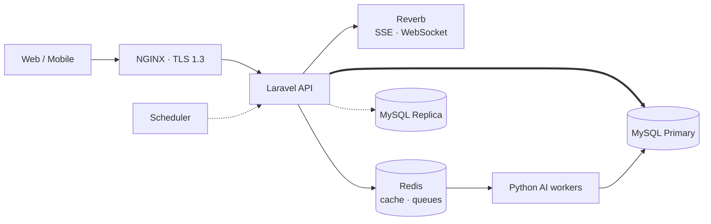

<div align="center">

# ⚙️ ATLANTECH — Backend

### Port API · Modular Monolith


</div>

---

## 📖 Overview

The backend is a **Laravel modular monolith** that serves the Port API for the web dashboard and the mobile app. It owns business rules, RBAC, licensing, auditing, and orchestrates the Python AI workers through Redis queues.

### Functional areas
`Auth & RBAC` · `License & Mode` · `Check-in Client` · `Users & Devices` · `Port & Resources` · `Berthing Requests` · `BAPLIE` · `Recommendations` · `Plans & Dispatch` · `Container Yard` · `Mobile Sync` · `Tracking & Deviations` · `Notifications` · `Audit`

Module dependencies are one-way.

---

## 🏗️ Architecture



### 🔐 Write chain (every write request)
```
auth 401 → role & terminal 403 → app version 426 → license mode 423
        → record version 409 → business rules 409/422 → plan limits 422 → audit
```

### 🪪 License modes
| Mode | Meaning |
|---|---|
| `SETUP` | Port onboarding — only setup writes allowed |
| `FULL` | Active port, active license, valid token |
| `READ_ONLY` | Any other case — new writes return `423 LICENSE_READ_ONLY` |

### ⏱️ Scheduler
Weather pulls (6 h) · astronomical tide (daily) · license check-in (daily) · Part 3 evaluation · task re-send (T+10 / T+20 min) and escalation (T+30).

---

## 🛠️ Tech Stack

| Area | Technology |
|---|---|
| Framework | Laravel 13 (PHP 8.3) |
| Database | MySQL 8.4 — primary + replica, terminal-level row security, AES-256 at rest |
| Cache & queues | Redis — `queue:part1`, `queue:part2`, `queue:edi` |
| Realtime | Laravel Reverb — SSE (web), WebSocket (mobile), sent after DB commit |
| Entry | NGINX — load balancer, TLS 1.3 |
| Assets | Vite · Tailwind CSS 4 |
| Quality | PHPUnit · Laravel Pint |
| Local dev | Docker Compose (MySQL + phpMyAdmin) |

---

## 🚀 Getting Started

**Requirements:** PHP 8.3+, Composer, Node.js, Docker.

```bash
git clone https://github.com/Atlantech-project/project-backend.git
cd project-backend/ATLANTECH

# Start MySQL + phpMyAdmin
docker compose up -d

# Install dependencies
composer install
npm install

# Environment
cp .env.example .env
php artisan key:generate
php artisan migrate

# Run
composer run dev
```

| Service | URL |
|---|---|
| API | http://localhost:8000 |
| phpMyAdmin | http://localhost:8080 |

### 🧪 Tests & formatting
```bash
php artisan test
vendor/bin/pint
```

---

## 🌿 Workflow

One `feature/<task>` branch per task from `develop`, merged through pull requests.

---

## 🔗 Related Repositories

| | Repository |
|---|---|
| ⚓ Umbrella | [PortHub](https://github.com/Atlantech-project/PortHub) |
| 🧠 AI | [project-ai](https://github.com/Atlantech-project/project-ai) |
| 🖥️ Frontend | [project-frontend](https://github.com/Atlantech-project/project-frontend) |
| 📱 Mobile | [project-mobile](https://github.com/Atlantech-project/project-mobile) |

## 👥 Backend Team

- **Marwan Nabil Mohamed Motawea** — Backend Engineer
- **Menna-Allah Mohamed Magdy Abd El-Kader** — Backend Engineer
- **Mariem Mohamed Mansour Abd El-Gelel** — Backend Engineer

---

<div align="center">

⚓ *ATLANTECH — Intelligent Port Operations* · Mansoura University · Graduation Project 2026

</div>
