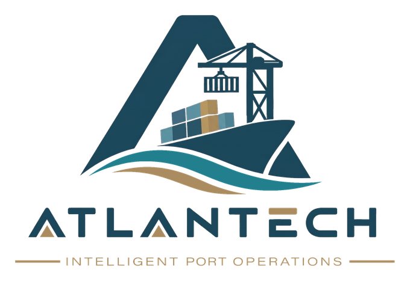
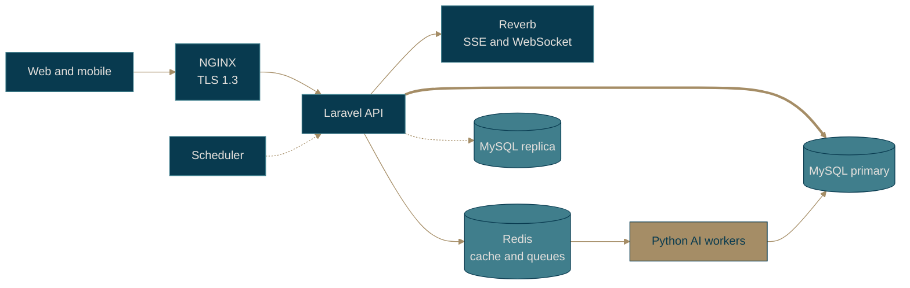

<p align="center">
  <picture>
    <source media="(prefers-color-scheme: dark)" srcset=".github/assets/logo-dark.png">
    
  </picture>
</p>

<p align="center"><b>Backend</b> &nbsp;|&nbsp; the harbour master behind the screens</p>
<p align="center"><i>Smarter coordination. Stronger ports.</i></p>

<p align="center">
  
  
</p>

<p align="center">
  
  
  
  
  
  
  
  
  
  
</p>


## What lives here

The Port API: one **Laravel modular monolith** that the dashboard and the phones both talk to. It holds the business rules, decides who may do what, keeps the license honest, writes the audit trail and sends work to the Python AI workers through Redis.

The modules each own one part of the port, and dependencies only point one way:

`Auth & RBAC` &middot; `License & Mode` &middot; `Check-in Client` &middot; `Users & Devices` &middot; `Port & Resources` &middot; `Berthing Requests` &middot; `BAPLIE` &middot; `Recommendations` &middot; `Plans & Dispatch` &middot; `Container Yard` &middot; `Mobile Sync` &middot; `Tracking & Deviations` &middot; `Notifications` &middot; `Audit`

## Shape of the system



### Every write passes the same checkpoints

```
auth 401 -> role & terminal 403 -> app version 426 -> license mode 423
         -> record version 409 -> business rules 409/422 -> plan limits 422 -> audit
```

If a request fails a checkpoint, it stops there with that status code. If it passes all of them, it is written to the audit log.

### License modes

| Mode | When |
|---|---|
| `SETUP` | The port is still onboarding. Only setup writes are allowed. |
| `FULL` | The port is active, the license is active and the token is valid. |
| `READ_ONLY` | Anything else, always with a reason. New writes get `423 LICENSE_READ_ONLY`. |

### The scheduler

Weather every 6 hours, the astronomical tide and the license check-in once a day, Part 3 evaluation runs, and reminders for unanswered tasks at T+10 and T+20 minutes before escalating at T+30.

## Stack

| Area | Technology |
|---|---|
| Framework | Laravel 13 on PHP 8.3 |
| Database | MySQL 8.4, primary plus replica, terminal-level row security, AES-256 at rest |
| Cache and queues | Redis: `queue:part1`, `queue:part2`, `queue:edi` |
| Realtime | Laravel Reverb: SSE to the web, WebSocket to mobile, sent only after the commit |
| Entry | NGINX load balancer, TLS 1.3 |
| Front assets | Vite, Tailwind CSS 4 |
| Quality | PHPUnit, Laravel Pint |
| Local development | Docker Compose (MySQL and phpMyAdmin) |

## Getting started

You'll need PHP 8.3+, Composer, Node.js and Docker.

```bash
git clone https://github.com/Atlantech-project/project-backend.git
cd project-backend/ATLANTECH

docker compose up -d            # MySQL + phpMyAdmin

composer install
npm install

cp .env.example .env
php artisan key:generate
php artisan migrate

composer run dev
```

| Service | Address |
|---|---|
| API | http://localhost:8000 |
| phpMyAdmin | http://localhost:8080 |

Before you open a pull request:

```bash
php artisan test
vendor/bin/pint
```

## How we work

Each task gets its own `feature/<task>` branch, cut from `develop` and merged through a pull request.

## Neighbours

[PortHub](https://github.com/Atlantech-project/PortHub) &middot;
[project-ai](https://github.com/Atlantech-project/project-ai) &middot;
[project-frontend](https://github.com/Atlantech-project/project-frontend) &middot;
[project-mobile](https://github.com/Atlantech-project/project-mobile)

## Crew

**Mariem Mohamed Mansour Abd El-Gelel**, Backend Engineer<br>
**Marwan Nabil Mohamed Motawea**, Backend Engineer<br>
**Menna-Allah Mohamed Magdy Abd El-Kader**, Backend Engineer


<p align="center">
  <picture>
    <source media="(prefers-color-scheme: dark)" srcset=".github/assets/symbol-dark.png">
    
  </picture>
</p>

<p align="center">
  <sub>ATLANTECH, Intelligent Port Operations &middot; Mansoura University &middot; Graduation Project 2026</sub>
</p>
